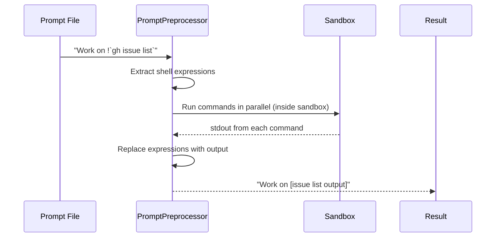
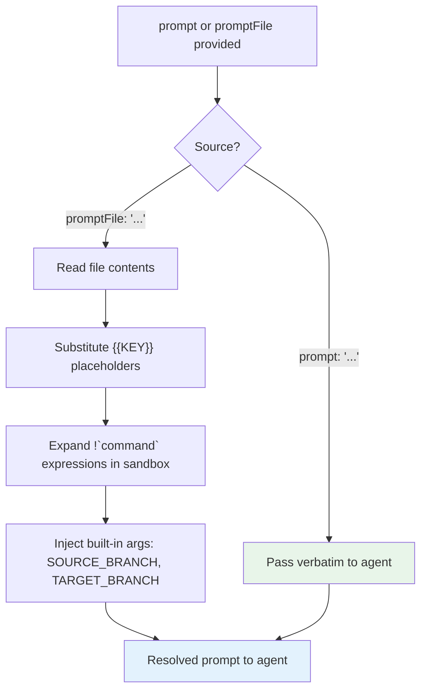

# Sandcastle — Prompt System

## Prompt Resolution

Source: `src/PromptResolver.ts` — `resolvePrompt()`

Sandcastle requires exactly one prompt source:

| Source | Option | Expansion |
|--------|--------|-----------|
| Inline | `prompt: "string"` | None — passed literally |
| File | `promptFile: "path"` | `{{KEY}}` substitution + `` !`command` `` expansion |

Both provided = error. Neither = error.

**Aha:** Inline prompts (`prompt: "..."`) are passed to the agent **literally**. No `{{KEY}}` substitution, no `` !`command` `` expansion, no built-in `{{SOURCE_BRANCH}}` / `{{TARGET_BRANCH}}` injection. If you need values interpolated into an inline prompt, build the string in JavaScript. Passing `promptArgs` alongside an inline prompt is an error — Sandcastle guards against this with `validateNoArgsWithInlinePrompt()`.

Source: `src/run.ts:718-720`
```typescript
if (isInlinePrompt) {
  yield* validateNoArgsWithInlinePrompt(userArgs);
  resolvedPrompt = rawPrompt;  // Passed through verbatim
}
```

## `{{KEY}}` Substitution

Source: `src/PromptArgumentSubstitution.ts` — `substitutePromptArgs()`, `PromptArgs`

Placeholders in the prompt file are replaced with values from `promptArgs`:

```typescript
// In the prompt file:
"Work on issue #{{ISSUE_NUMBER}} (priority: {{PRIORITY}})"

// In run():
await run({
  promptFile: "./my-prompt.md",
  promptArgs: { ISSUE_NUMBER: "42", PRIORITY: "high" },
});

// Resolves to:
"Work on issue #42 (priority: high)"
```

**Validation:**
- Missing placeholder (key in prompt but not in `promptArgs`) → error
- Unused argument (key in `promptArgs` but not in prompt) → warning
- Built-in args (`SOURCE_BRANCH`, `TARGET_BRANCH`) cannot be overridden → error if attempted

Source: `src/PromptArgumentSubstitution.ts` — `BUILT_IN_PROMPT_ARG_KEYS`
```typescript
const BUILT_IN_PROMPT_ARG_KEYS = ["SOURCE_BRANCH", "TARGET_BRANCH"];
```

**Inert text marking:** Shell blocks are marked with `\x01` so that `` !`command` `` patterns appearing inside argument values are treated as inert text, not executed:

**Aha:** `` !`…` `` expansion only runs on shell blocks written in the prompt file itself. Any `` !`…` `` pattern that appears inside an argument value is treated as inert text — it won't be executed against the host shell. This makes it safe to pass user-authored content (issue titles, PR descriptions, docs excerpts) through `promptArgs`.

## `` !`command` `` Expansion

Source: `src/PromptPreprocessor.ts` — `preprocessPrompt()`

Shell expressions in prompt files are replaced with their stdout:

```markdown
# Open issues
!`gh issue list --state open --label Sandcastle --json number,title,body --limit 100`

# Recent commits
!`git log --oneline -10`
```

**Key properties:**
- Commands run **inside the sandbox** after `onSandboxReady` hooks complete
- All expressions run **in parallel** (unbounded concurrency) for faster expansion
- 30s timeout per expression
- Non-zero exit fails the run immediately
- Token count estimation logged per command



**Processing order:** `{{KEY}}` substitution runs first (on the host), then `` !`command` `` expansion (in the sandbox). So `{{KEY}}` placeholders inside shell expressions are replaced before the command runs:

```markdown
!`gh issue view {{ISSUE_NUMBER}} --json body -q .body`
```
Resolves `{{ISSUE_NUMBER}}` first, then runs the command.

## Built-In Prompt Arguments

Sandcastle automatically injects two arguments into every file prompt:

| Placeholder | Value |
|-------------|-------|
| `{{SOURCE_BRANCH}}` | The branch the agent works on (determined by branch strategy) |
| `{{TARGET_BRANCH}}` | The host's active branch at `run()` time |

Use them without passing via `promptArgs`:
```markdown
You are working on {{SOURCE_BRANCH}}. When diffing, compare against {{TARGET_BRANCH}}.
```

## The Full Prompt Resolution Pipeline



Source: `src/run.ts:596-614` — prompt resolution in `run()`
```typescript
const resolved = await Effect.runPromise(
  resolvePrompt({ prompt, promptFile }).pipe(Effect.provide(NodeContext.layer)),
);
const rawPrompt = resolved.text;
const isInlinePrompt = resolved.source === "inline";
```

## Convention: `.sandcastle/prompt.md`

**Aha:** `sandcastle init` scaffolds `.sandcastle/prompt.md` and all templates explicitly reference it via `promptFile: ".sandcastle/prompt.md"`. This is a convention, not an automatic fallback — Sandcastle does not read `.sandcastle/prompt.md` unless you pass it as `promptFile`.

---

Next: [06-cli-interface.md](./06-cli-interface.md) — CLI commands, `sandcastle init`, Docker/Podman image management, and non-interactive flags.
