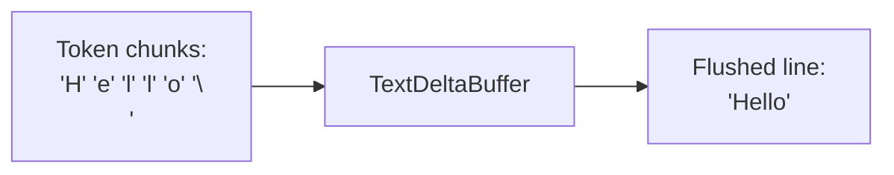

# Sandcastle — Utilities

## BoundedTail

Source: `src/boundedTail.ts` — `BoundedTail` class

Caps buffered output to prevent V8 string overflow:

```typescript
// src/boundedTail.ts
class BoundedTail {
  private buffer = "";
  private maxBytes: number;  // Default: 64KB

  append(chunk: string): void {
    this.buffer += chunk;
    if (this.buffer.length > this.maxBytes) {
      // Keep only the last maxBytes
      this.buffer = this.buffer.slice(-this.maxBytes);
    }
  }

  toString(): string {
    return this.buffer;
  }
}
```

**Aha:** Without `BoundedTail`, a long-running agent that produces megabytes of output would crash the process when the entire stdout is concatenated into a single string (V8 has a ~512MB string length limit, but practical issues occur much earlier). Every sandbox provider's `exec` uses `BoundedTail` to cap buffered output.

## raceAbortSignal

Source: `src/raceAbortSignal.ts` — `raceAbortSignal()`

Combines an `AbortSignal` with a timeout into a single signal:

```typescript
// Creates an AbortController that fires on either:
// 1. The provided signal being aborted
// 2. The timeout elapsing
```

Used by the Orchestrator's idle timeout and completion timeout mechanisms.

## shutdownRegistry

Source: `src/shutdownRegistry.ts` — `shutdownRegistry`

**Aha:** Process-wide signal handler registry. A single `SIGINT`/`SIGTERM`/`exit` listener fans out to registered teardowns. This prevents `MaxListenersExceededWarning` when multiple sandboxes are running concurrently — each sandbox would otherwise register its own signal handler.

Registration:
```typescript
shutdownRegistry.register(async () => {
  // Teardown logic — called once on process exit
});
```

## ErrorHandler

Source: `src/ErrorHandler.ts` — `withFriendlyErrors`, `formatErrorMessage`

Effect pipe that converts Effect errors to user-friendly terminal messages. Used in `main.ts`:

```typescript
// src/main.ts
cli(process.argv).pipe(
  withFriendlyErrors,  // <- converts Effect errors to readable messages
  Effect.provide(mainLayer),
  NodeRuntime.runMain,
);
```

In `run()`, errors in file-logging mode are written to the log file before propagation:

Source: `src/run.ts:775-788`
```typescript
const withErrorLog = resolvedLogging.type === "file"
  ? baseEffect.pipe(
      Effect.tapError((error) =>
        Effect.gen(function* () {
          const d = yield* Display;
          yield* d.status(formatErrorMessage(error as SandboxError), "error");
        }),
      ),
    )
  : baseEffect;  // In stdout mode, errors already shown by withFriendlyErrors
```

## Errors

Source: `src/errors.ts` — 20+ tagged error classes

All errors extend `SandboxError` union and use `Data.TaggedError` for pattern matching:

| Error | When Thrown |
|-------|-------------|
| `ExecError` | Command execution failure |
| `SyncError` | sync-in or sync-out failure |
| `WorktreeError` | Worktree creation/removal failure |
| `AgentIdleTimeoutError` | No output for `idleTimeoutSeconds` |
| `SessionCaptureError` | Session JSONL copy failure |
| `StructuredOutputError` | XML tag not found or schema validation failure |
| `CwdError` | Invalid cwd directory |
| `HookError` | Lifecycle hook failure |
| `MountError` | Mount configuration error |
| `PromptError` | Prompt resolution failure |

Each error has:
- `tag` — for discriminated union matching
- `message` — user-friendly description
- Underlying cause (when available)

The `withTimeout()` helper wraps effects with custom timeout errors:
```typescript
withTimeout(effect, timeoutMs, () => new ExecError("..."));
```

## CwdError

Source: `src/CwdError.ts` — `CwdError` class

Thrown when the `cwd` option doesn't exist or isn't a directory. Exported from the public API so callers can catch it specifically.

## RecoveryMessage

Source: `src/RecoveryMessage.ts` — `buildRecoveryMessage()`

Builds recovery suggestions on failure, including preserved worktree paths and commands to continue working.

## TextDeltaBuffer

Source: `src/TextDeltaBuffer.ts` — `TextDeltaBuffer` class

Buffers token-by-token chunks into multi-word lines for readable display:

**Why it exists:** Pi (and potentially other agents) emit text as single-token deltas — each chunk is a word fragment or even a single character. Displaying these individually produces choppy, unreadable output. `TextDeltaBuffer` accumulates chunks and flushes them as complete lines when it detects word boundaries.



Used by the Orchestrator when forwarding agent text to the display.

## MountConfig + mountUtils

Source: `src/MountConfig.ts` — `MountConfig` type
Source: `src/mountUtils.ts` — path utilities

Mount configuration types and utilities:
- SELinux label handling (`z`, `Z`, false)
- Path normalization (tilde expansion, absolute resolution)
- Git mount resolution (follows worktree `.git` file to actual gitdir)
- Windows worktree path patching (ADR-0006)

## resolveCwd

Source: `src/resolveCwd.ts` — `resolveCwd()` (Effect)

Resolves and validates the `cwd` option:
- Relative paths → resolved against `process.cwd()`
- Absolute paths → used as-is
- Invalid path → `CwdError` thrown

## EnvResolver + mergeProviderEnv

Source: `src/EnvResolver.ts` — `resolveEnv()`
Source: `src/mergeProviderEnv.ts` — `mergeProviderEnv()`

**EnvResolver** resolves env from `.sandcastle/.env` + `process.env`.

**mergeProviderEnv** merges the resolver output with agent + sandbox provider env:

```typescript
// Merge rules:
// 1. Provider env (agent + sandbox) overrides .sandcastle/.env for shared keys
// 2. Agent provider env and sandbox provider env MUST NOT overlap → throws if they share any key
// 3. When env is not provided, it defaults to {}
```

## resumePrecheck

Source: `src/resumePrecheck.ts` — `assertResumeSessionExists()`

Pre-flight check: validates that the session file exists on the host before sandbox creation. Throws immediately if missing, avoiding the cost of starting a sandbox for a session that doesn't exist.

## extractStructuredOutput

Source: `src/extractStructuredOutput.ts` — `extractStructuredOutput()`

1. Finds the **last** occurrence of `<tag>...</tag>` in stdout (regex)
2. Unwraps Markdown code fences if present (```json ... ```)
3. For `Output.object`: JSON parses, validates against Standard Schema
4. For `Output.string`: returns trimmed text

On failure: throws `StructuredOutputError` with `commits`, `branch`, `preservedWorktreePath`, `sessionId`, `sessionFilePath`.

## templates

Source: `src/templates.ts` — template definitions + metadata

Registry of 5 templates with metadata:

| Template | Main File | Prompts | Requires Host Deps |
|----------|-----------|---------|-------------------|
| `blank` | `main.mts` | `prompt.md` | No |
| `simple-loop` | `main.mts` | `prompt.md` | No |
| `sequential-reviewer` | `main.mts` | `implement-prompt.md`, `review-prompt.md` | No |
| `parallel-planner` | `main.mts` | `plan-prompt.md`, `implement-prompt.md`, `merge-prompt.md` | Yes (`zod`) |
| `parallel-planner-with-review` | `main.mts` | `plan-prompt.md`, `implement-prompt.md`, `review-prompt.md`, `merge-prompt.md` | Yes (`zod`) |

Each template's `template.json` contains:
- `name` — display name
- `description` — what it does
- `main` — orchestration script file
- `prompts` — array of prompt file paths
- `hostDeps` — npm packages the main file imports

## version

Source: `src/version.ts` — `VERSION` constant

Exports `VERSION` from `__SANDCASTLE_VERSION__` (injected by tsup from `package.json` at build time).

---

Next: [08-cross-cutting.md](./08-cross-cutting.md) — Error handling patterns, abort signals, shutdown lifecycle, Windows handling, and testing strategy.
