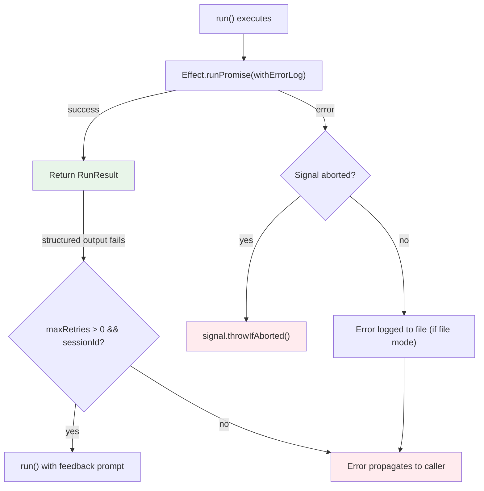

# Sandcastle — Cross-Cutting Concerns

## Error Handling Patterns

### Tagged Errors with Data.TaggedError

Source: `src/errors.ts`

All 20+ error types use Effect's `Data.TaggedError` for discriminated unions:

```typescript
// src/errors.ts — error pattern
class ExecError extends Data.TaggedError("ExecError")<{
  readonly command: string;
  readonly exitCode: number;
  readonly stdout: string;
  readonly stderr: string;
}> {}
```

This enables exhaustive pattern matching:
```typescript
if (error._tag === "ExecError") {
  // command, exitCode, stdout, stderr available
}
```

### Error Flow Through run()



**File vs stdout mode:** In file-logging mode, errors are written to the log file before propagation (via `Effect.tapError`). In stdout mode (ClackDisplay), errors are already shown by `withFriendlyErrors` in `main.ts`, so we skip to avoid duplicate terminal output.

### Recovery Data on Errors

Errors carry recovery information:

`StructuredOutputError` carries: `commits`, `branch`, `preservedWorktreePath`, `sessionId`, `sessionFilePath`, `tag`, `rawMatched`, `cause`.

This means even when structured output extraction fails, the caller has everything needed to:
1. Resume the session manually (`sessionId`)
2. Inspect what was committed (`commits`)
3. Find the worktree if dirty (`preservedWorktreePath`)
4. See the raw matched output (`rawMatched`)

## AbortSignal Support

Source: `src/run.ts:398-408` — `signal` option

`AbortSignal` support is wired through the entire stack:

- **Pre-check:** If `signal.aborted` is already `true` at entry, `run()` rejects immediately without any setup work
- **Mid-iteration:** Aborting kills the in-flight agent subprocess
- **Phase boundaries:** Between iterations, the signal is checked
- **Hooks:** The signal is threaded to all hooks — aborting cancels in-flight commands
- **Rejection:** The rejected promise surfaces `signal.reason` via `signal.throwIfAborted()` — no Sandcastle-specific wrapping
- **Worktree preservation:** The worktree is preserved on disk after abort (error-path behavior)

**Aha:** The signal is passed to the Effect Layer and threaded through `orchestrate()`, `SandboxFactory.withSandbox()`, and all hook execution. This is a single signal that cascades through the entire stack — no separate cancellation mechanism needed for each component.

## Shutdown Lifecycle

Source: `src/shutdownRegistry.ts`

Instead of each sandbox registering its own `SIGINT`/`SIGTERM` handler (which would cause `MaxListenersExceededWarning` with multiple concurrent sandboxes), Sandcastle uses a **process-wide registry**:

```
Process exit (SIGINT/SIGTERM/exit)
  → shutdownRegistry fans out to all registered teardowns
  → each teardown runs once
  → process exits
```

This is why Sandcastle can run multiple sandboxes concurrently without signal handler collisions.

## Windows Handling

Multiple modules handle Windows-specific behavior:

### Windows Path Patching (ADR-0006)

Source: `src/mountUtils.ts` — Windows worktree path patching

Git worktrees on Windows have different path conventions. The mount resolution code patches paths to ensure they work correctly when bind-mounted into containers.

### Windows Mounts Tests

- `src/createSandbox-windowsMounts.test.ts`
- `src/createWorktree-windowsMounts.test.ts`
- `src/SessionStore.windowsPath.test.ts`
- `src/WorktreeManager.windowsPath.test.ts`
- `src/interactive-windowsMounts.test.ts`

### Windows Shell

Source: `src/sandboxes/no-sandbox.ts`

The no-sandbox provider spawns `sh -c` on Unix or `cmd.exe` on Windows.

## Testing Strategy

Source: `vitest.config.ts` — Vitest configuration

**Test framework:** Vitest (`vitest run` for CI, `vitest` for watch mode)

**Test files:** ~60 test files alongside source files (`*.test.ts` naming convention)

### Test Categories

| Category | Files | Purpose |
|----------|-------|---------|
| **Unit tests** | `*.test.ts` alongside source | Test individual functions in isolation |
| **Windows mount tests** | `*-windowsMounts.test.ts` | Windows-specific path handling |
| **Integration tests** | `.sandcastle/test-*.ts` | Test real sandbox providers |

### Test Utilities

Source: `src/testSetup.ts` — Vitest setup file
Source: `src/sandboxes/test-shared.ts` — shared test utilities
Source: `src/sandboxes/test-isolated.ts` — isolated provider using temp directories
Source: `src/sandboxes/test-bind-mount.ts` — bind-mount provider for testing

The test providers use temp directories and mocked subprocesses instead of real containers:

- `test-isolated.ts`: Creates temp directories to simulate isolated sandboxes
- `test-bind-mount.ts`: Simulates bind-mount with direct filesystem operations
- `testSetup.ts`: Provides mock Effect services for testing

### Display Silencing in Tests

Source: `src/Display.ts` — `SilentDisplay`

Tests use `SilentDisplay` which accumulates entries in a `Ref` instead of rendering to terminal. This lets tests verify what would have been displayed without producing terminal output.

## CI/CD Pipeline

Source: `.github/workflows/ci.yml`, `.github/workflows/release.yml`

### CI (`ci.yml`)

- **Trigger:** Push to `main`, pull requests
- **Node:** 22
- **Steps:**
  1. Checkout
  2. Install dependencies (`npm ci`)
  3. Build (`npm run build`)
  4. Test (`npm test`)
  5. Type check (`npm run typecheck`)

### Release (`release.yml`)

- **Trigger:** Changeset PR merged to `main`
- **Node:** 24
- **Permissions:** `id-token: write` (for npm provenance)
- **Steps:**
  1. Changeset publish → npm
  2. Create GitHub release

### Agent Workflows (`.github/workflows/agent-*.yml`)

Sandcastle dogfoods its own agent workflows:

- `agent-explore.yml` — agent explores codebase
- `agent-implement.yml` — agent implements tasks
- `agent-implement-pr.yml` — agent implements from PR
- `agent-review.yml` — agent reviews changes
- `agent-update-branch.yml` — agent updates branch

These workflows run Sandcastle's own `.sandcastle/` templates against the Sandcastle codebase itself.

## Design Decisions Summary

### ADR Index

| ADR | Topic | Impact |
|-----|-------|--------|
| 0003 | Reuse worktree by default | Worktree fast-forwards from origin instead of recreating |
| 0006 | Windows worktree patching | Git worktree paths work correctly on Windows |
| 0010 | Structured output design | Standard Schema validation, XML tag extraction, maxRetries |
| 0012 | Session capture | JSONL copy with cwd rewriting |
| 0016 | Non-resumable providers | Cursor/OpenCode/Copilot have no session capture or resume |
| 0017 | Sync-base ref | Tracks last-synced commit to avoid SHA mismatch from `git am` rewrites |
| 0018 | Fork is session-only + random suffix | Fork isolates JSONL only; random temp branch suffix prevents collisions |
| 0019 | Completion timeout | Distinguishes genuinely stuck agents from agents with hung children |

---

Next: [README.md](./README.md) — Documentation index with navigation to all documents.
