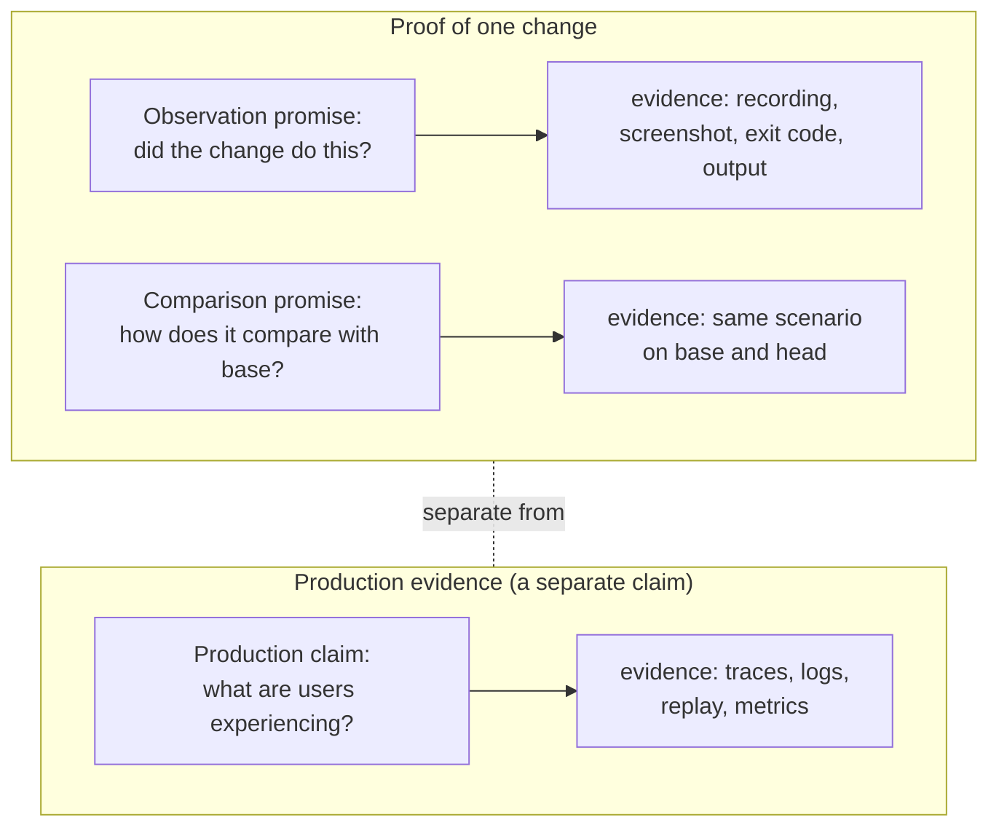
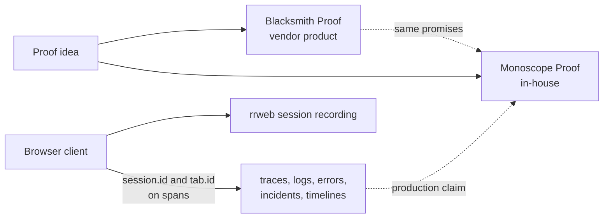

# Proof: two implementations of one idea

**Thesis.** A diff records what changed. It does not record whether the change works. **Proof** is the idea that a system can run a change, capture the result as evidence, and attach that evidence to a pull request (PR). This exploration documents two implementations of that idea and one production evidence system.

| Subject | Kind | Location |
|---------|------|----------|
| Blacksmith Proof | Product sold by the vendor; the sandbox operator is not documented | `https://docs.blacksmith.sh/proof/overview` |
| Monoscope Proof | In-house system | `/Users/darkvoid/GitSources/src.monoscope/monoscope` |
| Session recording and timelines | In-house system | `/Users/darkvoid/GitSources/src.monoscope/monoscope-web` and the Monoscope server |

## 1. Source revisions

| Source | Revision |
|--------|----------|
| Monoscope server and proof host | `1ea47f3580bf9e4069c5081c808c5f4e98a41e52` (`v0.6.31-159-g1ea47f358`) |
| Monoscope browser client | `8d9678c331f8b4be6fbec4ee0c8219ba701368a3` (`0.13.0`) |
| TimeFusion (telemetry store) | `d32177040f19fa861290ed316ef7f25813c8bce4` |
| Testkit (test harness) | `b9cecb520f901e372a6198dce3eaf01f8c51fa7c` |
| Blacksmith documentation | Accessed 2026-11-11 |

Monoscope is an observability system. Its server repository is `/Users/darkvoid/GitSources/src.monoscope/monoscope`. That repository contains the proof host, the Application Programming Interface (API), the database migrations, and the background workers. Its browser client repository is `/Users/darkvoid/GitSources/src.monoscope/monoscope-web`. TimeFusion is the telemetry store that keeps traces, logs, and metrics; the review queries it for production evidence. Testkit is an API test tool with a YAML Ain't Markup Language (YAML) scenario syntax. Its revision pins the test context, not the proof code. The Monoscope row in the table above covers the server and the proof host; the session recording row covers the browser client.

Terms used here: **Impact Review** is the Monoscope subsystem that reviews a pull request. Its Haskell code is in `CodeReview.hs` and `ImpactReview.hs`, and its Node.js worker is in `impact-review-worker/`. A **scenario** is the action that a proof performs, such as a click path, a command, or a load test. A **span** is one timed operation in a trace. **Gondolin** is the micro-Virtual Machine (micro-VM) runtime. `offline_cow` is its copy-on-write isolation mode, and it has no external network. A browser proof still reaches the application at `127.0.0.1` inside the same guest. A **warm checkpoint** is a saved copy-on-write disk from an earlier run. A **base revision** is the revision that the pull request targets. A **lineage pointer** is a pointer file, named by a lineage hash, that names an earlier checkpoint; the hash omits the base revision and the project, but the file is stored under the project directory. A **promise** is a guarantee that a proof system states about its evidence. A **claim** is one statement in the review comment. A **proof comment** is the comment that carries the claim and the evidence.

## 2. The central fact

The Monoscope source does not reference Blacksmith Proof. A case-insensitive search of the tracked text files in the Monoscope server repository at commit `1ea47f35` for the string `blacksmith` returns one hit:

```text
AGENTS.md:185: Use standard GitHub-hosted runners for remote jobs.
               Do not add Blacksmith runners or actions without an explicit user request.
```

That rule is about Continuous Integration (CI) runners. It is unrelated to Proof. A tracked Mach-O binary under `.github/skills/impeccable/scripts/bin/darwin-arm64/` also contains the byte sequence; it is compiled code, not a source reference. A search of the browser client repository at commit `8d9678c3` returns no hit. The two proof systems are two implementations of one idea. Neither uses the other.

## 3. Two promises and one separate claim



```text
Observation promise: the change produced this result in this environment.
Comparison promise:  the same scenario ran on base and head, so the results can be compared.
Production claim:    this is what production did, and it is not a proof of the change.
```

A **promise** here is a guarantee that a proof system states about its evidence. The observation promise is one-sided: it says that the change produced a result. The comparison promise is two-sided: it says that the same scenario ran on the base revision and on the head. It promises a comparison, not a difference; a scenario that passes on both sides is a valid result. Production evidence is raw telemetry from deployed users. A production claim is a statement about that evidence. In this diagram, a solid arrow means "is supported by", and the dotted line means "is a separate kind of evidence". The production claim is not a third proof promise.

The production claim belongs to the same review, but it is not a third proof promise. A proof compares a change with its base. The base revision is the revision that the pull request targets, and the head revision is the pull request's last commit. The production claim reports what telemetry shows after deployment. Monoscope keeps the two kinds of evidence separate.

In Monoscope, "this environment" is the pinned base or head revision inside the offline micro-Virtual Machine (micro-VM).

**Aha: the comparison base is the target branch tip, not the merge base.** The proof compares the pull request head with the target branch tip recorded in the pull request event, which is the revision that the pull request would merge into. The common ancestor of the two branches can be much older. A difference between the recordings can therefore come from target-branch work and not from the pull request. Document 03 gives the source for this behavior and the place where the documentation disagrees.

## 4. Headline evidence

These snippets show the load-bearing facts. The later documents give the full context. The comments in each snippet name the source path.

```haskell
-- src/Data/Effectful/CodeReview.hs:61-63
-- | Proof attempts a review may make. Failed attempts count too: each one costs two VM runs.
proofBudget :: Int
proofBudget = 3
```

This is the proof limit for one agent attempt. The in-memory counter stops the fourth request, and the database count stops a fourth stored proof key. A new attempt starts the budget again (document 03 section 9).

```bash
# src/Data/Effectful/CodeReview/proof.sh:21-24
if [ "$(source_state)" != "$before" ]; then
  echo "monoscope-proof-failed: setup changed the commit or tracked files; seed data and start services without editing source"
  exit 1
fi
```

The guard compares the commit and tracked-file status before and after setup. It ignores untracked files, so a setup can create a new file. If that file is the one the pull request adds, it also exists on the base side, and the base recording can show behavior that came from the setup. The guard is a partial boundary, not a proof of setup honesty (document 03 section 11).

```haskell
-- shared/src/Data/Effectful/AgentWorkspace.hs:1422-1428
-- Warm start: the repository's latest build moves to this base. Ignored build output
-- (target/, dist-newstyle/, node_modules/) survives, so the script rebuilds incrementally.
```

A warm start reuses the checkpoint disk. The restore replaces `.git` from the baseline mount, runs `git reset --hard`, and runs `git clean -fdq`, which removes untracked files and directories. Ignored build output survives because the command does not pass `-x`. The lineage pointer can choose a disk built for another base (document 02 section 7).

```js
// impact-review-worker/sandbox.mjs:28-30
if (vm || config.isolation !== 'offline_cow') throw new Error('Invalid sandbox transition');
...
sandbox: { imagePath: config.imagePath, netEnabled: false },
```

The bridge accepts only copy-on-write isolation, and `netEnabled: false` removes the guest's external network. The browser proof reaches the application at `127.0.0.1` inside the same guest.

```haskell
-- src/Pkg/ImpactReview.hs:860
proofSection claims = case sortOn (\c -> (c.status /= Differs, null (sidesOf c))) claims of
```

A `Differs` claim sorts first, because `status /= Differs` is false for it. A claim that cites a recorded side sorts before one that cites none. `sidesOf` collects the recorded rows for the first proof key that the claim cites; a claim with no proof key, or with a key that has no stored side, sorts as "no side". `Differs` means the recording contradicts the pull request description; it does not mean the base and head recordings differ from each other (document 04 section 2).

```haskell
-- src/Pkg/ImpactReview.hs:939-941
plain = T.concatMap (\c -> (if c `elem` ("\\*_|#!" :: String) then "\\" else "") <> one c) . clean
clean = T.replace "://" ":／／" . T.map (\c -> fromMaybe c $ lookup c [('[', '［'), (']', '］'), ('@', '＠'), ...])
```

Model text is escaped character by character and defanged before it enters Markdown. The replacements stop a link, a table break, or a user notification (document 04 section 7).

```sql
-- static/migrations/0269_pr_review_proofs.sql:2-4
-- Recorded proof media: one row per proof and revision side. Keys count up across a run's
-- attempts and are never reused, so a signed media URL always names the same bytes.
```

Media is stored as bytes. The host builds a signed link after the proof transaction commits, and a committed key is not reused, so a published link names stored bytes. A rolled-back attempt can derive the same key again, but it publishes no link. This is an inference from the publish order; the exploration did not test a link that became visible before a commit (document 03 section 9).

```ts
// monoscope-web/src/index.ts:11
const SESSION_TIMEOUT_MS = 30 * 60 * 1000;
```

The browser rotates the session identifier when the document becomes visible and the last recorded activity is 30 minutes old or older (`monoscope-web/src/index.ts:104-164`). It does not check the timeout on a timer. Session resumption after a reload needs both a stored session identifier and a stored last-activity time; if either is absent, the client creates a new identifier (`monoscope-web/src/index.ts:104-116`).

```ts
// monoscope-web/src/tracing.ts:336-340
"session.id": this.sessionId,
"tab.id": this.tabId,
"pageview.id": this.pageviewId,
```

These three values are span attributes. Only `session.id` becomes a server lookup key; the replay service stores no field for `tab.id`, and the review queries one session identifier from a trace inside a time window (documents 05 and 06).

```ts
// monoscope-web/src/replay.ts:165-169
if (forceSynchronous && typeof navigator !== "undefined" && navigator.sendBeacon) {
  const blob = new Blob([JSON.stringify(payload)], { type: "application/json" });
  const sent = navigator.sendBeacon(baseUrl, blob);
```

The unload path uses `sendBeacon`, which cannot set an `Authorization` header. The server route receives a beacon with no such header; this exploration did not run that path. The client also has a `fetch` fallback that can send the header (document 05 section 4).

A **signed Uniform Resource Locator (URL)** is the proof system's product boundary. The host computes a hash-based message authentication code (HMAC) with Secure Hash Algorithm 256-bit (SHA-256) over the payload `project-id:proof:review-id/file-name`, using the server's API key encryption secret as the key; `proof:` is a literal prefix (`Widget.hs:676-679`; `ImpactReviews.hs:729-730`; `ImpactReview.hs:826`). The link has no expiry and needs no session, so GitHub's image proxy can fetch it (`Links.hs:601`). The host builds a published link from a committed proof row, and a committed key is not reused, so the link names the stored bytes. This is an inference from the publish order, not a test of a pre-commit link (document 03 section 10).

## 5. The three subjects



rrweb is a browser session recording library. The browser client produces two independent streams: the replay recording and the telemetry spans. The server does not join them into one stored timeline. The only connection is the `session.id` span attribute and a query-time lookup inside a time window. A production claim is not a proof of the change. In this diagram, a solid arrow means "contributes to" or "is implemented by". A dotted arrow means "is related by idea, but does not prove". The dotted arrow from production telemetry to Monoscope Proof marks context that the review can cite, not evidence for a proof. The dotted arrow between the two proof systems marks one shared idea, not a dependency.

| Subject | What it can establish | What it cannot establish |
|---------|----------------|----------------------|
| Blacksmith Proof | The change ran and produced visual evidence in a Linux sandbox | Production behavior; Apple-platform behavior; any internals the documentation omits |
| Monoscope Proof | The change produced this result on base and head in an offline micro-VM | Production behavior; code paths the scenario does not touch |
| Session recording | A real user saw and did this | That the PR caused it; a unified session timeline across requests, which is not implemented |

## 6. What this exploration found

| Finding | Evidence |
|---------|----------|
| The two proof systems are independent implementations | `AGENTS.md:185` is the only text hit for case-insensitive `blacksmith`; one tracked binary also contains the byte sequence |
| Monoscope proof runs on Gondolin micro-VMs with the network disabled | `sandbox.mjs:28-30` |
| The Haskell guest session owns the micro-VM; the Node model host never holds it | `pi-host.mjs:2-3`; `impact-review-worker/README.md:28` |
| A proof request normally costs two virtual machine runs, and a failed request still uses one budget place | `CodeReview.hs:61-63, 665-666` |
| The setup must not change the commit or a tracked file; untracked files pass the guard | `proof.sh:12-25` |
| A warm-checkpoint lineage pointer ignores the base revision, so one build can serve another base | `AgentWorkspace.hs:1469-1470`, `1347-1352` |
| Proof media is stored as bytes; the host builds a signed link after the proof row commits, and a committed key is not reused | Migration 0269; `src/Web/Routes.hs:805-811` |
| The proof comment sorts a `Differs` claim first when one exists, meaning the recorded evidence contradicts the claim in the pull request description | `ImpactReview.hs:860`; `Policy.hs:211` |
| Model text is escaped and defanged character by character | `ImpactReview.hs:939-941` |
| The browser sends a tab identifier that the server does not store | `replay.ts:155`; `Replay.hs:53-60` |
| There is no stored session-to-trace relation | `src/Pages/Issues.hs:536-545` reads one session identifier from one trace; no table joins a session to its traces |
| The issue timeline mixes the event clock with the ingestion clock and has no tie-breaker | `src/Models/Apis/Issues.hs:4036-4055` |
| The unload beacon cannot send the Authorization header | `monoscope-web/src/replay.ts:165-176`; `src/Web/Routes.hs:209` |

## 7. Document index

These links point to the generated HyperText Markup Language (HTML) pages. The Markdown sources are in `monoscope/markdown/`. A separate parent session (the session that owns this exploration) builds the HTML tree.

| Document | Content |
|----------|---------|
| [README](monoscope/html/README.html) | Reading order and document map |
| [00 Overview](monoscope/html/00-overview.html) | The idea, the promises, the three subjects |
| [01 Blacksmith Proof](monoscope/html/01-blacksmith-proof.html) | The vendor product as documented, and its gaps |
| [02 Pipeline](monoscope/html/02-monoscope-proof-pipeline.html) | Haskell host, Node adapter, Gondolin, checkpoints, offline operation |
| [03 Running one proof](monoscope/html/03-running-one-proof.html) | Base and head, setup, markers, media, database rows |
| [04 The proof comment](monoscope/html/04-the-proof-comment.html) | Claims, chapters, stills, findings, goldens |
| [05 Session recording](monoscope/html/05-browser-session-recording.html) | rrweb, batching, transport, privacy, storage |
| [06 Incidents and timelines](monoscope/html/06-incidents-and-timelines.html) | Grouping, correlation keys, timelines, clocks |
| [07 Comparison](monoscope/html/07-comparison-and-assessment.html) | The three-way assessment |
| [08 Glossary](monoscope/html/08-glossary.html) | The terms and abbreviations used across the exploration |

## 8. Unverified and undocumented areas

| Area | Status |
|------|--------|
| Blacksmith executor, sandbox image, scenario format, storage, Application Programming Interface (API), Command Line Interface (CLI) | Not documented by the vendor |
| Blacksmith behavior for a pure addition with no old behavior | Not documented |
| Blacksmith check names and check visibility | Not documented |
| Monoscope proof end-to-end execution on the host in this environment | Read from source; not executed |
| Server behavior for an unauthenticated `sendBeacon` | Client inconsistency observed; server response not executed |
| Session-to-trace join | Not implemented as a stored relation |
| Tab-level analysis | Not stored on the server |
| General metric anomaly detection | Not implemented beyond the fixed detectors listed in document 06 |

## 9. Reading note

The source is the authority for every Monoscope claim. The vendor documentation is the authority for every Blacksmith claim. Where a common assumption conflicts with either authority, this exploration follows the authority and says so. Where neither states a fact, the exploration marks it as undocumented rather than guessing.

Start with [00 Overview](monoscope/html/00-overview.html). Read [01](monoscope/html/01-blacksmith-proof.html) for the vendor product. Read [02](monoscope/html/02-monoscope-proof-pipeline.html) and [03](monoscope/html/03-running-one-proof.html) for the machinery. Read [04](monoscope/html/04-the-proof-comment.html) for the output. Read [05](monoscope/html/05-browser-session-recording.html) and [06](monoscope/html/06-incidents-and-timelines.html) for production evidence. Read [07](monoscope/html/07-comparison-and-assessment.html) for the assessment. Use [08](monoscope/html/08-glossary.html) for terms.
