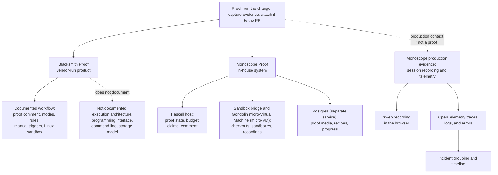
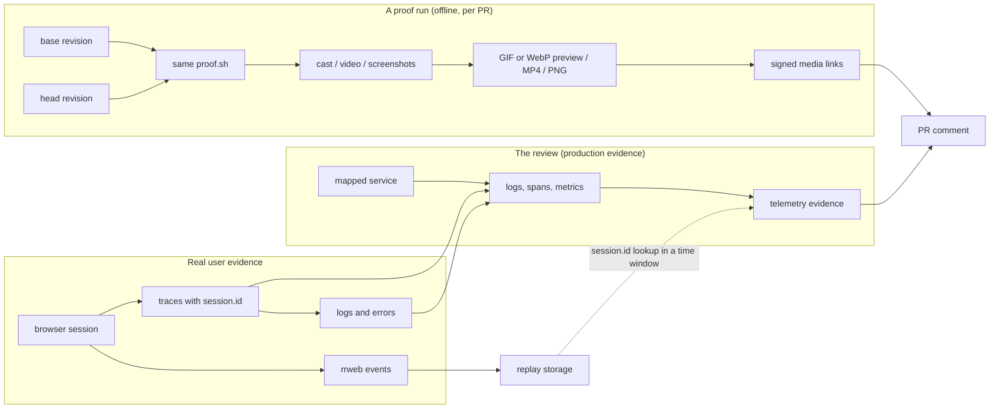

# Overview: Proof as an idea, and three subjects

**Thesis.** Proof replaces a written claim with an observed result. A proof system runs a change, records what happened, and attaches the record to the Pull Request (PR). The reader then checks evidence instead of trusting a description. This document defines the idea, separates its two promises, introduces the three subjects, and shows how the parts relate.

Source: `docs/proof-strategies.md:1-6` states the target in one paragraph. It says that a proof records the merge base and the pull request in two offline Virtual Machines (VMs), one for each side, with the same script. The implementation pins the target branch revision, not a computed merge base; section 1 explains the difference.

The Monoscope source commit for this exploration is `1ea47f3580bf9e4069c5081c808c5f4e98a41e52` (version `v0.6.31-159-g1ea47f358`). The `monoscope-web` commit is `8d9678c331f8b4be6fbec4ee0c8219ba701368a3` (version `0.13.0`). Bare file names such as `ImpactReview.hs` refer to the short-name table at the top of [08-glossary.md](08-glossary.md); that file also lists the repository root for each path.

Terms used from this point:

- **Monoscope** is an observability product. Its server repository contains the in-house proof system, and its browser client repository contains the session recorder.
- A **review** is one Impact Review object for one pull request revision. It has one run identifier, one state, and one final comment. A review can contain more than one **agent attempt**; an attempt is one model execution inside the review.
- The **host** is the Haskell server process that owns the review state, the proof budget, and the comment.
- The **model** is the language model in one agent attempt of a review. One agent attempt can use more than one model session. The host gives it tools and text, and the model chooses claims.
- A **claim** is one statement in the review comment. This exploration distinguishes two claim kinds. A **proof claim** is the review's restatement of one checkable statement in the pull request description; the model identifies that statement when it writes the claim. A **production claim** is a statement about telemetry from a deployed service; the telemetry is its evidence. The source has no object with that name. The object that carries production evidence is a **finding**: a risk statement about a changed line, which must cite production telemetry as its evidence. A finding is not a proof claim. An **assessment** is a risk grade for one dimension, such as alignment, impact, verification, rollback cost, or error detection.
- A **proof budget** is the maximum number of proof requests that one agent attempt may make: three. A **proof request** is one `record_proof` tool call; its `claim` argument is a short label for the behavior that the proof will show, not the final review claim.
- A **proof key** names one recorded proof pair, such as `proof-1`.
- An **executor** is the component that starts the virtual machine and runs the command.
- A **scenario** is the action that a proof performs, such as a click path or a command.

The most visible evidence forms are a Graphics Interchange Format (GIF) image and an MPEG-4 Part 14 (MP4) video for a terminal proof, and an animated WebP preview, an MP4 video, and Portable Network Graphics (PNG) stills for a browser proof. WebP is an image format that supports animation. A proof also produces a terminal cast (an asciinema recording of a terminal session), chapter markers for a browser video, exit codes, and a captured check log. The proof tables do not store the raw log or the summary text; the host reads the log during rendering, stores the rendered media, and returns a short summary to the model.

## 1. The problem that Proof answers

A diff answers one question: **what text changed?** It does not answer the next question: **does the change work?** A reviewer can read a correct diff and still miss a broken button, a slower request, or a command that now fails.

The Blacksmith Proof documentation states the problem directly: "Reading a diff tells you what changed. It doesn't tell you whether the thing works." The product then "boots your app in its own sandbox, tries the change the way a person would, and posts screenshots or a recording back to the pull request."

Source: `https://docs.blacksmith.sh/proof/overview`.

The Monoscope source states the same target in engineering terms. A proof runs both the base and the head in fresh offline Virtual Machines (VMs), with one script, and shows both recordings to the PR author (`ImpactReviews.hs:227`; `Policy.hs:57`). "Fresh" here means a fresh VM instance. A **warm checkpoint** is a saved copy-on-write disk from an earlier run; copy-on-write is a disk mode in which a write goes to a new layer instead of the shared base image. A warm checkpoint can supply the disk, but the checkout is reset to the pinned revision before the proof runs (document 02 section 7).

The PR event supplies two revisions. `base` is `pr.base.revision`, the target branch tip recorded in the pull request event. `head` is `pr.head.revision`, the newest commit of the PR branch. The host pins both commits as a `Base` side and a `Head` side, and runs the same command on each (`ImpactReviews.hs:227`; `Types.hs:114`). A **side** is one of these two revisions.

`base` is not the merge base. The merge base is the common ancestor commit of the PR branch and the target branch. The strategy document calls the base the merge base, but the code does not compute that commit. The review prompt tells the model to use `git merge-base` when it needs the true ancestor (`Policy.hs:79`). [03-running-one-proof.md](03-running-one-proof.md) section 1 records this contradiction. The source stores the branch tip but does not state a reason. A practical reason is that the tip is the revision that the pull request would merge into at the time of the event, so a difference against it answers the reviewer's question about the target at that time. A merge base can omit later changes on the target branch. That reason is this document's inference, not a source statement.

Three texts are easy to confuse. The **command** is the recorded Bash command that shows the behavior. The **setup** is a separate script that runs first and is not recorded. The **frozen check** is `proof.sh`, which the host supplies and the pull request cannot change. This document also calls it the frozen script or the frozen guard; all three names mean the same file. The file is part of the server source tree; the server embeds its bytes at build time and sends them to the guest (`Explanation.hs:165-166`). A pull request to the reviewed repository cannot change the running server's copy. When this document says that both sides run "the same script", it means the same command and setup; the frozen check is always the same.

```haskell
-- src/Data/Effectful/CodeReview/Policy.hs:57
RecordProof -> "Prove one claim of the pull request by running it. The host runs your setup, then records your bash command with asciinema, in fresh offline VMs at the pinned base and head, and shows both recordings to the PR author as video."
```

## 2. The two promises

The idea carries two promises. They are separate promises, and a system can keep one while breaking the other.

| Promise | Exact question | Required evidence | How it fails |
|---------|----------------|-------------------|--------------|
| **Observation** | Did the change do this? | A recording, a screenshot, an exit code, or a command output captured while the change ran | The command does not exercise the change; the setup fails; the recorded run is not the head revision |
| **Comparison** | How does the result compare with the base? | The same scenario on the base revision and on the PR head | One side does not run; the base is the wrong revision; the two runs use different scenarios |

The comparison promise promises a comparison, not a difference. A scenario that passes on both sides is a valid result, and the promise still holds. The promise fails when the two results cannot be compared, as when the base is the wrong revision or one side did not run.

The Monoscope implementation encodes part of these evidence conditions in code. The claim schema and `validateClaims` enforce the citation rules; they do not check that the command exercised the change. Each claim has a status and a list of proof keys. A claim status is `Matches`, `Differs`, or `Unverified`. The status compares the evidence with the statement in the pull request description, not the base recording with the head recording. `Matches` means the recording agrees with that statement. `Differs` means the recording contradicts it. `Unverified` means there is no proof, or the proof does not settle the claim (`Policy.hs:211`). The model supplies the statement as the claim title and summary; the host does not parse the pull request description to find it. If the description has no checkable statement, the model can write an `Unverified` claim that cites no proof. The source gives no separate rule for that case. A claim with status `Matches` must cite a proof recorded on both sides, and the head recording must have exit code 0. A claim with status `Differs` must also cite a proof recorded on both sides, but its head recording does not need exit code 0.

No component computes an automated base-versus-head difference verdict. The host records both sides, and the model receives one summary per side. The model can cite both sides and state what changed, and the reviewer sees both recordings. The comparison promise is therefore supported by two-sided evidence and a human or model judgement, not by an automated diff verdict.

```haskell
-- src/Pkg/ImpactReview.hs:308-316
validateClaims :: [ProofLink] -> [Claim] -> Either Text ()
validateClaims recorded claims = do
  unless (length claims <= 5) $ Left "Review returned more than five claims"
  for_ claims \claim -> do
    let cited key = filter ((== key) . (.key)) recorded
    unless (claim.status == Unverified || not (null claim.proofKeys)) $ Left "A matching or differing claim must cite a recorded proof"
    unless (all (\key -> sort (map (.side) $ cited key) == universe) claim.proofKeys) $ Left "Claim cites a proof that was not recorded on base and head"
    unless (claim.status /= Matches || all (any (\p -> p.side == Agent.Head && p.exitCode == Just 0) . cited) claim.proofKeys) $ Left "A matching claim needs a head recording that succeeded"
    unless (not (T.null $ T.strip claim.title) && not (T.null $ T.strip claim.summary)) $ Left "Each claim needs a title and a summary"
```

The host does not compare the two recordings and does not check that a claim status is correct. It also does not check that a claim is relevant to the diff or that the base and head recordings differ from each other. It records both sides, and `validateClaims` checks only a small set of conditions: no more than five claims; any claim that cites a proof key must cite it on both sides, including a claim with status `Unverified`; a `Matches` claim's head recording exited with code 0; and every claim has a title and a summary. The review model reads one proof summary per side: the check status, exit code, the last 3,000 characters of output, a **clip** marker (the time window of a terminal cast), screenshot labels, and whether a browser video exists. It does not open the binary media. It chooses `Matches`, `Differs`, or `Unverified` against the claim (`CodeReview.hs:686`). The identifier `universe` on line 314 is the list of both sides, `Base` and `Head`.

The observation promise can be met with a one-sided record: one run of the change, with its output. The comparison promise needs both sides. Monoscope records both sides under one proof key, and `validateClaims` requires the sides together. The claim model therefore cannot accept a one-sided, evidence-backed proof claim: if a claim cites a proof, it has both sides, and a claim that cites no proof must be `Unverified`. The `pr_review_proofs` table permits one row per side; the two-sided requirement is in validation, not in the table constraint. The two promises stay separate in concept, but the Monoscope claim model couples them in practice.

Those two promises produce proof claims. A separate kind of statement is not a proof claim. Monoscope also queries production telemetry for a mapped service and reports observations. This document calls such a statement a **production claim**: a statement about what production did, with telemetry as its evidence, not as a proof of the change. The source object that carries it is a **finding**: the review's risk statement about a changed line. A finding is not a proof claim. A finding must cite that telemetry evidence. The source gives telemetry its own evidence kind, `Telemetry`, and it requires at least one telemetry key in every finding. A finding may cite at most three keys, and every key must exist in the collected evidence.

```haskell
-- src/Pkg/ImpactReview.hs:340-342
    let cited = filter ((`elem` finding.evidenceKeys) . fst) evidence
    unless (not (null finding.evidenceKeys) && length finding.evidenceKeys <= 3 && length cited == length (nubOrd finding.evidenceKeys)) $ Left "Finding cites unavailable evidence"
    unless (any ((== Telemetry) . snd) cited) $ Left "Finding has no measured production context"
```

**Aha.** The production claim and the proof claim are deliberately different types. A recording shows what the code did in an offline VM. Telemetry shows what production did in the review window. The source requires at least one telemetry key in every finding, so a proof key cannot replace the telemetry key in that list. It does not test that the telemetry explains the change.

## 3. The three subjects



In this diagram, a solid arrow means "is part of", "produces", or "writes to". The dotted arrow from the idea to production evidence means "related evidence, not a proof"; the dotted arrow from Blacksmith Proof means "does not document". The Postgres edge means that the proof writes rows: Postgres is a separate service, not a layer of the proof system.

### 3.1 Blacksmith Proof

Blacksmith Proof is a vendor-run product in this document. The documentation does not use the word hosted, and it does not state where the sandbox runs or who operates it. This document calls the product vendor-run because the vendor sells and describes the Proof service; that label is an inference about operation, not a documented fact. Blacksmith is a vendor of Continuous Integration (CI) runners; Proof is a separate product from the same vendor. The public documentation describes what a user sees and configures:

- Proof "runs your code change and posts visual evidence."
- It compares the old code and the PR when a change modifies existing behavior.
- It has three modes: drafts and ready PRs, ready PRs only, and when asked.
- It filters automatic runs by paths, labels, branches, draft state, and titles through a rules file named `.blacksmith/PROOF.md`.
- It runs Linux only, so it cannot run iOS, iPadOS, watchOS, visionOS, or macOS applications.
- It bills compute at United States Dollars (USD) 0.002 per virtual central processing unit (vCPU) per minute. It also bills model tokens at the provider rate and adds USD 0.20 per million tokens.

Sources: `https://docs.blacksmith.sh/proof/overview`, `https://docs.blacksmith.sh/proof/proof-md.md`, `https://docs.blacksmith.sh/proof/pricing.md`.

The documentation does not describe the executor, the sandbox image, the Application Programming Interface (API), the Command Line Interface (CLI), the storage model, or the scenario authoring format. Document 01 records exactly what is present and what is absent.

### 3.2 Monoscope Proof

Monoscope Proof is an in-house system. It is not a wrapper around the Blacksmith product. A case-insensitive search of the tracked text files at the source commit finds the string `blacksmith` only in an unrelated rule about Continuous Integration (CI) runners at `AGENTS.md:185`. A tracked Mach-O binary also contains the byte sequence; it is compiled code, not a source reference.

The system has four functional layers:

| Layer | Responsibility | Main files |
|-------|----------------|------------|
| Review host | Queue, lease, budget, claims, progress, comment | `src/Models/Projects/ImpactReviews.hs`, `src/Pkg/ImpactReview.hs` |
| Model host | Child process that runs the model session and forwards tools | `impact-review-worker/pi-host.mjs` |
| Sandbox bridge | Gondolin session operations, guest file and shell operations, one virtual machine handle at a time in the bridge process; the Haskell guest session owns the lifecycle. The host runs the base side, closes it, then runs the head side. | `impact-review-worker/sandbox.mjs` |
| Guest | Frozen check `proof.sh`, browser guest image (Chromium, Playwright, a local PostgreSQL for the application under test), image content | `src/Data/Effectful/CodeReview/proof.sh`, `impact-review-worker/Dockerfile.*` |

The host database is a separate participant, not a layer. It stores the proof media, the saved recipes, and the progress state (migrations 0269 to 0275). The browser guest also runs a PostgreSQL instance, but that instance serves the application under test inside the virtual machine; it is not the host database and has no network route to it.

The **adapter boundary** is the pair of Node.js processes between the Haskell host and the guest. It has two processes. `pi-host.mjs` is the model host; it runs the model session and never holds a virtual machine handle. `sandbox.mjs` is the sandbox bridge; it holds the virtual machine handle and executes the Software Development Kit (SDK) operations that the Haskell guest session selects. A **guest session** is the Haskell-side owner of one micro-VM lifecycle. The split separates decision from handle: the Haskell guest session decides when the micro-VM starts, resumes, and closes, and the bridge performs each operation and keeps the handle in its process. The Haskell host owns the guest session, the policy, and the lifecycle (`pi-host.mjs:2-3`; `sandbox.mjs:2`; `impact-review-worker/README.md:28`).

The Monoscope executor is the guest session together with the bridge: the bridge starts the micro-VM, and the frozen check runs inside it. The host passes the command and the setup; it does not run them in its own process.

The Haskell host drives Gondolin, the micro-Virtual Machine (micro-VM) runtime and SDK, through the sandbox bridge. A micro-VM is a small Virtual Machine with a minimal device model. The virtual machine is offline and copy-on-write:

```js
// impact-review-worker/sandbox.mjs:29-33
const options = { sessionLabel: 'monoscope-native-workspace', cpus: config.cpus,
  memory: `${config.memoryMiB}M`, sandbox: { imagePath: config.imagePath, netEnabled: false },
  rootfs: { mode: 'cow', size: '64G' }, ... };
vm = snapshot ? await VmCheckpoint.load(snapshot).resume(options) : await VM.create(options);
```

```mermaid
sequenceDiagram
    participant GH as GitHub PR
    participant H as Haskell review host
    participant N as Model host (pi-host.mjs)
    participant B as Sandbox bridge (sandbox.mjs), one guest session per side
    participant G as Gondolin micro-VM, one per side
    participant DB as Postgres
    participant C as PR comment

    GH->>H: pull request event or prove-it issue comment
    H->>H: claim the lease, start one agent attempt
    H->>N: tool schema, prompts, workspace paths
    N->>N: run Pi model session
    N->>H: record_proof(claim, command, setup)
    loop base side, then head side
    H->>B: run the frozen check
    B->>G: VM.create or VmCheckpoint.load; run proof.sh
    G-->>B: log markers: cast, screenshots, video, chapters, page
    B-->>H: exit status and log path
    end
    H->>H: parse both sides; render preview and MP4, both sides at once
    H->>DB: saveProofs and the conditional recipe insert (one transaction)
    H-->>N: proof summary: key, both sides, note
    N->>N: read summaries, choose claim statuses
    N->>H: submit_review(claims, findings, assessments)
    H->>H: validateClaims (both sides; head exit 0 for Matches)
    H->>C: publish progress comment, then replace its body with the final comment
```

The model chooses a status after it receives the proof summaries. The host runs the base side and the head side in sequence, each in a fresh sandbox; it renders the two sides at the same time after both runs end. The host does not compare the recordings. This second model turn is where `Matches`, `Differs`, and `Unverified` appear, so the diagram shows it before submission. The recipe insert needs a setup and a head side with exit code 0, because a setup that fails on the change is not a useful default. In this diagram, the **check log** is the captured standard output and standard error of the frozen check. **page** is the optional browser page title and URL that the guest reports. **note** is the short text in the proof summary; it is not a claim.

Pi is the pinned coding agent (`@earendil-works/pi-coding-agent`). `@monoscope prove it` is a GitHub issue comment. The server parses the comment body, maps `prove it` to the `Prove` request, and starts or joins a review run (`ImpactReviews.hs:280-292`).

### 3.3 Browser session recording

The third subject is not a proof system. It is the **evidence source for production claims**. The browser client records the user's session with rrweb, a browser session recording library. It sets `session.id` and `tab.id` on the spans that it creates and propagates them as World Wide Web Consortium (W3C) baggage. The backend can then tag its own spans with the same identifiers.

```typescript
// monoscope-web/src/tracing.ts:302-305
const baggage = propagation.createBaggage({
  "session.id": { value: this.sessionId },
  "tab.id": { value: this.tabId },
});
```

```typescript
// monoscope-web/src/replay.ts:5-7
const MAX_EVENT_BATCH = 50;      // events in one request
const SAVE_INTERVAL = 2000;      // milliseconds between timer saves
const MAX_RETRY_EVENTS = 5000;   // events kept in the retry queue
```

The retry queue trims itself only when it holds more than 5,000 events. It keeps all full snapshots first, keeps the most recent other events that fit the remaining slots, and sorts the result by timestamp. A full snapshot is an rrweb event that contains the whole Document Object Model (DOM), and the replay cannot start without one. If the snapshots alone exceed 5,000, the queue stays above the limit (`monoscope-web/src/replay.ts:49-62`). The event batch is at most 50 events, and a timer saves waiting events every 2,000 milliseconds.

That path answers a different question: **what did a real user experience, and which backend events belong to that experience?** Document 05 covers recording and transport. Document 06 covers incident grouping and timeline correlation. This section does not describe incident detection, because the recording path and the incident path are separate.

Terms for the next section: a **span** is one timed operation in a trace. **TimeFusion** is Monoscope's telemetry store. A **mapped service** is one service name in the project's service mapping. The mapping links a repository to a production service, and the review may query only that service. The **review window** is the bounded time range of that query, not all stored history.

## 4. How the pieces relate



WebP is the animated preview format; a browser proof uses it for the inline preview. Two evidence streams meet in the review comment: proof media and production telemetry. The browser session is the third source. It reaches the review only indirectly: a telemetry finding can cite a trace whose spans carry `session.id`, and the trace page can resolve a replay for that identifier. The comment does not embed the replay. The dotted edge marks a query-time lookup, not a stored relation. The three sources keep different authority:

| Evidence | Where it is produced | What it can establish | What it cannot establish |
|----------|----------------------|-------------------|----------------------|
| Proof recording | Offline micro-VM | The change produced this result in this environment | That production behaves the same |
| Production telemetry | TimeFusion query over data in OpenTelemetry Protocol (OTLP) form | What production did in the review window | That the PR causes it |
| Browser session | User's browser | What one user saw and did | That the backend failure came from that session. A `session.id` on a span supports a time-window lookup; it is not a stored join, and the replay may be absent. |

## 5. The design decisions worth noticing

### 5.1 The setup is unrecorded and must not change the revision

The host passes the recorded command as `$1` and the optional setup script as `$2`. The frozen check runs the setup first and compares `git rev-parse HEAD` and `git status --porcelain --untracked-files=no` before and after. If the setup changes the commit or a tracked file and leaves it changed, the proof fails. A setup that changes and then restores the tracked state before the check would pass, because the guard compares only the before and after values. Ignored files and untracked files do not affect the guard, which is why a setup may write caches and build output. The guard does not stop a setup from creating an untracked file that later changes behavior; it stops the recorded revision from being edited.

```bash
# src/Data/Effectful/CodeReview/proof.sh:12-25
if [ -n "${2:-}" ]; then
  printf %s "$2" | base64 -d > /tmp/monoscope-setup.sh
  source_state() { git -c safe.directory='*' rev-parse HEAD 2>&1; git -c safe.directory='*' status --porcelain --untracked-files=no 2>&1; }
  before=$(source_state)
  if ! bash /tmp/monoscope-setup.sh > /tmp/monoscope-setup.log 2>&1; then
    tail -c 4000 /tmp/monoscope-setup.log
    echo "monoscope-proof-failed: setup exited nonzero"
    exit 1
  fi
  if [ "$(source_state)" != "$before" ]; then
    echo "monoscope-proof-failed: setup changed the commit or tracked files; seed data and start services without editing source"
    exit 1
  fi
fi
```

**Aha.** The guard catches a setup that edits tracked source, but it is not a complete boundary. A setup can create a new untracked file that the diff should have contained, because the status check uses `--untracked-files=no`. The base recording would then show behavior that came from the setup, not from the base revision. The guard removes the easy case, where a setup edits a tracked file. The review still trusts the setup text and the model's judgement. The source states the guard; it does not state a motive, so this paragraph is the author's interpretation.

A warm checkpoint adds a second path for stale files. The lineage pointer excludes the base (`AgentWorkspace.hs:1468-1470`), so it can name a disk from another base (`AgentWorkspace.hs:1344, 1347-1352`). The checkpoint restore resets tracked files and runs `git clean -fdq`, which removes untracked files and directories that Git does not ignore (`AgentWorkspace.hs:1422-1428`). It does not remove ignored build output. The setup guard also uses `--untracked-files=no`, so it ignores untracked and ignored files. A cross-base checkpoint can therefore leave ignored artifacts in `/workspace` that neither the reset nor the guard inspects. The source does not state that the host removes them. The guard and the reset protect the tracked revision; they do not prove that ignored output came from this build.

### 5.2 The budget counts failed attempts

A proof request normally starts one comparison with two sides, so the normal cost is two VM runs. The in-memory budget counts the request even if it fails before either side runs. A failed request therefore consumes one place in the agent attempt's budget, although it may cost fewer than two VM runs. A separate counter limits local check comparisons to three per review session; here a **review session** is one host launch for the review, and the source names the counter file with the session identifier (`AgentWorkspace.hs:1134-1139`). A **local check comparison** is a `run_regression` call: a repository test command that the host replays in fresh base and head virtual machines. That comparison budget controls local checks, not proof requests; it is a different limit with the same number.

```haskell
-- src/Data/Effectful/CodeReview.hs:61-63
-- | Proof attempts a review may make. Failed attempts count too: each one costs two VM runs.
proofBudget :: Int
proofBudget = 3
```

The comment says that each failed attempt "costs two VM runs." That is the normal cost, not a guarantee: a request can fail before both sides start. The place in the budget is consumed either way. Read the comment as a cost estimate and the counter as the enforced rule.

```haskell
-- src/Data/Effectful/CodeReview.hs:665-667; counter created at :425
proofCount <- newIORef (0 :: Int)   -- one counter per task launch; a resume restores it from saved state
taken <- atomicModifyIORef' proofCount \n -> (n + 1, n)
if taken >= proofBudget
  then pure $ Left "Proof budget exhausted; cite the proofs already recorded"
```

Two proof counters enforce the same number at different layers. The in-memory `proofCount` above lives for one task launch and stops the fourth tool call before it runs. A resumed model session restores the saved value (`CodeReview.hs:462`), so the attempt keeps its place in the budget. The database count `taken` inside `saveProofs` counts distinct proof keys under the same attempt and stops a retry from storing a fourth proof (`ImpactReviews.hs:624-648`). A new attempt has a new identifier, so both proof counts start again. A run can therefore hold more than three keys if it has several attempts. The key number does not restart: it comes from `used`, which counts every distinct key in the run, so the next key is `used + 1`. The two proof counters are not duplicates: one guards work inside a live process, and one guards stored rows after a restart. The comparison budget above is a third counter for a different operation.

**Aha.** The budget is a cost control, not a quality control. It limits VM time on a shared host. It does not limit how many claims the review may make: a claim can cite an earlier proof key. A separate rule caps the comment at five claims (`validateClaims`).

### 5.3 The database stores a proof's media, not a path to it

A proof row holds the cast, the GIF, and the MP4 in `bytea` columns, which are binary byte strings, not PostgreSQL large objects. Screenshots are rows in a child table. Every proof writes a cast. For a terminal proof, the host renders a GIF and an MP4 from that cast, and both columns hold those files. For a browser proof, the host writes a WebP preview into the `gif` column and the full video into the `mp4` column; the cast is still recorded in `cast_bytes`. The three columns are therefore `NOT NULL` in both cases. The column name `gif` is broader than its content.

Migration 0269 creates the base proof table shown below. Migration 0273 adds three things: the `browser` flag, which marks a user interface proof; the `chapters` array, which holds named time markers; and the `pr_review_proof_shots` table, which holds up to four labelled PNG images for each side. The migration does not store the captured log in these tables.

A signed Uniform Resource Locator (URL) is a URL whose signature permits access to stored bytes without a login. Its path names the review and the media file, and the signature payload also contains the project identifier; together they name one asset. A committed key is not reused for different bytes: after a rollback no row exists and no link is published, so a later attempt can derive the same number without exposing different bytes under one URL. The migration comment says "never reused"; the body shows the exact rule. The comment is shorthand for the visible-key invariant: the rolled-back number was never visible to a reader, so that number can return. The host publishes a media link after the transaction commits, so a published link names committed bytes; this is an inference from the publish order, not a test of a pre-commit link.

```sql
-- static/migrations/0269_pr_review_proofs.sql:2-4
-- Recorded proof media: one row per proof and revision side. Keys count up across a run's
-- attempts and are never reused, so a signed media URL always names the same bytes.
CREATE TABLE projects.pr_review_proofs (
  run_id uuid NOT NULL REFERENCES projects.pr_review_runs(id) ON DELETE CASCADE,
  attempt_id uuid NOT NULL,
  key text NOT NULL CHECK (key ~ '^proof-[1-9][0-9]*$'),
  side text NOT NULL CHECK (side IN ('base', 'head')),
  revision text NOT NULL,
  exit_code integer,
  cast_bytes bytea NOT NULL,
  gif bytea NOT NULL,
  mp4 bytea NOT NULL,
  created_at timestamptz NOT NULL DEFAULT now(),
  PRIMARY KEY (run_id, key, side)
);
```

**Aha.** Storing the bytes makes the comment stable. The comment can cache the image for one year (`Routes.hs:811` sets `public, max-age=31536000, immutable`), because the host does not reuse a committed key for different bytes. This is an invariant of committed keys, not a property of the URL alone. Document 04 shows how the signed path is built and served.

## 6. Where to go next

- Read [01-blacksmith-proof.md](01-blacksmith-proof.md) for the vendor-run product and its documented limits.
- Read [02-monoscope-proof-pipeline.md](02-monoscope-proof-pipeline.md) for the executor.
- Read [03-running-one-proof.md](03-running-one-proof.md) for the script and the media.
- Read [04-the-proof-comment.md](04-the-proof-comment.md) for the comment.
- Read [05-browser-session-recording.md](05-browser-session-recording.md) and [06-incidents-and-timelines.md](06-incidents-and-timelines.md) for the production evidence.
- Read [07-comparison-and-assessment.md](07-comparison-and-assessment.md) for the judgement.

## 7. Terms used here

- **Base**: the pinned `pr.base.revision` of the target branch. The strategy document calls it the merge base, but the code stores the branch tip. See section 1.
- **Head**: the newest commit of the PR branch, pinned as `pr.head.revision`.
- **Merge base**: the common ancestor of the PR branch and the target branch. The review model must compute it with `git merge-base` when the diff needs it.
- **Proof key**: a name such as `proof-1` that identifies one proof attempt across both sides. The row key is `(run_id, key, side)`. A key is scoped to one run. A key that became visible is not reused; a rolled-back attempt was never visible, so its number can return. Deleting the run removes its keys and links.
- **Signed URL**: a URL with a hash-based message authentication code (HMAC) that permits access to stored bytes without a login. The host signs the project identifier and the media path with the server's API key encryption secret. An **asset** is one media file, such as a cast, GIF, MP4, preview, or screenshot.
- **Side**: `Base` or `Head`. PostgreSQL stores these values in lowercase as `base` and `head`.
- **Cast**: an asciinema recording of a terminal session. asciinema is a terminal recording tool.
- **Micro-VM**: a small Virtual Machine with a minimal device model, used here through Gondolin. Gondolin is the micro-VM runtime and Software Development Kit (SDK).
- **Checkpoint**: a saved copy-on-write disk that a later proof can resume. The cache directory key includes the base; the lineage pointer excludes it (`AgentWorkspace.hs:1468-1470`).
- **Warm checkpoint**: a checkpoint from an earlier build that a later proof resumes instead of creating a new VM.
- **Guest**: the Linux system inside the micro-VM, including the frozen check and the browser guest image.
- **Chapter**: a named time marker in a browser proof video.
- **Clip**: the time window of a terminal cast that the host keeps for the proof summary; a browser proof reports no clip.
- **Dependency archive**: an optional tar file that the host copies to `/run/monoscope-dependencies.tar` in the guest. The host checks its Secure Hash Algorithm 256-bit (SHA-256) digest, and the checkpoint lineage includes the fingerprint.
- **Mapped service**: one service name in the project's service mapping; the review may query only that service.
- **Recipe**: the saved setup script for a repository, stored per project, owner, and repository. A recipe is not `.monoscope/PROOF.md`. It is the setup text from a proof whose head side exited 0, offered to a later review.
- **`.monoscope/PROOF.md`**: free-form guidance in the repository, read from the base revision, on when to prove a change and how to start the application offline. The host passes it to the model as untrusted guidance. It is not a machine-parsed format.
- **Lease**: a time-limited grant to one worker for one review run. The **worker** is the process that holds the lease.
- **Checkpoint cache key**: the SHA-256 digest of the full checkpoint identity, including the base revision. It names one cache directory.
- **Lineage pointer**: `latest-<lineage>.json`, which names the newest checkpoint for a repository, image, preparation script, and optional dependency archive (`AgentWorkspace.hs:1344`). The lineage excludes the base revision, so the pointer can name a disk from another base (`AgentWorkspace.hs:1468-1470`).
- **Preparation script**: the trusted host-supplied script that prepares the workspace before a checkpoint is saved.
- **Build**: one creation of a guest image or a checkpoint disk. A **build identifier** names the result.
- **Executor**: the component that starts the virtual machine and runs the command.
- **Scenario**: the action that a proof performs, such as a click path, a load test, an API request, or a command.
- **Agent attempt**: one model execution inside a review. The attempt has its own identifier and its own proof budget.
- **Model session**: the model conversation of one agent attempt. This is not a browser session.
- **Production claim**: an observation from telemetry about a deployed service. It is not a proof claim and cannot replace one.
- **Pi**: the pinned coding agent (`@earendil-works/pi-coding-agent`) that runs the review model session.
- **rrweb**: a library that records Document Object Model (DOM) changes and replay events in a browser.
- **Span**: one timed operation in a trace.
- **W3C baggage**: key-value context that propagates across service calls. Monoscope puts `session.id` and `tab.id` in baggage.
- **OpenTelemetry (OTel)**: a standard for traces, metrics, and logs.
- **TimeFusion**: the Rust telemetry store built on Apache DataFusion, a query engine. It holds the log and span data.
