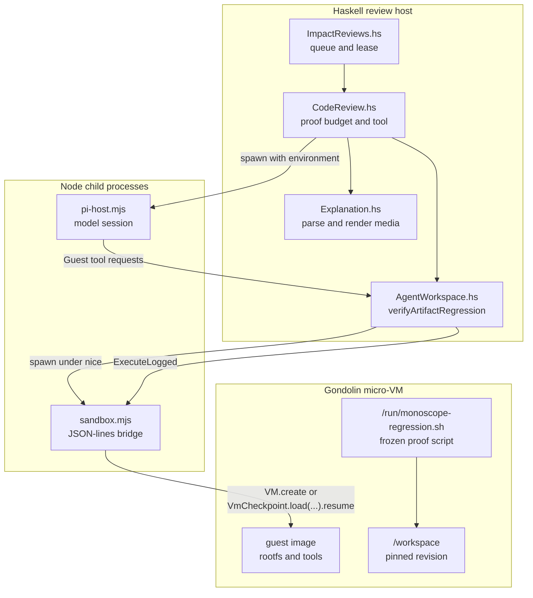
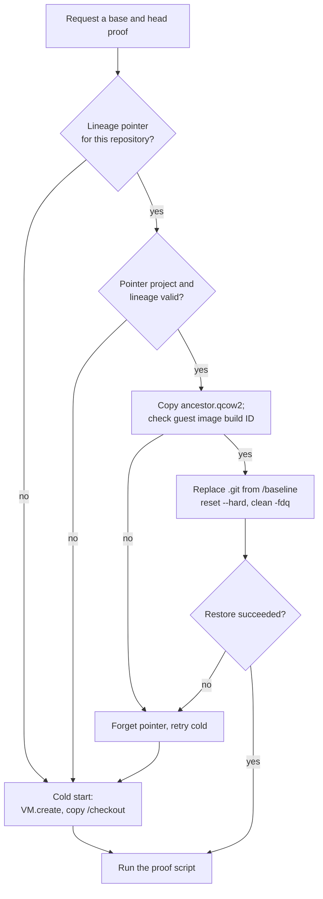
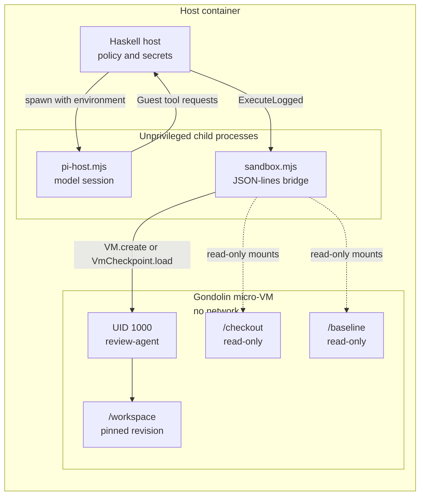

# The Monoscope proof pipeline

**Thesis.** Monoscope's proof system is an in-house pipeline with four layers. A Haskell host owns the review state machine, the proof budget, and the media rendering. A Node child process runs the model session and forwards tool calls. A local Gondolin micro-Virtual Machine (micro-VM) runs the commands offline. A frozen Bash script records the evidence. No layer trusts the layer below it for the facts that matter.

Source commit: `1ea47f3580bf9e4069c5081c808c5f4e98a41e52` at `/Users/darkvoid/GitSources/src.monoscope/monoscope`.

Terms used in this document:

- **Monoscope** is the observability product whose repository this document studies.
- A **proof** is one command run on two revisions, `base` and `head`, with the evidence recorded.
- A **review run** is one queued review of one pull request. An **agent attempt** is one model execution inside that run; a retry starts a new attempt. A **model session** is one connection between the host and the review model; one attempt can use more than one model session. The exploration uses **review session** only for the lifetime of one host launch when it describes the separate comparison budget.
- A **frozen** script is a script that is compiled into the host binary, so the code under test cannot change it.
- A **cast** is an asciinema terminal recording. A **chapter** is a named time marker in a browser video.
- **`offline_cow`** is the only isolation mode that the bridge accepts. **Offline** means no network. **Copy-on-write (COW)** means changed disk blocks go to a new layer.
- A **checkpoint** is a saved virtual machine disk that a later run can resume.
- A **claim** is a statement in the review comment about one behavior change. A **signed link** is a HyperText Transfer Protocol (HTTP) address with a Hash-based Message Authentication Code (HMAC) signature.
- **Cache publication** means the host, not the bridge, decides when a prepared disk becomes a reusable checkpoint.

## 1. The four layers

| Layer | Language | Responsibility | Main files |
|-------|----------|----------------|------------|
| Review host | Haskell | Queue, lease, state machine, proof budget, claims, comment, media rendering, signed links | `src/Models/Projects/ImpactReviews.hs`, `src/Pkg/ImpactReview.hs`, `src/Data/Effectful/CodeReview.hs`, `src/Data/Effectful/CodeReview/Explanation.hs`; the shared `shared/src/Data/Effectful/AgentWorkspace.hs` runs the sandbox side |
| Model host | JavaScript (Node.js) | Run the model session, enforce the time budget, forward tool calls, write durable receipts | `impact-review-worker/pi-host.mjs` |
| Sandbox bridge | JavaScript (Node.js) | Start, resume, execute in, checkpoint, and close one micro-VM; speak JavaScript Object Notation (JSON) lines | `impact-review-worker/sandbox.mjs` |
| Guest | Bash and image content | Run setup unrecorded, record the command, emit media between markers | `src/Data/Effectful/CodeReview/proof.sh`, `impact-review-worker/Dockerfile.*` |



The arrows show the main call direction, not every call. The host writes the frozen script into the guest, and the guest returns one log for each side. The host then parses the log. The sequence diagram in section 2 shows the time order.

The boundary is deliberate. `sandbox.mjs:2` states: "SDK bridge only. Haskell selects commands, paths, resources and cache publication." Here SDK means Software Development Kit. The Node bridge cannot decide policy.

A third Node file, `workspace.mjs`, is the research and test Command Line Interface (CLI) wrapper. `review.mjs` is the research adapter that uses the same VM host and Pi tools as production. Here **Pi** is the pinned coding agent that `pi-host.mjs` runs (section 5), and the **VM host** is the local Gondolin runtime behind `sandbox.mjs`. Production uses neither research file. Do not mistake either file for the production path; the production path starts at `pi-host.mjs` and `sandbox.mjs`.

## 2. From a review request to a proof

```mermaid
sequenceDiagram
    participant GH as GitHub
    participant IR as ImpactReviews.hs
    participant CR as CodeReview.hs
    participant AW as AgentWorkspace.hs
    participant SB as sandbox.mjs
    participant VM as Micro-VM
    participant EX as Explanation.hs
    participant DB as Postgres

    GH->>IR: pull_request event or manual request
    IR->>IR: enqueue one run; take the run lease
    IR->>CR: run review attempt
    CR->>CR: increment proofCount and take the old value (one atomic action)
    alt budget exhausted
        CR-->>CR: return error to model
    else budget available
        CR->>AW: verifyRegression base and head
        AW->>SB: start bridge for each side
        SB->>VM: VM.create or VmCheckpoint.load
        AW->>SB: ExecuteLogged /run/monoscope-regression.sh
        SB->>VM: run the frozen script
        VM-->>SB: log with media markers
        SB-->>AW: log
        AW-->>CR: two side results
        CR->>EX: proofCast, renderProof, browserMedia
        EX-->>CR: cast, GIF, MP4, shots, chapters
        CR->>DB: saveProofs all sides or none
    end
```

The diagram shows the host side and omits `pi-host.mjs`. In the real call, the Haskell host spawns `pi-host.mjs`, the model asks for the proof tool, and the host then runs the path shown from `CR` to `DB`. Postgres is the PostgreSQL database.

The two side runs use the same script. `recordSides` builds one check artifact and sends it for both revisions. The model host never holds the VM handle. It asks the review host for a guest operation, and the review host routes that operation through the sandbox bridge.

```haskell
-- src/Data/Effectful/CodeReview.hs:672-675 (condensed)
recordSides request outbox identifier proof hooks = active \session -> runExceptT do
  (result, logs) <- ExceptT $ regression request session.baseline identifier
    (AE.object ["script" AE..= Media.proofScript proof.setup proof.shellCommand, "failureMessage" AE..= Media.proofFailure])
    [("base", request.base), ("head", request.head)] outbox
```

`recordSides` renders each receipt and calls `hooks.save` once. The save writes one proof with its sides in one transaction. If any side conflicts or the budget is full, the transaction rolls back and no side is kept. A **conflict** is an existing proof row with the same key and side; the insert uses `ON CONFLICT DO NOTHING`, so a lost race produces a partial save that the host rejects. Document 03 shows the rest of the function. The helper `active` wraps the run in the active review session and supplies `session.baseline`, the prepared base checkpoint for the proof.

## 3. The Haskell host owns the state machine

A review run moves through a small closed set of states. The source defines the states and the triggers. The proof system does not add states of its own; a proof result becomes part of a review attempt.

```haskell
-- src/Models/Projects/ImpactReviews.hs:101
data ReviewState = Queued | Reviewing | Completed | Incomplete | Superseded
```

```haskell
-- src/Models/Projects/ImpactReviews.hs:131
data ReviewTrigger = ReadyPullRequests | AllPullRequests | WhenAsked
```

`ReviewState` is the review's life cycle. `Queued` waits for a worker, `Reviewing` holds a lease, `Completed` published a comment, `Incomplete` stopped before publication, and `Superseded` was replaced by a newer revision or a close. `ReviewTrigger` is the repository's review mode, not the webhook action. The webhook action arrives as a text field. `receiveEvent` accepts six action names: `opened`, `synchronize`, `reopened`, `ready_for_review`, `closed`, and `converted_to_draft` (`ImpactReviews.hs:217`). Any other action is `UnsupportedAction`, and the server ignores it.

Two mechanisms keep two workers from reviewing the same pull request at the same time. A third limit bounds how long one attempt may run:

| Mechanism | Source | Effect |
|-----------|--------|--------|
| Queue admission | `ImpactReviews.hs:303-352` | An event either joins an existing queued run or creates one |
| Run lease | `ImpactReviews.hs:372-399` | One worker takes the run lease; the lease expires after `reviewSeconds + 300` seconds, or 2,100 seconds (`ImpactReviews.hs:383`) |
| Review duration | `src/Data/Effectful/CodeReview/Types.hs:121-122` | `reviewSeconds = 30 * 60` |

A lease is not renewed by the proof code. The lease sets one expiry 300 seconds after the review execution budget. A worker that loses the lease cannot save a proof, because `saveProofs` checks `lease_owner` and `lease_until` in the same transaction.

The proof budget sits inside the attempt:

```haskell
-- src/Data/Effectful/CodeReview.hs:61-63
-- | Proof attempts a review may make. Failed attempts count too: each one costs two VM runs.
proofBudget :: Int
proofBudget = 3
```

```haskell
-- src/Data/Effectful/CodeReview.hs:665-667
taken <- atomicModifyIORef' proofCount \n -> (n + 1, n)
if taken >= proofBudget
  then pure $ Left "Proof budget exhausted; cite the proofs already recorded"
```

The lambda receives the old count as `n` and returns the new count `n + 1`. The action also returns the old count as `taken`. The first attempt sees `taken = 0`, the second sees `1`, and the third sees `2`. The fourth attempt sees `3` and is rejected. Thus exactly three attempts run. This local variable is not the database `taken` count in `saveProofs`; the two counters share a name but count different things (document 03 section 9).

## 4. The Node child runs the model, not the virtual machine

`pi-host.mjs` is spawned by Haskell with a selected environment. It runs the Pi model session, meters it, writes a receipt before each request, and forwards guest operations back to Haskell. Pi is the pinned coding agent (`@earendil-works/pi-coding-agent`).

```js
// impact-review-worker/pi-host.mjs:2-3
// Pi session host. Haskell owns the VM, workflow and policy; this process runs the model session, meters it, and
// forwards Pi's tools to the host.
```

The protocol is JSON lines on standard output. Diagnostics go to standard error. Receipts are written and flushed before transmission, so a lost host can replay them:

```js
// impact-review-worker/pi-host.mjs:288-293 (condensed)
const persistReceipt = (tag, receipt) => {
  writeFileAtomic.sync(join(outbox, `${receipt.id}.json`), JSON.stringify(tag === 'Usage' ? receipt : { tag, contents: receipt }) + '\n', { mode: 0o600 });
  const fd = fs.openSync(outbox, 'r');
  try { fs.fsyncSync(fd); } finally { fs.closeSync(fd); }
  return exchange(tag, receipt);
};
```

The receipt is durable before transmission, so a lost host can replay it.

The child may not start a virtual machine, may not advance the **fix state machine** (the ordered reproduce, capture, verify, and submit steps that the host tracks for a fix), and may not clone source as a fallback. `docs/agent-operations.md:11-12` states: "Repository tools run as UID 1000 inside the Haskell-owned guest. Model tools cannot use the private supervisor protocol or start another VM." Here UID means user identifier. The **private supervisor protocol** is the root-privileged control channel that the Haskell guest session uses inside the micro-VM; the model cannot send commands on it.

### 4.1 A documentation drift

The worker manifest `impact-review-worker/package.json` pins `@earendil-works/pi-coding-agent` `1.5.0` at line 16, and `impact-review-worker/package-lock.json` locks it. `impact-review-worker/README.md` says `1.4.0`. `docs/agent-operations.md:187` says Gondolin `0.13.0`, but `impact-review-worker/package.json:14` pins `@earendil-works/gondolin` `0.14.0`. The manifest and the lockfile are the source of truth. The prose is stale.

## 5. Gondolin: one micro-VM per bridge process

The bridge imports the Gondolin Software Development Kit (SDK) and starts one virtual machine. Gondolin is a micro-VM runtime and SDK. The bridge refuses a second machine in the same process. It also refuses any isolation mode other than `offline_cow`.

```js
// impact-review-worker/sandbox.mjs:28
if (vm || config.isolation !== 'offline_cow') throw new Error('Invalid sandbox transition');
```

```js
// impact-review-worker/sandbox.mjs:29-35
const options = {
  sessionLabel: 'monoscope-native-workspace',
  cpus: config.cpus,
  memory: `${config.memoryMiB}M`,
  sandbox: { imagePath: config.imagePath, netEnabled: false },
  rootfs: { mode: 'cow', size: '64G' },
  tmpfs: Object.fromEntries(Object.entries(DEFAULT_GUEST_TMPFS).filter(([path]) => path !== '/root')),
  vfs: { mounts: ... new ReadonlyProvider(new RealFSProvider(host)) },
};
vm = snapshot ? await VmCheckpoint.load(snapshot).resume(options) : await VM.create(options);
await vm.start();
```

The virtual machine has these fixed properties:

| Property | Value | Source |
|----------|-------|--------|
| Isolation | `offline_cow` only | `sandbox.mjs:28`, `AgentWorkspace.hs:394` |
| Network | Disabled | `sandbox.mjs:30` |
| Root filesystem | Copy-on-write, 64 GiB | `sandbox.mjs:30` |
| Host mounts | Read-only | `sandbox.mjs:32` |
| Model workspace virtual machine (agent) | 2 virtual central processing units (vCPU), 1024 mebibytes (MiB) | `AgentWorkspace.hs:96-98` |
| Proof virtual machine (check) | 4 vCPU, 4096 MiB | `AgentWorkspace.hs:101-103`, `1185` |

```haskell
-- shared/src/Data/Effectful/AgentWorkspace.hs:96-103
agentResources = (2, 1024)
...
checkResources = Resources 4 4096
```

A proof does not run in the model workspace virtual machine. `verifyRegression` is the public wrapper. Its input is an artifact: a script, an optional set of test files that become a patch, and a failure literal. The wrapper renders the test patch and calls `verifyArtifactRegression`, which validates that the checkout and artifact-directory paths are absolute, that each requested revision matches the checkout or the request base, and then builds a separate check sandbox with `checkResources` (4 vCPU, 4096 MiB) at `AgentWorkspace.hs:1185` (`AgentWorkspace.hs:1107-1132`). The host fetches the checkout before any guest starts. The model workspace virtual machine then uses that checkout to prepare the warm checkpoint.

The read-only host mount carries the checkout at `/checkout`. The guest copies it, or fetches a revision from it, then detaches at the pinned commit. A second read-only mount, `/baseline`, holds the host's clean checkout; the warm restore uses it to replace `.git` (section 7.1). The checkout is credential-free because the host fetches it before the guest starts.

```haskell
-- shared/src/Data/Effectful/AgentWorkspace.hs:434-442
if resumed
  then ... git fetch --quiet --no-tags -- /checkout <revision>
  else cp -R /checkout/. /workspace
git checkout --quiet --detach <revision>
```

## 6. The guest image and its build

Three image profiles exist. The `browser` profile carries the production server, a migrated PostgreSQL database, and Chromium, so a frontend proof can run the real application. The `monoscope` profile carries the Command Line Interface (CLI) build inputs and a pinned dependency image. The `minimal` profile is the base image. The `minimal` profile has no application. The profile is a build choice; the host records the built image identifier in the checkpoint identity. This document does not trace how a project selects a profile.

```js
// impact-review-worker/build-guest.mjs:10-11, 20 (condensed)
const profile = z.enum(['minimal', 'monoscope', 'browser']).parse(process.argv[2] ?? 'minimal');
const outputDir = resolve(cwd, process.argv[3] ?? (profile === 'minimal' ? '.guest' : `.guest-${profile}`));
await cp(join(cwd, { minimal: 'Dockerfile.guest', monoscope: 'Dockerfile.monoscope', browser: 'Dockerfile.browser' }[profile]), join(context, 'Dockerfile'));
```

The build tool:

1. Selects Docker or Podman.
2. Pins each base image by immutable image identifier.
3. Builds the selected Dockerfile.
4. Calls `buildAssets` to export the image directory.

The build declares an 8 GiB root filesystem for the browser profile (`sizeMb: 8192`). The runtime instead asks Gondolin for a 64 GiB copy-on-write view (`sandbox.mjs:30`). The first value sizes the built image; the second sizes the disk that the running micro-VM sees.

```js
// impact-review-worker/build-guest.mjs:41-46 (condensed)
const config = getDefaultBuildConfig();
if (profile === 'browser') config.rootfs = { ...config.rootfs, sizeMb: 8192 };
config.oci = { image: (await readFile(join(context, 'image-id'), 'utf8')).trim(), pullPolicy: 'never', runtime: engine };
config.init = { rootfsInitExtra: join(cwd, 'guest-init.sh') };
await buildAssets(config, { outputDir });
```

The browser image provides:

| Content | Source |
|---------|--------|
| Debian Bookworm slim base | `Dockerfile.browser:9` |
| Node.js 24 | `Dockerfile.browser:7, 11-13` |
| Playwright 1.58.2 and Chromium | `Dockerfile.browser:14-18` |
| PostgreSQL 18 and TimescaleDB | `Dockerfile.browser:29-39` |
| The Monoscope server | `Dockerfile.browser:5-6, 40` |
| `monoscope-app.sh` as `/usr/local/bin/monoscope-app` | `Dockerfile.browser:56-59` |
| User `review-agent` with UID 1000 | `Dockerfile.browser:24-25` |

TimescaleDB is a PostgreSQL extension for time-series tables. The browser profile installs it so the guest database matches the production schema.

The image is built with its database already initialized:

```text
Dockerfile.browser:47-55
  initdb -A trust
  start PostgreSQL
  run migrations with MIGRATE_AND_INITIALIZE_ON_START=True
    (a server setting that creates and migrates the schema at boot)
  wait for /ping and the log explorer page
  insert the local proof API key (defined below)
  stop the server and PostgreSQL
```

The proof Application Programming Interface (API) key is a fixed local credential. The guest server accepts it without a login, and the proof traffic can write data to the local database. The key is not a production secret. The guest has no network at proof time. The image build also pins each base image by immutable identifier and uses `pullPolicy: 'never'`.

## 7. Warm checkpoints turn minutes into seconds

A cold proof builds the workspace from the image and the checkout. A warm proof resumes a saved copy-on-write disk from an earlier build. The checkpoint identity is a closed record: it has six fixed fields, the host constructs it once from the request, and no later code adds a field. The trusted preparation script is the host-supplied script that prepares the workspace before the proof; for example, it installs the dependency archive and builds the warm state. Its digest is one identity field, so a changed script cannot reuse an old checkpoint.

```haskell
-- shared/src/Data/Effectful/AgentWorkspace.hs:329-330
-- Declaration order preserves the existing JavaScript cache key encoding.
data Identity = Identity
  { projectId :: ProjectId, repository :: Repository, base :: Revision
  , imageBuildId :: ImageId, preparationSha256 :: Fingerprint
  , dependency :: Maybe FileFingerprint }
```

```haskell
-- shared/src/Data/Effectful/AgentWorkspace.hs:1533-1534
identityKey :: Identity -> Fingerprint
identityKey = sha . toStrict . Encoding.encodingToLazyByteString . AE.genericToEncoding AE.defaultOptions{AE.omitNothingFields = True}
```

The cache path is `IMPACT_REVIEW_CACHE_DIR/<project>/workspaces/<identity key>/`. The identity key hashes the whole `Identity` record, including `base` (`AgentWorkspace.hs:1336-1337, 1533-1534`). `preparationSha256` is the Secure Hash Algorithm 256-bit (SHA-256) digest of the trusted preparation script bytes. The host reads at most 262,144 bytes, which is four bytes for each of the 65,536 allowed characters, then requires valid Unicode Transformation Format 8-bit (UTF-8) and rejects a script whose text is longer than 65,536 characters or blank (`AgentWorkspace.hs:1324-1331`). The read cap bounds memory, and the character cap bounds the text that the host handles. `dependency` is the SHA-256 digest and byte size of an optional dependency archive, or no value when the request has no archive (`AgentWorkspace.hs:323-326, 1327`). The JSON encoding omits a missing `dependency` field instead of writing a null, so a request with no archive hashes a different field set than a request with an archive. A qcow2 file is a copy-on-write virtual disk image. The directory has three files, and each has a different job:

| File | Role | Source |
|------|------|--------|
| `baseline.qcow2` | The canonical checkpoint disk. | `AgentWorkspace.hs:1449-1451` |
| `manifest.json` | Identity, disk SHA-256 digest, byte size, resources, and build duration. Validation reads it before any resume. | `AgentWorkspace.hs:1453-1456`, `1472-1488` |
| `last-used.json` | The time the checkpoint was last resumed, used by cache pruning. | `AgentWorkspace.hs:1487` |

The trusted preparation script runs before these files exist. It is not the proof setup script. The proof setup arrives with each proof request, runs inside the restored checkpoint, and is checked by the setup guard (document 03 section 3.1). The trusted script runs before the checkpoint exists, so a proof request cannot change it.

These three files are the permanent cache entries. A lease adds two temporary names inside a `.lease-*` directory. It does not use `baseline.qcow2` in place. It hard-links the canonical disk into the lease directory under the source variable name `immutable`; the path there is `baseline.qcow2`. It then copies that hardlink to `resume.qcow2`, the writable disk for the lease (`AgentWorkspace.hs:1514-1521`). The hard link makes the canonical disk reachable under a second name without a full copy, and the copy gives the lease its own writable file, so a run cannot change the shared checkpoint. A separate prepare step restores an ancestor disk as `ancestor.qcow2` inside its own temporary directory (`AgentWorkspace.hs:1426-1427`).

A separate pointer file, `latest-<lineage>.json`, sits in the project's `workspaces` cache directory and names the newest cache directory for the repository, image, preparation script, and dependency set (`AgentWorkspace.hs:1344-1352`).

### 7.1 The warm pointer ignores the base revision

The pointer's lineage key excludes the base revision:

```haskell
-- shared/src/Data/Effectful/AgentWorkspace.hs:1469-1470
lineage identity = digestText $ sha $ toStrict $ AE.encode
  (identity.repository, identity.imageBuildId, identity.preparationSha256, identity.dependency)
```

```haskell
-- shared/src/Data/Effectful/AgentWorkspace.hs:1422-1428
-- Warm start: the repository's latest build moves to this base. Ignored build output
-- (target/, dist-newstyle/, node_modules/) survives, so the script rebuilds incrementally.
restoreSnapshot rpc image.buildId sandbox snapshot (source </> "ancestor.qcow2")
void $ execute (Just "/workspace") False $ "/bin/bash" :| ["-c",
  "exec 2>&1; set -e; rm -rf .git; cp -R /baseline/.git .git; ... git reset --quiet --hard; git clean -fdq"]
```

The lineage excludes the base revision, so the pointer can name a disk built for another base. The cache path for the current base is still different, so this ancestor is not a cache hit. It is a warm starting disk. The script replaces `.git` from the credential-free clone at the new base, then resets and cleans tracked files. `/baseline` is the read-only mount of the host's clean checkout (`AgentWorkspace.hs:1416`). Build output that Git ignores survives. That is why the restore can start a large build in seconds instead of minutes.

If the warm restore fails, the pointer is forgotten and the build retries cold. A run never mutates the shared canonical disk because the lease uses `resume.qcow2`, which is a copy of the hardlink.

### 7.2 Checkpoint validation

| Check | Source |
|-------|--------|
| Manifest version, nonzero size, resource shape | `AgentWorkspace.hs:341-350` |
| Identity and key equality | `AgentWorkspace.hs:1033, 1471-1489` |
| Disk Secure Hash Algorithm 256-bit (SHA-256) and declared size | `AgentWorkspace.hs:1484`, `1593-1599` |
| Guest image build identifier | `AgentWorkspace.hs:1585-1590` |
| Remote archive SHA-256 digest, declared byte size, and checkpoint identity | `AgentWorkspace.hs:1354-1381` |

**Resource shape** means the stored vCPU count, memory size, and disk size agree with the manifest and the current request. The manifest stores the values from the build, so a resume cannot silently use a smaller machine.

A **remote checkpoint archive** is an optional copy of a checkpoint in object storage. It is used when the local cache has no entry. The host reads the remote `manifest.json` with a 65,536-byte cap, checks the stored identity and the declared byte size, checks the expected digest when the request names a checkpoint, downloads the disk while checking its declared size, then recomputes the file fingerprint and compares the digest and byte count (`AgentWorkspace.hs:1354-1381`). The transfer uses the object-storage client, so transport security is the client's Transport Layer Security (TLS) connection. The code then inspects the checkpoint with the same validation as a local one before it publishes it.



This path runs after the exact identity cache lookup misses. That lookup compares the full identity, including `base` (`AgentWorkspace.hs:1033`). The warm pointer is a different mechanism: it deliberately ignores `base`, so its check compares the project identifier and the lineage, not the full identity. The restore then copies the disk and checks the guest image build identifier (`AgentWorkspace.hs:1351-1352, 1585-1590`).

The guest image build identifier check is defensive. The lineage already includes `imageBuildId`, so a normal pointer names a matching image. The check catches a stale or hand-edited pointer. A pointer check failure does not by itself forget the pointer; only a failed warm restore removes it (`AgentWorkspace.hs:1424-1428`).

## 8. Offline operation

The virtual machine has no network. The pipeline replaces every network dependency with a local one.

| Need | Local replacement | Source |
|------|-------------------|--------|
| Source code | Read-only `/checkout` mount | `AgentWorkspace.hs:434-442` |
| Loopback names | `guest-init.sh` writes `127.0.0.1 localhost` and `::1 localhost` into `/etc/hosts` | `guest-init.sh:1-4` |
| Dependencies | Pin in guest image or host-owned tar | `AgentWorkspace.hs:1437-1442` |
| Database | PostgreSQL on a Unix socket only | `Dockerfile.browser:43, 49` |
| Telemetry | Loopback OpenTelemetry Protocol (OTLP) to `127.0.0.1:8080`; `monoscope-traffic.mjs` is a local traffic generator copied into the image | `monoscope-app.sh:20`, `monoscope-traffic.mjs:12`, `Dockerfile.browser:58` |
| Git protocol | Local `file` path: production fetches from the read-only `/checkout` mount, and the research adapter uses the same local VM host and Pi tools (`review.mjs:1, 29`); `workspace.mjs` is the separate test CLI | `AgentWorkspace.hs:434-442`; `review.mjs:1, 29` |
| Container engine | None inside the guest | `docs/agent-operations.md:226` |

The dependency archive is copied to `/run/monoscope-dependencies.tar` and hash-checked. The host fingerprints the archive into the checkpoint identity, and the guest recomputes a SHA-256 digest and compares it with the expected value (`AgentWorkspace.hs:1327, 1437-1441`). The archive is not extracted automatically. The trusted preparation script consumes it. That script is the host-supplied workspace preparation step, and a dependency archive requires one (`CodeReview.hs:1033`). `docs/proof-strategies.md:60` gives the guidance: "Vendor dependencies into the dependency archive (`cargo vendor`), since the VM is offline."

## 9. How the frozen check runs

Haskell compiles the script at build time and prepends two base64 arguments. `$(embedFile ...)` is a Template Haskell splice: it reads the file during compilation and embeds the bytes in the binary. The host does not read `proof.sh` from disk at run time. The two arguments encode the command and the setup script, so the guest can decode them without quoting problems.

```haskell
-- src/Data/Effectful/CodeReview/Explanation.hs:158-166
proofScript setup command =
  "set -- " <> unwords (map (show @Text . extractBase64 . Base64.encodeBase64 . encodeUtf8) [command, fold setup])
  <> "\n" <> decodeUtf8 $(embedFile "src/Data/Effectful/CodeReview/proof.sh")
```

The host writes that script to the guest and executes it as UID 1000 with a reset environment:

```haskell
-- shared/src/Data/Effectful/AgentWorkspace.hs:425-427
-- Runs as the unprivileged review account with a reset environment and fixed UTF-8 locale.
agentCommand command = "/usr/bin/setpriv" :|
  ["--reuid=1000", "--regid=1000", "--clear-groups", "--no-new-privs",
   "--reset-env", "--", "/usr/bin/env", "LANG=C.UTF-8", "LC_ALL=C.UTF-8"] <> command
```

```haskell
-- shared/src/Data/Effectful/AgentWorkspace.hs:1242
result <- rpc @LogExit $ ExecuteLogged $ LoggedCommand
  (GuestCommand (agentCommand ["/bin/bash", "--noprofile", "--norc", "/run/monoscope-regression.sh"])
    (Just "/workspace") False)
  logPath checkLogLimit CloseSandbox
```

The expected failure text is `proofFailure = "monoscope-proof-failed"` (`Explanation.hs:169-170`). The frozen script prints that literal when the setup fails and when the recorded command exits nonzero (`proof.sh:18, 22, 44`). The host does not trust the exit status alone. It applies these conditions in order:

| Condition | Classification | Source |
|-----------|----------------|--------|
| Log limit reached | `OutputLimit` | `AgentWorkspace.hs:1244` |
| Tracked source changed during the check, at any exit code | `Invalidated` | `AgentWorkspace.hs:1250` |
| Exit code 126 or 127 | `Blocked` | `AgentWorkspace.hs:1251` |
| Exit code 0, with tracked files unchanged | `Passed` | `AgentWorkspace.hs:1252` |
| The failure literal appears in the log | `Failed` | `AgentWorkspace.hs:1253` |
| Any other nonzero exit | `Blocked`; the reason says that the log did not contain the expected literal | `AgentWorkspace.hs:1254` |
| No result before the timeout | `TimedOut` | `AgentWorkspace.hs:1257` |
| Cleanup failure | `CleanupFailed` | `AgentWorkspace.hs:1258-1260` |

The order matters. A check that changed a tracked file is `Invalidated` even when the command exited 0. A command that exits 0 never reaches the failure-literal branch.

Exit codes 126 and 127 have a special meaning in a shell. Code 126 means the command exists but cannot be executed, for example because it is not executable. Code 127 means the command was not found. Both indicate a broken environment rather than a broken change, so the host reports `Blocked` and does not blame the pull request.

## 10. Limits that shape a proof

| Limit | Value | Source |
|-------|-------|--------|
| One side timeout | 120 seconds (s) | `AgentWorkspace.hs:1182` |
| Comparison requests | 3 per review session (one host launch) | `AgentWorkspace.hs:1134-1139` |
| Whole regression effect | 420 s; three comparison requests x 120 s for concurrent sides, plus 60 s of overhead | `AgentWorkspace.hs:780-783` |
| Proof attempts | 3 per agent attempt | `CodeReview.hs:61-63` |
| Stored proofs | 3 distinct keys per agent attempt | `ImpactReviews.hs:624-648` |
| Review budget | 30 minutes | `CodeReview/Types.hs:121-122` |
| Model session | 1,740 s host budget for an advisory review (`reviewSeconds - 60`); 480 s for other tasks. The child aborts 20 s before the value in `IMPACT_REVIEW_AGENT_SECONDS`, so 1,720 s in production | `CodeReview.hs:427, 472`; `pi-host.mjs:261` |
| Check log | 24 MiB | `AgentWorkspace.hs:106-108` |
| Bridge standard output | 512 kibibytes (KiB) | `sandbox.mjs:59-61` |
| Guest file read | 8 MiB | `Guest.hs:187-191` |
| Virtual machine slot wait | 45 s for the agent and check virtual machines; 3600 s for a build | `AgentWorkspace.hs:1689-1690, 1724-1736` |
| Bridge close | 2 s | `AgentWorkspace.hs:1766` |

The model session has two time limits. The host gives `pi-host.mjs` the task budget and passes it in `IMPACT_REVIEW_AGENT_SECONDS` (`CodeReview.hs:427, 472`). The pull-request review is an `AdvisoryTask`, so its budget is `reviewSeconds - 60`, which is 1,740 seconds for the 30-minute review budget. Other task kinds get 480 seconds. The child aborts 20 seconds before the value, so the pull-request review aborts at 1,720 seconds (`pi-host.mjs:261`). The source comment says the early stop leaves the host a clean error instead of a kill. When the variable is unset, the child default is 440 seconds, so it aborts at 420 seconds.

The regression counter is separate from the proof budget. It is stored in a file named from the review session identifier, and it rejects a fourth comparison request in that session (`AgentWorkspace.hs:1134-1139`). The proof budget has two counters, both scoped to one agent attempt: the in-memory `proofCount` stops a fourth request from starting, and the database `taken` count stops a fourth stored pair (`CodeReview.hs:664-668`; `ImpactReviews.hs:624-648`). [03-running-one-proof.md](03-running-one-proof.md) section 9 gives the full comparison of the counters. A comparison request starts one virtual machine for each side.

## 11. Security boundaries



The defences are layered:

- The virtual machine boundary isolates the guest kernel and disk (`sandbox.mjs:28-35`).
- The network is disabled, so a proof cannot fetch code or leak data (`sandbox.mjs:30`). The guest sees the host checkout at `/checkout` and, during preparation, the clean baseline at `/baseline`; both mounts are read-only (`sandbox.mjs:32`; `AgentWorkspace.hs:1416`).
- Every guest shell command runs as UID 1000 with `--no-new-privs` and a reset environment (`AgentWorkspace.hs:425-427`). The model host is a separate unprivileged child process.
- The bridge opens log and copy paths with `O_NOFOLLOW` and requires regular files (`sandbox.mjs:40-42, 67-68`).
- The artifact directory is mode 0700 and its files are mode 0600 (`AgentWorkspace.hs:868, 1123, 1369`).
- Checkpoint identity, digest, size, and image build identifier are checked before use (`AgentWorkspace.hs:1471-1489, 1585-1599`).
- The bridge exits when standard input closes or a termination signal arrives, and then closes the virtual machine (`sandbox.mjs:8-12`).
- The bridge runs under `nice -n 19` and `ionice -c2 -n7` (`AgentWorkspace.hs:1745-1747`).
- Lock-file slot pools limit concurrent virtual machine slots. The documentation names nested virtual machine deadlock as the reason (`docs/agent-operations.md:84`); the code states that separate pools stop agent and verifier virtual machines from starving each other (`AgentWorkspace.hs:1693-1695`). A build virtual machine can run while an agent virtual machine holds a slot, so the pools keep the two classes from starving each other.

The repository contains no seccomp profile, no namespace configuration, and no explicit read-only root filesystem flag. Isolation is delegated to Gondolin and to the controls above. This document states that as a negative finding, not as a gap in Gondolin.

## 12. The Aha moments

**Aha: the production path does not use `workspace.mjs`.** `workspace.mjs` is the research and test Command Line Interface (CLI) wrapper. A production proof calls `verifyRegression` in Haskell and starts `sandbox.mjs` directly. A reader who starts at `workspace.mjs` will trace the wrong path.

**Aha: the warm pointer ignores the base revision, but the cache key does not.** `Identity` includes `base`, so the cache path is per base. The `lineage` digest excludes `base`, so `latest-<lineage>.json` can name an ancestor build from another base. The script repairs the checkout by replacing `.git` and running `reset --hard` and `clean -fdq`. The speed comes from keeping ignored build output. The Git reset makes the tracked tree correct. It cannot make stale ignored output correct, so a build that reads ignored artifacts can still differ.

**Aha: the guest script's exit code is not the verdict.** The host classifies the run from the exit code, the log text, the tracked-file fingerprint, the log limit, and the timeout. A command can exit 0 and still produce `Invalidated` if it changed tracked files.

## 13. Next

Read [03-running-one-proof.md](03-running-one-proof.md) for the script, the markers, the media, and the database rows. Read [07-comparison-and-assessment.md](07-comparison-and-assessment.md) for the comparison with Blacksmith Proof.

Back to [README.md](README.md).
