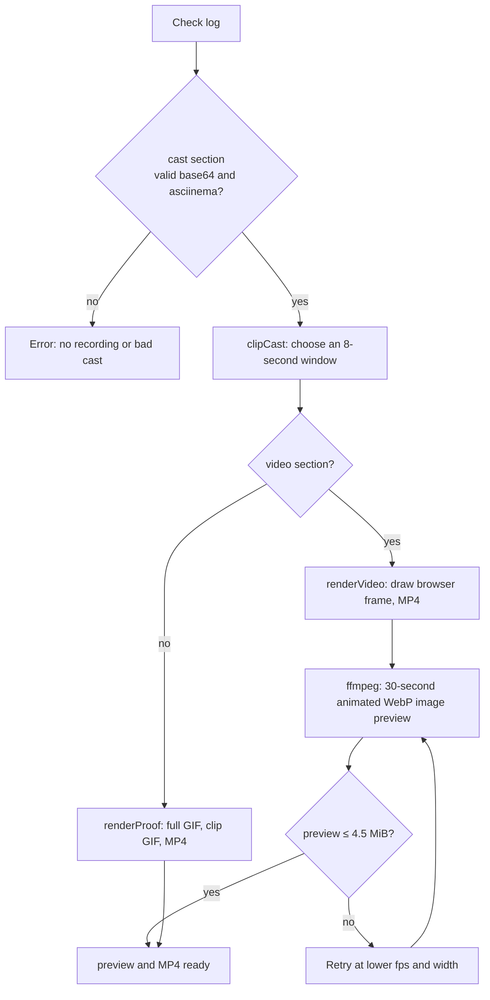
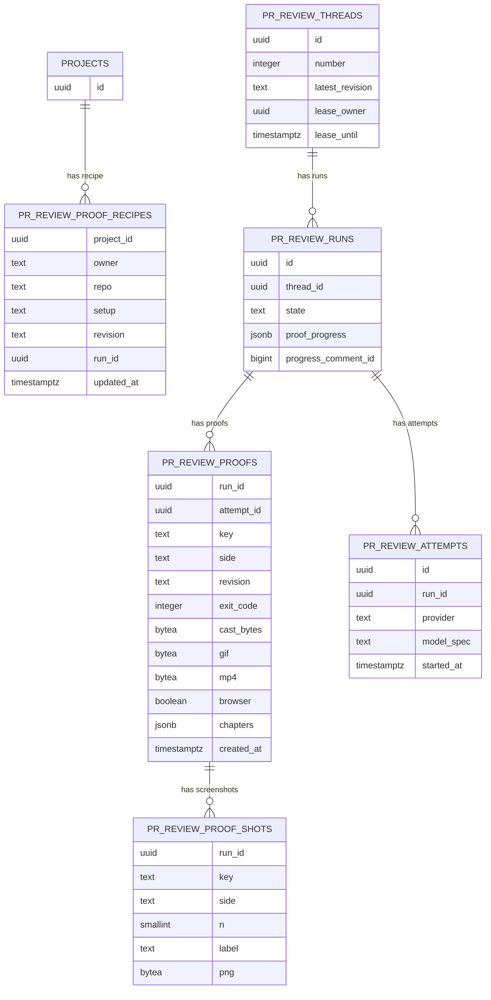

# Running one proof: from a command to a signed image

**Thesis.** One proof is a Bash command and an optional setup script, sent as two base64 arguments to a frozen script. The script runs setup unrecorded, records the command with asciinema (a terminal recording tool), and returns every artifact between markers in one check log for each side. The host parses the markers, renders a Graphics Interchange Format (GIF) image and a Moving Picture Experts Group (MPEG)-4 Part 14 (MP4) container, and stores the bytes in Postgres.

Sources: `src/Data/Effectful/CodeReview/proof.sh`, `src/Data/Effectful/CodeReview/Explanation.hs`, `src/Data/Effectful/CodeReview.hs`, `static/migrations/0269` to `0275`, `.monoscope/PROOF.md`.

Terms used here:

- The **host** is the Haskell server process. The **guest** is the Linux system inside the Gondolin micro-virtual machine (micro-VM). Gondolin is the micro-VM runtime.
- The **host checkout** is the Git working tree that the host prepares from the pull request head. The host mounts it in the guest at `/checkout`; the guest copies or fetches from that directory into `/workspace` for the selected side (`AgentWorkspace.hs:1185`, `1200-1203`). A second guest path, `/baseline`, appears only when the host builds a checkpoint: it holds a clean prepared copy of the repository, and the guest copies `/baseline` into `/workspace` and restores `.git` from `/baseline/.git` (`AgentWorkspace.hs:1416`, `1421`, `1428`).
- A **checkpoint** is a saved, prepared guest disk from an earlier run. A **pristine run** starts without a checkpoint. A resumed proof run starts from a checkpoint and its working tree begins as the prepared copy; a pristine run starts from `/checkout`.
- A **receipt** is the host's per-side record: it names the side, the revision, the check status, the exit code, the log digest, and the resource shape.
- The **check log** is the file that captures the frozen script's standard output and standard error, including its marker lines. The guest command's own output goes into the asciinema cast, and asciinema's standard output is discarded (`proof.sh:27-32`). All media markers and the failure literal arrive in the check log. The **failure literal** is the string `monoscope-proof-failed`; the script prints it when setup fails.
- `regression` is the host function that runs both sides. The `outbox` is the durable receipt stream that the Node model host (`pi-host.mjs`) writes and the Haskell host reads; it carries review receipts between the two processes. `hooks.save` is the `saveProofs` transaction, and `hooks.progress` publishes the progress comment state. A **model host** is the Node.js process `impact-review-worker/pi-host.mjs`, which runs the model session; it is not the Haskell host. `session.baseline` is a field of the regression request: the prepared checkpoint that supplies the starting disk for the two side runs. The expression `active \session -> ...` is a Haskell binder: `active` starts the guest session, and `session` is the regression request record for that run. A **proof budget** of three limits how many proofs one agent attempt (defined below) can request or store; section 9 explains the two counters. A **check status** is one of seven distinct values; `Blocked` covers two rules. The host tests them in this order: a log over the limit is `OutputLimit`; a tracked-file set that changed between the start and the end is `Invalidated`; exit 126 or 127 is `Blocked`; exit 0 is `Passed`; a nonzero exit whose log contains the failure literal `monoscope-proof-failed` is `Failed`; any other nonzero exit, or no usable log, is `Blocked`; a run with no result inside the timeout is `TimedOut`; a sandbox cleanup failure is `CleanupFailed` (`AgentWorkspace.hs:1244-1260`). The host computes a tracked-file fingerprint before and after the run. A change makes `Invalidated` even when the setup guard exits with the failure literal, because `Invalidated` is tested before the literal. A setup that changes tracked files is therefore `Invalidated`, not `Failed`. If only the commit changed, the fingerprint does not change, and the literal can produce `Failed`.
- An **agent attempt** is one execution of the review model for a run. It is a row in `projects.pr_review_attempts`, and a retry after a failure starts a new agent attempt. A proof row carries the attempt identifier, but it has no foreign key to that table (`0259_native_agent_records.sql:71-82`; `0269_pr_review_proofs.sql:6`).
- A **model session** is one connection between the host and the review model. One agent attempt can use more than one model session. A **paused model session** stops at a decision or provider wait and saves its transcript. A resume restores the transcript and the proof count (`CodeReview.hs:462`).
- PostgreSQL stores the chapter and progress arrays as `jsonb` (binary JavaScript Object Notation). A JSONB value is a binary JSON value, not a text string.

## 1. The two sides

Every proof runs on two revisions of the same repository.

```haskell
-- src/Data/Effectful/CodeReview/Types.hs:114
data RevisionSide = Base | Head
```

| Side | Meaning | Source |
|------|---------|--------|
| `Base` | The pinned target branch revision, `pr.base.revision` | `ImpactReviews.hs:227`; `Types.hs:114` |
| `Head` | The pull request head, verified against the host checkout's `HEAD` | `AgentWorkspace.hs:1128-1129` |

`base` is not the merge base. The pull request event stores the current target branch tip. The **merge base** is the best common ancestor of the pull request head and the target branch. The strategy document `docs/proof-strategies.md:3` in the Monoscope repository calls this revision the merge base, but the review prompt tells the model to compute `git merge-base` when it needs the common ancestor (`Policy.hs:79`). The comparison therefore shows the change against the latest target branch, not against the common ancestor. This is a source contradiction, and it can add unrelated target-branch changes to a base recording.

The host records both sides as receipts, each with a check status and an exit code. A **receipt** here is the host record for one side: the side, the revision, the check status, the exit code, the log digest, and the resource shape. The host reads the host checkout's `HEAD` with `git rev-parse HEAD` and requires the head revision to equal it before it runs a side (`AgentWorkspace.hs:1128-1129`). For the base side, the same check only confirms that the requested revision equals `request.base`. The base side is checked out at the pinned `request.base` revision in the guest, and its receipt records that revision. A **claim** is one statement that the review makes about a claim in the pull request description. A **`ProofLink`** is the stored result that a claim cites: the proof key, one side, the revision, and the exit code. The model sets each claim status. A claim that cites a proof must have both sides recorded. A claim with status `Matches` must also have a head exit code of zero. The three claim statuses are `Matches`, `Differs`, and `Unverified`. The status compares the evidence with the claim, not one recording with the other. `Matches` means the recording agrees with the claim, and the head run succeeded. `Differs` means the recording contradicts the claim in the pull request description. `Unverified` means there is no proof, or the proof does not settle the claim, and only `Unverified` may cite no proof (`Policy.hs:211`; `ImpactReview.hs:313`). The review may make at most five claims.

```haskell
-- src/Pkg/ImpactReview.hs:308-316
validateClaims :: [ProofLink] -> [Claim] -> Either Text ()
validateClaims recorded claims = do
  unless (length claims <= 5) $ Left "Review returned more than five claims"
  for_ claims \claim -> do
    let cited key = filter ((== key) . (.key)) recorded
    unless (claim.status == Unverified || not (null claim.proofKeys)) $ Left "A matching or differing claim must cite a recorded proof"
    unless (all (\key -> sort (map (.side) $ cited key) == universe) claim.proofKeys) $ Left "Claim cites a proof that was not recorded on base and head"
    unless (claim.status /= Matches || all (any (\p -> p.side == Agent.Head && p.exitCode == Just 0) . cited) claim.proofKeys) $ Left "A matching claim needs a head recording that succeeded"
    unless (not (T.null $ T.strip claim.title) && not (T.null $ T.strip claim.summary)) $ Left "Each claim needs a title and a summary"
```

`universe` is the list of every `Agent.Side` value, which is `Base` and `Head`. The equality also assumes that `universe` is ordered `Base` then `Head`, because the left side is sorted. The third condition therefore requires one cited link for each side. The fourth condition requires every cited head link to have exit code 0 when the claim says `Matches`.

## 2. The tool call

The review agent asks for a proof with a tool call. The tool takes a claim text, a Bash command, an optional setup script, and an optional `highlight` text (the text that the clip should contain). The schema calls the Bash command `command`; the Haskell field is `shellCommand`.

```haskell
-- src/Data/Effectful/CodeReview.hs:56-58
data ProofArgs = ProofArgs {claim :: Text, shellCommand :: Text, setup :: Maybe Text, highlight :: Maybe Text}
  deriving stock (Generic)
  deriving (AE.FromJSON) via DAE.CustomJSON '[DAE.FieldLabelModifier '[DAE.Rename "shellCommand" "command"]] ProofArgs
```

The fourth field, `highlight`, is text that the eight-second clip should contain. The host searches the recorded terminal output for the first occurrence of that text and starts the clip one second before it. The clip applies only to a terminal proof. A browser proof renders from the recorded page video and ignores the clip.

`recordProof` checks the budget, then calls `recordSides`:

```haskell
-- src/Data/Effectful/CodeReview.hs:662-675 (condensed)
recordProof request outbox identifier invocation hooks = case AET.parseEither (AE.parseJSON @ProofArgs) invocation.arguments of
  Left _ -> pure $ Left "Tool arguments do not match the host contract"
  Right proof -> do
    taken <- atomicModifyIORef' proofCount \n -> (n + 1, n)
    if taken >= proofBudget
      then pure $ Left "Proof budget exhausted; cite the proofs already recorded"
      else do
        hooks.progress $ Started proof.claim
        recorded <- recordSides request outbox identifier proof hooks
        recorded <$ whenLeft_ recorded (const $ hooks.progress $ Unproved proof.claim)
```

`proofCount` is an in-memory counter with the value `proofBudget = 3` (`CodeReview.hs:62-63`). The host creates it for one agent-attempt launch and restores the count from a paused session, so a resume continues the same agent attempt (`CodeReview.hs:425`, `462`). The counter is incremented before the proof runs, so a failed proof still consumes one place. The counter therefore limits requests over one agent attempt, even when that attempt uses more than one model session. A second budget in the database also counts proofs under the same `attempt_id`. It uses the same constant: `saveProofs` compares `taken` with `Agent.proofBudget`, which is three (`ImpactReviews.hs:632`). Section 9 explains how the two budgets work together.

`recordSides` sends one artifact to both revisions. It renders each side at the same time:

```haskell
-- src/Data/Effectful/CodeReview.hs:672-691 (condensed)
recordSides request outbox identifier proof hooks = active \session -> runExceptT do
  (result, logs) <- ExceptT $ regression request session.baseline identifier
    (AE.object ["script" AE..= Media.proofScript proof.setup proof.shellCommand, "failureMessage" AE..= Media.proofFailure])
    [("base", request.base), ("head", request.head)] outbox
  recorded <- ExceptT $ sequence <$> forConcurrently result.receipts \receipt -> runExceptT do
    -- The proof side type becomes the workspace side type used for log lookup.
    let side = case receipt.side of Base -> Workspace.Base; Head -> Workspace.Head
    logFile <- maybe (throwE "The proof log was not retained") pure $ listToMaybe [path | (logged, path, _) <- logs, logged == side]
    logBytes <- readFileBS logFile
    (cast, output) <- except $ Media.proofCast logBytes
    let browser = Media.browserMedia logBytes
    (clip, window) <- except $ Media.clipCast proof.highlight cast
    (gif, mp4) <- ExceptT $ maybe (Media.renderProof clip cast) (Media.renderVideo browser.page) browser.video
    let summary = AE.object ["side" AE..= receipt.side, "revision" AE..= receipt.revision, "status" AE..= receipt.status, "exitCode" AE..= receipt.exitCode, "clip" AE..= (window <$ guard @Maybe (isNothing browser.video)), "output" AE..= T.takeEnd 3000 output, "screenshots" AE..= map fst browser.shots, "video" AE..= isJust browser.video]
    pure (ProofMedia{side = receipt.side, revision = receipt.revision, exitCode = receipt.exitCode, cast, gif, mp4, browser = isJust browser.video, shots = browser.shots, chapters = browser.chapters}, summary)
  sides <- maybe (throwE "The proof recorded no revision") pure $ nonEmpty $ map fst recorded
  key <- ExceptT $ hooks.save proof.setup sides
  lift $ hooks.progress $ Recorded proof.claim key
  pure $ AE.object ["key" AE..= key, "claim" AE..= proof.claim, "sides" AE..= map snd recorded, "note" AE..= "Cite this key in a claim. The PR author sees both recordings."]
```

Each side has its own check log; `recordSides` selects the log whose side matches the receipt (`CodeReview.hs:680`). `recordSides` does not compare the logs or decide the claim status. It renders the evidence and saves the rows. It returns one summary per side to the model, with the side, the revision, the check status, the exit code, the clip window, the last 3,000 characters of the captured output, the screenshot labels, and a Boolean that says whether a browser video exists (`CodeReview.hs:686`). The `clip` field is null when a browser video exists, because the browser renderer ignores the clip and the video is the evidence. It also returns the proof key and the note "The PR author sees both recordings." The model reads those summaries and states a claim status. `validateClaims` then rejects a claim that the receipts do not support (`ImpactReview.hs:308-316`).

The command runs in the guest at `/workspace`, which is the pinned revision on the selected side.

## 3. The frozen script

The host does not generate a new shell program for each proof. It embeds one frozen program at compile time and prepends the two arguments with `set -- COMMAND SETUP`. The script reads the command as `$1` and the setup as `$2`; an absent setup becomes an empty second argument.

```haskell
-- src/Data/Effectful/CodeReview/Explanation.hs:165-166
proofScript setup command =
  "set -- " <> unwords (map (show @Text . extractBase64 . Base64.encodeBase64 . encodeUtf8) [command, fold setup])
  <> "\n" <> decodeUtf8 $(embedFile "src/Data/Effectful/CodeReview/proof.sh")
```

Base64 matters: the alphabet has no shell metacharacters, so a double-quoted literal is safe for any command text.

### 3.1 Setup runs first and is not recorded

```bash
# src/Data/Effectful/CodeReview/proof.sh:12-25
if [ -n "${2:-}" ]; then
  printf %s "$2" | base64 -d > /tmp/monoscope-setup.sh
  source_state() { git -c safe.directory='*' rev-parse HEAD 2>&1; git -c safe.directory='*' status --porcelain --untracked-files=no 2>&1; }
  before=$(source_state)
  if ! bash /tmp/monoscope-setup.sh > /tmp/monoscope-setup.log 2>&1; then
    tail -c 4000 /tmp/monoscope-setup.log
    echo "monoscope-proof-failed: setup exited nonzero"
    exit 1
  fi
  if [ "$(source_state)" != "$before" ]; then
    echo "monoscope-proof-failed: setup changed the commit or tracked files; seed data and start services without editing source"
    exit 1
  fi
fi
```

The setup may start services, seed data, install packages from local archives, and write files that Git ignores. It may not change `HEAD` and may not change a tracked file. The rule keeps the tracked tree honest: the command runs on the revision under review, not on a repair made by the setup. A setup can still create an untracked file that changes behavior, because the guard ignores untracked files.

### 3.2 The command runs under asciinema

```bash
# src/Data/Effectful/CodeReview/proof.sh:26-31
printf %s "$1" | base64 -d > /tmp/monoscope-proof.sh
asciinema rec --quiet --overwrite --cols 110 --rows 32 --idle-time-limit 2 \
  --command 'bash /tmp/monoscope-proof.sh; echo $? > /tmp/monoscope-proof.status' \
  /tmp/monoscope-proof.cast </dev/null >/dev/null 2>/tmp/monoscope-proof.err || cat /tmp/monoscope-proof.err
status=$(cat /tmp/monoscope-proof.status 2>/dev/null || echo 125)
```

| asciinema setting | Value | Effect |
|-------------------|-------|--------|
| Terminal width | 110 columns | Fixes the layout of the recording |
| Terminal height | 32 rows | Fixes the layout of the recording |
| Idle time limit | 2 seconds | Long pauses are shortened in playback |
| Output | `/tmp/monoscope-proof.cast` | One asciinema version 2 cast |

The script exits with the recorded command's status, not with asciinema's status. The final line is `exit "$status"` (`proof.sh:45`).

## 4. The media markers

All artifacts return through the check log. Each artifact is wrapped in a begin marker, a base64 payload, and an end marker.

```bash
# src/Data/Effectful/CodeReview/proof.sh:8-10
export HOME="${HOME:-/tmp}" TERM=xterm-256color LANG=C.UTF-8 LC_ALL=C.UTF-8 PROOF_MEDIA=/tmp/monoscope-proof-media
mkdir -p "$PROOF_MEDIA"
emit() { printf '\n::monoscope-%s::%s\n' "$1" "$2"; base64 -w0 "$3"; printf '\n::monoscope-%s-end::\n' "$1"; }
```

`PROOF_MEDIA` is the directory where the command writes browser artifacts. Section 6 defines its path and contents.

| Marker name | Parameter | Payload | Source |
|-------------|-----------|---------|--------|
| `cast` | empty | asciinema cast | `proof.sh:31-33` |
| `shot` | label | Portable Network Graphics (PNG) screenshot | `proof.sh:34-39` |
| `video` | extension | WebM (a video container format) or MP4 bytes | `proof.sh:40-41` |
| `chapters` | empty | Tab-separated seconds and label | `proof.sh:42` |
| `page` | empty | Tab-separated title and Uniform Resource Locator (URL) | `proof.sh:43` |

The frozen script makes the calls that fill those markers:

```bash
# src/Data/Effectful/CodeReview/proof.sh:31-44 (condensed)
emit cast "" /tmp/monoscope-proof.cast
for shot in "$PROOF_MEDIA"/*.png; do ... emit shot "$label" "$shot"; done
[ -n "$video" ] && emit video "${video##*.}" "$video"
[ -s "$PROOF_MEDIA/chapters.tsv" ] && emit chapters "" "$PROOF_MEDIA/chapters.tsv"
[ -s "$PROOF_MEDIA/page.tsv" ] && emit page "" "$PROOF_MEDIA/page.tsv"
[ "$status" = 0 ] || echo "monoscope-proof-failed: exit $status"
```

The host parses the markers by string search, not by a grammar. It does not validate a payload here; each consumer checks its own format:

```haskell
-- src/Data/Effectful/CodeReview/Explanation.hs:364-380
logSections :: ByteString -> ByteString -> [(Text, ByteString)]
logSections name = go
  where
    begin = "::monoscope-" <> name <> "::"
    end = "::monoscope-" <> name <> "-end::"
    go bytes = case BS.breakSubstring begin bytes of
      (_, rest)
        | BS.null rest -> []
        | otherwise ->
            let (param, body) = BS8.break (== '\n') (BS.drop (BS.length begin) rest)
                (encoded, remaining) = BS.breakSubstring end (BS.drop 1 body)
             in (decodeUtf8 param, BS8.strip encoded) : go remaining
```

## 5. The limits the guest and the host enforce

`proof.sh` drops an artifact that is too large. The Haskell host applies a second limit even when the marker is present, and it silently drops excess items: extra screenshots, chapters above 12, and labels or URLs above the length limit are cut or ignored rather than reported as an error.

| Artifact | Guest limit | Host limit | Source |
|----------|-------------|------------|--------|
| Cast | 524,288 bytes | `castLimit = 524288` | `proof.sh:31`; `Explanation.hs:175` |
| Screenshots | At most 4, each at most 2 mebibytes (MiB) | At most 4, and each must start with the four-byte PNG prefix | `proof.sh:34-39`; `Explanation.hs:353` |
| Video | 12 MiB incoming video; above this the guest emits no video section | The rendered MP4 is cut at `mediaLimit = 8 MiB` by ffmpeg `-fs`; this is not a second check on the incoming video | `proof.sh:40-41`; `Explanation.hs:273, 300` |
| Chapters | 4,096 bytes, tab-separated | At most 12, each label at most 80 characters | `proof.sh:42`; `Explanation.hs:355` |
| Page | 2,048 bytes, tab-separated | Title 34 characters, URL 140 characters | `proof.sh:43`; `Explanation.hs:356` |

The host also checks the content, not only the name:

```haskell
-- src/Data/Effectful/CodeReview/Explanation.hs:349-359
browserMedia :: ByteString -> BrowserMedia
browserMedia logBytes =
  BrowserMedia
    { video = snd <$> listToMaybe (sections "video")
    , shots = take 4 [(T.strip label, png) | (label, png) <- sections "shot", "\137PNG" `BS.isPrefixOf` png]
    , chapters = take 12 [(at, T.take 80 label) | ...]
    , page = listToMaybe [...]
    }
```

A screenshot must start with the four bytes `\137PNG`, the first four bytes of the eight-byte PNG signature. The check does not test the remaining four signature bytes. A file named `.png` with other content is discarded.

The guest chooses which files to send. It walks `*.png` in shell glob order, skips a file above 2 MiB, and keeps the first four files that pass the size test. It derives each label from the base name: a character outside letters, digits, space, dot, underscore, and hyphen becomes a space, and the label is cut to 80 characters (`proof.sh:34-39`). The host then keeps at most four shots and drops any whose bytes do not start with the PNG prefix (`Explanation.hs:353`).

The guest sends at most one video. It expands `*.webm` and `*.mp4`, takes the first line of the combined listing, and tests only that file. A second video is ignored. The chosen file is ignored when it is above 12 MiB, and the host then sees no video (`proof.sh:40-41`).

The host parses the two tab-separated files as follows (`Explanation.hs:355-356`):

| File | Parse rule |
|------|------------|
| `chapters.tsv` | Each line splits at the first tab. The number before the tab must parse as a nonnegative number. The host strips the label, drops a line with an empty label, keeps at most 12 pairs, and cuts each label to 80 characters. A chapter section is read only when a video section is also present, because a chapter points into a video. |
| `page.tsv` | The host reads the first line only. The text before the first tab is the title, and the text after the first tab is the URL. It strips both, cuts the title to 34 characters and the URL to 140 characters. A line with no tab gives an empty URL. |

A file that does not follow the tab rule does not stop the proof. The host keeps whatever it can parse and ignores the rest, as the limits table above states.

## 6. What the script writes to `$PROOF_MEDIA`

`$PROOF_MEDIA` is `/tmp/monoscope-proof-media`. The command writes files there, and the frozen script collects them.

```text
$PROOF_MEDIA/
├── *.png                 ≤ 4 files, ≤ 2 MiB each, named by what they show
├── *.webm or *.mp4       one video, ≤ 12 MiB (WebM is a video container format)
├── chapters.tsv          seconds<TAB>label, ≤ 4096 bytes
└── page.tsv              title<TAB>url, ≤ 2048 bytes
```

The chapters file uses seconds relative to the **browser video**. A chapter is read only when a video section is also present, so a terminal proof that writes `chapters.tsv` gets no chapter rows. The host uses the numbers as given and does not adjust them. The reference script starts its timer before it launches the browser, and the video starts when the browser context is created. A chapter second can therefore be later than the video frame it names by however long the browser took to start. The source of the offset is the order in `.monoscope/PROOF.md:32-35`: the script sets `t0` first, then calls `chromium.launch()` and `newContext`.

```bash
# .monoscope/PROOF.md:32-33
const out = process.env.PROOF_MEDIA, t0 = Date.now(), chapters = [];
const step = (label) => { chapters.push(((Date.now() - t0) / 1000).toFixed(1) + '\t' + label); console.log('== ' + label); };
```

The page file supplies the browser frame:

```js
// .monoscope/PROOF.md:45
writeFileSync(`${out}/page.tsv`, `${await page.title()}\t${page.url().replace(/^https?:\/\//, '')}\n`);
```

## 7. A complete user interface (UI) proof from the repository

The repository's own `.monoscope/PROOF.md` is the reference example. The file is free-form Markdown guidance, not a machine-parsed recipe. The host reads it from the base revision with `git show <base>:.monoscope/PROOF.md` and gives the text to the review model, which decides whether and how to use it (`ImpactReview.hs:629-631`). The base revision is deliberate: a pull request cannot change the instructions that judge it.

The setup is the single command `monoscope-app`, which starts the application, PostgreSQL, and sample traffic in the guest. The source file is `monoscope-app.sh`; the image copies it to `/usr/local/bin/monoscope-app`, and the command the model passes is the installed name (`Dockerfile.browser:59`). The recorded command writes a Playwright (a browser automation library) script and runs it. In the reference example, a quoted heredoc writes `web-components/proof.mjs`, then `node proof.mjs` runs it (`PROOF.md:22-58`). That file is untracked. The setup guard does not see it, because the guard checks only the setup step and the command runs after the guard.

The two texts go into two different tool arguments. The setup argument is `monoscope-app`, and the command argument is the whole Bash block that starts with `cd web-components` and ends with `node proof.mjs`. The heredoc body is part of the command, not a separate file that the review model sends:

```bash
# .monoscope/PROOF.md:29, 53-54
cd web-components && cat > proof.mjs <<'JS'
...
JS
node proof.mjs
```

The frozen script decodes the setup first, runs it unrecorded, and checks the guard. It then decodes the command and records it. The heredoc runs inside the recorded step, so the recording shows the script being written and then run. `PROOF.md` tells the model to run the setup once per virtual machine; a review that runs the command on both sides has two virtual machines and runs the setup on each side (`PROOF.md:21`). The host loops over the two revisions and starts one `withSandbox` for each side, so the two sides do not share a guest (`AgentWorkspace.hs:1160-1182`).

```bash
# .monoscope/PROOF.md:9-13
monoscope-app
```

```js
// .monoscope/PROOF.md:29-35
import { chromium } from 'playwright';
import { writeFileSync } from 'node:fs';
const out = process.env.PROOF_MEDIA, t0 = Date.now(), chapters = [];
const step = (label) => { chapters.push(((Date.now() - t0) / 1000).toFixed(1) + '\t' + label); console.log('== ' + label); };
const browser = await chromium.launch();
const context = await browser.newContext({ viewport: { width: 1280, height: 800 }, recordVideo: { dir: out, size: { width: 1280, height: 800 } } });
```

The proof shows the pointer because the page installs a dot that follows the mouse:

```js
// .monoscope/PROOF.md:36-42
await context.addInitScript(() => addEventListener('DOMContentLoaded', () => {
  const dot = document.documentElement.appendChild(document.createElement('div'));
  dot.style.cssText = 'position:fixed;z-index:2147483647;left:-40px;width:16px;height:16px;margin:-8px 0 0 -8px;border-radius:50%;background:#2f6fedaa;border:2px solid #fff;pointer-events:none;transition:scale .1s';
  addEventListener('mousemove', (e) => { dot.style.left = e.clientX + 'px'; dot.style.top = e.clientY + 'px'; }, true);
  addEventListener('mousedown', () => { dot.style.scale = '.6'; }, true);
  addEventListener('mouseup', () => { dot.style.scale = ''; }, true);
}));
```

The script asserts on what the user sees, so the base fails and the head passes. In the reference change, the Clear and Pause/Resume controls should sit on one row. The old layout wraps Clear onto its own row, so the base exits 1. The new layout keeps their vertical positions within four pixels, so the head passes:

```js
// .monoscope/PROOF.md:61-65
const clear = page.getByRole('button', { name: 'Clear' }), pause = page.getByRole('button', { name: /Pause|Resume/ });
await clear.waitFor();
const [c, p] = [await clear.boundingBox(), await pause.boundingBox()];
if (Math.abs(c.y - p.y) > 4) { console.log('Clear wrapped onto its own row'); process.exit(1); }
```

The repository's guidance adds three rules that are easy to miss:

| Rule | Reason | Source |
|------|--------|--------|
| Write `chapters.tsv` and close the context before `process.exit` | The video is lost if the browser closes abnormally | `.monoscope/PROOF.md:71` |
| Name a screenshot for what it frames, not for the expected outcome | The same script runs on both sides, so an outcome name is a lie on one side | `.monoscope/PROOF.md:72-74` |
| Hold about two seconds on each state worth seeing | The recording is the first thing a reviewer sees | `.monoscope/PROOF.md:67-69` |

The assertion example and the first rule conflict if you copy them literally. The `process.exit(1)` in the example exits before the script writes `chapters.tsv` and closes the context. In a real proof script, write the chapter file first, or close the context in a `finally` block. The side still classifies as `Failed`, but a side that exits early has no video and no chapters. The page file can survive because the reference script writes it before the steps. The reviewer then sees the failure text without the frame that failed.

## 8. Parsing and rendering

The renderer uses two external programs. `agg` is the asciinema GIF generator. `ffmpeg` is a video converter.



The two renderers are alternatives, not steps in one proof. A terminal proof takes the left branch: `renderProof` produces the full GIF, the clip GIF, and the MP4. A browser proof takes the right branch: `renderVideo` produces the browser-framed MP4 and the animated WebP (an image format that supports animation) preview, and ignores the clip. The code still computes the clip for a browser side, before it chooses the renderer (`CodeReview.hs:685`). A cast that is absent or invalid stops the side before either renderer runs. Because `saveProofs` stores all sides or none, the proof stores no row at all; it does not store a side without media.

The three size limits act at different places, and the difference matters when a proof fails:

| Limit | Where it acts | Result |
|-------|----------------|--------|
| Video above 12 MiB | Guest. `proof.sh` emits no `video` section (`proof.sh:40-41`). | The host treats the side as a terminal proof. A side with a valid cast renders as terminal; a side without one fails, and the all-or-none save stores nothing. |
| Cast absent or above 524,288 bytes | Guest emits no cast section, and the host rejects a cast above `castLimit` even if the section is present (`proof.sh:31`; `Explanation.hs:175`). | The side fails even when its video is below its limit. `proofCast` runs before the host chooses the renderer (`CodeReview.hs:682`), and the all-or-none save stores no row. |
| Rendered MP4 above 8 MiB | Host. `ffmpeg` receives `-fs 8 MiB`, so it stops writing at the limit (`Explanation.hs:273`, `332`). | The MP4 is cut, not rejected. The proof keeps a shorter video that ends at the limit. |

### 8.1 The terminal clip

A terminal proof produces two renderings: the whole recording as an MP4, and an eight-second clip as an animated GIF. GIFs play inline in GitHub comments.

```haskell
-- src/Data/Effectful/CodeReview/Explanation.hs:269-273
renderProof :: ByteString -> ByteString -> IO (Either Text (ByteString, ByteString))
renderProof clip cast = renderMedia cast \directory run -> do
  writeFileBS (directory </> "clip.cast") clip
  for_ [("proof.input", "full.gif"), ("clip.cast", "proof.gif")] \(input, output) ->
    run "agg" ["--idle-time-limit", "2", "--fps-cap", "12", "--font-size", "16", "--theme", "github-dark", input, output]
  run "ffmpeg" (quiet <> ["-t", "120", "-i", "full.gif", ... "-fs", show mediaLimit, "proof.mp4"])
```

`renderMedia` writes the whole cast as `proof.input`. `renderProof` writes the eight-second clip as `clip.cast`. `agg` renders each cast to a GIF. `ffmpeg` converts the full GIF to an MP4 with a 120-second limit and an 8 MiB file-size limit.

The clip window has three cases. A recording of eight seconds or less uses the whole recording. Otherwise, if the `highlight` text appears, the window starts one second before its first occurrence and stays inside the recording. If the text never appears, the window uses the last eight seconds:

```haskell
-- src/Data/Effectful/CodeReview/Explanation.hs:224-263 (condensed)
window
  | total <= 8 = Window 0 total total
  | Just m <- moment = let from = max 0 (min (m - 1) (total - 8)) in Window from (from + 8) total
  | otherwise = Window (total - 8) total total
```

`moment` is the first output time that contains the `highlight` text. `Window` holds three numbers in recording seconds: `start` and `end` bound the clip, and `total` is the last output time in the whole recording. The rendered clip is rebased: every output at or after `start` is written at time `t - start`, and the clip ends at `end - start`. Outputs before `start` are collapsed into one event at time zero, so the terminal shows its screen state at the clip start without replaying the earlier seconds (`Explanation.hs:255-262`). The timeline row under the terminal shows the whole recording, the clip section in blue, and a dot for the current moment. The dot is placed with the absolute time `t`, so it moves across the whole recording while the clip itself starts at zero (`Explanation.hs:246-254`). The **player** is the Monoscope web view for one proof.

### 8.2 The browser video

A browser proof produces an MP4 with a drawn browser window around the page recording, plus an animated WebP preview. WebP is a web image format that supports animation.

```haskell
-- src/Data/Effectful/CodeReview/Explanation.hs:281-311 (condensed)
renderVideo page video = renderMedia video \directory run -> do
  ...
  run "ffmpeg" (quiet <> ["-t", "120", "-i", "proof.input", "-f", "lavfi", "-i", "color=c=0xDCE1EA:s=1328x926",
    "-filter_complex", "...[frame][page]overlay=24:102:shortest=1", "-an", "-movflags", "+faststart",
    "-pix_fmt", "yuv420p", "-c:v", "libx264", "-crf", "24", "-fs", show mediaLimit, "proof.mp4"])
  ...
  unlessM (anyM preview [("8", "1200", "60"), ("6", "960", "50"), ("4", "800", "40")]) $
    throwIO $ userError "the preview exceeds GitHub's image size limit"
```

The preview is a WebP animation, not a GIF, because a scrolling user interface recorded as a GIF grows to several megabytes. It shows the first 30 seconds of the MP4, or the whole video when the video is shorter than 30 seconds (`Explanation.hs:303`, `309`). The three settings control the frame rate, the maximum width, and the encoder quality, in that order: 8 frames per second (fps) at 1200 pixels wide and quality 60, then 6 fps at 960 and 50, then 4 fps at 800 and 40 (`Explanation.hs:311`). The code stops at the first setting whose file is below 4,718,592 bytes (4.5 MiB). If no setting fits, the render fails with an error. The player label is `▶  Play full video  ·  m:ss`, with two spaces on each side of the middle dot, where `m:ss` is the MP4 duration in minutes and seconds (`Explanation.hs:305`). The duration comes from `ffprobe`, and the code uses 30 seconds when the probe fails (`Explanation.hs:301-302`).

Rendering runs under `nice -n 19`, with a 120-second timeout, and with only `PATH` in the environment (`Explanation.hs:316-319`). The 8 MiB output limit applies to each MP4. The animated WebP preview has a separate 4,718,592-byte check. The full terminal GIF has no shown size limit.

Screenshots do not depend on the video. The parser reads the screenshot markers into `browser.shots`, and `recordSides` stores them even when `browser.video` is null (`CodeReview.hs:683-687`). When no video exists, the same code calls the terminal renderer and sets the proof's `browser` flag to false, so the proof keeps its screenshots but has no chapters, because chapters require a video. A browser proof whose video was too large therefore still shows its still images.

## 9. The database rows



The **lease** is the right to work on a pull request thread. A thread has one lease holder at a time. `PR_REVIEW_THREADS.lease_owner` holds the identifier of the run that holds the lease, and `lease_until` holds the time at which the lease ends (`0213_pr_impact_reviews.sql:19-20`). The column has no foreign key to `PR_REVIEW_RUNS`. The entity diagram draws the thread-to-run containment, not a lease-owner relation. `lease_owner = run.id` and `lease_until > now()` together establish that the current run still owns the thread.

A run has one or more agent attempts. `PR_REVIEW_ATTEMPTS` records the provider and the model for each attempt (`0259_native_agent_records.sql:71-82`). `PR_REVIEW_PROOFS.attempt_id` names the attempt that stored a proof, but it has no foreign key to `PR_REVIEW_ATTEMPTS`; the proof table was added with its own attempt identifier. A proof recipe belongs to one project, and the primary key is `(project_id, owner, repo)`.

The main table stores the bytes, not a path:

```sql
-- static/migrations/0269_pr_review_proofs.sql:2-4
-- Recorded proof media: one row per proof and revision side. Keys count up across a run's
-- attempts and are never reused, so a signed media URL always names the same bytes.
CREATE TABLE projects.pr_review_proofs (
  run_id uuid NOT NULL REFERENCES projects.pr_review_runs(id) ON DELETE CASCADE,
  attempt_id uuid NOT NULL,
  key text NOT NULL CHECK (key ~ '^proof-[1-9][0-9]*$'),
  side text NOT NULL CHECK (side IN ('base', 'head')),
  revision text NOT NULL,
  exit_code integer,
  cast_bytes bytea NOT NULL,
  gif bytea NOT NULL,
  mp4 bytea NOT NULL,
  created_at timestamptz NOT NULL DEFAULT now(),
  PRIMARY KEY (run_id, key, side)
);
```

Screenshots are separate rows, because a proof can have up to four:

```sql
-- static/migrations/0273_pr_review_proof_screenshots.sql
ALTER TABLE projects.pr_review_proofs
  ADD COLUMN browser boolean NOT NULL DEFAULT false,
  ADD COLUMN chapters jsonb NOT NULL DEFAULT '[]' CHECK (jsonb_typeof(chapters) = 'array');
CREATE TABLE projects.pr_review_proof_shots (
  run_id uuid NOT NULL,
  key text NOT NULL,
  side text NOT NULL,
  n smallint NOT NULL CHECK (n BETWEEN 1 AND 4),
  label text NOT NULL CHECK (length(label) <= 80),
  png bytea NOT NULL,
  PRIMARY KEY (run_id, key, side, n),
  FOREIGN KEY (run_id, key, side) REFERENCES projects.pr_review_proofs (run_id, key, side) ON DELETE CASCADE
);
```

The browser and screenshot columns enter with Pull Request 825, merge commit `a399f2e39b3dbf947d60101ee7f6d39e8e351b45`, titled "Proofs: browser recordings with screenshots and chapters, and a comment that leads with the proof (#825)". The migration file is `static/migrations/0273_pr_review_proof_screenshots.sql`.

The recipe table stores a working setup for the next review:

```sql
-- static/migrations/0270_pr_review_proof_recipes.sql:2-4
-- The setup script (start the app, migrate, seed) behind a repository's last successful proof.
-- The next review gets these exact bytes back, so proofs reuse code rather than rediscover it.
CREATE TABLE projects.pr_review_proof_recipes (
  project_id uuid NOT NULL REFERENCES projects.projects(id) ON DELETE CASCADE,
  owner text NOT NULL,
  repo text NOT NULL,
  setup text NOT NULL,
  revision text NOT NULL,
  run_id uuid NOT NULL REFERENCES projects.pr_review_runs(id) ON DELETE CASCADE,
  updated_at timestamptz NOT NULL DEFAULT now(),
  PRIMARY KEY (project_id, owner, repo)
);
```

The recipe is replaced only when the new setup has a successful head recording:

```sql
-- src/Models/Projects/ImpactReviews.hs:657-661 (condensed)
INSERT INTO projects.pr_review_proof_recipes (project_id, owner, repo, setup, revision, run_id)
SELECT ... WHERE #{setup}::text IS NOT NULL
  AND #{any (\p -> p.side == Agent.Head && p.exitCode == Just 0) sides}
ON CONFLICT (project_id, owner, repo) DO UPDATE SET
  setup = EXCLUDED.setup, revision = EXCLUDED.revision, run_id = EXCLUDED.run_id, updated_at = now()
```

The insert runs in the same transaction as the proof insert, so a rollback removes both the proof and the recipe change. The recipe insert does not gate the proof insert: its `WHERE` clause can match zero rows and the transaction still commits the proof. The insert also computes a **reuse status** by comparing the new setup with the prior setup: `NoSetup` when there is no setup, `Reused` when the text is identical, and `Changed` otherwise (`ImpactReviews.hs:616-618`, `ImpactReviews.hs:657-661`). The same statement reads the prior setup in a common table expression before the insert. A repository's first successful setup therefore reports `Changed`, not `Reused`, because the prior row is null. The status is returned to the caller and logged as `Proof setup` with the run identifier (`ImpactReview.hs:590-591`). It is not stored in a table column. The status is a measure of how often a repository's saved setup replays byte for byte; it does not change the proof.

On a later review, the host reads the saved setup back. `proofRecipe` selects `setup` and `revision` for the project, owner, and repository (`ImpactReviews.hs:670-671`). The model session receives the result in its instructions, as a JavaScript Object Notation (JSON) string, with the text: "Pass it unchanged as record_proof's setup unless the code it relies on changed" (`ImpactReview.hs:619`, `ImpactReview.hs:632`). The read is not scoped to a run, so every later run in the same repository sees the most recent successful setup. The stored `revision` tells the model which code the setup was known to work with.

The save is all-or-nothing per proof, and only the run that holds the review lease can write. The query computes two counts. `used` is the number of distinct proof keys that the run already stored, so the next key number is `used + 1`. `taken` is the number of distinct proof keys already stored under the current agent attempt, so a fourth proof cannot be stored under one attempt. The run-level budget is separate: `recordProof` increments an in-memory counter before it runs the proof, so a failed attempt consumes one of the three (`CodeReview.hs:664-668`); `proofBudget = 3` (`CodeReview.hs:62-63`). The two counters answer different questions. The in-memory counter limits how many proof attempts the review model may request over one agent attempt; a resume restores it. The database `taken` count limits how many proofs one agent attempt may commit, even if a later model session continues the same attempt. The database `used` count supplies the key number and is not a budget.

```haskell
-- src/Models/Projects/ImpactReviews.hs:624-634 (condensed)
saveProofs run attempt setup sides = Hasql.transaction TxS.ReadCommitted TxS.Write do
  HI.OneColumn leased <- Hasql.oneTx
    [HI.sql|SELECT EXISTS (SELECT 1 FROM projects.pr_review_runs r
      JOIN projects.pr_review_threads t ON t.id = r.thread_id
      WHERE r.id = #{run.id} AND r.state = #{Reviewing}
        AND t.lease_owner = r.id AND t.lease_until > now())|]
  (used :: Int64, taken :: Int64) <- Hasql.oneTx
    [HI.sql|SELECT count(DISTINCT key), count(DISTINCT key) FILTER (WHERE attempt_id = #{attempt})
      FROM projects.pr_review_proofs WHERE run_id = #{run.id}|]
  let key = "proof-" <> show (used + 1)
  -- The full function then condemns the attempt when leased is false or taken is at the budget.
```

The transaction rolls back when the proof cannot be stored, and it condemns the attempt instead of keeping a partial set. To condemn here means to mark the attempt as failed so it is not retried as a success. The full function compares `taken` with `Agent.proofBudget`, which is the same value as `proofBudget = 3` (`ImpactReviews.hs:632`; `CodeReview.hs:62-63`).

The migration comment says that keys "are never reused, so a signed media URL always names the same bytes" (`0269_pr_review_proofs.sql:2-4`). Read that sentence as a guarantee about published media, not about key numbers in all cases. After a rollback, no key row exists, so a later attempt can derive the same number again. The number is reused in this case. The bytes are not, because the failed attempt publishes no proof link: the host writes the final comment, with its links, only after a successful save. The progress comment can already exist, because `publishProgress` runs while the review is active. A signed media URL therefore cannot name two different byte strings. The guarantee holds for every key that a reader can see.

The progress table supports a comment that updates while the review runs:

```sql
-- static/migrations/0275_pr_review_proof_progress.sql:2-4
-- A review's live comment: the claims its agent plans to prove and how far each has got, and the
-- comment that shows them until the finished review replaces it.
ALTER TABLE projects.pr_review_runs
  ADD COLUMN proof_progress jsonb NOT NULL DEFAULT '[]' CHECK (jsonb_typeof(proof_progress) = 'array'),
  ADD COLUMN progress_comment_id bigint;
```

The progress comment and the final comment are the same GitHub comment. `publishProgress` renders the planned claims and the recorded proof links, finds the comment to edit with `reviewComment`, and publishes (`ImpactReview.hs:696-711`). A **member-requested review** is a run started by an explicit request from a person; an **automatic review** is a run started by a pull request event. `reviewComment` prefers the stored `progress_comment_id`; if none is stored, it returns no identifier for a member-requested review, so the review starts a new comment, and it returns the last comment with the review marker for an automatic review (`ImpactReview.hs:685-693`). `setProgressComment` stores the identifier after a successful publish (`ImpactReviews.hs:720-725`). A failed progress update is logged and does not fail the review (`ImpactReview.hs:705`). The final `publish` renders the completed review and passes the same `existing` identifier, so GitHub edits the progress comment in place instead of adding a second one (`ImpactReview.hs:655-682`). If the review stops for good, `stopProgress` edits the same comment with a "Review stopped" reason (`ImpactReview.hs:460-465`). A publication that waits for human approval shows no progress until the approval (`ImpactReview.hs:698-699`). The source does not name the approving person or the exact permission.

## 10. The signed media link

Media is served outside the cookie session, so GitHub's image proxy can fetch it.

```haskell
-- src/Web/Routes.hs:805-811
proofMediaGetH pid rid file sigM request send = do
  ctx <- ask @AuthContext
  whenLeft_ (BotUtils.verifyWidgetSignature ctx.env.apiKeyEncryptionSecretKey pid (ImpactReviews.proofSignedPath rid file) sigM) \err -> Error.throwError err403{errBody = err}
  bytes <- maybe (Error.throwError err404) pure =<< ImpactReviews.proofFile pid rid file
  let mime = case file.asset of ImpactReviews.Recording ImpactReviews.Gif -> if "RIFF" `BS.isPrefixOf` bytes then "image/webp" else "image/gif"; ImpactReviews.Recording ImpactReviews.Mp4 -> "video/mp4"; ImpactReviews.Recording ImpactReviews.Cast -> "application/x-asciicast"; ImpactReviews.Screenshot _ -> "image/png"
  liftIO $ send $ PageCodeContext.rangedMedia request [(H.hContentType, mime), (H.hCacheControl, "public, max-age=31536000, immutable")] (toLazy bytes)
```

The link carries a `sig` query parameter. The signature is a hexadecimal hash-based message authentication code (HMAC) with the Secure Hash Algorithm 256-bit (SHA-256). The signed text is `<project id>:proof:<review id>/<file>`, and the key is `apiKeyEncryptionSecretKey` (`Widget.hs:676-679`; `ImpactReviews.hs:729-730`). The project identifier binds the link to one project. The `proof:` prefix keeps a proof signature apart from a widget signature that uses the same key. Verification recomputes the signature and compares the two values with a constant-time comparison, so an attacker cannot learn the expected value one byte at a time (`Utils.hs:479-481`).

The signature covers the file value: the key number, the side, the asset kind, and, for a screenshot, the screenshot number. The signature does not cover the response bytes. Integrity of the bytes comes from the stored row and the rule that a visible key never names different bytes. The cache header does not provide integrity; it controls caching. The header is `public, max-age=31536000, immutable`, which permits one year of caching and forbids revalidation. The signature has no expiry time. That is consistent with the key rule: a key that a reader can see never names different bytes (`Routes.hs:811`). The code reuses the key that encrypts stored API keys as the signing secret, and it defines no separate proof-media secret. The title of this document says "signed image", but the route serves images, animated images, video, and terminal casts.

The `review id` in the signed text is the review run identifier, not the pull request number. The caller passes `run.id` to `proofSignedPath` (`ImpactReview.hs:826`; `ImpactReviews.hs:729-730`). The file value has four serialized shapes (`ImpactReviews.hs:599-611`):

| Asset | Example path piece | Meaning |
|-------|--------------------|---------|
| Recording, GIF | `proof-1-base.gif` | Key 1, base side, terminal GIF or browser preview |
| Recording, MP4 | `proof-1-head.mp4` | Key 1, head side, full video |
| Recording, cast | `proof-1-base.cast` | Key 1, base side, asciinema cast |
| Screenshot | `proof-1-head-2.png` | Key 1, head side, screenshot 2 of up to 4 |

The parser accepts screenshot numbers 1 to 4 only, and it accepts any recording extension as text. The parser stores the asset kind in the `ProofFile` value, and the route uses that parsed kind, not the file extension, to choose the content type (`ImpactReviews.hs:606-611`). A path that does not follow one of these shapes is rejected before the signature check has any data to verify.

```haskell
-- src/Web/Links.hs:602
type ProofMediaGet = "p" :> ProjectId :> "reviews" :> Capture "review_id" (UUIDId "pr_review")
  :> "proofs" :> Capture "file" ImpactReviews.ProofFile :> QPT "sig" :> RawM
```

The server treats a file whose bytes start with `RIFF` (Resource Interchange File Format) as WebP and every other recording GIF as GIF. A RIFF container is not necessarily WebP, so the check is a container test, not a complete format test. It takes the other content types from the typed `ProofFile` value, not from a file name. A browser proof's preview is stored in the `gif` field and served on a path that ends in `.gif`, but its bytes are WebP. The content type comes from the asset type and the RIFF prefix, so a signed path serves the correct type even when the path has a legacy name.

## 11. The Aha moments

**Aha: the setup guard is a partial security boundary, not a complete one.** The git-state guard (`proof.sh:21-24`) rejects a setup that edits a tracked file. It does not reject a new untracked file, because it runs `git status` with `--untracked-files=no` (section 3.1). A setup can therefore create the file that a pull request adds, and the base recording can show behavior that the base revision does not contain. That exploit is a reasoned consequence of the guard, not an observed result. The guard raises the cost of a dishonest proof, but the trust model also depends on the setup text and on the review model. The rule is a boundary with a known hole, not a proof of honesty.

**Aha: a browser preview is WebP, not GIF, because the size limit shapes the design.** The comment preview for a browser proof is always an animated WebP. The code does not make a GIF first and convert it only after an overflow. The preview renderer writes WebP at each of three settings and stops at the first file below 4,718,592 bytes. A GIF of a scrolling interface grows to several megabytes. The source comment says GitHub's image proxy limit motivates WebP, so WebP is the only format that the code tries (`Explanation.hs:278-279`). The retries lower the frame rate and width. If no setting fits, the render fails rather than publishing an oversized image. The full MP4 keeps the quality.

**Aha: chapter count is capped on the host, not in the guest script.** `proof.sh` forwards any `chapters.tsv` below 4,096 bytes. The host keeps only the first 12. A chapter is a labelled second in the browser video. The comment renders each chapter as a link to the video with a `#t=` fragment for that second (`ImpactReview.hs:879`). A script that writes 30 chapters produces 12 chapter links plus the full-video link, and the rest are silently dropped.

## 12. Next

Read [04-the-proof-comment.md](04-the-proof-comment.md) for how these artifacts become a comment. Read [02-monoscope-proof-pipeline.md](02-monoscope-proof-pipeline.md) for the virtual machine that runs the script.

Back to [README.md](README.md).
