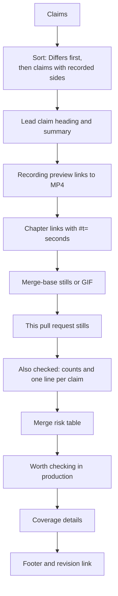
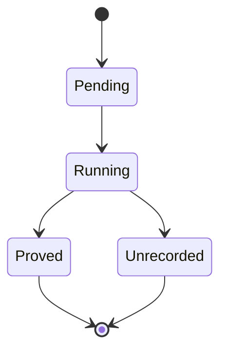

# The proof comment

**Thesis.** The proof comment is not a summary of a recording. It is an argument with a structure: the most decision-relevant claim first, its recording and stills, the other claims in one line each, then a risk table, findings, and coverage. The host builds every explicit link that it emits. Model text is escaped and defanged before it enters the Markdown.

The comment includes a preview image, a link to a Moving Picture Experts Group (MPEG)-4 Part 14 (MP4) video, and up to four Portable Network Graphics (PNG) stills for a recorded side. A terminal proof uses a Graphics Interchange Format (GIF) image as the preview and has no stills. A browser proof uses an animated WebP image as the preview and can add stills. WebP is an image format that supports animation. The browser preview is stored in the `gif` field and served under a `.gif` name, although its bytes are WebP.

Terms used in this file: a **proof** is one recorded check of a claim, stored under a proof key. A **claim** is one statement that the review makes about the change. A **side** is the base revision or the head revision. The **host** is the Haskell review process that renders the comment. **Model text** is text that the review model wrote. To **defang** text means to rewrite Markdown characters so that the text cannot create a link, image, table, or heading. A **golden** is a stored expected output file. A **terminal proof** runs a command and records the terminal. A **browser proof** runs a Playwright script and records the page.

Sources: `src/Pkg/ImpactReview.hs:834-972`; goldens in `test/golden/impact-review/`; `src/Models/Projects/ImpactReviews.hs`.

## 1. The shape of the comment



The golden `github-comment-ui-proof.md` shows the full browser form. The golden `github-comment.md` shows the terminal form. The golden `github-comment-links-only.md` shows the form used when the review setting `includeEvidence` is false. That setting is per owner and repository. Its control is labelled "Production evidence in GitHub", and the option that turns the evidence off is "Links only" (`src/Pages/CodeContext.hs:851`). In that form, a finding keeps its location line but replaces the mechanism, the next check, and the inline production evidence with one link to the full review (`ImpactReview.hs:846, 898-902`). The `shown` flag is the `includeEvidence` setting for a GitHub comment. It is always true for the Monoscope view.

## 2. The lead claim is chosen, not taken in order

```haskell
-- src/Pkg/ImpactReview.hs:860-886 (condensed)
proofSection claims = case sortOn (\c -> (c.status /= Differs, null (sidesOf c))) claims of
  [] -> []
  lead : rest ->
    ("### " <> icon 20 lead.status <> " " <> plain lead.title)
      : plain lead.summary
      : foldMap media (nonEmpty $ sidesOf lead)
      <> [ ...also checked... ]
```

The sort key has two parts. `sidesOf claim` returns the recorded rows for the first proof key that the claim cites; a **side** is one revision, base or head.

| Sort key part | Meaning | Consequence |
|---------------|---------|-------------|
| `c.status /= Differs` | `False` sorts before `True` | A claim with status `Differs` leads when one exists |
| `null (sidesOf c)` | `False` sorts before `True` | A claim with a recording leads over one without, when no `Differs` claim exists |

`Differs` means the review model judged that the recording contradicts the claim in the pull request description (`Policy.hs:211`). It does not mean that the base and head recordings differ from each other. The host does not compare the recordings and does not check the judgement. It validates the claim and stores the status with the artifacts, so the status is the model's judgement, not a measurement. That is the claim a reviewer most needs to see. Every claim that is not the lead, including a matching claim, goes to the "Also checked" line.

`Differs` is not necessarily a failure of the change. It is the signal that the description and the observed behavior disagree. In the golden comment, the claim says that every retry reuses the idempotency key. The head recording shows that the second retry sends a new key, so the evidence contradicts the claim. The base recording's command exits 1, so the comment labels that side `Merge-base · exit 1`; the head recording is the one that shows the contradiction. The model's summary states the behavior it saw. The status can report a regression, an improvement, or a mismatch between words and behavior; the summary says which.

The comment calls the base side "Merge-base":

```html
<!-- test/golden/impact-review/github-comment.md:9-11 -->
<sub>Merge-base · exit 1</sub>

```

The label is misleading. The base side recorded `pr.base.revision`, which is the target branch tip, not the common ancestor (`ImpactReviews.hs:227`; `ImpactReview.hs:887`). A reader who trusts the label believes the comparison isolates the pull request (PR), but the base can include changes merged into the target branch after the PR started.

## 3. The media block

```haskell
-- src/Pkg/ImpactReview.hs:872-885 (condensed)
media sides =
  let pr = find ((== Agent.Head) . (.side)) sides
      base = find ((== Agent.Base) . (.side)) sides
      hero = fromMaybe (head sides) pr
      stills p = case fold p.shots of [] -> [(sideName p.side, p.preview)]; shots -> [(s.label, s.url) | s <- shots]
      image (alt, url) = if github then " url <> "\" alt=\"" <> attr alt <> "\" width=\"100%\">" else ""
   in [ if github then "<a href=\"" <> hero.video <> "\"> hero.preview <> "\" alt=\"Recording\" width=\"100%\"></a>" else image ("Recording", hero.preview)
      , T.intercalate " · " $ ("[Watch full video](" <> hero.video <> ")")
          : ["[" <> timestamp at <> " " <> plain chapter <> "](" <> hero.video <> "#t=" <> ... <> ")" | (at, chapter) <- fold hero.chapters]
      ]
        <> concat [("<sub>Merge-base" <> exit p <> "</sub>") : map image (stills p) | Just p <- [base], or p.browser || isJust pr]
        <> concat [("<sub>This PR <code>" <> T.take 8 p.revision <> "</code></sub>") : map image (stills p) | Just p <- [pr], or p.browser]
```

The rules:

| Rule | Effect |
|------|--------|
| The hero is the head side when it exists, else the first side | If a side list lacks head, the block still shows a recording |
| The GitHub audience gets an anchor around the preview image | A click on the preview opens the MP4 |
| Stills appear only when screenshots exist | A browser proof can add stills; a terminal proof has no stills and shows one GIF per side |
| A terminal base is labelled with its nonzero exit code | A terminal base that failed is visible without watching. A zero exit code and every browser side get no label |
| A browser proof shows the base even when no head recording exists | This is a defensive branch; a successful save has both sides |
| A base-only side list would show the base in the hero | This is a defensive branch; a successful save has both sides. A per-claim "Watch recording" link still needs a head side |

The current save path stores all sides or none (`ImpactReviews.hs:621-648`), and `validateClaims` requires a cited key to have both base and head (`ImpactReview.hs:308-316`). A successful proof therefore never produces a base-only side list. The media block's base-only branches are defensive code for a partial list; they are not evidence that a base-only proof exists.

The media block does not enforce the chapter and screenshot caps itself. Those caps are applied when the host parses the markers (`Explanation.hs:349-359`). The media block receives the already-limited list.

The media block uses only the first proof key that a claim cites. The tool schema allows at most three keys in a claim (`Policy.hs:209`). The helper is `sidesOf claim = [p | key <- take 1 claim.proofKeys, p <- fold result.proofs, p.key == key]` (`ImpactReview.hs:871`). A claim that cites several proofs is validated with all of them, but the comment renders the media of the first one.

The chapter link arithmetic:

```haskell
-- src/Pkg/ImpactReview.hs:885
timestamp at = let total = floor at :: Int in show (total `div` 60) <> ":" <> T.justifyRight 2 '0' (show (total `mod` 60))
```

The media fragment drops trailing zeros and a trailing dot:

```haskell
T.dropWhileEnd (== '.') (T.dropWhileEnd (== '0') (show at))
```

So `0.0` becomes `0`, and `6.40` becomes `6.4`. The result is a media fragment such as `#t=6.4`. The golden shows `0:00`, `0:06`, and `0:14` labels that link to `#t=0`, `#t=6.4`, and `#t=14.2`.

## 4. "Also checked"

The rest of the claims are compressed into one line. The line opens with counts, then one bullet per claim.

```haskell
-- src/Pkg/ImpactReview.hs:868
("**Also checked** · " <> T.intercalate " · "
  [show n <> " " <> bool plural singular (n == 1)
  | (status, singular, plural) <- [(Matches, "match", "match"), (Differs, "differs", "differ"), (Unverified, "not verified", "not verified")]
  , let n = length (filter ((== status) . (.status)) rest), n > 0])
```

```markdown
**Also checked** · 1 match · 1 not verified
```

Each claim in the line carries the status icon. A claim with a proof gets a link to the head recording. A claim without a proof gets no link.

```haskell
-- src/Pkg/ImpactReview.hs:868 (second element)
icon 16 c.status <> " " <> plain c.title
  <> foldMap (\p -> " · [Watch recording](" <> p.video <> ")")
       (find ((== Agent.Head) . (.side)) (sidesOf c))
```

The counts are a completeness signal. A reader sees at once whether the review proved one claim or five, and how many are unverified.

The plural forms come from a small table: `Matches` uses `"match"` for both singular and plural, `Differs` uses `"differs"` and `"differ"`, and `Unverified` uses `"not verified"` for both. A comment with two matching claims therefore reads `2 match`, not `2 matches`. The form is a small grammatical defect in the source, not a rendering error.

## 5. The risk table

```haskell
-- src/Pkg/ImpactReview.hs:854-858 (condensed)
riskTable assessments =
  T.intercalate "\n"
    $ ["| Check | Verdict | What raises the risk |", "| :-- | :-- | :-- |"]
    <> ["| **" <> dimensionName a.dimension <> "** | " <> gradeText a.dimension a.grade
        <> " | " <> (if null a.gaps then "—" else T.intercalate (if github then "<br>" else "; ") (map plain a.gaps)) <> " |"
       | a <- sortOn (.dimension) assessments]
```

| Dimension | Grades | What the grade means |
|-----------|--------|----------------------|
| Alignment | good, decent, poor | Good means the change matches the stated intent. Decent is the display word for the `Fair` grade |
| Impact | small, medium, large | Large means a wide or deep effect |
| Verification | good, decent, poor | Poor means no test or proof covers the behavior |
| Rollback cost | low, medium, high | High means a costly or slow reversal |
| Error detection | good, decent, poor | Poor means a failure would be invisible |

The merge risk heading uses three colours and three words: `🟢 Merge risk: low`, `🟡 Merge risk: medium`, `🔴 Merge risk: high`.

The heading is a summary of the five review grades, not a separate code-quality judgement. Each grade uses one of four internal values: `Good`, `Fair`, `Poor`, or `NotApplicable`. The table shows the word for the dimension. For Impact the words are small, medium, and large; for rollback cost they are low, medium, and high; for the other three they are good, decent, and poor. `NotApplicable` shows as `n/a`. The host computes a weighted mean of the grades that the model returned. Good and not-applicable count as 1, fair counts as 2, and poor counts as 3. Impact and verification have weight 2, rollback has weight 1.5, and alignment and error detection have weight 1. The mean below 1.5 is low risk, below 2.25 is medium risk, and the rest is high risk. The denominator is the sum of the weights of the present assessments, so a dimension that the model omits does not count in the mean.

```haskell
-- src/Pkg/ImpactReview.hs:125-133
mergeRisk assessments
  | score < 1.5 = LowRisk
  | score < 2.25 = MediumRisk
  | otherwise = HighRisk
  where
    score = sum [weight a.dimension * points a.grade | a <- assessments] / max 1 (sum $ map (weight . (.dimension)) assessments)
    weight = \case Impact -> 2; Verification -> 2; Rollback -> 1.5; (Alignment; ErrorDetection) -> 1 :: Double
    points = \case Good -> 1; NotApplicable -> 1; Fair -> 2; Poor -> 3
```

The host inserts the heading and the review summary after the proof section and before the table (`ImpactReview.hs:838-839`). When all five dimensions are present, the weights sum to 7.5 (2 + 2 + 1.5 + 1 + 1). A poor alignment grade alone cannot raise the risk to high: alignment has weight 1, and the denominator is 7.5. Alignment is not uniquely the lowest weight, because error detection also has weight 1. If the model omits other dimensions, the denominator shrinks, and a single poor grade can raise the risk. A poor impact or verification grade moves the mean the most when all dimensions are present.

The table reports the review's assessment of the change. It is not itself proof that the code is safe. It tells a reviewer where to spend attention.

## 6. Findings and production evidence

```haskell
-- src/Pkg/ImpactReview.hs:893-902 (condensed)
findingText finding =
  T.intercalate "\n"
    . map (\line -> if T.null line then ">" else "> " <> line)
    $ ["[!WARNING]" | github]
    <> ["**[`" <> clean finding.location.path <> ":" <> show finding.location.line <> "`](" <> diffLink finding.location <> ")**"
        <> case finding.location.side of Base -> " (removed line)"; Head -> ""]
    <> if shown
      then [plain finding.mechanism, "", "**Next check:** " <> plain finding.nextStep, ""]
           <> map evidenceText (filter (\e -> e.key `elem` finding.evidenceKeys) result.evidence)
      else ["The reasoning and production evidence are in the " <> fullReview <> "."]
```

In the GitHub audience, the finding is a GitHub alert. In the Monoscope view, it is a plain block quote. The difference is the first list item: `[!WARNING]` is emitted only for GitHub.

A finding always cites production evidence. The validator rejects a finding with no telemetry key:

```haskell
-- src/Pkg/ImpactReview.hs:340-342
let cited = filter ((`elem` finding.evidenceKeys) . fst) evidence
unless (not (null finding.evidenceKeys) && length finding.evidenceKeys <= 3 && length cited == length (nubOrd finding.evidenceKeys)) $ Left "Finding cites unavailable evidence"
unless (any ((== Telemetry) . snd) cited) $ Left "Finding has no measured production context"
```

That rule is why a proof and a finding are different objects. A proof shows what a change did offline. A finding says what production is doing now. The comment keeps both, and neither replaces the other.

### 6.1 Coverage: what the review could not verify

Coverage is the review's list of missing evidence. The GitHub comment puts it inside a collapsed block:

```haskell
-- src/Pkg/ImpactReview.hs:911-916
coverage
  | null result.coverage || not shown = []
  | github = ["<details><summary>What this review could not verify (" <> show (length result.coverage) <> ")</summary>\n\n" <> gaps <> "\n</details>"]
  | otherwise = ["**What this review could not verify**", gaps]
  where
    gaps = unlines $ map (("- " <>) . plain) result.coverage
```

The block is omitted when the list is empty, and it is also omitted from the links-only GitHub form when `includeEvidence` is false (`shown` is false). A reader must not read "no findings" as "no risk". When the block appears, it states the limits of the review's own evidence.

### 6.2 The production chart limit

A GitHub comment includes at most three production charts, and only when `includeEvidence` is true. The host takes the first three evidence items that any finding cites and emits an image for each item that has a chart Uniform Resource Locator (URL) (`ImpactReview.hs:842`). The limit keeps the comment readable and bounds the number of charts.

## 7. Defanging model text

All model-authored text passes through `plain` or `clean`.

```haskell
-- src/Pkg/ImpactReview.hs:939-941
plain, clean :: Text -> Text
plain = T.concatMap (\c -> (if c `elem` ("\\*_|#!" :: String) then "\\" else "") <> one c) . clean
clean = T.replace "://" ":／／" . T.map (\c -> fromMaybe c $ lookup c
  ([('[', '［'), (']', '］'), ('@', '＠'), ('<', '‹'), ('>', '›'), ('`', '\''), ('\n', ' '), ('\r', ' ')] :: [(Char, Char)]))
```

| Character | Replacement | Reason |
|-----------|-------------|--------|
| `[` | `［` fullwidth | Stops a Markdown link |
| `]` | `］` fullwidth | Stops a Markdown link |
| `@` | `＠` fullwidth | Stops a user mention |
| `<` | `‹` | Stops HyperText Markup Language (HTML) |
| `>` | `›` | Stops HTML and block quotes |
| Backtick character | Apostrophe | Stops inline code and a code span escape |
| newline | space | Keeps one claim on one line |
| `://` | `:／／` | Stops a bare Uniform Resource Locator (URL) from becoming a link |
| Backslash, asterisk, underscore, vertical bar, hash, and exclamation mark | Backslash prefix | Stops escapes, emphasis, tables, headings, and images |

The character mapping runs before the `://` replacement. The order does not change the result, because the mapping does not touch a colon or a slash.

The alt text in an HTML image gets a second escape. `attr` is defined later in the same `where` block (`ImpactReview.hs:888`):

```haskell
-- src/Pkg/ImpactReview.hs:888
attr = T.replace "\"" "&quot;" . clean
```

The replacement is character-level, so it is a strong but not complete defence. It blocks Markdown links, mentions, HTML tags, code spans, emphasis, tables, headings, and images. It does not block every possible bare autolink: text such as `www.example.com` has no `://`, so the URL replacement does not touch it and GitHub may still autolink it. It also does not escape the ampersand, so an entity reference survives as characters. GitHub sanitizes the result as well, so the remaining risk is a link the model did not need a host to build.

Only host-built links are guaranteed by construction. A model cannot add a link with Markdown syntax, mention a person, or embed an image. It can still leave text that the GitHub renderer may autolink.

## 8. The progress comment

While the review runs, the host writes different content into the comment that it already owns. It does not post a second comment.

```haskell
-- src/Pkg/ImpactReview.hs:956-972 (condensed)
renderProgress host baseRevision headRevision claims links =
  T.intercalate "\n\n"
    $ ["#### Proving this PR · " <> show (length recorded) <> " of " <> show (length claims) <> " recorded"]
    <> ["<a href=\"" <> p.video <> "\"> p.preview <> "\" alt=\"Recording\" width=\"100%\"></a>" | p <- take 1 (mapMaybe recording recorded)]
    <> [T.intercalate "<br>" [line c | c <- claims] | not (null claims)]
    <> ["<sub>Proof on <code>" <> T.take 8 headRevision <> "</code> (from <code>" <> T.take 8 baseRevision <> "</code>) · still running</sub>"]
  where
    recorded = [key | Reviews.ClaimProgress _ (Reviews.Proved key) <- claims]
    recording key = find (\p -> p.key == key && p.side == Agent.Head) links
    line c =
      let (icon, suffix) = case c.state of
            Reviews.Pending -> ("pending", " · *Pending*")
            Reviews.Running -> ("running", " · *Running*")
            Reviews.Proved key -> ("recorded", foldMap (\p -> " · [Watch recording](" <> p.video <> ")") (recording key))
            Reviews.Unrecorded -> ("unverified", " · *Not recorded*")
       in statusIcon host 16 icon <> " " <> plain c.claim <> suffix
```

The progress comment shows the first recording as soon as it exists. The final comment replaces it. The state lives in `projects.pr_review_runs.proof_progress` and `progress_comment_id` (migration 0275).

The state model:

In the snippet, `Reviews.Proved key` means the claim has a stored proof with that key. `recorded` is the list of proved keys, and `recording key` finds the head media for one key.



`Unrecorded` is not a failure of the review. It tells the reader that a planned claim has no recording and is therefore unverified. The inputs are four events: `Planned` sets the whole claim list that the review intends to prove, `Started` marks one claim as running, `Recorded` marks it proved with a key, and `Unproved` marks it unrecorded.

The diagram shows the normal order, not an enforced state machine. `advance` applies an event to the list without checking the current state (`ImpactReviews.hs:695-704`). A `Started` event can therefore move a proved claim back to `Running`, and a `Planned` event replaces the list. When a new plan omits a claim, that claim disappears from the progress comment, although its stored proof remains in the review. The plan keeps the state of every claim that it repeats, and a claim recorded outside the plan joins the end of the list.

## 9. The goldens

The repository keeps five rendered comments as golden files. They are the contract.

| Golden | Shape | What it establishes |
|--------|-------|----------------|
| `github-comment.md` | Full GitHub comment with production evidence | Lead, media, risk table, findings, coverage, footer |
| `github-comment-ui-proof.md` | Full GitHub comment for a browser proof | Chapter links, base and head stills |
| `github-comment-links-only.md` | GitHub comment without inline evidence | Findings link to the full review |
| `github-comment-progress.md` | Progress comment | Counts, one recording, per-claim state |
| `monoscope-view.md` | Application view | Emoji icons and plain Markdown instead of HTML |

The first line of `github-comment.md` is the lead:

```markdown
###  Reuses the idempotency key on every retry
```

The first line of `monoscope-view.md` is the same claim in the application:

```markdown
### ⚠️ Reuses the idempotency key on every retry
```

The audience changes the rendering, not the argument.

## 10. Identity and updates

The review owns one comment among the application's comments on a pull request. The marker identifies the project, not the run:

```haskell
-- src/Pkg/ImpactReview.hs:945-946
reviewMarker :: Reviews.ReviewRun -> Text
reviewMarker run = "<!-- monoscope-impact:" <> run.projectId.toText <> " -->"
```

```haskell
-- src/Pkg/ImpactReview.hs:691
let ours = [c.id | c <- comments, fmap (.id) c.performedViaGithubApp == Just appId, reviewMarker run `T.isInfixOf` c.body]
```

The update finds a comment that the application created and that contains this project marker. It does not match by run identifier, because the marker has none. A human's comment that quotes the marker is not matched unless the application created it.

The marker is scoped to the project, not to the pull request or the run. Two reviews for the same project on the same pull request therefore share a marker. The selection first looks for the stored progress comment identifier. Only when the run has no explicit request (a `prove it` comment ask, stored as `run.request`) does it fall back to the last matching comment (`ImpactReview.hs:691-692`). That fallback can select the other review's comment when two runs overlap, and the two runs can then overwrite each other's comment.

## 11. Limits on the argument

| Limit | Value | Source |
|-------|-------|--------|
| Claims in one review | 5 | `ImpactReview.hs:308-316` |
| Evidence keys per finding | 3 | `ImpactReview.hs:340-342` |
| Chapter links | 12 | `Explanation.hs:355` |
| Screenshots per side | 4 | migration 0273; `Explanation.hs:349-359` |
| Production charts in a GitHub comment | 3 | `ImpactReview.hs:842` |

The parser stops at four screenshots per side, and the table stores what the parser accepts. The two limits are the same limit applied at two points, not two different limits.

## 12. The Aha moments

**Aha: the lead claim can be bad news.** The sort puts `Differs` first. A review whose recorded evidence contradicts the pull request description leads with that contradiction. The comment is designed to show the most decision-relevant fact, not the most favorable one.

**Aha: a model cannot write a Markdown link, a mention, or an image.** `clean` replaces the characters that Markdown and GitHub interpret. `plain` adds a backslash before emphasis characters. Only host-built links are guaranteed. A bare host name can still become an autolink, so the defence stops explicit Markdown, not every possible link. The defanging is character-level, so it holds even if the model writes valid Markdown.

**Aha: the progress comment is the same comment.** The review rewrites the comment it already owns rather than posting a second one. That keeps the pull request timeline clean and makes the final comment appear in the same place as the progress.

## 13. Next

Read [05-browser-session-recording.md](05-browser-session-recording.md) for the browser evidence that supports production findings. Read [03-running-one-proof.md](03-running-one-proof.md) for the artifacts that this comment displays.

Back to [README.md](README.md).
