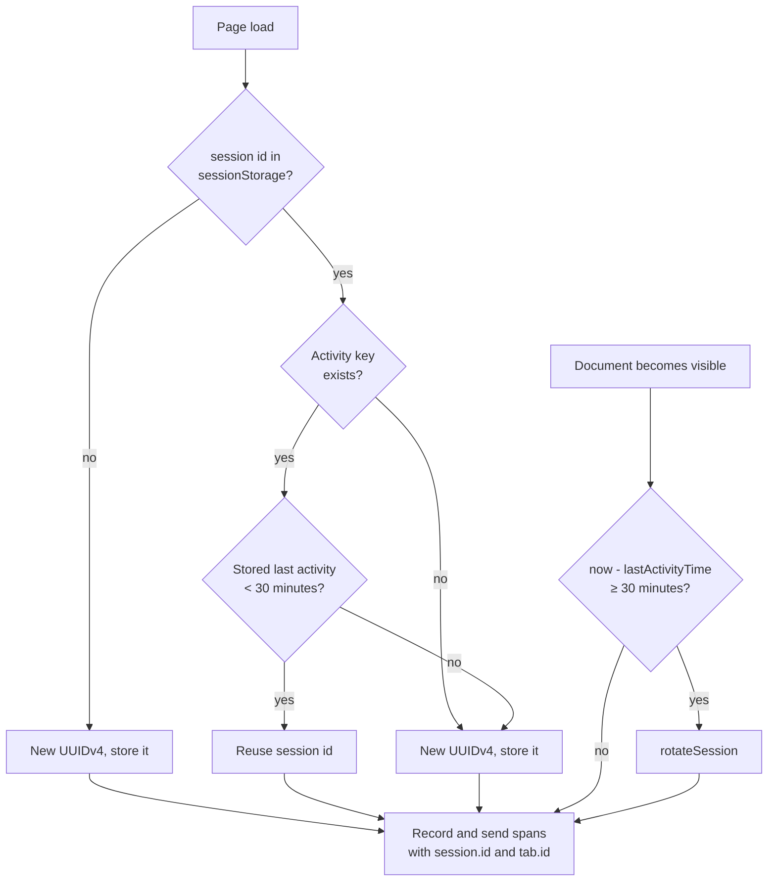
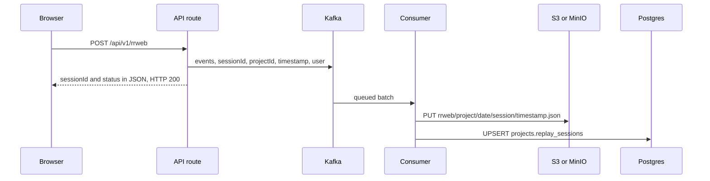
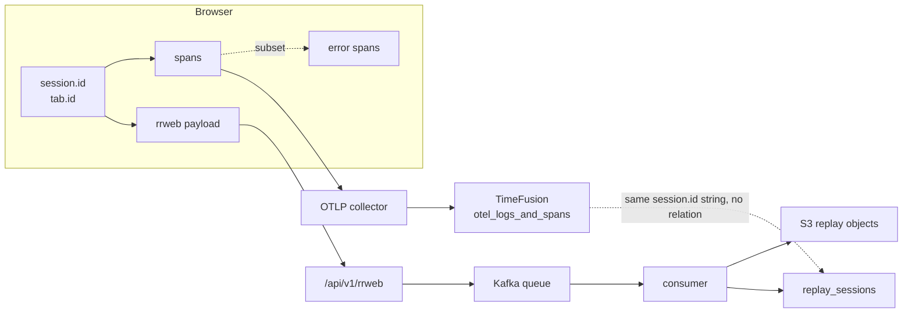

# Browser session recording

**Thesis.** `@monoscopetech/browser` records a user session with rrweb (a browser session recording library), batches events in memory, and posts them to one endpoint. The server acknowledges the request, publishes the payload to a message queue, and a background consumer writes the events to object storage and a session row to Postgres. The same client puts `session.id` on every span that it creates, and that attribute is the main link between a recording and backend telemetry.

Sources: `/Users/darkvoid/GitSources/src.monoscope/monoscope-web` at `8d9678c331f8b4be6fbec4ee0c8219ba701368a3`; `/Users/darkvoid/GitSources/src.monoscope/monoscope` at `1ea47f3580bf9e4069c5081c808c5f4e98a41e52`.

Citations use repository-relative paths. `Replay.hs` means `src/Pages/Replay.hs`; `Telemetry.hs` means `src/Models/Telemetry/Telemetry.hs`; `Routes.hs` means `src/Web/Routes.hs`; `Minio.hs` means `src/Pkg/Minio.hs`. `tracing.ts`, `replay.ts`, and `index.ts` mean `src/tracing.ts`, `src/replay.ts`, and `src/index.ts` in the browser client.

## 1. The client package

```json
// monoscope-web/package.json:2-3
"name": "@monoscopetech/browser",
"version": "0.13.0",
```

| Dependency | Version | Role |
|------------|---------|------|
| `rrweb` | `2.0.0-alpha.20` | Record Document Object Model (DOM) mutations and input events |
| `@rrweb/rrweb-plugin-console-record` | `2.0.0-alpha.18` | Record console output |
| `@opentelemetry/sdk-trace-web` | `^2.0.1` | OpenTelemetry (OTel) web Software Development Kit (SDK); creates spans |
| `@opentelemetry/instrumentation-fetch` | `^0.203.0` | OTel instrumentation; traces `fetch` calls |
| `@opentelemetry/instrumentation-xml-http-request` | `^0.203.0` | OTel instrumentation; traces `XMLHttpRequest` calls |
| `@opentelemetry/exporter-trace-otlp-http` | `^0.203.0` | OTel exporter; sends traces to the collector |
| `@opentelemetry/exporter-logs-otlp-http` | `^0.203.0` | OTel exporter; declared in `package.json`, with no import in `src` |

The public Application Programming Interface (API) is a constructor, not an `init` function:

```ts
// monoscope-web/src/index.ts:276
export default Monoscope;
```

The React wrapper `monoscope-web/src/react.tsx` constructs the same object in `MonoscopeProvider` at lines 15-20. `README.md:40` shows `new Monoscope({ apiKey: "YOUR_API_KEY" })`. The constructor accepts `apiKey`, or the deprecated `projectId` as a fallback, and throws when both are absent (`index.ts:29-33`). It creates the session and tab identifiers, constructs the replay and OTel objects, and then calls `configure` and `start` when recording is enabled (`index.ts:45-72`). Recording is disabled when `config.enabled` is exactly `false` (`index.ts:41`); the client then creates the objects but does not start the recorder, the error tracker (`errors.ts`), the web-vitals collector (`web-vitals.ts`), or the router (`router.ts`).

## 2. The two identifiers

The client uses two identifiers, both random Universally Unique Identifier version 4 (UUIDv4) strings in `sessionStorage`.

```ts
// monoscope-web/src/index.ts:104-121 (condensed)
const storedId = sessionStorage.getItem("monoscope-session-id");
const lastActivity = sessionStorage.getItem(LAST_ACTIVITY_KEY);  // defined at index.ts:12
if (storedId && lastActivity) {
  const elapsed = Date.now() - parseInt(lastActivity, 10);
  if (elapsed < SESSION_TIMEOUT_MS) return storedId;
}
const id = newId();
sessionStorage.setItem("monoscope-session-id", id);
```

The constructor stores the result in `this.sessionId` and gives it to the replay object (`index.ts:40-48`). The same constructor gives the tab identifier to that object.

```ts
// monoscope-web/src/index.ts:125-133
const existing = sessionStorage.getItem("monoscope-tab-id");
if (existing) return existing;
const id = newId();
sessionStorage.setItem("monoscope-tab-id", id);
```

| Property | Session identifier | Tab identifier |
|----------|--------------------|----------------|
| Storage | `sessionStorage` | `sessionStorage` |
| Scope | One tab normally. A duplicated tab can copy the value. Cleared when the tab closes | One tab normally. A duplicated tab can copy the value |
| Rotation | After 30 minutes of inactivity, when the document next becomes visible | Never |
| Key | `monoscope-session-id` | `monoscope-tab-id` |
| Related storage key | `monoscope-last-activity` stores the last activity time that drives rotation | None |

```ts
// monoscope-web/src/index.ts:11-12
const SESSION_TIMEOUT_MS = 30 * 60 * 1000;
const LAST_ACTIVITY_KEY = "monoscope-last-activity";
```

A stored identifier alone is not sufficient. The code reuses it only when `monoscope-last-activity` also exists and the elapsed time is below the timeout. If another script or a storage cleanup removes the activity key, the client creates a new session identifier even though the old identifier is still present. The events that were already sent stay under the old identifier, and later events go under the new identifier.

The source comment refers to multi-page application (MPA) navigations and single-page application (SPA) reloads. It states the intent: "sessionStorage is tab-scoped, so a persisted id naturally identifies a single tab across MPA navigations and SPA reloads" (`index.ts:123-124`).

`sessionStorage` has two consequences that matter for correlation:

1. Two tabs are two sessions, even when one person uses both.
2. A duplicated tab can copy the storage of the original tab, so a session identifier can appear in two tabs.

The client does not reconcile either case.

### 2.1 Rotation

```ts
// monoscope-web/src/index.ts:143-155 (condensed)
rotateSession() {
  this.replay.save();
  this.breadcrumbs.clear();
  const id = newId();
  this.sessionId = id;
  sessionStorage.setItem("monoscope-session-id", id);
  this.replay.updateSessionId(id);
  this.otel.updateSessionId(id);
}
```

Rotation runs only when the document becomes visible and the timeout has elapsed. It does not run on a timer while the tab is hidden, and it does not run on a visibility change to the hidden state. A user who leaves a tab open overnight gets a new session identifier when the tab becomes visible, not at the 30-minute mark.

The call `this.replay.save()` is a promise and rotation does not await it. **Breadcrumbs** are the client's short list of recent actions that the error tracker attaches to an error; rotation clears that list so a new session does not inherit old context. When the save proceeds, it builds the payload and removes the events from the queue before its first wait, so the payload carries the old session identifier. If another save already holds `isSaving` (a Boolean guard flag that a save sets while it runs), the call returns immediately and the queued events stay in the queue; the next save then sends them under the new identifier. A rotation therefore sends one queue either under the old identifier or under the new one. It does not split one batch.

The last activity time is written on every check, not only at rotation:

```ts
// monoscope-web/src/index.ts:135-141
private persistActivity() {
  try {
    sessionStorage.setItem(LAST_ACTIVITY_KEY, Date.now().toString());
  } catch (e) {
    if (this.config.debug) console.warn("Monoscope: failed to persist activity", e);
  }
}
```

```ts
// monoscope-web/src/index.ts:157-164
private checkAndRefreshSession() {
  const now = Date.now();
  if (now - this.lastActivityTime >= SESSION_TIMEOUT_MS) {
    this.rotateSession();
  }
  this.lastActivityTime = now;
  this.persistActivity();
}
```



The diagram has two entries. Page load chooses an identifier. A later visibility change runs the timeout check. The check runs only when the document becomes visible, and it reads the in-memory `lastActivityTime`, not the stored key. The stored key is read only during page-load restoration. `lastActivityTime` advances on click and keydown, at most once every five seconds, and again on each check. A tab that stays visible and idle does not rotate until it is hidden and shown again.

```ts
// monoscope-web/src/index.ts:173-181
let lastTracked = Date.now();
const trackActivity = () => {
  const now = Date.now();
  if (now - lastTracked > 5000) {
    lastTracked = now;
    this.lastActivityTime = now;
    this.persistActivity();
  }
};
```

## 3. What rrweb records

```ts
// monoscope-web/src/replay.ts:77-96 (condensed)
this.stopRecording = rrweb.record({
  emit: (event) => {
    if (!this._enabled) return;
    this.events.push(event);
    if (this.events.length >= MAX_EVENT_BATCH) {
      this.save();
    }
  },
  blockClass: "rr-block",
  maskAllInputs: true,
  maskInputOptions: { password: true, email: true, tel: true },
  maskTextClass: "rr-mask",
  checkoutEveryNms: 15 * 1000,
  ...
});
```

| Option | Value | Effect |
|--------|-------|--------|
| `blockClass` | `rr-block` | Elements with this class are replaced by a placeholder and not recorded |
| `maskAllInputs` | `true` | Every input value is masked |
| `maskInputOptions` | password, email, telephone | Names the sensitive types. The list is redundant while `maskAllInputs` is `true`; it does not narrow the mask |
| `maskTextClass` | `rr-mask` | Text inside this class is masked |
| `checkoutEveryNms` | 15,000 ms | A fresh full snapshot every 15 seconds |

A **full snapshot** is an rrweb event of type 2. It contains the whole document at one moment.

The 15-second checkout limits the distance between a full snapshot and the events that follow it. A player can start from the nearest full snapshot and skip older events, so it may need to replay at most about 15 seconds of events before it reaches the requested moment. The player selects the snapshot; the recorder does not mark a start point.

### 3.1 Sampling

```ts
// monoscope-web/src/replay.ts:97-113
sampling: {
  mouseInteraction: {
    MouseUp: false, MouseDown: false, Click: true, ContextMenu: false,
    DblClick: true, Focus: false, Blur: false, TouchStart: true, TouchEnd: false,
  },
  mousemove: true,
  scroll: 150,
  media: 800,
  input: "last",
},
```

| Setting | Value | Meaning |
|---------|-------|---------|
| `mousemove` | `true` | Record mouse movement |
| `scroll` | 150 | Sample scroll every 150 ms |
| `media` | 800 | Sample media playback every 800 ms |
| `input` | `last` | Keep only the last input event in a burst |
| Clicks | Click, double click, and touch start are recorded | Mouse up, mouse down, context menu, and touch end are not recorded |
| Focus and blur | Not recorded | Focus changes are not in the replay |

Recording every mouse move adds many events, so it increases the payload size. The recording gains a smooth pointer path and loses exact focus timing.

### 3.2 Console capture

```ts
// monoscope-web/src/replay.ts:115-125
plugins: [
  getRecordConsolePlugin({
    level: ["info", "log", "warn", "error"],
    lengthThreshold: 10000,
    stringifyOptions: { stringLengthLimit: 1000, numOfKeysLimit: 100, depthOfLimit: 2 },
  }),
],
```

`lengthThreshold` caps one serialized console message at 10,000 characters. The `stringifyOptions` limits apply inside that message: each string is limited to 1,000 characters, each object to 100 keys, and nesting to 2 levels. A console argument can hold object properties that the page never renders. The console stringifier serializes the object itself, so those properties can enter the recording, up to the string and key limits. The input and text masks do not apply to console arguments.

## 4. Batching and the retry queue

```ts
// monoscope-web/src/replay.ts:5-7
const MAX_EVENT_BATCH = 50;
const SAVE_INTERVAL = 2000;
const MAX_RETRY_EVENTS = 5000;
```

| Trigger | Action | Source |
|---------|--------|--------|
| 50 events queued | `save()` | `replay.ts:81-83` |
| 2 seconds elapsed | `save()` | `replay.ts:128` |
| Page hidden | `save()` | `replay.ts:24` |
| `beforeunload` or `pagehide` | `save(true)` | `replay.ts:23, 36-37` |
| Explicit `stop()` | `save(true)` | `replay.ts:212` |

A normal `save()` returns early when another save is in flight. A forced `save(true)` bypasses that guard so the last batch can leave during an unload. `beforeunload` and `pagehide` can both fire for one page close; the second forced save finds an empty queue and returns without an upload.

If a `fetch` send fails, the events return to the front of the queue in their original order. A `sendBeacon` send does not report a server rejection, so a beacon failure is silent and the events do not return. The queue trims itself only when it holds more than 5,000 events. It keeps every full snapshot, keeps the most recent non-snapshot events that fit the remaining slots, and then sorts the result by timestamp.

```ts
// monoscope-web/src/replay.ts:198-207
} catch (error) {
  console.warn("Monoscope: failed to save replay events:", error);
  this.events = [...eventsToSend, ...this.events];
  this.trimEvents();
} finally {
  this.isSaving = false;
}
```

The catch restores the batch in front of any events that arrived during the request, and `finally` releases the guard on every path, including a thrown error.

```ts
// monoscope-web/src/replay.ts:49-61
private trimEvents() {
  if (this.events.length <= MAX_RETRY_EVENTS) return;
  const fullSnapshots = this.events.filter((e) => e.type === 2);
  const otherEvents = this.events.filter((e) => e.type !== 2);
  const remainingSlots = Math.max(0, MAX_RETRY_EVENTS - fullSnapshots.length);
  this.events = [...fullSnapshots, ...otherEvents.slice(-remainingSlots)];
  this.events.sort((a, b) => a.timestamp - b.timestamp);
}
```

Full snapshots have rrweb event type 2; the rrweb event model uses type 2 for a complete snapshot of the document. They are necessary for playback, so the queue never drops them. The cost is that a long failing period can keep snapshots and lose the events between them. The replay then jumps between snapshots. If the full snapshots alone exceed 5,000, `remainingSlots` is 0. The code then calls `otherEvents.slice(-remainingSlots)`, which is `slice(-0)` and behaves as `slice(0)`; it keeps every non-snapshot event as well. The queue can therefore exceed 5,000 by the whole backlog, not only by the snapshots. This is a code edge case, not the intended trim behavior.

`save` has a reentrancy guard:

```ts
// monoscope-web/src/replay.ts:139-144
async save(forceSynchronous: boolean = false) {
  if (this.isSaving && !forceSynchronous) return;
  if (this.events.length === 0) return;
  this.trimEvents();
  this.isSaving = true;
```

A forced save can run while a normal save is in flight, so two uploads can overlap. The normal save copies the events and clears the queue before it waits. The forced save therefore sends only the events that arrived after that copy. If no events remain, the forced save returns without an upload. Each request is independent; the server does not deduplicate them in the code examined.

## 5. The upload

```ts
// monoscope-web/src/replay.ts:146-162
const apiKey = this.config.apiKey || this.config.projectId || "";  // constructor rejects neither
const baseUrl = `${this.config.replayEventsBaseUrl || "https://app.monoscope.tech"}/api/v1/rrweb`;
const eventsToSend = [...this.events];
this.events = [];
const payload = {
  events: eventsToSend,
  sessionId: this.sessionId,
  tabId: this.tabId,
  timestamp: new Date().toISOString(),
  eventCount: eventsToSend.length,
  user: Object.keys(this.userAttributes).length > 0 ? this.userAttributes : undefined,
  tenant: Object.keys(this.tenantAttributes).length > 0 ? this.tenantAttributes : undefined,
};
const headers = { "Content-Type": "application/json", "Authorization": `Bearer ${apiKey}` };
```

| Payload field | Server use |
|---------------|------------|
| `events` | Stored as raw JavaScript Object Notation (JSON) in object storage |
| `sessionId` | Matched against the unique index on `projects.replay_sessions.session_id`; the table's primary key is a separate `id` column |
| `tabId` | **Not decoded and not stored**; the decoder ignores the unknown field and does not reject the request. The value is in `sessionStorage`, so a browser normally clears it when the tab closes; a duplicated tab copies it before that |
| `timestamp` | Used in the object key path; merge order uses the first event timestamp inside each file, not this field (section 8) |
| `eventCount` | **Not decoded and not stored** |
| `user` | Decoded into `user_id`, `user_email`, `user_name`; flat fields win over nested fields |
| `tenant` | Accepted and ignored; the table has no column |

`userAttributes` and `tenantAttributes` are the objects that the application supplies through `setUser` and `setTenant`. The payload includes each object only when it has at least one key. The decoder reads flat `userId`, `userEmail`, and `userName` first, and uses the nested `user` object only as a fallback; `userName` tries `name` and then `full_name` (`Replay.hs:79-88`).

The `// constructor rejects neither` comment is misleading on its own. The constructor computes `const resolvedKey = config.apiKey || config.projectId;` and throws only when `resolvedKey` is falsy (`index.ts:30-31`). An empty or absent `apiKey` therefore cannot reach the payload when `projectId` is also absent, because construction throws. This fallback is empty only if the configuration object changes after construction. The construction copies the config, so a later change to the caller's object does not affect it; a change through the client's own config object would be needed. The request then sends `Authorization: Bearer ` with no key, and the authentication handler rejects it. The normal path uses `fetch` with `keepalive` only when `body.length` is below 63,000. That number is an internal safety margin below the 64 kibibyte (KiB) body limit that browsers apply to a `keepalive` request; the source gives no derivation, and this exploration did not test the browser limit. The code measures JavaScript string length in 16-bit code units, not bytes. A body with multibyte characters can pass this test and still exceed the browser's byte quota for `keepalive`, which is measured in bytes. When the test fails, the request is sent without `keepalive` and is not guaranteed to finish after the page closes.

```ts
// monoscope-web/src/replay.ts:179-185
const body = JSON.stringify(payload);
const response = await fetch(baseUrl, {
  method: "POST",
  headers,
  body,
  keepalive: body.length < 63000,
});
```

### 5.1 The beacon path cannot send the Authorization header

```ts
// monoscope-web/src/replay.ts:165-176
if (forceSynchronous && typeof navigator !== "undefined" && navigator.sendBeacon) {
  const blob = new Blob([JSON.stringify(payload)], { type: "application/json" });
  const sent = navigator.sendBeacon(baseUrl, blob);
  if (!sent) {
    fetch(baseUrl, { method: "POST", headers, body: JSON.stringify(payload), keepalive: true }).catch(() => {});
  }
}
```

`sendBeacon` has no parameter for request headers. The route is behind the `api-key-auth` authentication handler (`src/Web/Routes.hs:209`; `src/Web/Auth.hs:294-311`). That handler reads the `Authorization` header and strips an optional `Bearer ` prefix (`Auth.hs:103-108`). The normal fetch path therefore works with the client's `Authorization: Bearer <key>` header. The beacon call sends no header, so it cannot present the key.

The fallback `fetch` call does send `headers`, so it can authenticate. The gap is limited to a queued beacon. `sendBeacon` returns `true` when the browser queues the request. It does not report the response. The code therefore does not detect a rejected beacon and does not retry. The last batch before a page unload may be lost. This document marks that as an observed inconsistency in the client, not as a verified end-to-end failure; the server-side behavior for an unauthenticated beacon was not executed in this exploration.

## 6. What the server does with the upload

The consumer writes the event bytes to object storage (Amazon Simple Storage Service, S3, or MinIO) and the session index to Postgres. Kafka is the message queue between the route and the consumer.

```haskell
-- src/Web/ApiHandlers.hs:226
rrwebPost :: mode :- "rrweb" > ReqBody '[JSON] Replay.ReplayPost > Post '[JSON] AE.Value
```

```haskell
-- src/Web/Routes.hs:209
apiV1 :: mode :- "api" > "v1" > AuthProtect "api-key-auth" > NamedRoutes ApiV1Routes
```

The handler does not write storage. It publishes the payload to a queue topic and returns.

The return value has two shapes. On success it is `{"sessionId": ..., "status": "ok"}`. If the publish fails, it is `{"sessionId": ..., "status": "warning", "message": ...}`. Both are a normal HTTP 200 response, because the route type declares a JSON value and does not raise an HTTP error for a failed publish (`Replay.hs:96-101`). A Servant route that returns `Post '[JSON] AE.Value` describes only the response type; the handler chooses the status code, and this handler does not raise one.

```ts
// monoscope-web/src/replay.ts:186-197
if (!response.ok) {
  const status = response.status;
  // ... warning text ...
  throw new Error(`Failed to save replay events: ${status} ${response.statusText}`);
}
```

The client checks only `response.ok`. A 200 reaches the success path even when the body says `"warning"`, so the client removes the events from its queue and does not retry them.

```haskell
-- src/Pages/Replay.hs:92-101 (condensed)
let messagePayload = AE.object
      [ "events" AE..= body.events, "sessionId" AE..= body.sessionId
      , "projectId" AE..= pid, "timestamp" AE..= body.timestamp
      , "userId" AE..= body.userId, "userEmail" AE..= body.userEmail, "userName" AE..= body.userName ]
runSharedProducer ctx (publishJSONToKafka topicName messagePayload ...)
```



The server decoder reads flat `userId`, `userEmail`, and `userName` first. It uses the nested `user` object that this client sends, with `id`, `email`, and `name` or `full_name`, only when the flat field is absent. The flat field wins because older Software Development Kit (SDK) builds send only the flat form. The decoder accepts `tenant` and drops it, because the replay table has no column for it (`Replay.hs:66-85`).

The request type does not include `tabId`:

```haskell
-- src/Pages/Replay.hs:53-60
data ReplayPost = ReplayPost
  { events :: AE.Value
  , sessionId :: UUID.UUID
  , timestamp :: UTCTime
  , userId :: Maybe Text
  , userEmail :: Maybe Text
  , userName :: Maybe Text
  }
```

The handler receives the project identifier from the authentication result, not from the request body: `replayPostH :: Projects.ProjectId -> ReplayPost -> ...` (`Replay.hs:92`). A client cannot choose another project by changing the payload.

The comment above `FromJSON` states the tenant decision: "`@tenant@` is accepted and ignored — `@projects.replay_sessions@` has no column to put it in" (`Replay.hs:77-78`). Nested `user.id`, `user.email`, and `user.name` are accepted as an alternative to the flat fields (`Replay.hs:84-88`).

## 7. Where the bytes live

Events are not rows in Postgres. They are JavaScript Object Notation (JSON) objects in Amazon Simple Storage Service (S3) or MinIO.

```haskell
-- src/Pages/Replay.hs:499-508
replayObjectRoot = "rrweb/"
replayObjectPrefix pid at sid =
  replayObjectRoot <> pid.toText <> "/" <> toText (formatTime ... "%Y-%m-%d" at) <> "/" <> UUID.toText sid <> "/"
```

```text
rrweb/<project>/<YYYY-MM-DD>/<session>/<YYYYMMDDTHHMMSS%q>.json
rrweb/<project>/<YYYY-MM-DD>/<session>/shard-<idx6>-<firstTsMs>.json.gz
```

In the first form, `%q` is the `formatTime` conversion for picoseconds, so the name has sub-second precision. In the second form, `<idx6>` is a zero-padded six-digit shard index, and `<firstTsMs>` is the first event time in milliseconds.

The first form is an individual upload. The second form is a sealed shard. A merge job reads raw upload files, orders them by their first event timestamp, concatenates their event arrays, compresses the result, and writes one immutable shard. It seals the shard when the buffer holds 12 mebibytes (MiB) of uncompressed events or more, so the last file can push a shard past that budget. One merge invocation reads at most 25 files (`Replay.hs:1047-1054`; `Replay.hs:1107-1127`; `Replay.hs:733-735`). An older monolith file can also appear in the shard list as a legacy shard. A monolith file is one file that holds a whole session's events, from a storage format that predates sharding. The manifest orders it with the shards by the timestamp that `parseShardKey` extracts; a key with no parseable timestamp gets 0.

The table tracks both forms in two arrays. `file_keys` lists the individual upload keys that are not yet sealed. `shard_keys` lists the sealed shard keys plus the legacy monolith. `event_file_count` counts the raw uploads that are still unsealed. A merge appends to `shard_keys`, removes only the raw keys it sealed, and recomputes `event_file_count` from the remaining `file_keys` (`Replay.hs:1006-1023`). The upload sets `merged` to `FALSE` when new raw data arrives. A merge sets `merged` to `TRUE` only when no raw key remains, so the cron (a scheduled background job, section 11) selects the row until the session is fully sealed (`Replay.hs:368, 1031-1035`).

Postgres holds the index:

```sql
-- static/migrations/0029_replay_sessions.sql:2-13
CREATE TABLE IF NOT EXISTS projects.replay_sessions (
  id BIGSERIAL PRIMARY KEY,
  session_id UUID NOT NULL,
  project_id UUID NOT NULL REFERENCES projects.projects(id),
  last_event_at TIMESTAMPTZ NOT NULL DEFAULT current_timestamp,
  merged BOOLEAN NOT NULL DEFAULT FALSE,
  created_at TIMESTAMPTZ NOT NULL DEFAULT now(),
  updated_at TIMESTAMPTZ NOT NULL DEFAULT now()
);
CREATE UNIQUE INDEX IF NOT EXISTS idx_replay_sessions_session_id
  ON projects.replay_sessions(session_id);
```

Later migrations add `event_file_count`, `file_keys`, `user_id`, `user_email`, `user_name`, `merge_started_at`, and `shard_keys`. The insert uses `ON CONFLICT (session_id)` and appends the new file key:

```sql
-- src/Pages/Replay.hs:764-778 (condensed)
INSERT INTO projects.replay_sessions
  (session_id, project_id, last_event_at, event_file_count, file_keys, user_id, user_email, user_name)
VALUES (...)
ON CONFLICT (session_id) DO UPDATE SET
  last_event_at = ..., merged = FALSE,
  event_file_count = projects.replay_sessions.event_file_count + 1,
  file_keys = array_append(projects.replay_sessions.file_keys, EXCLUDED.file_keys[1]),
  user_id = COALESCE(EXCLUDED.user_id, projects.replay_sessions.user_id), ...
```

The `VALUES` list supplies a one-element `file_keys` array for the new row; the conflict path appends `EXCLUDED.file_keys[1]`, the same key, to the existing array.

The unique index is on `session_id` alone, not on `(project_id, session_id)`. The design therefore assumes that no two projects ever send the same session identifier. The client generates a random UUIDv4, so a collision is extremely unlikely, but the database does not scope the identifier to a project. If a collision occurred, the `ON CONFLICT (session_id)` path would append the second project's file key to the first project's session row and would not change that row's `project_id`. The code has no collision check. This consequence is an inference from the schema and the conflict statement, not an observed behavior.

## 8. Reading a replay back

```text
GET /p/:projectId/replay_session/:sessionId
GET /p/:projectId/replay_session/:sessionId/manifest
GET /p/:projectId/replay_session/:sessionId/shard?key=<objectKey>
```

These routes use the cookie session and project membership, not an API key.

A **manifest** is the ordered list of segment keys that the player fetches. The manifest puts sealed shards first, ordered by the first event timestamp embedded in the shard key. It then appends the unmerged tail in the order of the `file_keys` array:

```haskell
-- src/Pages/Replay.hs:867-874
(shardKeys, tailKeys) <- sessionKeys pid sessionId
let shardSegs = sortOn (.firstTs) [ReplaySegment{key = k, firstTs = fromIntegral (maybe 0 snd (parseShardKey k))} | k <- shardKeys]
    tailTs = maybe 0 (.firstTs) (viaNonEmpty last shardSegs)
    tailSegs = [ReplaySegment{key = k, firstTs = tailTs} | k <- tailKeys]
    segs = shardSegs <> tailSegs
```

The manifest does not sort the tail. Every tail segment gets the first-event timestamp of the last shard (`firstTs`), so the tail stays after all shards in the segment list. The array order is append order, not timestamp order. When there are no shards, `maybe 0` gives the tail a timestamp of 0, which is the Unix epoch; the tail is then the only group.

A **player** is the browser viewer that plays the replay. The manifest and the full read use different orders. The manifest is the list that the player fetches to find segment keys. The full read is a server-side path that returns the combined event array. It fetches every key and orders two groups by first event timestamp. In this snippet, `shards.ok` is the list of sealed shards that the server fetched and decoded successfully, and `individuals` is the list of unsealed raw files that it fetched and decoded successfully, each paired with its first event timestamp (`Replay.hs:545-562`, `Replay.hs:565-589`). A key that is absent from storage is `NoSuchKey`; the code drops it without marking the read partial. The document reads that behavior as a concurrent merge that already sealed the file. That reading is an inference about intent; the code only drops the key. A decode error or a transport error drops the key and marks the read partial (`Replay.hs:550-551`, `Replay.hs:565-568`):

```haskell
-- src/Pages/Replay.hs:631-633 (condensed)
indivBlob = concatRawJsonArrays $ map snd $ sortWith fst individuals
indivEntry = [(fromRight 0 (firstEventTimestampRaw indivBlob), indivBlob) | not (null individuals)]
combined = concatRawJsonArrays $ map snd $ sortWith fst (shards.ok <> indivEntry)
```

The individual tail is first sorted among itself by file timestamp and concatenated into one blob. That blob then takes its timestamp from its first event and is ordered against the shards. The result is ordered by file group, not by event. Two files with the same first event timestamp keep their input order, because the sort is stable; the code has no explicit tie-break rule.

The merge job orders the files inside each shard by their first event timestamp before it seals the shard (`Replay.hs:1118-1122`). It does not reorder events inside one raw file, and it does not sort across shards. That does not create a global order. A shard boundary falls on the 12 MiB budget over the sorted file-key order, so two shards can overlap in event time, and the reader places the whole shard before or after another. **The reader** here means the full-read function, not the browser player. It never merges events across file boundaries. In the full read, the tail blob takes the timestamp of its first event after its files are sorted and concatenated. A slow upload that contains an old event can therefore place the whole tail before a newer shard.

## 9. Privacy

| Control | Effect | Limit |
|---------|--------|-------|
| `rr-block` class | Element replaced by a placeholder | The developer must add the class |
| `rr-mask` class | Text masked | The developer must add the class |
| `maskAllInputs` | Every input value is masked, whatever its type | Text outside an input is not masked |
| `maskInputOptions` | Password, email, and telephone are named | The list is redundant while `maskAllInputs` is `true`; it does not narrow the mask |
| Console plugin | Console text recorded | Console arguments are not masked |
| `setUser` | User fields sent with the replay | The values are not masked |

`setUser` copies the user fields into the replay attributes and into the tracing manager (`replay.ts:235-237`; `index.ts:199-207`). The next replay batch carries the fields, and the server stores them on the session row. The tracing manager adds them to later spans. The recorder does not mask them, so a user identifier or email address that the application sends is stored as sent. In debug mode, the client warns about keys outside `id`, `email`, `name`, `full_name`, and `roles`, but it still sends them (`index.ts:200-204`). The server decoder accepts only `id`, `email`, `name`, and `full_name`; a `roles` field is not stored on the session row.

The client has no automatic detection of credit card numbers, national identifiers, or personal names. Input masking is on by default, but all other masking is opt-in by Cascading Style Sheet (CSS) class. A recording of a page that shows personal data in text will contain that text unless the developer marks the element.

## 10. Correlation with telemetry

The replay payload carries `sessionId`, but the stronger correlation is on the trace side. Every span that the browser client creates carries the session and tab attributes, because `emitSpan` and the other span paths call `applyCommonAttrs` (`tracing.ts:334-346`, `573-591`):

```ts
// monoscope-web/src/tracing.ts:336-346 (condensed)
"session.id": this.sessionId,
"tab.id": this.tabId,
"pageview.id": this.pageviewId,
"page.url": location.href,
"page.title": document.title,
```

```ts
// monoscope-web/src/tracing.ts:302-309
const baggage = propagation.createBaggage({
  "session.id": { value: this.sessionId },
  "tab.id": { value: this.tabId },
});
```

`pageview.id` names one view in the browser client. It changes on a route change and is not a server join key. **Web vital metrics** are the browser performance measurements that the client sends on the OTel metrics signal, such as loading and interaction timings.

The baggage travels with outgoing `fetch` and `XMLHttpRequest` calls through the World Wide Web Consortium (W3C) baggage propagator. The OpenTelemetry propagator writes the baggage header on each outgoing request; the application does not add the header by hand (`tracing.ts:300-309`, `388-389`). A backend that reads baggage can attach the same values to its own spans. The trace exporter sends them to an OpenTelemetry Protocol (OTLP) collector.

| Signal | Destination | Authentication | Source |
|--------|-------------|----------------|--------|
| Traces | `https://otelcol.monoscope.tech/v1/traces` | `x-api-key` header | `tracing.ts:198-201` |
| Web vital metrics | `https://otelcol.monoscope.tech/v1/metrics` | `x-api-key` header | `tracing.ts:198-201` |
| Replay events | `https://app.monoscope.tech/api/v1/rrweb` | `Authorization: Bearer` | `replay.ts:147, 178` |
| Logs | None | The client does not export OTel logs | `package.json`; `src` |

Errors are spans, not logs:

```ts
// monoscope-web/src/errors.ts:73-94 (condensed)
window.onerror = (...) => {
  this.emit("exception", "uncaught_exception", ...);
};
```

`emit` is the error tracker's span emitter. The constructor passes it the OTel manager's `emitSpan` function (`index.ts:50`). `createErrorSpan` calls that emitter (`errors.ts:51-68`). Because an error span passes through `emitSpan`, which calls `applyCommonAttrs`, it carries `session.id` and `tab.id` (`tracing.ts:573-591`). The OpenTelemetry tracer gives the span its own trace identifier, so the error is linked to its trace without any help from the replay. The client does not put a trace identifier in the replay payload.



Error spans are a subset of all spans. The dotted arrow marks that relation; it is not a second data flow. The diagram draws `E` separately to show that errors are not log records.

TimeFusion is the telemetry store. It holds traces and logs in its `otel_logs_and_spans` table and metrics in a separate metrics table. It does not hold replay events. Document 06 gives the table list.

The dotted line is the only join: both sides store the same `session.id` string. There is no foreign key and no write that creates a relation between a replay session and a trace.

The source names three object stores in different places: S3, MinIO, and Cloudflare R2. They are the same role behind one storage interface. The replay code performs every object read, write, and delete through `Storage.runMinio`, which is a thin wrapper over the `minio-hs` client (`src/Pkg/Minio.hs:1-13`; `Replay.hs:578`, `620`, `754`, `894`, `1106`, `1123`, `1173`). The comments say that the interface works with R2 and that `minio-hs` cannot list R2 buckets. That is why every key list comes from Postgres and never from a bucket listing (`Replay.hs:646-653`). This statement is about the replay code, not about every object operation in the server; other modules that use object storage were not part of this check.

## 11. Retention and size limits

| Limit | Value | Source |
|-------|-------|--------|
| Replay retention, default storage | 30 days | `Replay.hs:1130-1132` |
| Expiry batch | 200 sessions per run | `Replay.hs:1135-1138` |
| One queue message | 100 MiB | `Replay.hs:118-119` |
| One processing call | 64 MiB | `Replay.hs:122-123` |
| Merge threshold | 14 files | `Replay.hs:726-727` |
| Files per merge | 25 | `Replay.hs:734-735` |
| Shard size | 12 MiB uncompressed | `Replay.hs:1053-1054` |
| Client queue | 5,000 events | `replay.ts:7` |
| Client batch | 50 events | `replay.ts:5` |
| Client interval | 2 seconds | `replay.ts:6` |

"One queue message" is the largest replay message that the consumer accepts; a larger message becomes a poison message for the dead-letter queue and increments a metric, so it does not block the queue (`Replay.hs:313-331`). "One processing call" is the byte budget for one `processReplayEvents` call. The worker splits its input into chunks under that budget and lets the garbage collector reclaim each chunk.

The three merge limits work at different scopes:

- **14 files** is the threshold that triggers a merge for a session.
- **25 files** is the cap on files processed in one merge invocation. A larger backlog drains in several passes, and the job re-enqueues itself (`Replay.hs:1040-1044`).
- **12 MiB** is the uncompressed budget for one sealed shard inside a merge (`Replay.hs:1047-1054`).

The merge has two triggers. The upload path enqueues a merge job when the session's file count reaches an exact multiple of 14, so a busy session does not enqueue one job per upload (`Replay.hs:784-790`). The hourly scheduler also enqueues the batch job `CompressReplaySessions`, which selects at most 100 sessions with `merged = FALSE` and `last_event_at` older than 30 minutes (`BackgroundJobs.hs:1484`; `Replay.hs:918-929`). The 30-minute quiet period lets a session settle before it is sealed. A session that keeps sending events therefore waits for the first hourly pass after it goes quiet.

The expiry job runs in batches of 200 sessions. After it deletes a batch, it re-enqueues itself when the batch contained the full 200 rows (`Replay.hs:1130-1184`). It deletes object storage first, then the row, and it keeps the row when an object delete fails with an error other than "no such key", so a later run can retry. A **default-storage project** is a project with no `s3_bucket` value of its own; it uses the Monoscope-managed bucket. The query selects those projects with `WHERE p.s3_bucket IS NULL`, so a bring-your-own-bucket project is not selected. A bring-your-own-bucket project must apply its own lifecycle policy.

## 12. The Aha moments

**Aha: the tab identifier is sent, but no server field uses it.** The client puts `tabId` in every replay upload and on every span that it creates. The replay request type has no `tabId` field, the replay table has no column, and a repository-wide search finds no server query that reads `tab.id`. The value can still sit inside the generic span `attributes` JSONB when a span carries it, because the server stores the attribute map and promotes known keys to columns (`0002_logs_traces_metrics.sql:126`; `ProcessMessage.hs:459`). No `attributes___tab___id` column exists in the migrations, and no index, view, or query uses the key. The replay path drops it. Tab-level analysis is therefore not available from any designed server field, even though the client collects the value.

**Aha: a failed publish still returns HTTP 200.** The handler answers with `status: "warning"` when the queue publish fails. The status code is 200, and the client checks only `response.ok`. The batch is then removed from the queue and never retried. A queue outage can therefore lose recordings without a visible error in the browser console.

**Aha: the unload beacon cannot authenticate.** `sendBeacon` cannot set an `Authorization` header, and the replay route requires one. The fallback `fetch` can authenticate, but it runs only when the browser refuses to queue the beacon. The normal path works. The last batch before an unload may not. The failure is silent because `sendBeacon` reports only whether the request was queued, not whether the server accepted it.

**Aha: the replay index is not in TimeFusion.** Traces, backend logs, and metrics live in TimeFusion, but replay events live in S3 with an index in Postgres. The browser client itself exports no logs; backend services send the logs. The source says so directly: "Replays are Postgres-only — projects.replay_sessions is the session index; rrweb payloads live in S3/R2 and never reach TimeFusion" (`Telemetry.hs:1256-1257`). Here "Postgres-only" means the replay metadata never enters TimeFusion. The event payloads are still in object storage, and the session index is in Postgres.

## 13. Next

Read [06-incidents-and-timelines.md](06-incidents-and-timelines.md) for how a session, a trace, and an error become a timeline. Read [07-comparison-and-assessment.md](07-comparison-and-assessment.md) for the assessment.

Back to [README.md](README.md).
