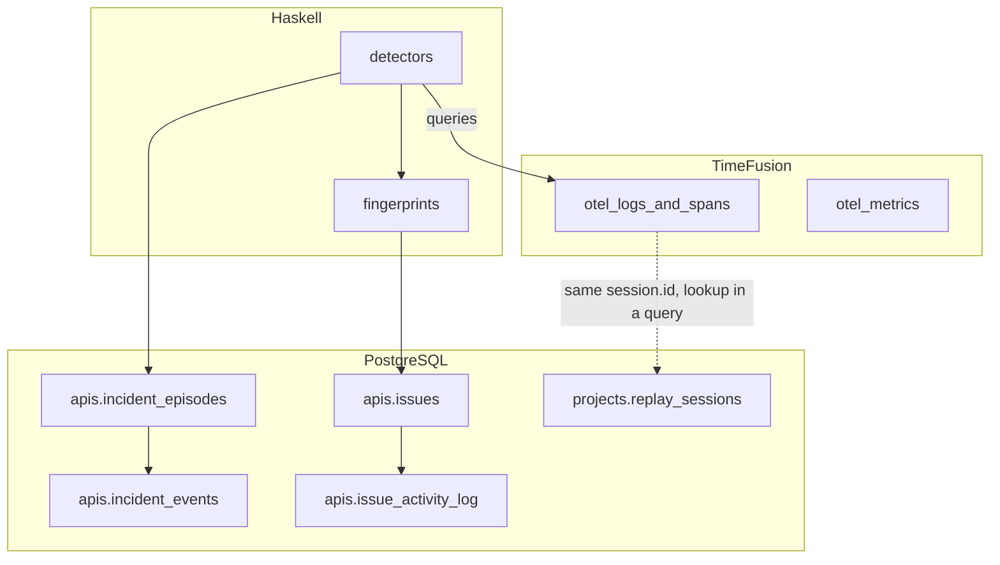
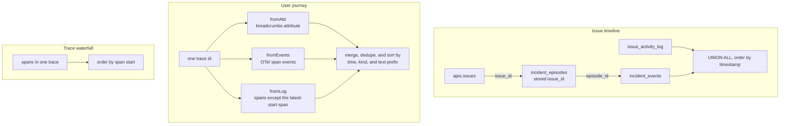
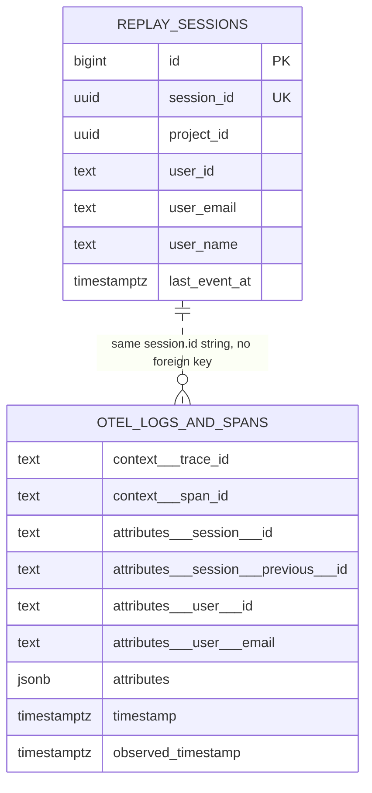

# Incidents and timelines

**Thesis.** Monoscope groups observations into issues with a fixed fingerprint, records incident episodes as a delivery ledger, and presents three different timelines. None of the three is a unified session-to-backend timeline. The issue timeline links an incident episode to an issue by a stored key. A browser session relates to backend telemetry only by the `session.id` attribute on spans, not by a stored relation.

Sources: `/Users/darkvoid/GitSources/src.monoscope/monoscope` at `1ea47f3580bf9e4069c5081c808c5f4e98a41e52`; TimeFusion at `d32177040f19fa861290ed316ef7f25813c8bce4`.

Terms used here: a **session** is one value of `session.id`. On the replay side, it names one replay row; on the telemetry side, it names the same value on spans. Two browser tabs can write to the same replay row, so a session is not always one visit. A **trace** is a tree of spans that share one `trace_id`. A **span** is one timed operation inside a trace. An **issue** is the triage row that a person can acknowledge, assign, archive, and discuss. An **incident episode** is one active period of a monitored source. A **timeline** is an ordered list of rows that answers one question about one subject. A **baggage** is a World Wide Web Consortium (W3C) header that carries key-value context on outbound requests. A **fingerprint** is a hash that groups equivalent observations; section 3 gives its inputs. A **delivery ledger** is the record of each incident observation and each notification attempt; section 4 gives its rows. **Delta Lake** is a table format for object storage; TimeFusion uses it, and the replay store does not.

## 1. Where the state lives

| State | Store | Module |
|-------|-------|--------|
| Issues, incidents, episodes | PostgreSQL | `src/Models/Apis/Issues.hs`, `src/Models/Apis/Incidents.hs` |
| Issue activity log | PostgreSQL | `apis.issue_activity_log`, written by the issue mutation paths and read in section 6.1 |
| Error patterns and fingerprints | PostgreSQL | `src/Pkg/ErrorFingerprint.hs`, `src/Models/Apis/ErrorPatterns.hs` |
| Detection jobs and thresholds | Haskell | `src/BackgroundJobs.hs` |
| Spans, logs, metrics, telemetry events | TimeFusion | `src/Models/Telemetry/Telemetry.hs` |
| Replay index | PostgreSQL | `projects.replay_sessions` |
| Replay bytes | Amazon Simple Storage Service (S3) or MinIO | `src/Pages/Replay.hs` |

The Module column names the Haskell module that reads or writes the state, or the table that holds it. It does not name the store itself.

TimeFusion is the Rust telemetry service. It stores logs, traces, metrics, and events as Delta Lake tables on S3-compatible object storage, and it answers SQL over the PostgreSQL wire protocol. A Delta Lake table is a directory of data files with a transaction log; it is not a PostgreSQL table. An **event** here is one telemetry record in a Delta table; the TimeFusion README gives `otel_logs_and_spans` as an example (`timefusion/README.md:7-8, 76-77`). It is not an `apis.incident_events` row. Apache DataFusion is its query engine, not a separate store. TimeFusion contains no issue, incident, or grouping logic. A case-insensitive search for `incident` across `timefusion/src` at the pinned commit returned operational comments, one maintenance migration name, and test names; it found no detector, incident table, or grouping function. That is an absence in the examined source, not a claim about a running deployment.



The dotted arrow is a query-time match, not a stored foreign key. The diagram has three chains. A detector writes a fingerprint and then an issue. A detector writes an episode and then an incident event. An issue owns activity-log rows. The detectors read TimeFusion; they do not write to it.

## 2. The issue is a triage object

```haskell
-- src/Models/Apis/Issues.hs:360-374
data IssueType
  = ApiChange | RuntimeException | QueryAlert | LogPattern | LogPatternRateChange
  | Performance | Frontend | Uptime | Cron | Feedback
```

The module header states the semantics: an issue is the triage object; an Application Programming Interface (API) change groups endpoint drift; a runtime exception is one issue per error pattern; a query alert is long-lived and can reopen (`Issues.hs:3-17`). In this section and in the first table, a citation that says only `Issues.hs` means `src/Models/Apis/Issues.hs`. Section 6 states the full path whenever the page module could be meant instead. A **triage object** is the row that a person can acknowledge, assign, archive, and discuss. An **error pattern** is the normalized group of errors that share a fingerprint.

| Issue type | Meaning | Source |
|------------|---------|--------|
| `ApiChange` | Endpoint, shape, or format drift, grouped by endpoint | `Issues.hs:3-17` |
| `RuntimeException` | One issue per error pattern | `Issues.hs:3-17` |
| `QueryAlert` | A monitor threshold breach. It is long-lived and reopens instead of duplicating on each firing | `Issues.hs:3-17` |
| `LogPattern` | A log signal | `Issues.hs:3-17` |
| `LogPatternRateChange` | A change in the rate of a log pattern | `Issues.hs:3-17` |
| `Performance` | A performance detector signal | `Issues.hs:360-374`; section 5 below |
| `Frontend` | A frontend detector signal, such as a rage click or a dead click | `Issues.hs:360-374`; `BackgroundJobs.hs:5841-5869` |
| `Uptime` | An uptime monitor result | `Issues.hs:360-374`; `BackgroundJobs.hs:5046-5047` |
| `Cron` | A cron monitor failure, missed or failed | `Issues.hs:360-374, 378` |
| `Feedback` | A user feedback record | `Issues.hs:360-374, 386-399` |

The grouping key is `target_hash`, a text column. A **partial unique index** enforces uniqueness only for rows that match a condition. Here the condition is "open": the index applies only while `acknowledged_at` and `archived_at` are null. The same key can therefore appear again in a closed issue. The index is the mechanism, and `target_hash` is the column it compares. For an error the column holds the chosen fingerprint hash. For a monitor it holds the monitor identifier, so a monitor has exactly one open issue per issue type (`Issues.hs:759`).

```sql
-- static/migrations/0032_log_patterns.sql:79-81
CREATE UNIQUE INDEX ... ON apis.issues (project_id, target_hash, issue_type)
  WHERE acknowledged_at IS NULL AND archived_at IS NULL;
```

An open issue is unique for one project, one target hash, and one issue type. A repeat detection does not create a second row.

```sql
-- src/Models/Apis/Issues.hs:811-828 (condensed)
ON CONFLICT (project_id, target_hash, issue_type)
  WHERE acknowledged_at IS NULL AND archived_at IS NULL
DO UPDATE SET updated_at = EXCLUDED.updated_at,
  affected_requests = apis.issues.affected_requests + EXCLUDED.affected_requests,
  issue_data = EXCLUDED.issue_data
    || jsonb_build_object('occurrence_count',
         (apis.issues.issue_data->>'occurrence_count')::bigint
         + COALESCE((EXCLUDED.issue_data->>'occurrence_count')::bigint, 1))
    || jsonb_build_object('first_seen', apis.issues.issue_data->'first_seen')
RETURNING id;
```

The upsert preserves `first_seen` and increments `occurrence_count`. The `occurrence_count` lives inside the `issue_data` JavaScript Object Notation (JSON) object, not in a table column. The separate `affected_requests` column is also incremented. The index covers only rows whose `acknowledged_at` and `archived_at` are both null. When a person acknowledges or archives an issue, a later detection opens a new issue instead of reviving the old one. The exception is an explicit reopen: `reopenIssue` clears `acknowledged_at`, `acknowledged_by`, `acknowledged_until`, and `archived_at`, and the old row returns to the open set (`Issues.hs:874-875`). The reopen function does not test whether another open row already holds the same `(project_id, target_hash, issue_type)`. If one does, the partial unique index rejects the update, so the reopen fails instead of merging the two rows. This is an inference from the index definition, not an observed error path.

## 3. The fingerprint decides the group

An error fingerprint is the 64-bit xxHash of a string, rendered as 16 hexadecimal characters, of which the code keeps the first 8. xxHash is a fast non-cryptographic hash (`Utils.hs:772-773`). The result is 8 lowercase hexadecimal characters, left-padded with `0` if the rendered value is shorter. The hash input depends on the information that is available.

```haskell
-- src/Pkg/ErrorFingerprint.hs:393-405 (condensed)
computeErrorHashes ... = ErrorHashes{narrow = go spanName, broad = go Nothing, shape}
  where
    shape = shapeWithMasks [] projectId exceptionType message
    go sn = hashParts $ projectId : serviceName :
      bool [fromMaybe "" sn, typ, msg] [typ, normalizeStackTrace stack] (not $ T.null stack)
  -- Framework transport errors take a different branch:
  -- narrow = broad = hashParts [projectId, "transport", typ, msg]
```

```haskell
-- src/Pkg/ErrorFingerprint.hs:408-409
hashParts = toXXHash . T.intercalate "|" . filter (not . T.null)
```

The module produces three hashes:

| Hash | Input | Use |
|------|-------|-----|
| Narrow | Project, service, then span name, error type, and message; or error type and stack when a stack exists | Route identity only when no stack exists; otherwise equal to the broad hash |
| Broad | Project, service, then error type and message; or error type and stack when a stack exists | Cross-route rollup |
| Shape | Project, exception type, and error text; the detection call passes no learned masks | Review grouping |

The first two rows are identical when a stack exists, because the `bool` selects the stack branch for both. The narrow and broad hashes differ only for an error with no stack. The broad hash then drops the route name, and the narrow hash keeps it.

At detection time the shape hash uses an empty mask list (`shapeWithMasks []`), so it contains no learned masks. The masks are learned later from observed variation (`ErrorFingerprint.hs:485-573`).

```haskell
-- src/Models/Apis/Issues.hs:4220-4245 (condensed)
let (isFramework, targetHash) = maybe (False, p.hash) (True,) (p.parentHash <* guard p.isFramework)
```

The **parent hash** is the broad hash of an error pattern, used for rollup. `isFramework` is a stored Boolean on the error pattern. The tuple section `(True,)` sets the first element of the result pair to `True` and keeps the parent hash as the second element. The first element therefore says that the parent branch was taken. A framework or transport error uses the parent hash when a parent hash exists and the pattern is marked as framework noise. The guard `p.parentHash <* guard p.isFramework` returns the parent hash only when both conditions hold, so a non-framework pattern keeps its own hash. `p.hash` is the pattern row's stored hash, and the pattern store writes `hashes.narrow` into that column (`Telemetry.hs:2513`). An application error therefore keeps the narrow hash. The narrow hash carries route identity only when the error has no stack. When a stack exists, the `bool` selects the same input for narrow and broad, so the stored hash carries no route name.

Message normalization keeps the first two non-empty lines and truncates a JSON body above 512 characters to `{json}`:

```haskell
-- src/Pkg/ErrorFingerprint.hs:311-319 (condensed)
normalizeMessage msg =
  let lns = take 2 $ filter (not . T.null . T.strip) $ T.splitOn "\n" $ T.replace "\r\n" "\n" msg
      combined = T.intercalate " " $ map T.strip lns
      (prose, json) = T.breakOn "{\"" combined
      collapsed = if T.compareLength json 512 == GT then prose <> "{json}" else combined
   in T.strip $ replaceAllFormats collapsed
```

The small JSON body is kept, because the source comments that it usually tells two failures apart. A large dump is removed from the hash. The comparison applies only to the combined first two non-empty lines. A JSON body after those lines is not part of the hash input at all. Stack normalization does not keep file and line detail. It parses the frames, keeps the last in-application frame, strips memory addresses, generic type parameters, and parameter lists, and reduces the frame to `module|function` (`ErrorFingerprint.hs:265-281`). A stack with no in-application frame uses its last frame of any kind. Learned masks are derived from observed variation (`ErrorFingerprint.hs:485-573`). A **mask** is a variable region that the derivation removes from the shape input; the shape hash at detection time uses none.

## 4. Incident episodes are a separate ledger

An incident episode is not an issue. It records that a source entered an active state and stores the notification payloads for that episode in `root_payload` and `reply_payload`. A monitor is a configured check, such as a query monitor or an uptime check. In this code, "incident" names the source's active condition, and "episode" names one active period of that condition. A source can have several episodes over time, but only one active episode at a time.

```sql
-- static/migrations/0153_incident_delivery.sql:18-22 (condensed)
CREATE UNIQUE INDEX incident_one_active_episode
  ON apis.incident_episodes(project_id, source_kind, source_id) WHERE phase = 'active';
CREATE INDEX incident_source_history
  ON apis.incident_episodes(project_id, source_kind, source_id, started_at DESC);
```

The identifiers `episode_id`, `project_id`, `source_id`, and `actor_id` are Universally Unique Identifiers (UUIDs). `source_kind` is text, and `observed_at` is a timestamp.

```sql
-- static/migrations/0153_incident_delivery.sql:23-38 (condensed)
CREATE TABLE apis.incident_events (
  episode_id UUID NOT NULL, project_id UUID NOT NULL,
  source_kind TEXT NOT NULL, source_id UUID NOT NULL,
  event_kind TEXT NOT NULL CHECK (event_kind IN ('alert', 'reminder', 'recovered', 'resolved')),
  observed_at TIMESTAMPTZ NOT NULL, actor_id UUID,
  root_payload JSONB NOT NULL, reply_payload JSONB NOT NULL,  -- JSONB is a binary JSON type
  FOREIGN KEY (episode_id, project_id) REFERENCES apis.incident_episodes(id, project_id) ON DELETE CASCADE,
  UNIQUE (project_id, source_kind, source_id, observed_at, event_kind)
);
```

| Concept | Meaning | Source |
|---------|---------|--------|
| Source kind | `monitor`, `issue`, or `error` | `src/Models/Apis/Incidents.hs:93-96, 184-187`; migrations 0153 and 0166 |
| Episode | One active period for one source | Migration 0153 |
| Event | A delivery or observation inside an episode | Migration 0153, 0154 |
| Closed episode | `phase` is not `active` | Migration 0153 |

A source is one of three typed identifiers: a query monitor (`MonitorIncident QueryMonitorId`), an issue (`IssueIncident IssueId`), or an error pattern (`ErrorIncident ErrorPatternId`) (`src/Models/Apis/Incidents.hs:93-96`). `sourceFields` maps those constructors to the strings `"monitor"`, `"issue"`, and `"error"` (`:184-187`). The pair `(source_kind, source_id)` is therefore a typed reference, not a free-form label. Migration 0153 allowed only `monitor` and `issue` in its check constraint. Migration 0166 replaces both `source_kind` check constraints in `incident_episodes` and `incident_events` so that `error` is also a valid value (`static/migrations/0166_error_incident_source.sql:1-8`).

The write path takes a transaction-scoped advisory lock before it validates the source. The lock key is a hash of the project, source kind, and source identifier, so two writers for one source serialize without blocking other sources (`src/Models/Apis/Incidents.hs:570-574`). A hash collision serializes two unrelated sources, which costs time but does not change identity. It then rejects duplicate events:

```haskell
-- src/Models/Apis/Incidents.hs:594-614 (condensed)
duplicate <- queryTx @[(EpisodeId, IncidentEventId)]
  [HI.sql|SELECT episode_id, id FROM apis.incident_events
    WHERE project_id = #{pid} AND source_kind = #{sourceKind} AND source_id = #{sourceId}
      AND observed_at = #{at} AND event_kind = #{eventKind}|]
case listToMaybe duplicate of
  Just (eid, eventId) -> pure $ AlreadyRecorded eid eventId
  Nothing | not sourceActionable -> pure $ Rejected InactiveIncidentSource
  Nothing -> do
    latest <- latestEpisodeTx pid update.source
    case latest of
      Just episode | at < episode.lastEventAt -> pure $ Rejected OlderThanCurrentEpisode
      _ -> ...
```

Duplicate detection uses `(project_id, source_kind, source_id, observed_at, event_kind)`. An event older than the latest episode's `last_event_at` is rejected. The examined insert path does not update or delete an event row, so the event ledger grows inside one episode and a late event cannot reorder a closed episode. The document does not trace every update path for the episode row itself.

An episode also carries an optional `issue_id`. The write path reuses the active episode when one exists. When it creates a new episode, it requires an issue identifier; a create attempt with no issue returns `EpisodeWithoutIssue` (`src/Models/Apis/Incidents.hs:603-623`). The source comment gives the reason: every episode is read from its issue page, so an episode with no issue is unreachable. The later update writes `issue_id = COALESCE(issue_id, #{issueId})`, so the first non-null issue sticks (`:630-631`). This stored column is the edge that the issue timeline uses; the correlation in section 7 is a different mechanism.

## 5. The detectors

```mermaid
flowchart LR
    subgraph SIGNALS["Signals"]
        S1["schema anomaly trigger"]
        S2["query monitor result"]
        S3["hourly error stats"]
        S4["log templates"]
        S5["frontend clicks"]
        S6["uptime and cron checks"]
    end
    S1 --> D1["processAPIChangeAnomalies"]
    S2 --> D2["evaluateQueryMonitor"]
    S3 --> D3["detectErrorSpikes"]
    S4 --> D4["detectLogPatternSpikes"]
    S5 --> D5["detectFrontendIssues"]
    S6 --> D6["applyUptimeResult / evaluateCronMonitor"]
    D1 --> I["issue upsert"]
    D2 --> I
    D3 --> I
    D4 --> I
    D5 --> I
    D6 --> I
```



| Detector | Method | Threshold or rule | Source |
|----------|--------|-------------------|--------|
| API change | Database trigger on schema entities | Any field or format drift on an endpoint | `0001_create_monoscope_tables.sql:336, 404-407`; `BackgroundJobs.hs:3501-3525` |
| Query monitor | Threshold with recovery hysteresis | Monitor configuration | `BackgroundJobs.hs:5473-5486` |
| Error spike | Mean and standard deviation of the baseline | z-score above 3.0 and current count above mean plus 50 | `BackgroundJobs.hs:5509-5513, 5758-5760` |
| Log spike or drop | Mean and scaled median absolute deviation (MAD) of the baseline | Absolute z-score above 3.0, an absolute change above 50, and a baseline floor of 500 for a spike or 2,000 for a drop | `BackgroundJobs.hs:5520-5522, 5551-5566, 5604-5612` |
| New log pattern | Event count | At least 2,000 events in the project window | `BackgroundJobs.hs:5505-5506, 5681-5682` |
| Performance | Span heuristic | Repeated query at least 5 times and at least 50 ms, or one query above 1 second | `Telemetry.hs:840-859` |
| Frontend rage click | Three or more clicks in 2 seconds on the same element | Same session, page, and element | `BackgroundJobs.hs:5842-5865` |
| Frontend dead click | Two or more `dead_click` spans in one hour | Same page and element; sessions may differ; the client SDK decides that a click had no effect | `BackgroundJobs.hs:5844, 5866-5869` |
| Uptime | Check result | Monitor configuration | `BackgroundJobs.hs:5046-5047` |
| Cron | Schedule evaluation | Monitor configuration | `BackgroundJobs.hs:5021-5046` |

The diagram shows the main signal groups; the table lists all ten detectors. The new-log-pattern detector reads the same log templates as the log-spike detector. The performance detector reads spans, not a separate job signal. The dead-click and rage-click detectors both read frontend clicks.

The threshold column mixes two kinds of rule. Some detectors have a fixed rule in the source, such as the error spike z-score. The query monitor, uptime, and cron rows say "Monitor configuration" because the user supplies the rule when the user creates the monitor; this document does not infer a global threshold for those three rows. The performance thresholds are literals in the query, not project settings (`Telemetry.hs:848-853`).

Terms in the table: a **template** is one log line with its variable parts replaced by placeholders. The **baseline volume floor** is the minimum baseline mean before a log rate change can fire. **Hysteresis** means the clear threshold differs from the fire threshold, so a value near the boundary does not flap. A **dead click** is a click that produces no visible change. An **orphan span** is a span whose parent identifier is not in the loaded trace.

The spike detector is the most instructive:

```haskell
-- src/BackgroundJobs.hs:5551-5561 (condensed)
detectSpikeOrDrop zThreshold minDelta mean mad currentCount
  | z > zThreshold && rate > mean + minDelta = Just $ SpikeResult ... Spike
  | z < -zThreshold && rate < mean - minDelta = Just $ SpikeResult ... Drop
  | otherwise = Nothing
  where
    rate = fromIntegral currentCount
    effectiveMad = max mad 1.0
    z = (rate - mean) / effectiveMad
```

A z-score alone is not enough. The absolute change must also exceed 50 events. That stops a quiet service from producing an alert because one extra error is a large relative change. The same function detects a drop, with the opposite sign. The log detector adds a direction-specific floor on the baseline mean: 500 for a spike and 2,000 for a drop (`BackgroundJobs.hs:5605-5612`). The error detector calls `detectSpikeOrDrop` without that floor (`:5758-5760`), so the 500 and 2,000 floors do not apply to error spikes. The error detector passes the baseline standard deviation as the `mad` argument; the log detector passes a scaled MAD (`:5604-5612`). A parameter name alone is therefore not a statement about the statistic. The baseline sampling window is set by the baseline jobs, not by this function; the document cites the detector rule, not a tuning guide.

## 6. The three timelines



The three timelines answer different questions. Two Haskell modules have the file name `Issues.hs`: `src/Models/Apis/Issues.hs` holds queries and types, and `src/Pages/Issues.hs` holds page and view code. The citations below name the full path when the distinction matters.

| Timeline | Question | Unit | Source |
|----------|----------|------|--------|
| Issue timeline | What happened to this issue? | Activity and episode rows | `src/Models/Apis/Issues.hs:4036-4055` |
| User journey | What happened in this request? | Spans, OTel span events, and span-derived rows of one trace | `src/Pages/Issues.hs:810-835` |
| Trace waterfall | How did this trace spend time? | Spans, ordered by start | `Pages/Telemetry.hs:1278-1320`; `Telemetry.hs:814` |

A **trace waterfall** is a view of the spans of one trace, ordered by start time and usually drawn as nested bars. A **span-derived row** is a row that the code builds from a span field, such as the span name, status, or attributes, rather than from a separate record type.

A **span event** is a timestamped annotation attached to one span, such as an exception or a breadcrumb. A **trace-scoped log** is a log record that carries the trace identifier. A span event is a journey source. A trace-scoped log is not: despite the name `fromLog`, the user journey reads spans and span events, not log records. Both kinds live in TimeFusion, not in the issue table.

### 6.1 The issue timeline

```sql
-- src/Models/Apis/Issues.hs:4036-4055
SELECT a.event::text, a.created_by, a.created_at, a.metadata
FROM apis.issue_activity_log a
JOIN apis.issues i ON i.id = a.issue_id
WHERE a.issue_id = #{issueId} AND i.project_id = #{pid}
UNION ALL
SELECT 'episode:' || ev.event_kind, ev.actor_id, ev.observed_at, NULL::jsonb
FROM apis.incident_events ev
JOIN apis.incident_episodes ep ON ep.id = ev.episode_id
WHERE ep.issue_id = #{issueId} AND ep.project_id = #{pid}
ORDER BY 3 DESC LIMIT 200
```

The query unions two timestamp columns into position 3 and sorts descending. There is no secondary key. Two rows with the same timestamp have no defined order.

The two timestamps come from different producers:

| Column | Producer | Meaning |
|--------|----------|---------|
| `issue_activity_log.created_at` | Server default `now()` | Time the server wrote the activity |
| `incident_events.observed_at` | Detection job | Time the producer observed the event |

Both are `TIMESTAMPTZ`. The query does no timezone conversion and no clock reconciliation. A detection job that runs late writes an `observed_at` in the past, and the row appears below a later activity row.

### 6.2 The user journey

```haskell
-- src/Pages/Issues.hs:810-835 (condensed)
extractBreadcrumbs :: V.Vector Telemetry.SpanRecord -> Maybe (NonEmpty Breadcrumb)
extractBreadcrumbs spans' =
  let recs = V.toList spans'
      utcToEpochMs = floor . (* 1000) . POSIX.utcTimeToPOSIXSeconds
      errorSpanId = maybe "" (.spanId) $ viaNonEmpty last $ sortOn (.startTime) recs
      fromAttr sr = fromMaybe [] $ AE.decodeStrict . encodeUtf8 =<< Telemetry.atMapText "breadcrumbs" sr.attributes
      fromEvents sr = ...
      fromLog sr = [ Breadcrumb { kind = sr.spanName, message = ..., timestamp = utcToEpochMs sr.startTime }
                   | sr.spanId /= errorSpanId ]
      dedupKey bc = (bc.timestamp, bc.kind, T.take 80 $ fromMaybe "" bc.message)
   in nonEmpty $ sortOn dedupKey $ ordNubOn dedupKey $ foldMap (`concatMap` recs) [fromAttr, fromEvents, fromLog]
```

The three producers are functions inside `extractBreadcrumbs`. `AE` is Aeson, the Haskell JavaScript Object Notation (JSON) library; `SpanRecord` is the decoded row for one span; and `atMapText` reads one string attribute by key (`src/Pages/Issues.hs:810-835`).

| Producer | Input | Emits | Source |
|----------|-------|-------|--------|
| `fromAttr` | The stringified JSON array in the `breadcrumbs` span attribute | One row per decoded array entry | `src/Pages/Issues.hs:818` |
| `fromEvents` | OTel span events, including the `sentry.breadcrumb.*` keys | One row per event that has a message or a payload summary | `src/Pages/Issues.hs:820-828` |
| `fromLog` | Every `SpanRecord` in the trace except the latest-start span | One row per span, using the span name and status or body text | `src/Pages/Issues.hs:829-837` |

The third producer does not match its own comment. The function receives `SpanRecord` values, not log-record values. `fromLog` visits every span in the trace and emits one breadcrumb for each span except `errorSpanId` (`src/Pages/Issues.hs:829-837`). The `kind` is the span name, and the message is the status message or the `body` or `message` attribute. A normal span therefore becomes a journey row even when it produced no log. The name `fromLog` and the source comment describe an intent that the code does not enforce.

The identifier named `errorSpanId` is an assumption, not a checked fact. The code takes the span with the latest start time and calls it the error span (`src/Pages/Issues.hs:816`). It does not test that the span has an error status or an exception event. If a trace has a later non-error span, the journey drops the wrong span record.

The comment in the source gives the reason for the third source: it "gives backend traces a journey with no custom instrumentation at all" (`src/Pages/Issues.hs:808-809`). The implementation reaches that result by turning spans into journey rows, not by reading logs.

It deduplicates on timestamp, kind, and the first 80 characters of the message. It sorts by that three-part key, whose first part is epoch milliseconds, and displays Coordinated Universal Time (UTC).

Every journey row is a `Breadcrumb` with four fields: `kind`, `message`, `payload`, and `timestamp` (`src/Pages/Issues.hs:732-737`). `payload` is optional structured detail from the source; `timestamp` is epoch milliseconds. The merge keeps no `source` field, so after deduplication a row does not say whether it came from the legacy attribute, a span event, or a span. The fields are built differently per source: a span event takes its kind from `sentry.breadcrumb.category` or `sentry.breadcrumb.type` and its message from `sentry.breadcrumb.message`, `message`, `body`, or `exception.message`; a span takes its kind from the span name and its message from the status message, then the `body` attribute, then the `message` attribute (`src/Pages/Issues.hs:818-835`). Deduplication compares only time, kind, and the first 80 characters of the message, so two rows from different sources with those three values collapse into one (`src/Pages/Issues.hs:837`).

The trace is selected per issue, in a plus or minus five minute window around a known point in time (`src/Pages/Issues.hs:474-476`; `src/Models/Telemetry/Telemetry.hs:808-814`). An explicitly selected event, from the previous and next buttons or the events table, wins over the stored first or recent trace reference (`src/Pages/Issues.hs:475`). Otherwise the known point is the selected trace reference: the first or recent trace time stored on the error pattern, or the time stored on a performance, frontend, or feedback issue. When the issue stores no exact time, the code uses the issue creation or update time as an approximation (`src/Pages/Issues.hs:479-500`). The window is an assumption: the code expects the relevant spans to be close to that point. A trace outside the window is not found. The loader also fetches parent spans that are missing from the initial result and adds them to the trace in a plus or minus 24 hour window around the same point (`src/Models/Telemetry/Telemetry.hs:811-819`). That window is wider because a parent span can start before its child.

### 6.3 What is not a session timeline

The user journey is a **trace** timeline, not a **session** timeline (the terms in the header define both). The tracing instrumentation decides where a trace starts, so a page view and the requests it sends can appear as one trace or as several. Browser and backend rows appear together only when they share a `trace_id`. The code does not count the traces in a session, and no session-level timeline view exists. The sessions view in section 7 groups telemetry rows by session identifier, but no query assembles the traces of one session into one ordered list.

## 7. The correlation keys



In the diagram, `PK` means primary key and `UK` means unique key. The notation `||..o{` means one replay session can have zero or many matching telemetry rows. The line is dashed and labelled "no foreign key" because the database does not enforce the relation; it is a conceptual match only.

A run of three underscores replaces each dot in a flattened attribute name. For example, `attributes.session.id` becomes `attributes___session___id`, and `context.trace_id` becomes `context___trace_id`. `JSONB` is the binary JavaScript Object Notation (JSON) type in PostgreSQL. The `attributes` JSONB column keeps every attribute key that has no promoted column (`0002_logs_traces_metrics.sql:126`). The client's `tab.id` key can therefore exist there, but no column or index names it.

| Key | In telemetry | In replay | Join quality |
|-----|--------------|-----------|-------------|
| `session.id` | `attributes___session___id` | `replay_sessions.session_id` | Exact string match when the client sends a UUID string |
| `session.previous.id` | `attributes___session___previous___id` | Previous session is not stored | One-sided; no producer found |
| `tab.id` | No dedicated column; the value can sit inside the generic `attributes` JSONB | Not stored in a replay field | No designed server-side correlation |
| `user.id` | `attributes___user___id` | `replay_sessions.user_id` | Exact match, but not unique per visit |
| `user.email` | `attributes___user___email` | `replay_sessions.user_email` | Exact match, but not unique per visit |
| `trace_id` | `context___trace_id` | Not in the replay payload | Only inside telemetry |
| `span_id` | `context___span_id` | Not in the replay payload | Only inside telemetry |
| Time | `timestamp` | `last_event_at` and the date segment in the object key | Window inference |

The session identifier is the only key that names one replay row exactly. `user.id` and `user.email` also appear on both sides, but they identify a person, not a visit, so they can match many sessions. The session identifier is a UUID on the replay side and text on the telemetry side, so a query casts or compares as text.

The match is exact for the string, not for a unique visit. A duplicated tab copies `sessionStorage`, so two tabs can send the same session identifier. Both tabs then write to one replay row, and the row is the merged recording of both tabs. The replay row is the unit, not the visit.

The client sends `tab.id` with each replay upload (`monoscope-web/src/replay.ts:155`), and it sets the same value on every span that it creates, with W3C baggage propagation for outbound requests (`monoscope-web/src/tracing.ts:339`). The server request type has no field for it, so the replay index never stores it (`Replay.hs:53-60`). The value can therefore survive in the generic span attributes, but no column or index names it.

A **replay upload** is the request that sends one batch of rrweb events from the page to the replay route. **Baggage** propagation copies the key-value header to an outbound request, so a backend service can read the value and add it to its own spans.

The client never sends `session.previous.id`, and the server never writes it. The Haskell telemetry decoder recognizes the attribute name (`Telemetry.hs:2264, 2644`), but a search of the browser client `src` tree and the server `src` tree at the pinned commits found no producer. The key is therefore available for another producer and is not evidence of a link that this code base creates.

The sessions view groups telemetry by this expression:

```sql
-- src/Models/Apis/LogQueries.hs:789
COALESCE(NULLIF(attributes___session___id,''), NULLIF(attributes___user___id,''), NULLIF(attributes___user___email,''))
```

A backend service that has no session identifier falls back to user identifier or email. Such a group has no session key, so a replay lookup by session identifier cannot match it. The replay index does store `user_id` and `user_email`, so a user-level join is possible in principle and can return many sessions for one person. The examined code has no such query, and the join would not be session-level either. The source notes the fallback case (`LogQueries.hs:913-915`).

### 7.1 The trace-to-session query in the examined source

```sql
-- src/Pages/Issues.hs:536-545 (condensed). tTs is a UTCTime value.
SELECT attributes___session___id FROM otel_logs_and_spans
WHERE project_id = ... AND timestamp BETWEEN
        #{addUTCTime (-300) tTs} AND #{addUTCTime 300 tTs}
  AND context___trace_id = #{tId}
  AND attributes___session___id IS NOT NULL AND attributes___session___id <> ''
LIMIT 1;
```

This query answers one question: given a trace, which session should the replay panel show? It returns one scalar in a window of 300 seconds before and 300 seconds after the trace timestamp. The statement has no `ORDER BY` before `LIMIT 1`, so the database chooses which matching span supplies the value. When a trace contains spans from two sessions, the chosen value is not defined. It is not a general session-to-trace relation.

There is no table that maps a session to a list of trace identifiers. There is no query that joins `projects.replay_sessions` to `otel_logs_and_spans`. There is no session-to-trace foreign key. Correlation is by attribute predicate and time window.

### 7.2 Attribute backfill

A background job copies a session identifier to sibling spans in the same trace:

```haskell
-- src/BackgroundJobs.hs:2548-2549, 2569-2596 (condensed)
-- windowEnd = now - 120 seconds; windowStart = now - 1020 seconds
UPDATE otel_logs_and_spans o
SET attributes___session___id = COALESCE(o.attributes___session___id, s.sid)
FROM (SELECT context___trace_id, MAX(attributes___session___id) AS sid
      FROM otel_logs_and_spans
      WHERE project_id = ... AND timestamp >= #{windowStart} AND timestamp < #{windowEnd}
      GROUP BY context___trace_id) s
WHERE o.project_id = ... AND o.context___trace_id = s.context___trace_id
  AND o.timestamp >= #{windowStart} AND o.timestamp < #{windowEnd}
  AND o.attributes___session___id IS NULL AND s.sid IS NOT NULL;
```

The job runs on a window that starts 1,020 seconds ago and ends 120 seconds ago. The window is 900 seconds (15 minutes) long, and its start is 17 minutes before now. The `MAX` chooses the lexicographically greatest non-null string per trace. That choice is arbitrary with respect to time or frequency: it does not pick the newest or the most common identifier. If a trace already contains two identifiers, the job copies the chosen string to sibling spans that have none; a sibling span is another span with the same trace identifier. The same statement also fills `user.id`, `user.email`, `user.name`, and `user.full_name` from the same trace, each with its own `COALESCE`. The result is a best-effort fill, not a verified relation. The bounds are half-open: the start is included and the end is excluded. It leaves a two-minute gap behind the write-hot edge, the newest rows that are still being written, so a span can lack the session identifier for a short time after ingestion. A query in that window sees an incomplete correlation.

The update tests `o.attributes___session___id IS NULL`, while the read query in section 7.1 tests null or empty string. A span whose attribute is an empty string is therefore treated as missing by the read path but skipped by the backfill. The document does not show a job that repairs that case.

## 8. Clock assumptions

| Assumption | Evidence | Consequence |
|------------|----------|-------------|
| Event time is `timestamp`, not ingestion time | `Telemetry.hs:715-722` | A late arrival lands in its event window |
| Analytics windows built with `BETWEEN` are inclusive at both ends | `Telemetry.hs:715-717` | In those queries, an event exactly at the boundary is counted twice in adjacent windows. The session backfill in section 7.2 uses a half-open range instead |
| All stored instants are time-zone aware; display formats them as UTC | `TIMESTAMPTZ` stores an instant; `fmtDate "%F %T UTC"` at `src/Models/Apis/Issues.hs:756` renders it | No local time is stored, and the viewer's zone is not applied |
| The issue chart is anchored on the issue, not on now | `src/Models/Apis/Issues.hs:425-444` | A stale issue shows its own period |
| Trace lookup is plus or minus five minutes | `src/Pages/Issues.hs:473-475` | A distant trace is missed |
| Session lookup is plus or minus 300 seconds | `src/Pages/Issues.hs:536-545` | A long trace can exceed the window |
| Ingestion time is available but unused for ordering | `observed_timestamp` at `0002_logs_traces_metrics.sql:101` | Clock skew between client and server is not reconciled |

The client's clock sets the rrweb event timestamps. The server's clock sets the row timestamps. Replay order is not a global event sort: the **manifest** (the ordered list of object keys that the replay player reads) orders **shards** (individual replay files) and unmerged files by the first event timestamp embedded in each file, and the full read orders file groups by their first event. The events inside one file keep their recorded order (document 05 section 8 gives both orders). A client with a wrong clock can therefore put a whole file in the wrong position and label its playback time wrongly. The server does not correct the value because it has no trusted second timestamp for each event. The `observed_timestamp` column records server ingestion, but the replay read paths do not use it for order.

## 9. What is not implemented

This table is the answer to "how does Monoscope connect an incident to a specific timeline?" An incident episode reaches the issue timeline by its stored `issue_id`, as section 4 describes. Beyond that edge, the examined source has no stored relation from an incident to a replay or to a telemetry row; the only links are shared attribute values and time windows, as sections 6 and 7 describe. The table has three scopes: joins between an incident or a replay and telemetry, the shape of the timeline itself, and grouping configuration. Only the first scope answers the question directly; the other rows record related limits that a reader may expect to find.

| Missing feature | Evidence |
|-----------------|----------|
| A session-to-trace relation table | No such table in the migrations |
| A replay-to-telemetry join | No query joins `replay_sessions` to `otel_logs_and_spans` |
| A tab-level correlation | `tab.id` is not stored in a replay field or a dedicated column |
| A unified session timeline across requests | The journey is one trace only |
| A dedicated incident web page | Incidents exist in the API and in the issue timeline; no web route |
| User-configurable grouping rules | Fingerprints are fixed in code; learned masks are system-derived |
| A general metric anomaly engine | Only the fixed detectors in section 5 exist; there is no user-defined metric rule |
| Time-zone conversion per viewer | Display is UTC |
| Deduplication of replay batches | The server does not deduplicate in the examined code |
| A secondary sort key for equal timestamps | `ORDER BY 3 DESC` only |

These are absence claims about the pinned source, not proofs of impossibility. The check covered the Haskell server `src` tree, the SQL migrations, and the browser client at the commits in the Sources line. It did not inspect a running deployment, a private plugin, or a database extension. A feature that exists outside those trees would not appear in this table.

## 10. The Aha moments

**Aha: the timeline is two tables with no shared clock, not one event stream.** The issue timeline unions server-written activity rows with producer-written incident rows. The clocks are different, and there is no tie-breaker. A reader who assumes one ordered event stream will misread a late observation.

**Aha: the "user journey" is one trace, not one session.** The name suggests a session. The query selects one trace, in a plus or minus five minute window, and merges spans, span events, and span-derived rows. It reads no log records. A session with several requests has several journeys, and nothing joins them.

**Aha: `tab.id` is collected but not stored by the replay service.** The client sends it with each replay upload, but the server request type does not include it. The client sets it on every span that the client creates and seeds W3C baggage so outbound requests carry it, but the server has no dedicated column for it. The value therefore survives in a trace only inside the generic span attributes. The replay index never contains it.

## 11. Next

Read [07-comparison-and-assessment.md](07-comparison-and-assessment.md) for the three-way assessment. Read [05-browser-session-recording.md](05-browser-session-recording.md) for how the recording is produced.

Back to [README.md](README.md).
