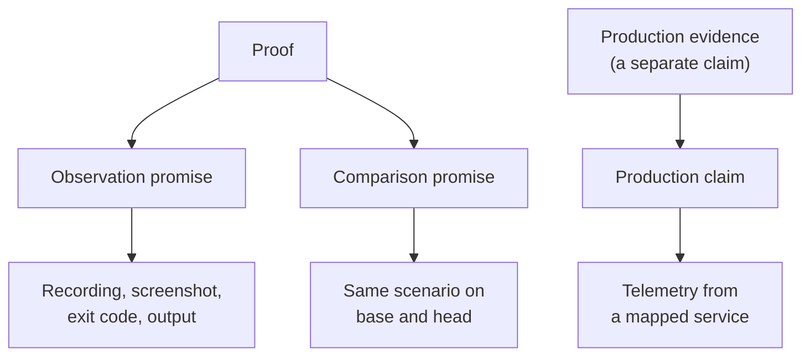
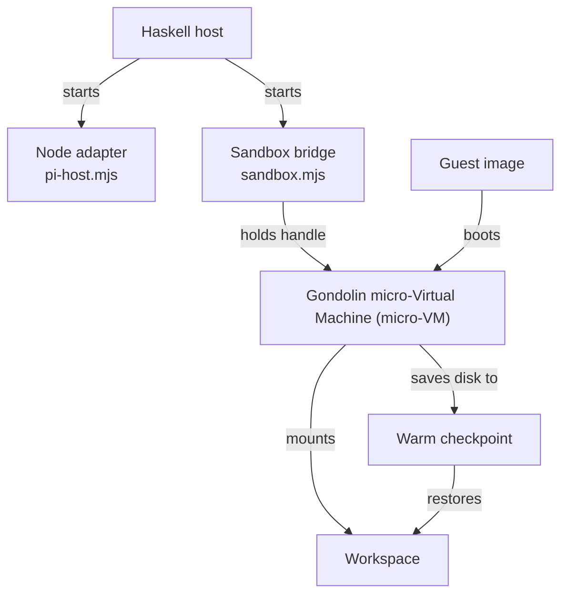

# Glossary

**Thesis.** This glossary defines the main terms that the exploration uses, spells out every abbreviation used in this file, and names the source that establishes each term. Terms are grouped by subject, not alphabetized, so a reader can follow a concept from the idea to the implementation.

A source path is relative to one of these repository roots:

| Prefix | Repository root |
|--------|------------------|
| `src/`, `shared/`, `static/`, `test/`, `impact-review-worker/`, `.monoscope/`, `docs/` | `/Users/darkvoid/GitSources/src.monoscope/monoscope` |
| `monoscope-web/` | `/Users/darkvoid/GitSources/src.monoscope/monoscope-web` |
| `timefusion/` | `/Users/darkvoid/GitSources/src.monoscope/timefusion` |

A bare file name such as `package.json` can occur in more than one repository. The source column of each row names the repository when the file name is not unique. A citation of the form `Migration NNNN` means the file `static/migrations/NNNN_*.sql` in the Monoscope repository. A citation of `Blacksmith overview` means `https://docs.blacksmith.sh/proof/overview`.

| Short name used here | Full path |
|----------------------|-----------|
| `AgentWorkspace.hs` | `shared/src/Data/Effectful/AgentWorkspace.hs` |
| `BackgroundJobs.hs` | `src/BackgroundJobs.hs` |
| `CodeReview.hs` | `src/Data/Effectful/CodeReview.hs` |
| `ErrorFingerprint.hs` | `src/Pkg/ErrorFingerprint.hs` |
| `ErrorPatterns.hs` | `src/Models/Apis/ErrorPatterns.hs` |
| `Explanation.hs` | `src/Data/Effectful/CodeReview/Explanation.hs` |
| `ImpactReview.hs` | `src/Pkg/ImpactReview.hs` |
| `ImpactReviews.hs` | `src/Models/Projects/ImpactReviews.hs` |
| `Incidents.hs` | `src/Models/Apis/Incidents.hs` |
| `Issues.hs` | `src/Models/Apis/Issues.hs` (issue types, queries, and timeline SQL) |
| `Pages/Issues.hs` | `src/Pages/Issues.hs` (issue pages, breadcrumbs, and the user journey) |
| `LogQueries.hs` | `src/Models/Apis/LogQueries.hs` |
| `Policy.hs` | `src/Data/Effectful/CodeReview/Policy.hs` |
| `proof.sh` | `src/Data/Effectful/CodeReview/proof.sh` |
| `Replay.hs` | `src/Pages/Replay.hs` |
| `Routes.hs` | `src/Web/Routes.hs` |
| `Types.hs` | `src/Data/Effectful/CodeReview/Types.hs` |
| `Utils.hs` | `src/Utils.hs` |
| `Widget.hs` | `src/Pkg/Components/Widget.hs` |
| `pi-host.mjs` | `impact-review-worker/pi-host.mjs` |
| `sandbox.mjs` | `impact-review-worker/sandbox.mjs` |
| `build-guest.mjs` | `impact-review-worker/build-guest.mjs` |
| `monoscope-app.sh` | `impact-review-worker/monoscope-app.sh` |

`Telemetry.hs` names two different files. `src/Pages/Telemetry.hs` renders telemetry pages. `src/Models/Telemetry/Telemetry.hs` decodes telemetry attributes and reads telemetry storage.

## Products, runs, and sessions

The exploration uses one word for an idea and for an execution of that idea. This table separates them.

| Term | Definition | Source |
|------|------------|--------|
| **Monoscope** | The observability product. Its server repository `monoscope` holds the Haskell server, the proof host, the workers, and the database migrations. Its browser client repository `monoscope-web` holds the replay recorder. | Repository roots at the top of this file |
| **Blacksmith** | The vendor whose Proof product this exploration documents from its public pages. The pages describe a workflow, not an execution architecture. This exploration calls the product vendor-run because the vendor sells and describes the service; the pages do not use the word "hosted" and do not state where the sandbox runs or who operates it. That label is an inference, not a documented fact. | Blacksmith overview |
| **Proof (the idea)** | The idea that a system runs a code change, captures the result, and attaches the evidence to a pull request. A **proof system** is one implementation of the idea. | `docs/proof-strategies.md:1-6`; Blacksmith overview |
| **Monoscope Proof** | Monoscope's in-house proof system. It lives in the Impact Review subsystem, not in a separate product. | `docs/proof-strategies.md`; `CodeReview.hs` |
| **Impact Review** | The Monoscope subsystem that reviews a pull request (PR). It owns the review state machine, the model session, the proof tool, the guest, the comment, and the production telemetry query. | `CodeReview.hs`; `ImpactReview.hs`; `ImpactReviews.hs` |
| **Review** | One review object for one pull request revision. It has one identifier (the **run identifier**), one state, one lease, and one final comment. The signed media path calls this identifier the review identifier. | `ImpactReviews.hs:227`; `ImpactReviews.hs:729-730` |
| **Review run** | The same object as a review. The code calls it a run. A run can contain more than one agent attempt. | `ImpactReviews.hs:624` |
| **Agent attempt** | One model execution inside a run, recorded in `projects.pr_review_attempts`. A retry starts a new attempt with a new identifier. The per-attempt proof limit applies to one attempt. | `0259_native_agent_records.sql:71-82`; `ImpactReviews.hs:630` |
| **Model session** | One connection between the host and the review model. One agent attempt can use more than one model session. The in-memory proof counter belongs to the agent attempt, and a resume restores it. A **review session** is the same connection when the sentence is about one model turn. It is not a browser session. | `CodeReview.hs:425, 462` |
| **One proof** | One proof key, such as `proof-1`, with one row for the base side and one row for the head side. One `record_proof` request produces it. A proof is not an agent attempt. A run stores at most three proofs per agent attempt. | Migration 0269; `ImpactReviews.hs:630-632` |
| **Comparison budget** | A limit of three local check comparisons for one review session. A **local check comparison** is a `run_regression` call: the guest runs one script, with an optional test patch, on the selected base and head revisions and writes a report. The counter is a file named for the session identifier, and the call fails with `ComparisonBudgetExhausted` at the fourth attempt (`AgentWorkspace.hs:1134-1150`). This budget is separate from the proof budget, and its scope is one review session, not one agent attempt. | `AgentWorkspace.hs:1134-1139` |
| **Worker** | The process that claims a review run, holds the lease, and runs the proof. In this exploration, "worker" and "server" name the same review side unless a sentence says otherwise. The host is the same process seen from the proof path. | `ImpactReviews.hs:372-399` |
| **Workspace** | The working tree inside the guest at `/workspace`. A pristine run copies from the read-only `/checkout` mount into `/workspace`. The `/baseline` mount is a separate read-only clean checkout; a warm start replaces `/workspace/.git` from `/baseline/.git` and resets the tree. The review agent uses the prepared workspace. | `AgentWorkspace.hs:1185, 1200-1203, 1416, 1428` |
| **Checkout mount** | The read-only `/checkout` mount of the host checkout. A pristine proof side copies from it. It is not the baseline mount. | `AgentWorkspace.hs:1185` |
| **Comment** | The final review comment that carries the claims, the media, the risk table, and the findings. The **progress comment** is the same GitHub comment while the review runs; the final body replaces the progress body. | `ImpactReview.hs:860-972`; `ImpactReview.hs:696-711` |
| **Proof comment** | A comment whose main content is proof evidence: the lead claim, the media preview, and the links to the full evidence. The term also names the Blacksmith Proof comment. It is not a separate object in Monoscope; the review comment carries the proof. | `ImpactReview.hs:860-972`; Blacksmith overview |
| **Telemetry** | Traces, logs, metrics, and replay events from deployed services. The production claim cites telemetry. TimeFusion stores the traces, logs, and metrics; replay events go to object storage. | `ImpactReview.hs:340-342`; `timefusion/README.md:8-14`; `Replay.hs:1053-1068` |
| **Recording** | One side's proof media: an asciinema cast for a terminal proof, or a page video for a browser proof. A side is `Base` or `Head` (section 2). The comment calls both a recording. It is not a replay session. | `proof.sh:27-41`; `Explanation.hs:269-311` |
| **Event (general)** | One recorded item. The meaning depends on the context: a replay event is one rrweb change, a span event is an annotation on a span, and an incident event is a delivery or observation inside an episode. A sentence must name the kind. | `Replay.hs`; `Pages/Issues.hs:820-827`; migration 0153 |

## 1. The idea



| Term | Definition | Source |
|------|------------|--------|
| **Proof** | The idea that a system runs a code change, captures the result, and attaches the evidence to a pull request. A proof system implements the idea. | `docs/proof-strategies.md:1-6`; Blacksmith overview |
| **Promise** | A stated guarantee that an implementation tries to keep. This exploration names two proof promises and one separate production claim. A promise is not a claim status. | `docs/proof-strategies.md:1-6` |
| **Observation promise** | The proof promise that the change did this. Evidence: a recording, a screenshot, an exit code, or command output captured while the change ran. | This exploration; `ImpactReview.hs:308-316` |
| **Comparison promise** | The proof promise that the same scenario runs on the base revision and on the head, so a reader can compare the two results. It does not promise that the results differ. In Monoscope the base revision is the target branch tip, not the computed merge base. | `docs/proof-strategies.md`; `ImpactReviews.hs:227`; `CodeReview.hs:672-675` |
| **Production claim** | A statement about what production did, supported by telemetry. It is not a proof of the change, and it has no claim status. | `ImpactReview.hs:340-342` |
| **Finding** | A risk statement in the comment about a changed line. It cites telemetry evidence and is not a proof claim. The source validates findings separately from claims. | `ImpactReview.hs:340-342` |
| **Mapped service** | A production service that the review links to repository code. The production claim cites telemetry from a mapped service. | `ImpactReview.hs:340-342, 777` |
| **Review window** | The time range of production telemetry that a review queries. The host sets the start to seven days before the review time (`addUTCTime (negate $ nominalDay * 7) until`), and the comment names the start and end dates. This is not the `reviewSeconds` execution budget. | `ImpactReview.hs:621, 917` |
| **Risk table** | The table of assessment dimensions that the comment renders: alignment, impact, verification, rollback cost, and error detection. | `ImpactReview.hs:838-853` |
| **Scenario** | The action a proof performs. In Blacksmith, the documentation does not define the format. In Monoscope, it is a Bash command plus an optional setup script; a browser scenario is a Bash command that runs a Playwright script. A scenario is not the saved recipe. | Blacksmith overview; `.monoscope/PROOF.md` |
| **Evidence** | Any recorded artifact that a reader can inspect: a cast, a video, a screenshot, an exit code, command output, or a telemetry query result. | This exploration; `ImpactReview.hs:340-342` |
| **Replay session** | One browser session represented by a row in `projects.replay_sessions` and one or more replay event objects. It is not the model session of a review. | Migration 0029; `Replay.hs` |
| **Session replay** | The playback of recorded browser events. A replay session is one recorded session; session replay is the activity of playing it back. | `Replay.hs`; `monoscope-web/src/replay.ts` |

## 2. Versions and sides

| Term | Definition | Source |
|------|------------|--------|
| **Pull request (PR)** | A proposed change to a repository. | General |
| **Base** | The revision that the pull request targets. In Monoscope it is the `Base` side, and the pull request event sets it to `pr.base.revision`, the target branch tip. The strategy document `docs/proof-strategies.md` calls it the merge base, but the code does not use the common ancestor. | `ImpactReviews.hs:227`; `Types.hs:114`; `docs/proof-strategies.md` |
| **Head** | The newest commit of the pull request. In Monoscope it is the `Head` side. | `Types.hs:114` |
| **Merge base** | The common ancestor of the pull request branch and the target branch. The strategy document names it as the base, and the review prompt tells the model to compute it, but the stored `base` value is the target branch tip. | `Policy.hs:79`; `docs/proof-strategies.md` |
| **Revision** | A commit identifier. | Git |
| **Target branch** | The branch that a pull request proposes to merge into. Blacksmith reads its rules from this branch. | GitHub; `https://docs.blacksmith.sh/proof/proof-md.md` |
| **Side** | One of the two revisions in a proof: `Base` or `Head`. | `Types.hs:114` |

## 3. The proof run

| Term | Definition | Source |
|------|------------|--------|
| **Frozen check** | The shell program `proof.sh`, embedded in the server at build time and sent to the guest unchanged. A pull request cannot edit it. | `proof.sh`; `Explanation.hs:165-166` |
| **Setup** | A script that runs before the recorded command. It is not recorded, and the check rejects a change to the commit or a tracked file. It may create an untracked file. | `proof.sh:12-25` |
| **Bash** | The Bourne Again Shell, the command interpreter that runs the setup and command. | `proof.sh:21, 27` |
| **Proof request** | One call that asks the host to run and store one proof. It can fail before any row is stored, and the in-memory budget counts it. | `CodeReview.hs:664-668` |
| **Proof tool** | The tool that the review agent calls to record a proof. | `CodeReview.hs:672-675` |
| **Proof shot** | One PNG screenshot in a proof, with a label. The host stores at most four shots per side. | `proof.sh:34-38`; `Explanation.hs` |
| **Command** | The Bash command that shows the behavior under test, recorded with asciinema. "Recorded" means that asciinema captured its terminal output into the cast. | `CodeReview.hs:56`; `proof.sh:27-29` |
| **Media marker** | A text marker in the check log that wraps a base64 payload: `::monoscope-NAME::PARAM`, then the payload, then `::monoscope-NAME-end::`. **base64** is a text encoding that represents binary bytes with printable characters. | `proof.sh:10`; `Explanation.hs:364-380` |
| **`PROOF_MEDIA`** | The directory where a user interface (UI) proof writes screenshots, a video, chapters, and the page file: `/tmp/monoscope-proof-media`. | `proof.sh:8` |
| **Cast** | An asciinema recording of a terminal session. | `proof.sh:27-33` |
| **asciinema** | A terminal recording tool that writes a version 2 cast file. | `proof.sh:27` |
| **Chapter** | A labelled second in a browser video, written as `seconds<TAB>label`. The host reads chapters only when the proof also has a video. **TAB** is the tab character, which separates the two fields. | `proof.sh:42`; `Explanation.hs:354-355`; `.monoscope/PROOF.md:32-33` |
| **Page file** | A tab-separated title and Uniform Resource Locator (URL) used to draw a browser frame: `title<TAB>url`. | `proof.sh:43`; `.monoscope/PROOF.md:45` |
| **Browser frame** | A drawn window around a browser recording, with window buttons, title bar, navigation bar, and URL. | `Explanation.hs:281-311` |
| **Exit code** | The status returned by the recorded command. A nonzero base exit code is shown in the final comment. | `proof.sh:30`; `ImpactReview.hs:881` |

```bash
# src/Data/Effectful/CodeReview/proof.sh:8-10
export HOME="${HOME:-/tmp}" TERM=xterm-256color LANG=C.UTF-8 LC_ALL=C.UTF-8 PROOF_MEDIA=/tmp/monoscope-proof-media
mkdir -p "$PROOF_MEDIA"
emit() { printf '\n::monoscope-%s::%s\n' "$1" "$2"; base64 -w0 "$3"; printf '\n::monoscope-%s-end::\n' "$1"; }
```

## 4. The proof host

| Term | Definition | Source |
|------|------------|--------|
| **Review host** | The Haskell server process that owns the review state, the proof budget, and the comment. | `src/Data/Effectful/CodeReview.hs` |
| **Executor** | The component that starts the virtual machine and runs the command. In Monoscope it is the guest session together with the sandbox bridge. Blacksmith does not document its executor. | `sandbox.mjs`; Blacksmith overview |
| **Host** | The same Haskell server process when the sentence is about one proof run. The host prepares the workspace, calls the Node adapter, renders the media, and stores the rows. | `CodeReview.hs:672-691` |
| **Review state** | One of `Queued`, `Reviewing`, `Completed`, `Incomplete`, `Superseded`. | `ImpactReviews.hs:101` |
| **Lease** | A time-limited claim by one review run on one pull request review thread. `lease_owner` names the run and `lease_until` names the end time. | `ImpactReviews.hs:383`; `0213_pr_impact_reviews.sql:19-20` |
| **Proof key** | A name such as `proof-1` that identifies one proof across both sides. The number is the count of distinct keys stored in the run plus one, so it is derived from visible rows, not from a separate sequence. A committed key is not reused in the same run because the count includes it. A rolled-back attempt stores no row, so a later attempt can derive the same key again. The host builds media links from the returned key after the transaction commits; this exploration found no path that publishes a media link before the commit. If a link were visible before the commit, the reuse could change the bytes behind it. That is an inference about publish order, not a test. | Migration 0269; `ImpactReviews.hs:630-631` |
| **Proof budget** | Three proofs per agent attempt, enforced at two layers. The in-memory `proofCount` counts proof requests in one agent attempt, including a request that fails, and a resume restores it. The database count `taken` counts distinct proof keys stored for the attempt and stops a fourth store. A run can hold more than three keys across several attempts; each attempt has its own three. | `CodeReview.hs:61-63, 425, 462, 665-666`; `ImpactReviews.hs:630-632` |
| **Claim** | A statement in the review with a status and zero or more proof keys. | `ImpactReview.hs:136-142` |
| **Claim status** | One of `Matches`, `Differs`, or `Unverified`. It compares the evidence with the claim, not the base recording with the head recording. | `ImpactReview.hs:136`; `Policy.hs:211` |
| **Matches** | The recorded evidence agrees with the claim. The claim cites proofs recorded on both sides, and each cited head proof has exit code 0. The validation does not require a base exit code of 0. | `ImpactReview.hs:308-316`; `Policy.hs:211` |
| **Differs** | The recorded evidence contradicts the claim in the pull request description. The claim cites proofs recorded on both sides. The validation does not require either exit code to be 0. This claim leads the comment. | `ImpactReview.hs:308-316, 860`; `Policy.hs:211` |
| **Unverified** | The claim has no proof, or the proof does not settle it. Only `Unverified` may cite no proof. | `ImpactReview.hs:308-316` |
| **Progress comment** | The same GitHub comment while the review runs. It shows planned claims and their state; the final review body replaces it in place. It is not a second comment. | `ImpactReview.hs:696-711`, `956-972` |
| **Prove request** | A manual comment command (`@monoscope prove it`) that asks for another review proof. | `ImpactReview.hs:950-951` |
| **Golden file** | A stored expected output that a test compares with generated output. The golden test fails if the rendered comment changes. | `test/golden/impact-review/` |

The review states move as follows. A **mode that skips drafts** is a review configuration that does not start automatic reviews for a draft pull request. A **retry** is a new agent attempt that puts an `Incomplete` run back in the queue; it does not reuse the old attempt or its proof budget. A **review thread** is the pull request conversation that holds the review comment while it changes from progress to final.

| From | To | Trigger | Source |
|------|----|---------|--------|
| `Queued` | `Reviewing` | A worker claims the run and holds the lease | `ImpactReviews.hs:372-399` |
| `Queued` | `Superseded` | The pull request closes, becomes a draft in a mode that skips drafts, or the run is replaced before it starts | `ImpactReviews.hs:320-333` |
| `Reviewing` | `Completed` | The review publishes its comment | `ImpactReviews.hs:421-422` |
| `Reviewing` | `Incomplete` | The review is interrupted before publication | `ImpactReviews.hs:452-454` |
| `Reviewing` | `Superseded` | A newer revision arrives during the review | `ImpactReviews.hs:452-454` |
| `Incomplete` | `Queued` | A retry re-queues the run | `ImpactReviews.hs:485` |

## 5. The sandbox



Each arrow label gives the exact relation. The bridge, not the Node adapter, holds the micro-VM handle. The Haskell guest session owns the micro-VM lifecycle. A checkpoint is a disk that the micro-VM boots, not a parent of the image.

| Term | Definition | Source |
|------|------------|--------|
| **Virtual Machine (VM)** | A software machine with its own kernel and disk. | General |
| **Micro-VM** | A small virtual machine with a minimal device model. | `impact-review-worker/README.md:3` |
| **Gondolin** | The micro-VM runtime and Software Development Kit (SDK) used by the worker. Pinned at `0.14.0`. | `impact-review-worker/package.json:14` |
| **Node.js** | The JavaScript runtime that runs `pi-host.mjs` and `sandbox.mjs`. The manifest requires version 22.19.0 or later. | `impact-review-worker/package.json:6` |
| **Guest** | The operating system inside the virtual machine. | General |
| **Guest session** | The Haskell-side owner of one micro-VM lifecycle. It sends operations through the sandbox bridge. | `AgentWorkspace.hs`; `sandbox.mjs` |
| **Guest image** | The exported root filesystem and initial ramdisk that boot the guest. | `build-guest.mjs` |
| **Playwright** | A browser automation library. The browser guest uses it to drive Chromium for a browser proof. | `Dockerfile.browser`; `.monoscope/PROOF.md:23-34` |
| **Checkpoint** | A saved copy-on-write disk that a later run can resume. It holds a built workspace, including ignored build output. | `AgentWorkspace.hs:329-350` |
| **Warm checkpoint** | A checkpoint from an earlier run that a later run can resume instead of building a new workspace. A lookup first uses the base-specific cache key. If that key misses, the host can try the lineage pointer, which may name a disk built for another base. | `AgentWorkspace.hs:1344-1352, 1419-1428` |
| **Warm start** | Resuming the repository's latest matching checkpoint instead of building from the image. | `AgentWorkspace.hs:1422-1428` |
| **Cold start** | Creating a new virtual machine and copying the checkout. | `AgentWorkspace.hs:1419-1421` |
| **Copy-on-write (COW)** | A disk mode where writes go to a private layer and the base image is unchanged. | `sandbox.mjs:30` |
| **Checkpoint identity** | The six-field record `Identity`: project, repository, base, image build identifier, preparation secure hash, and optional dependency fingerprint. The cache key `identityKey` hashes the whole record, so a different base is a different cache entry. | `AgentWorkspace.hs:329-330, 1533-1534` |
| **Checkpoint lineage** | A second hash over repository, image build identifier, preparation secure hash, and dependency. It omits the base and the project, so a lineage pointer can name an ancestor checkpoint from another base revision. | `AgentWorkspace.hs:1469-1470` |
| **Lineage pointer** | A JSON pointer file named `latest-<lineage>.json` that names an ancestor checkpoint. It omits the base and the project, so it can cross bases. | `AgentWorkspace.hs:1351-1352` |
| **Still** | A screenshot image in the review comment. The host shows one still per side when a video exists, or the proof preview otherwise. | `ImpactReview.hs:860-881` |
| **Preparation SHA-256** | The Secure Hash Algorithm 256-bit digest of the trusted preparation script. | `AgentWorkspace.hs:1336-1340` |
| **Trusted preparation script** | The host-supplied script that prepares the workspace. A dependency archive requires one. | `CodeReview.hs:1033` |
| **Dependency archive** | An optional archived input, such as a dependency cache, that the host copies into the guest. Its digest and byte size are part of the checkpoint identity. | `AgentWorkspace.hs:1437-1442` |
| **Baseline directory** | The read-only `/baseline` mount of the host's clean checkout. A warm start replaces `.git` from it before it resets the working tree. | `AgentWorkspace.hs:1416, 1428` |
| **Restore path** | The steps that resume a checkpoint disk: copy the disk, replace `.git` from `/baseline`, run `git reset --hard`, and run `git clean -fdq`. Ignored build output survives. | `AgentWorkspace.hs:1426-1428` |
| **JavaScript Object Notation (JSON)** | A text data format used for the bridge messages and stored payloads. | General |
| **Offline COW** | The only isolation mode the bridge accepts. The network is disabled. | `sandbox.mjs:28` |
| **Unprivileged user** | User identifier 1000, group identifier 1000, no new privileges, and a reset environment. | `AgentWorkspace.hs:425-427` |
| **Recipe** | The saved setup script for a repository, keyed by project, owner, and repository. It is separate from the `.monoscope/PROOF.md` rules guidance. | Migration 0270; `ImpactReviews.hs:670` |
| **Node adapter** | The Node.js process `pi-host.mjs` that starts and controls the model session, receives its tool calls, and returns tool results. It does not own a virtual machine; the Haskell guest session owns the virtual machine, and the sandbox bridge holds its handle. | `pi-host.mjs:2-3`; `impact-review-worker/README.md:28` |
| **`pi-host.mjs`** | The Node child that runs the model session and forwards tool calls. The code and this file also call it the Node adapter. | `pi-host.mjs:2-3` |
| **Sandbox bridge** | The process `sandbox.mjs`, a JavaScript Object Notation (JSON)-lines bridge between the Haskell guest session and the Gondolin software development kit (SDK). It holds the micro-VM handle and executes the operations that Haskell selects. | `sandbox.mjs:2` |
| **`sandbox.mjs`** | The file that implements the sandbox bridge. | `sandbox.mjs:2` |
| **Browser guest** | A guest image built with the `browser` profile. It holds Chromium, Playwright, PostgreSQL, the database migrations, and the application setup helper. | `impact-review-worker/Dockerfile.browser`; `build-guest.mjs` |
| **`monoscope-app.sh`** | The setup helper that starts the application, PostgreSQL, and sample traffic inside the browser guest. **Sample traffic** is a scripted set of requests that gives the application data to show. | `monoscope-app.sh` |
| **Review model** | The language model that the host calls through `pi-host.mjs`. It reads the proof summaries and chooses a claim status. The host does not compare the recordings. The model judges from the returned summaries and chooses `Matches`, `Differs`, or `Unverified` against the claim. | `CodeReview.hs:672-691`; `Policy.hs:211` |
| **Review agent** | The coding agent (`pi-coding-agent`) that runs in the model session and can call the proof tool. The exploration uses "review model" for the language model and "review agent" for the tool-using agent. | `pi-host.mjs:2-3`; `Policy.hs:57` |

A checkpoint has one record and two hashes. The **checkpoint identity** is the `Identity` record: project, repository, base, image build identifier, preparation secure hash, and dependency. The cache key `identityKey` hashes the whole record, so a new base is a new cache entry. The **checkpoint lineage** is a second hash over repository, image build identifier, preparation secure hash, and dependency. It omits the base and the project. A lineage pointer can therefore name an ancestor checkpoint from a different base. The restore path replaces `.git` from the baseline directory and resets the working tree, so the resumed disk can serve a different base than the one it was built on (`AgentWorkspace.hs:1422-1428`, `1469-1470`, `1533-1534`).

```haskell
-- shared/src/Data/Effectful/AgentWorkspace.hs:329-330
data Identity = Identity
  { projectId :: ProjectId, repository :: Repository, base :: Revision
  , imageBuildId :: ImageId, preparationSha256 :: Fingerprint
  , dependency :: Maybe FileFingerprint }
```

## 6. Media and storage

| Term | Definition | Source |
|------|------------|--------|
| **Graphics Interchange Format (GIF)** | An animated image format that GitHub displays inline. | `Explanation.hs:269-273` |
| **MPEG-4 Part 14 (MP4)** | A video container defined by Part 14 of the MPEG-4 standard of the Moving Picture Experts Group (MPEG). Monoscope writes H.264 video in an MP4 container. H.264 is also known as Advanced Video Coding (AVC), a video compression standard. | `Explanation.hs:269-273` |
| **WebP** | An image format that supports animation at a smaller size than GIF. The name comes from Web Picture format. Used for the browser preview. | `Explanation.hs:281-311` |
| **Portable Network Graphics (PNG)** | A lossless image format used for screenshots. The host checks the PNG signature. | `Explanation.hs:352-353` |
| **Timeline strip** | A row under a terminal clip that shows the whole recording, the clip section, and the current moment. | `Explanation.hs:224-263` |
| **Byte array (`bytea`)** | A binary string type in PostgreSQL. Proof media is stored in `bytea` columns, not in PostgreSQL large objects. | Migration 0269 |
| **Signed URL** | A URL with a signature query parameter that authorizes access without a session. The proof path signs `project-id:proof:review-id/file-name`. The signed text and the route carry no expiry field, so an image proxy can cache it. | `Routes.hs:805-811`; `Widget.hs:676-679`; `ImpactReview.hs:826`; `ImpactReviews.hs:729-730` |
| **Hash-based message authentication code (HMAC)** | The signature scheme behind the signed media path: HMAC-SHA256 with the project encryption secret as the key. The payload is the project identifier, a colon, and the proof path. The secret is not in the URL. | `Widget.hs:676-679`; `Routes.hs:808` |
| **Immutable cache** | A cache policy that lets a client keep a response for a long time because the URL always names the same bytes. | `Routes.hs:805-811` |
| **Amazon S3** | Amazon Simple Storage Service, the object store used for replay events. | `Replay.hs:749-754` |
| **MinIO** | An object store with an S3-compatible interface. | `Replay.hs:741-754` |
| **Cloudflare R2** | An object store with an S3-compatible interface. The source names S3/R2 as replay storage. | `src/Models/Telemetry/Telemetry.hs:1256-1257` |
| **Apache Kafka** | The message queue that carries replay events from the route to the consumer. | `Replay.hs:92-101` |
| **Structured Query Language (SQL)** | The language used for the PostgreSQL queries in this exploration. | Migrations; `Replay.hs` |
| **JavaScript Object Notation Binary (JSONB)** | A binary JSON type in PostgreSQL. | Migration 0273 |
| **Mebibyte (MiB)** | 1,048,576 bytes. | `Replay.hs:1053-1054` |
| **Kibibyte (KiB)** | 1,024 bytes. The browser replay client uses a 64 KiB limit for a `keepalive` request body. | General; `monoscope-web/src/replay.ts:184` |
| **HyperText Transfer Protocol (HTTP)** | The request and response protocol used by the client and server. | `replay.ts`; `Routes.hs` |

Amazon S3, MinIO, and Cloudflare R2 are three compatible object stores behind one interface. A deployment uses one of them. They are not three stores in one replay path.

## 7. Browser recording

| Term | Definition | Source |
|------|------------|--------|
| **rrweb** | A library that records Document Object Model (DOM) changes and replay events in a browser. Pinned at `2.0.0-alpha.20`. | `monoscope-web/package.json` |
| **DOM** | The browser's in-memory tree of a page. | General |
| **`sessionStorage`** | A browser store for one tab and one origin. It survives a reload and ends when the tab closes. The client keeps the session and tab identifiers there. | `monoscope-web/src/index.ts:104-133` |
| **Session identifier** | A random Universally Unique Identifier version 4 (UUIDv4) in `sessionStorage`. After 30 minutes without recorded activity, the identifier rotates when the document next becomes visible. A `visibilitychange` event (a change between visible and hidden) to the hidden state does not rotate it. The check runs on that event, not on a timer. | `monoscope-web/src/index.ts:104-121, 143-164` |
| **Tab identifier** | A UUIDv4 kept in `sessionStorage`. The store is tab-scoped, so the value normally names one tab across navigations and reloads. A duplicated tab copies the store, so two tabs can share the value. It is sent in the replay upload and in browser spans. The replay service has no field for it; it can survive inside a span's generic `attributes` JSONB, but no query uses it. | `monoscope-web/src/index.ts:125-133`; `monoscope-web/src/tracing.ts:339`; `monoscope-web/src/replay.ts:155` |
| **Pageview identifier** | An identifier for one page view, carried as the `pageview.id` span attribute. | `monoscope-web/src/tracing.ts:340` |
| **Batch** | Up to 50 rrweb events in one request (`MAX_EVENT_BATCH = 50`). A timer also flushes at intervals while events wait. | `monoscope-web/src/replay.ts:5, 81-83, 128` |
| **Retry queue** | Events that the client keeps after a failed send and tries again later. When the queue holds more than 5,000 events, the client keeps all full snapshots first, then the newest other events that fit the remaining slots, and sorts the result by timestamp. If the snapshots alone exceed 5,000, the queue stays above the limit. | `monoscope-web/src/replay.ts:49-62` |
| **Beacon** | A `navigator.sendBeacon` request used at page unload. It cannot set an `Authorization` header. | `monoscope-web/src/replay.ts:165-176` |
| **Full snapshot** | An rrweb event of type 2 that contains the whole DOM. It is preserved when the retry queue is trimmed. | `monoscope-web/src/replay.ts:56-60` |
| **Masking** | Replacing sensitive text or inputs before recording. Input values are masked by default. Text masking and blocking require explicit classes, and console output is not masked. | `monoscope-web/src/replay.ts:86-94` |
| **`rr-block`** | A class whose element is not recorded. | `monoscope-web/src/replay.ts:86` |
| **`rr-mask`** | A class whose text is masked. | `monoscope-web/src/replay.ts:94` |
| **Raw event file** | One uploaded file of replay events, named in the session's `file_keys` column. The merge job reads raw files and writes shards. | `Replay.hs:368, 1053-1068` |
| **Merge job** | The background job that reads a session's raw event files, writes compressed shards, and removes the raw keys it consumed. | `Replay.hs:1053-1068` |
| **Shard** | A compressed file of replay events that the merge job writes. One shard replaces several raw files. Its key embeds its first event timestamp. | `Replay.hs:1053-1068` |
| **Sealed shard** | A shard that the merge job wrote. It is written when the buffered events reach 12 MiB (`shardSealBytes`). The session sets `merged` only when no raw event key remains. | `Replay.hs:1059-1068, 368` |
| **Unmerged tail** | The raw upload files that no merge job has consumed yet. The manifest appends them after all shards. | `Replay.hs:646-653, 867-874` |
| **Manifest** | The ordered list of shards and the unmerged tail for one replay session. Shards are ordered by the first-event timestamp in the shard key; the tail follows all shards. | `Replay.hs:862-874` |
| **Bring your own bucket (BYO)** | A project that stores replay objects in its own bucket (`projects.s3_bucket` is not null). The expiry job skips it, so the 30-day retention rule does not delete its objects. | `Replay.hs:1158` |

```ts
// monoscope-web/src/index.ts:104-115 (condensed)
const storedId = sessionStorage.getItem("monoscope-session-id");
const lastActivity = sessionStorage.getItem(LAST_ACTIVITY_KEY);
if (storedId && lastActivity) {
  const elapsed = Date.now() - parseInt(lastActivity, 10);
  if (elapsed < SESSION_TIMEOUT_MS) return storedId;
}
const id = newId();
sessionStorage.setItem("monoscope-session-id", id);
```

## 8. Telemetry and correlation

| Term | Definition | Source |
|------|------------|--------|
| **OpenTelemetry (OTel)** | A standard for traces, metrics, and logs. | General |
| **OpenTelemetry Protocol (OTLP)** | The wire protocol that carries OTel data. | `tracing.ts:198-201` |
| **Transport Layer Security (TLS)** | The encrypted transport for network calls. The remote checkpoint download uses the object-storage client's TLS. The code also verifies the archive with a SHA-256 digest and a byte count, but it makes no separate TLS check. | `AgentWorkspace.hs:1354-1381` |
| **Span** | One timed operation in a trace. | General |
| **Trace** | A tree of spans that share a trace identifier. | General |
| **Trace identifier** | A 128-bit value that identifies one trace. | `0002_logs_traces_metrics.sql:116` |
| **Span identifier** | A 64-bit value that identifies one span. | `0002_logs_traces_metrics.sql:117` |
| **Span event** | A timestamped annotation attached to one span, such as an exception or a breadcrumb. | `Pages/Issues.hs:820-827` |
| **Trace-scoped log** | A log record that carries a trace identifier. The breadcrumb comment names these records as its third source. The implementation's third reader receives `SpanRecord` values and emits one breadcrumb per non-error span, not one per log record. | `Pages/Issues.hs:805-836` |
| **`session.previous.id`** | A telemetry attribute that could name the session before an inactivity rotation. A rotation creates a new identifier, so this attribute is the only way to link the old and new sessions without a separate join. No producer was found in the browser client or the server; the telemetry decoder reads it. | `src/Models/Telemetry/Telemetry.hs:2264, 2644` |
| **Sessions view** | A telemetry grouping that uses `session.id`, then falls back to `user.id`, then `user.email`. The fallback group is user-level, not session-level. | `LogQueries.hs:789` |
| **World Wide Web Consortium (W3C) baggage** | Key-value context that propagates across service calls. Monoscope puts `session.id` and `tab.id` in baggage. | `tracing.ts:302-309` |
| **OTel collector** | The service that receives OTLP data. Monoscope uses `otelcol.monoscope.tech`. | `tracing.ts:198-201` |
| **TimeFusion** | The Rust telemetry service. It stores logs, traces, metrics, and events as Delta Lake tables on object storage. An event here is one telemetry record, not an incident event. Delta Lake is a table format over object storage, and Apache DataFusion is the query engine. `otel_logs_and_spans` is the dataset that holds logs and spans. | `timefusion/README.md:7-8, 76-77` |
| **Observation** | One recorded occurrence of an error or log pattern. An issue groups observations. | `Issues.hs:360-374` |
| **Issue** | A triage object that groups observations by a target hash and an issue type. | `Issues.hs:360-374` |
| **Issue type** | The kind of condition that an issue tracks, such as an error fingerprint or a monitor result. | Migration 0032 |
| **Monitor** | A scheduled check whose result can open an issue and an incident. Its identifier can serve as a target hash. | `Issues.hs:759` |
| **Target hash** | The grouping key of an issue. For an error it is the chosen fingerprint hash; for a monitor it is the monitor identifier. | Migration 0032; `Issues.hs:759` |
| **Fingerprint** | In the issue path, an xxhash of normalized error or log data, rendered as 8 lowercase hexadecimal characters. xxhash is a fast non-cryptographic hash. In the checkpoint path, `Fingerprint` is the type of a SHA-256 digest, and a dependency fingerprint is a SHA-256 digest plus a byte size. The uses are unrelated. | `ErrorFingerprint.hs:408-409`; `Utils.hs:772-773`; `AgentWorkspace.hs:329-330` |
| **Narrow hash** | A fingerprint that includes the span name only when the error has no stack. A **stack** is the recorded call stack of the error. When a stack exists, the narrow hash and the broad hash are equal because both hash the stack branch. | `ErrorFingerprint.hs:393-405` |
| **Broad hash** | A fingerprint that omits the span name. It differs from the narrow hash only when the error has no stack. It gives a cross-route rollup: the same error from different routes groups together. | `ErrorFingerprint.hs:393-405` |
| **Shape hash** | A fingerprint that excludes service and stack, used for review grouping. The hash is computed in Haskell; migration 0142 adds the storage column. | `ErrorFingerprint.hs:571-573`; migration 0142 |
| **Drain** | A log template mining algorithm that groups messages into patterns. | `src/Pkg/Drain.hs` |
| **Error pattern** | A Drain template that the system tracks for volume changes and incidents. | `src/Pkg/Drain.hs` |
| **Median absolute deviation (MAD)** | A robust measure of variation. The code scales it by 1.4826. The error-spike detector in [06-incidents-and-timelines.md](06-incidents-and-timelines.md) uses mean and standard deviation instead. | `ErrorPatterns.hs:420-460` |
| **z-score** | The number of standard deviations between a value and a mean. | `BackgroundJobs.hs:5551-5559` |
| **Incident** | The active condition of one source: a monitor, an issue, or an error pattern. | Migrations 0153 and 0166; `Incidents.hs:93-196` |
| **Episode** | One active period of one incident source. Only one episode per source can be active at a time. | Migration 0153 |
| **Incident event** | A delivery or observation inside an episode. | Migration 0153 (kinds extended by migration 0166) |
| **Incident source** | The monitor, issue, or error pattern that an incident tracks. | `Incidents.hs:93-196` |
| **Timeline** | An ordered list of events for an issue, a trace, or a trace's spans. Monoscope has three separate timelines: the issue timeline, the user journey of one trace, and the trace waterfall. | `Issues.hs:4032-4057`; `Pages/Telemetry.hs:1278-1320` |
| **Issue timeline** | The union of issue activity rows and incident events for one issue, ordered by timestamp. | `Issues.hs:4036-4055` |
| **User journey** | The merged spans, span events, and span-derived rows of one trace. It does not read log records, and it is not a session timeline. | `Pages/Issues.hs:810-835` |
| **Trace waterfall** | The view of one trace's spans ordered by start time. | `src/Pages/Telemetry.hs:1278-1320` |
| **Session timeline** | A hypothetical ordered list of all traces and events in one browser session. Monoscope does not build one. | This exploration; `Pages/Issues.hs:810-835` |
| **Breadcrumb** | One user-journey row with kind, message, optional payload, and timestamp. | `Pages/Issues.hs:732-737` |
| **Breadcrumb comment** | The source comment that names the `breadcrumbs` span attribute and the span event list as journey sources. | `Pages/Issues.hs:805-809` |
| **Retention** | The period after which stored data is deleted. Replay retention is 30 days. | `Replay.hs:1130-1132` |

```sql
-- src/Models/Apis/LogQueries.hs:789
COALESCE(NULLIF(attributes___session___id,''), NULLIF(attributes___user___id,''), NULLIF(attributes___user___email,''))
```

TimeFusion joins nested telemetry attribute segments with three underscores. The path `attributes.session.id` becomes the column `attributes___session___id`. The same rule gives `attributes___user___id` and `attributes___user___email`. A reader who searches the database for a column named `session_id` will not find this one.

```haskell
-- src/Pkg/ErrorFingerprint.hs:408-409
hashParts = toXXHash . T.intercalate "|" . filter (not . T.null)
```

## 9. Documentation and method

| Term | Definition | Source |
|------|------------|--------|
| **ASD-STE100** | Simplified Technical English, a controlled language with one idea per sentence and approved vocabulary. | `markdown_engineering/documentation_directive.md` |
| **Mermaid** | A text format that renders diagrams. | `documentation_directive.md` |
| **Iron Rules** | The ten documentation rules in the directive. | `documentation_directive.md` |
| **Grandfather review** | A review of a document against its source by a reader who has the source open. | `documentation_directive.md` |
| **Fresh-reader review** | A review by an agent with no memory of the writing, no tool use, and no web search. | Project instructions, rule 7 |

## 10. Abbreviations

| Abbreviation | Expansion |
|--------------|-----------|
| API | Application Programming Interface |
| ASD-STE100 | Aerospace and Defence Simplified Technical English, issue 100 |
| AVC | Advanced Video Coding (H.264) |
| Bash | Bourne Again Shell |
| BYO | Bring Your Own |
| CI | Continuous Integration |
| CLI | Command Line Interface |
| COW | Copy-On-Write |
| CPU | Central Processing Unit |
| DOM | Document Object Model |
| GIF | Graphics Interchange Format |
| H.264 | Advanced Video Coding (also written AVC) |
| HMAC | Hash-based Message Authentication Code |
| HTML | HyperText Markup Language |
| HTTP | HyperText Transfer Protocol |
| JSON | JavaScript Object Notation |
| JSONB | JavaScript Object Notation Binary |
| KiB | Kibibyte |
| MAD | Median Absolute Deviation |
| MiB | Mebibyte |
| MP4 | MPEG-4 Part 14 |
| MPEG | Moving Picture Experts Group |
| OTel | OpenTelemetry |
| OTLP | OpenTelemetry Protocol |
| PNG | Portable Network Graphics |
| PR | Pull Request |
| SDK | Software Development Kit |
| S3 | Amazon Simple Storage Service |
| SHA-256 | Secure Hash Algorithm 256-bit |
| SQL | Structured Query Language |
| TAB | Tab character |
| TLS | Transport Layer Security |
| UI | User Interface |
| URL | Uniform Resource Locator |
| USD | United States Dollar |
| UUID | Universally Unique Identifier |
| vCPU | Virtual Central Processing Unit |
| VM | Virtual Machine |
| W3C | World Wide Web Consortium |

**Aha: the same word names two different revisions.** "Base" is the target branch tip in the Monoscope code, and "merge base" is the common ancestor that the strategy document and the comment label name. A reader who treats the two words as one idea will overestimate what the comparison isolates.

## 11. Back to the index

Return to [README.md](README.md) for the reading order. Read [07-comparison-and-assessment.md](07-comparison-and-assessment.md) for the assessment.
