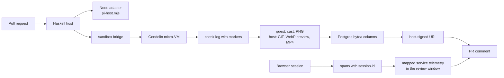
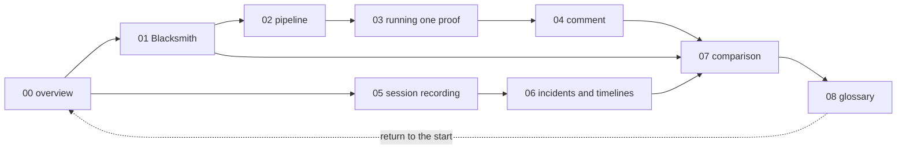

# Proof: showing the change instead of describing it

A diff records what changed. It does not record whether the change works. **Proof** is the idea that a system can run the change, capture the result as evidence, and attach that evidence to the pull request (PR). The reader checks the evidence in seconds instead of trusting a description. The intended reader is an engineer who knows version control and wants to understand how a proof system collects trustworthy evidence, or how Monoscope implements one.

This exploration documents two implementations of that idea and one separate production evidence system:

1. **Blacksmith Proof**, a product this exploration calls vendor-run because the vendor sells and describes the service. Its documentation describes the workflow and the rules, but not the execution architecture, and it does not use the word hosted or state who operates the sandbox.
2. **Monoscope Proof**, an in-house system in the Monoscope server repository. The Haskell host owns the proof state machine and the guest session. The Node model host runs the model session and forwards tool calls; the sandbox bridge holds the local Gondolin micro-Virtual Machine (micro-VM) handle. Guest images, warm checkpoints, the free-form `.monoscope/PROOF.md` guidance, browser recordings made with Playwright, and the proof tables (`projects.pr_review_proofs`, `projects.pr_review_proof_shots`, and `projects.pr_review_proof_recipes`) carry the evidence.
3. **Monoscope browser session recording and incident timelines**. The `@monoscopetech/browser` package records a user session with rrweb. It sends a session identifier and a tab identifier with the replay, and it sets both identifiers in World Wide Web Consortium (W3C) baggage (key-value context that travels with a request across services) so that a backend service can tag its spans with them. The server correlates the replay with telemetry at query time: it reads the session identifier from the spans of one trace, inside a time window, and looks for a replay with that identifier. The tab identifier is not stored in a replay field.

**Central fact.** The Monoscope source does not reference Blacksmith Proof. A case-insensitive search for `blacksmith` in the tracked text files of the Monoscope server repository returns one unrelated continuous integration rule at `AGENTS.md:185`; a tracked Mach-O binary also contains the byte sequence, but it is compiled code. A search of the browser client repository returns no hit. The two systems are two implementations of one idea. Neither uses the other. A review starts from one of two entry points: a pull request event, or an issue comment that says `@monoscope prove it`. The server maps the comment to a `Prove` request and starts or joins a review run (`ImpactReviews.hs:280-292`). `Prove` here is a request kind, not a claim status: it tells the host to review the pull request and record proof.

**Aha: the proof is the comment, not the recording.** A recording stored in a database changes no decision. The visible product is a pull request comment that leads with the claim, shows a preview, and links the full media. The machinery in documents 02 to 04 exists to make that comment trustworthy and quick to read.

Terms used in this index: rrweb is a browser session recording library. **Base** is the pinned revision of the pull request's target branch. **Head** is the pull request's newest commit. A **`Differs` claim** means the review model judged that the recorded evidence contradicts the claim in the pull request description. It does not mean that the base and head recordings differ from each other; both sides are recorded, but the status compares the evidence with the claim (`Policy.hs:211`). A **cast** is a terminal recording made by asciinema, a terminal recording tool. The **host** is the Haskell server process, and the **guest** is the Linux system inside the micro-VM. A **review** is one Impact Review run: the host, model session, and worker that examine one pull request revision and post a comment. Its state is one of `Queued`, `Reviewing`, `Completed`, `Incomplete`, or `Superseded`. The **review model** is the language model that receives a summary of each proof side and chooses claim statuses; it does not open the binary media. **Gondolin** is the micro-VM runtime. A **checkpoint** is a saved copy-on-write disk; a **warm checkpoint** is one from an earlier run. The **Node adapter** is `pi-host.mjs`, which runs the model session and forwards tool calls. Playwright is a browser automation library. `.monoscope/PROOF.md` is free-form repository guidance that the model reads; it is not a machine-parsed file. A **recipe** is different: it is a saved setup script from a proof that succeeded, stored per project, owner, and repository, and offered to a later review (migration 0270). `PROOF_MEDIA` is the directory in the guest where a proof script writes screenshots, video, chapters, and page metadata (a page title and Uniform Resource Locator (URL) for the browser frame). A **chapter** is a line `seconds<TAB>label`, where TAB is the tab character; the host keeps at most 12 and the comment links each to the video at that second. A **still** is a Portable Network Graphics (PNG) screenshot from a browser proof. A **golden** is a checked-in expected output file that a test compares with generated output.

## The two promises

Every proof implementation makes two promises. Keep them separate when reading, because each one can fail alone.

| Promise | Question it answers | Evidence that supports it | What weakens it |
|---------|---------------------|---------------------------|-----------------|
| **The observation promise** | Did the change do this? | A recording, a screenshot, an exit code, or a command output, captured while the change ran | A script that does not exercise the change; a setup error; a recording of the wrong revision |
| **The comparison promise** | How does the change compare with the base? | The same scenario runs on the base revision and on the PR head | A base that is not the revision the reviewer thinks; one side that did not run; a scenario that differs between the two sides |

The comparison promise promises a comparison, not a difference. A scenario that passes on both sides is a valid result.

Monoscope adds a third, separate claim: the **production claim**. The review queries real telemetry for a **mapped service** (a service name from the project's service mapping, which tells the review which service it may query) and reports what it observed. That claim is not a proof of the change. It is evidence about production, and the source keeps the two kinds of evidence distinct.

## Reading order

| Step | Document | What you learn |
|------|----------|----------------|
| 1 | [00-overview.md](00-overview.md) | The idea, the three subjects, the two promises, and how the parts relate |
| 2 | [01-blacksmith-proof.md](01-blacksmith-proof.md) | The vendor-run product as documented, and what the documentation omits |
| 3 | [02-monoscope-proof-pipeline.md](02-monoscope-proof-pipeline.md) | The Haskell host, the Node adapter, Gondolin, guest images, checkpoints, and offline operation |
| 4 | [03-running-one-proof.md](03-running-one-proof.md) | Base and head, the setup script, the Playwright script, `PROOF_MEDIA`, chapters, screenshots, a Graphics Interchange Format (GIF) image, an MPEG-4 Part 14 (MP4) container, a WebP preview, and the database schema |
| 5 | [04-the-proof-comment.md](04-the-proof-comment.md) | How evidence becomes a comment: lead claim, chapter links, stills, also-checked, findings, goldens |
| 6 | [05-browser-session-recording.md](05-browser-session-recording.md) | rrweb events, batching, transport, privacy, masking, and replay storage |
| 7 | [06-incidents-and-timelines.md](06-incidents-and-timelines.md) | Incident grouping, the correlation keys, timeline order, and clock assumptions |
| 8 | [07-comparison-and-assessment.md](07-comparison-and-assessment.md) | The comparison of both proof systems and session replay: what each can establish, costs, and cannot establish |
| 9 | [08-glossary.md](08-glossary.md) | Every term, spelled out |

## Source locations

| Subject | Location | Revision or access date |
|---------|----------|-------------------------|
| Monoscope server and proof host | `/Users/darkvoid/GitSources/src.monoscope/monoscope` | `1ea47f3580bf9e4069c5081c808c5f4e98a41e52` |
| Monoscope browser client | `/Users/darkvoid/GitSources/src.monoscope/monoscope-web` | `8d9678c331f8b4be6fbec4ee0c8219ba701368a3` |
| TimeFusion (telemetry store) | `/Users/darkvoid/GitSources/src.monoscope/timefusion` | `d32177040f19fa861290ed316ef7f25813c8bce4` |
| Testkit (test harness) | `/Users/darkvoid/GitSources/src.monoscope/testkit` | `b9cecb520f901e372a6198dce3eaf01f8c51fa7c` |
| Pull Request 825 (proof feature) | `https://github.com/monoscope-tech/monoscope/pull/825` | Merge commit `a399f2e39b3dbf947d60101ee7f6d39e8e351b45`; ancestor of the pinned server commit |
| Blacksmith Proof documentation | `https://docs.blacksmith.sh/proof/overview` | Accessed 2026-11-11 |

These are four separate repositories, not packages of one monorepo. The server and the browser client are the two inspected source repositories. TimeFusion and Testkit supply telemetry and test context; their internals are outside the scope of this exploration.

### Provenance: Pull Request 825

Pull Request 825 adds browser proof media, chapter markers, screenshot rows, and a comment that leads with the proof. Its merge commit is `a399f2e39b3dbf947d60101ee7f6d39e8e351b45`, and that commit is an ancestor of the pinned server commit. The claims in this exploration that name these features use these files from the pull request:

```text
.monoscope/PROOF.md
impact-review-worker/Dockerfile.browser
impact-review-worker/build-guest.mjs
monoscope.cabal
shared/src/Data/Effectful/AgentWorkspace.hs
src/Data/Effectful/CodeReview.hs
src/Data/Effectful/CodeReview/Explanation.hs
src/Data/Effectful/CodeReview/Policy.hs
src/Data/Effectful/CodeReview/Types.hs
src/Data/Effectful/CodeReview/proof.sh
src/Models/Projects/ImpactReviews.hs
src/Pkg/ImpactReview.hs
src/Web/Routes.hs
static/migrations/0273_pr_review_proof_screenshots.sql
test/golden/impact-review/github-comment-links-only.md
test/golden/impact-review/github-comment-ui-proof.md
test/golden/impact-review/github-comment.md
test/golden/impact-review/monoscope-view.md
test/integration/Pages/ImpactReviewsSpec.hs
```

The pull request is a provenance anchor, not the start of the proof system. Migration 0269 and the earlier proof path exist before it. This exploration reads the pinned commit, which contains the pull request and later changes; document 03 names the later schema changes.

## Document index

| Document | Mermaid diagrams | Fenced excerpts | Main sources |
|----------|------------------|-----------------|--------------|
| [00-overview.md](00-overview.md) | 3 | 10 | Documentation, `docs/proof-strategies.md`, `impact-review-worker/README.md` |
| [01-blacksmith-proof.md](01-blacksmith-proof.md) | 2 | 27 | The three Blacksmith documentation pages; source excerpts in section 14.1 |
| [02-monoscope-proof-pipeline.md](02-monoscope-proof-pipeline.md) | 4 | 21 | `impact-review-worker/`, `shared/src/Data/Effectful/AgentWorkspace.hs` |
| [03-running-one-proof.md](03-running-one-proof.md) | 2 | 31 | `proof.sh`, `Explanation.hs`, migrations 0269 to 0275 |
| [04-the-proof-comment.md](04-the-proof-comment.md) | 2 | 20 | `src/Pkg/ImpactReview.hs`, `test/golden/impact-review/` |
| [05-browser-session-recording.md](05-browser-session-recording.md) | 3 | 34 | `monoscope-web/src/replay.ts`, `tracing.ts`, server replay route |
| [06-incidents-and-timelines.md](06-incidents-and-timelines.md) | 4 | 16 | Issue and incident modules, telemetry queries |
| [07-comparison-and-assessment.md](07-comparison-and-assessment.md) | 3 | 10 | All of the above |
| [08-glossary.md](08-glossary.md) | 2 | 5 | All of the above |

## Key evidence

Each snippet shows one load-bearing fact. The comment inside each code block names the source file and line. The later documents give the full context.

```haskell
-- src/Data/Effectful/CodeReview.hs:61-63
proofBudget :: Int
proofBudget = 3
```

This is the maximum number of proof requests in one agent attempt. One agent attempt can use more than one model session, and a resume restores the count. A proof runs on base and head, so each proof normally costs two virtual machine runs. A failed proof request consumes one place. A new agent attempt starts a new budget.

```bash
# src/Data/Effectful/CodeReview/proof.sh:21-22
if [ "$(source_state)" != "$before" ]; then
  echo "monoscope-proof-failed: setup changed the commit or tracked files"
```

`source_state` hashes the commit and the tracked-file status. The script captures it in `before` and compares it after setup. The guard ignores untracked files, so a setup may create build output but may not edit a tracked file.

```js
// impact-review-worker/sandbox.mjs:28-30
if (vm || config.isolation !== 'offline_cow') throw new Error('Invalid sandbox transition');
sandbox: { imagePath: config.imagePath, netEnabled: false },
```

The bridge accepts only copy-on-write isolation, and `netEnabled: false` disables the guest's external network. A browser proof still reaches the application at `127.0.0.1` inside the same guest.

```haskell
-- shared/src/Data/Effectful/AgentWorkspace.hs:1469-1470
lineage identity = digestText $ sha $ toStrict $ AE.encode
  (identity.repository, identity.imageBuildId, identity.preparationSha256, identity.dependency)
```

The **lineage pointer** omits `base`, so it can name a build from another base revision. The cache directory key does include `base`, so a lookup normally starts from the base-specific entry. The lineage pointer is a fallback after that exact key misses; it then names the newest disk with the same repository, image, preparation script, and dependency, even if the disk was built for another base (document 02 section 7). The restore path resets `.git` to the pinned revision but keeps ignored build output, so a resumed workspace can reuse artifacts that were made for another base.

```bash
# src/Data/Effectful/CodeReview/proof.sh:10
emit() { printf '\n::monoscope-%s::%s\n' "$1" "$2"; base64 -w0 "$3"; printf '\n::monoscope-%s-end::\n' "$1"; }
```

The arguments are the marker name, the marker parameter, and a file path. The function base64-encodes the file at that path. A **marker** is a line that the script prints into the check log. Base64 keeps binary media intact in a text log, and the end marker lets the host find the payload boundary.

```haskell
-- src/Pkg/ImpactReview.hs:860
proofSection claims = case sortOn (\c -> (c.status /= Differs, null (sidesOf c))) claims of
```

The sort key puts a `Differs` claim first, because `status /= Differs` is False for it. The second component puts a claim that cites a recorded side before a claim that cites none. `sidesOf claim` returns the recorded rows for the first proof key that the claim cites; a **side** is one revision, base or head. The full `proofSection` then emits the lead claim and lists the rest under "Also checked".

```haskell
-- src/Pkg/ImpactReview.hs:939-941
plain = T.concatMap (\c -> (if c `elem` ("\\*_|#!" :: String) then "\\" else "") <> one c) . clean
clean = T.replace "://" ":／／" . T.map (\c -> fromMaybe c $ lookup c [('[', '［'), (']', '］'), ('@', '＠'), ('<', '‹'), ('>', '›'), ('`', '\''), ('\n', ' '), ('\r', ' ')])
```

This escaping stops model text from creating Markdown links, breaking a table, or notifying a user with `@`. The replacement characters look the same but have no Markdown meaning.

```ts
// monoscope-web/src/index.ts:11
const SESSION_TIMEOUT_MS = 30 * 60 * 1000;
```

After 30 minutes without recorded activity, the next time the document becomes visible starts a new session identifier. Replay and telemetry from before and after the rotation therefore do not join. The client does not send a `session.previous.id` value, and a search of the examined source trees found no producer of that field. The old and new identifiers therefore have no stored link.

```haskell
-- src/Pkg/ImpactReview.hs:945-946
reviewMarker run = "<!-- monoscope-impact:" <> run.projectId.toText <> " -->"
```

The host puts this HTML comment in its review. The project identifier lets the host find its own comment and update it, without touching another bot's comment.

```ts
// monoscope-web/src/tracing.ts:336-340
"session.id": this.sessionId,
"tab.id": this.tabId,
"pageview.id": this.pageviewId,
```

These lines are span attributes. A **span** is one timed operation in a trace. **Baggage** is key-value context that travels with a request across services. The client also puts the same identifiers in baggage, so a backend can copy them onto its spans. The pageview identifier names one view in the browser client. It is not used as a server join key.

## The evidence pipeline

The final link is a signed Uniform Resource Locator (URL). The Haskell host starts one proof tool call. The Node model host (`pi-host.mjs`) runs the model session and forwards tool calls; it never holds a virtual machine. The sandbox bridge (`sandbox.mjs`) holds the virtual machine handle; the Haskell guest session owns the lifecycle. The host starts a Gondolin micro-virtual machine (micro-VM) through the bridge for each side. The guest runs the frozen check script, which records the command and prints each artifact between markers. The host parses those markers and renders the media: a Graphics Interchange Format (GIF) image and an MPEG-4 Part 14 (MP4) container for a terminal proof, or an MP4 and an animated WebP preview (WebP is an image format that supports animation) for a browser proof. The host writes the bytes to Postgres and returns signed links. The columns are `bytea` values, not PostgreSQL large objects. The comment embeds a preview and links the full media.

The production path is a different path with a similar end. A browser sends rrweb events to the replay route. Spans from the same browser carry `session.id` and go to TimeFusion. The review queries a mapped service for the **review window**, the bounded interval that the query selects, not all stored history, and puts the result in the same comment. The window ends at the review time and starts seven days before it (`ImpactReview.hs:621`). Document 07 gives the comparison of the window with the proof budget; document 06 gives the correlation bounds. The replay and the telemetry meet only through a query-time lookup of `session.id` inside a time window; no stored relation joins them.



In this diagram, a solid arrow means "passes data to the next step". The two paths meet only at the comment node. The replay path and the telemetry path have no arrow between them.

A proof has three script layers. The **setup script** runs first and is not recorded. The **proof script** is the recorded Bash command; the tool schema calls it `command`. For a browser proof, that command starts a Playwright script. The host passes both the setup and the command as arguments to the **frozen check script** `proof.sh`, which the host embeds at build time. A pull request cannot change that script.

## Cross-reference map



A solid arrow in this map means "the target document cites or builds on the source document". A dotted arrow means "this document points back to the start". The map shows cross-references, not the numbered reading order in the table above, and not data flow.

## What this exploration does not do

- It does not run the build. A separate parent session runs `build.py` and writes the HyperText Markup Language (HTML) tree.
- It does not modify any other exploration directory.
- It does not claim to know how Blacksmith Proof works inside its sandbox. The public documentation does not describe that.
- It does not treat a Monoscope claim as verified when the source only infers it. Where the code does not implement a correlation, the document says so.
