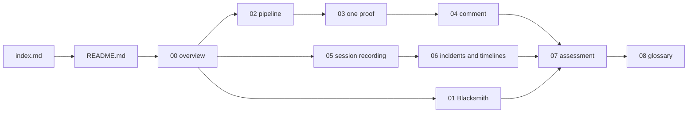
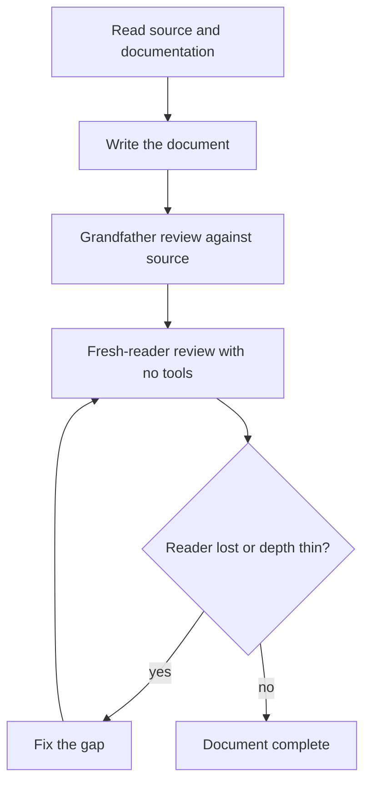

# Spec: Proof, two implementations of one idea

## 1. Source

| Property | Value |
|----------|-------|
| Monoscope location | `/Users/darkvoid/GitSources/src.monoscope/monoscope` |
| Monoscope remote | `https://github.com/monoscope-tech/monoscope` |
| Monoscope commit | `1ea47f3580bf9e4069c5081c808c5f4e98a41e52` |
| Monoscope version | `v0.6.31-159-g1ea47f358` |
| Browser client location | `/Users/darkvoid/GitSources/src.monoscope/monoscope-web` |
| Browser client commit | `8d9678c331f8b4be6fbec4ee0c8219ba701368a3` |
| Browser client version | `0.13.0` (`package.json`), package `@monoscopetech/browser` |
| TimeFusion location | `/Users/darkvoid/GitSources/src.monoscope/timefusion` |
| TimeFusion commit | `d32177040f19fa861290ed316ef7f25813c8bce4` |
| Testkit location | `/Users/darkvoid/GitSources/src.monoscope/testkit` |
| Testkit commit | `b9cecb520f901e372a6198dce3eaf01f8c51fa7c` |
| Vendor-run product documentation | `https://docs.blacksmith.sh/proof/overview` |
| Rules documentation | `https://docs.blacksmith.sh/proof/proof-md.md` |
| Pricing documentation | `https://docs.blacksmith.sh/proof/pricing.md` |
| Pull Request (PR) 825 | Merge commit `a399f2e39b3dbf947d60101ee7f6d39e8e351b45`, title "Proofs: browser recordings with screenshots and chapters, and a comment that leads with the proof (#825)". The merge commit is an ancestor of the pinned Monoscope commit. |
| Source of truth | The source at the commits above. Every implementation claim names a file and, where useful, a line. Every product claim names the documentation page. |
| Blacksmith internals | Not documented. This exploration does not invent them. |

TimeFusion is the telemetry store. It keeps logs, traces, metrics, and events as Delta Lake tables on Simple Storage Service (S3)-compatible object storage and answers queries over the PostgreSQL wire protocol (`timefusion/README.md:7-8`). An event here is one telemetry record, not an incident event. Testkit is an API test tool with a YAML Ain't Markup Language (YAML) scenario syntax. The exploration uses the TimeFusion and Testkit commits as pins for the telemetry and test context; it does not document their internals.

Pull Request 825 is a provenance anchor for the browser proof media, the chapter markers, the screenshot rows, and the comment that leads with the proof. It is not the start of the proof system: the earlier proof path and migration 0269 exist before it. This exploration reads the pinned commit, which contains the pull request and later changes. A statement about behavior that the pull request adds names a file from its 19-file change set; a statement about earlier machinery does not.

### Commit rule for this exploration

Two independent proof implementations and one production evidence system are the subjects of this exploration. The Monoscope source does not reference the Blacksmith Proof product. A case-insensitive search for the string `blacksmith` across the tracked text files of the Monoscope server repository at the pinned commit returns one text hit only: a rule about continuous integration runners in `AGENTS.md:185`. That rule is unrelated to Proof. A tracked Mach-O binary under `.github/skills/impeccable/scripts/bin/darwin-arm64/` also contains the byte sequence; it is compiled code, not a source reference. The same search across the browser client repository at its pinned commit returns no hit. The two proof systems are therefore treated as **two implementations of one idea**, not as one product used by the other.

## 2. What the Project Is

This exploration explains the idea of **Proof**: an automated approach that runs a code change, captures what the change does, and returns visual evidence to the pull request (PR) author. A **proof system** is a system that implements the idea. A **promise** is a guarantee that a proof system states about its evidence. The observation promise says that the change produced this result. The comparison promise says that the same scenario ran on the base revision and on the head, so a reader can compare the results; it does not promise a difference. A separate **production claim** reports what telemetry shows about deployed users. The exploration documents three subjects:

1. **Blacksmith Proof**, the product this exploration calls vendor-run because the vendor sells and describes the service. It is documented as a workflow, not as an execution architecture; the documentation does not use the word hosted and does not state who operates the sandbox.
2. **Monoscope's own Proof system**. It is an in-house system inside the Monoscope server repository. An **Impact Review** is the subsystem that reviews one pull request. The system's Haskell host owns the review state machine and the guest session. A Node.js model host (`impact-review-worker/pi-host.mjs`) runs the model session and forwards tool calls. A sandbox bridge (`impact-review-worker/sandbox.mjs`) holds the local Gondolin micro-Virtual Machine (micro-VM) handle and executes the operations that the Haskell guest session selects. An **agent attempt** is one model execution inside a review run; one agent attempt can use more than one model session. Guest images, warm checkpoints, a repository guidance file (`.monoscope/PROOF.md`), browser recordings made with Playwright, and the `projects.pr_review_proofs` table provide the evidence. The guidance file is not a machine-parsed recipe; the host gives its text to the review model. The review model chooses a claim status from proof summaries; the host does not compare the recordings itself.
3. **Monoscope browser session recording and incident timelines**. The `@monoscopetech/browser` package records a user's browser session with rrweb. It sends `session.id` and `tab.id` with the replay, and sets both in World Wide Web Consortium (W3C) baggage so that a backend service can add them to its spans. At query time, the server reads one `session.id` scalar from the spans of an issue trace, inside a plus or minus 300-second window around the trace's timestamp, and then looks for a replay recording with that identifier. It stores no `tab.id` field and no session-to-trace relation.

Terms that item 2 uses: a **guest image** is the Linux image that a micro-VM boots, with a tool profile such as `minimal`, `monoscope`, or `browser`. A **checkpoint** is a saved copy-on-write disk from that image; a **warm checkpoint** is one that an earlier run prepared, so a later run can resume instead of starting cold. A **dependency archive** is a tar archive that the host copies into the guest for the trusted preparation script to consume. The checkpoint identity stores its Secure Hash Algorithm 256-bit (SHA-256) digest and byte size (`AgentWorkspace.hs:1437-1444`). The **trusted preparation script** is the host-supplied script that builds the checkpoint for an image; it is not the proof setup script, which a proof request supplies. A **recipe** is a saved proof setup script from a successful head run, stored for the project, owner, and repository and offered to a later review (migration 0270). The host gives the model a summary of each side, not the binary media (`CodeReview.hs:686`), and the model chooses `Matches`, `Differs`, or `Unverified` against the claim (`Policy.hs:211`).

**Aha: the proof is a link in a comment, not a file that a reviewer opens.** The media bytes live in Postgres, and the reviewer never touches the database. The host turns each stored row into a signed link, and the pull request comment is the only surface that the reviewer sees. The signature is a hash-based message authentication code (HMAC) over the project identifier and the media path (`Widget.hs:676-679`). The link has no expiry and needs no session, so GitHub's image proxy can fetch it. The signed link is therefore the product boundary between the proof system and its user.

## 3. Documentation Goal

A reader must be able to:

1. State the Proof idea in one sentence, and state the two promises that the idea carries.
2. Describe the documented Blacksmith Proof workflow, including modes, rules, triggers, limits, pricing, and the undocumented areas.
3. Trace one Monoscope proof from a review request to a published comment, naming every component and file.
4. Explain how the Haskell host, the Node adapter, and the Gondolin micro-VM divide responsibility.
5. Explain how guest images, warm checkpoints, dependency archives, and the saved recipe reduce repeated preparation work.
6. Read a proof script and state what the setup does, what the recording shows, and what the proof script writes to `PROOF_MEDIA`.
7. Explain how screenshots, chapters, a browser video, a preview image (GIF or animated WebP), and an MPEG-4 Part 14 (MP4) video become a signed media link.
8. Explain how the proof comment selects a lead claim, orders the evidence, and escapes model text.
9. Explain how `@monoscopetech/browser` records a session, batches events, masks private data, and transports events.
10. Explain which keys correlate a browser session with backend traces, logs, and errors, and where correlation stops.
11. Compare Blacksmith Proof, Monoscope Proof, and plain session replay. A **session replay** is the playback of recorded browser events. State what each can establish, what each costs, and what each cannot establish.
12. Name every abbreviation and term used in the exploration.

## 4. Documentation Structure

```
src.proof/
├── index.md                                  ← parent index: thesis, sources, document table
├── index.html                                ← generated from index.md
├── build.py                                  ← builds every child that holds markdown/
├── styles.css                                ← shared style sheet, copied into each html/ tree
└── monoscope/
    ├── spec.md                               ← this file
    ├── markdown/
    │   ├── README.md                         ← thesis, reading order, document index
    │   ├── 00-overview.md                    ← the idea, three subjects, two promises, how pieces relate
    │   ├── 01-blacksmith-proof.md            ← the vendor-run product and what its documentation omits
    │   ├── 02-monoscope-proof-pipeline.md    ← host, adapter, micro-VM, images, checkpoints, offline
    │   ├── 03-running-one-proof.md           ← base/head, setup, Playwright, media, schema
    │   ├── 04-the-proof-comment.md           ← claims, chapters, stills, findings, goldens
    │   ├── 05-browser-session-recording.md   ← rrweb, batching, transport, masking, storage
    │   ├── 06-incidents-and-timelines.md     ← grouping, correlation keys, timeline order
    │   ├── 07-comparison-and-assessment.md   ← the three-way comparison and assessment
    │   └── 08-glossary.md                    ← every term, spelled out
    └── html/                                 ← generated
```

The reading order follows the dependency between the ideas. A reader should not meet the comment format before the proof run that produces its evidence.



## 5. Tasks

| Phase | Task | Status |
|-------|------|--------|
| 1 | Read the instruction set, the ten Iron Rules, and the exploration agent quality bar | DONE |
| 2 | Read the Blacksmith Proof overview, rules, and pricing documentation | DONE |
| 3 | Map the Monoscope proof files, migrations, goldens, and Pull Request 825 | DONE |
| 4 | Trace the Haskell proof state machine and media pipeline | DONE |
| 5 | Trace the Node adapter, Gondolin micro-VM, guest images, and checkpoints | DONE |
| 6 | Trace `monoscope-web` session recording and the replay transport | DONE |
| 7 | Trace incident detection, grouping, and timeline correlation | DONE |
| 8 | Write `index.md`, `README.md`, and documents 00 to 02 | DONE |
| 9 | Write documents 03 to 05 | DONE |
| 10 | Write documents 06 to 08 | DONE |
| 11 | Grandfather review against the source for every document | DONE |
| 12 | Fresh-reader review for every document, and fix every reported gap | DONE |
| 13 | Report contradictions, findings, and open questions to the parent session | DONE |
| 14 | Final consistency pass: one term for the vendor environment, `bytea` for binary column storage, the seven-day review window, and a structural check of every file | DONE |
| 15 | Build the generated HyperText Markup Language (HTML) tree and check every local link | DONE |

The **ten Iron Rules** are the quality rules in `markdown_engineering/documentation_directive.md`; section 7 lists them. A **grandfather review** is a check of every document, including claims written earlier, against the pinned source before the fresh-reader pass. A **fresh-reader review** is a read by an agent with no memory of the writing and no tools, which reports where the text loses the reader.

Each phase produces a checkable artifact: a pinned commit, a cited source range, a diagram, or a written document. The source review checks each artifact against the source. The fresh-reader review closes the loop before a document is called complete.



## 6. Build System

This exploration builds the HyperText Markup Language (HTML) tree from its parent directory. The generated files are not edited by hand; every change starts in Markdown and the build replaces the HTML.

```bash
cd /Users/darkvoid/Dev/explorations/src.proof
python3 -I build.py .
```

`build.py` finds every direct child directory that holds a `markdown/` directory. It converts each `markdown/*.md` file to `html/*.html`, copies the parent `styles.css` into the `html/` tree, and writes an `index.html` for the child and for the parent. It converts relative `.md` links to `.html` links and supplies previous and next navigation.

The parent index is `/Users/darkvoid/Dev/explorations/src.proof/index.md`. It links to the generated pages under `monoscope/html/`.

## 7. Quality Requirements

The ten Iron Rules from `markdown_engineering/documentation_directive.md` apply:

1. **Detailed sections with code snippets.** Every concept is grounded in a real file, function, table, or documented command.
2. **Teach key facts quickly.** The first sentence of each section is its thesis.
3. **Clear articulation.** One idea per sentence. Aerospace and Defence Simplified Technical English, issue 100 (ASD-STE100).
4. **Mermaid diagrams.** At least two per document. Every box and arrow matches the source or the documentation.
5. **Visual assets.** Tables, trees, diagrams, and code blocks are preferred over long prose.
6. **Generated HTML.** The parent session uses `build.py` with the shared template and navigation.
7. **Cross-references.** Every document links to related documents with relative file names.
8. **Source references.** Every implementation claim cites a path and, where useful, a line. Every product claim cites a documentation Uniform Resource Locator (URL).
9. **Aha moments.** At least one non-obvious design decision per document.
10. **Index and navigation.** `README.md` is the index. `build.py` supplies previous and next navigation.

Additional rules for this exploration:

- Spell out every abbreviation at first use in **each file**, not once in the whole project. Examples: Application Programming Interface (API), Virtual Machine (VM), Pull Request (PR), Graphics Interchange Format (GIF), Portable Network Graphics (PNG), OpenTelemetry Protocol (OTLP), World Wide Web Consortium (W3C), Universally Unique Identifier (UUID), Command Line Interface (CLI).
- Each deep-dive document holds at least ten code snippets. A **deep-dive document** is one of documents 00 to 07. The README, the spec, the index, and the glossary are navigation or reference documents. The glossary may hold fewer than ten snippets, but it must define every term.
- State unverified and undocumented areas explicitly. Do not guess the internals of Blacksmith Proof.
- Treat model-authored text in the Monoscope comment as untrusted. The source escapes and defangs it; the documentation must say so.

## 8. Expected Outcome

After reading, an engineer can explain why a diff is not proof, and what evidence a proof system must collect to replace trust with observation. The engineer can describe the Blacksmith workflow from its public documentation and name its gaps. The engineer can trace the Monoscope implementation from a review request through the Haskell host, the Node adapter, the Gondolin micro-VM, the guest script, the media renderer in `Explanation.hs`, the database rows, and the signed link in the PR comment. The engineer can also explain how a recorded browser session connects to backend telemetry, and where that connection is exact and where it is only a time-window inference.
