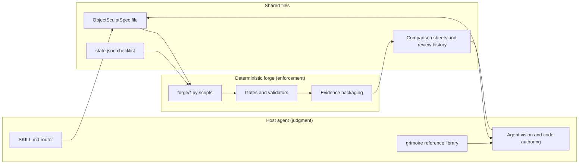
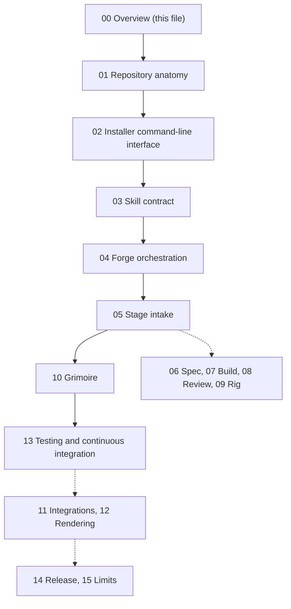

# Overview: img2threejs in Two Halves

img2threejs is not a model. It is a written contract for an agent and a deterministic forge of Python scripts. The contract supplies judgment. The scripts supply enforcement. Files join the two halves. This document explains that split, gives the shared vocabulary, and shows where each later document enters the story.

Two terms need a definition at the start. A *host* is a program that loads skills and runs an agent, such as Claude Code or OpenAI Codex. An *agent* is the model inside that host. The agent reads the contract, looks at images, and writes code. The forge never does those things.

## What the project claims

The repository states its product in one line. The line is a promise about the *method*, not about the output format.

```markdown
# README.md:7
**Rebuild the object in a reference image as a code-only, procedural Three.js model.**
```

The next line adds the quality promise and the negative list. The project is explicit about what it refuses to do.

A "negative list" is the set of methods that the project does not use. The list refuses three methods: photogrammetry, mesh extraction, and downloaded art packs. Photogrammetry builds geometry from many photographs. Mesh extraction takes a mesh out of another file. An art pack is a set of ready-made assets. None of the three counts as code-only reconstruction.

```markdown
# README.md:9
Quality-gated, animation-ready, and deliberately token-efficient — reconstruction-by-code, not photogrammetry, mesh extraction, or downloaded art packs.
```

The skill contract repeats the same promise. It also names an artificial intelligence (AI) vision self-correction loop. And it adds one careful limit. A selected emission target is a transform of a model that already exists. It is not a second way to build the model.

An "emission target" is the output format that the user selects with `--target <kind>`. A "terminal, whole-artifact transform" means one final conversion of the whole model. The limit says that the conversion happens after the build. It never becomes a shortcut around the build.

```markdown
# SKILL.md:10-16
Rebuild the object visible in a reference image as a **code-only** procedural Three.js model,
gated by a staged sculpting pipeline and an AI-vision self-correction loop. This is
reconstruction-by-code, **not** photogrammetry, mesh extraction, or downloaded art packs. That
promise governs how the model is *built* — it says nothing about which file formats it can
subsequently be *exported* to; an explicitly-selected emission target (`--target <kind>`) is a
terminal, whole-artifact transform of the already-built model, verified to its own stated limit,
never a second way to build one.
```

Read those three quotes together. The model is always code. The code always runs in Three.js. The scripts always measure and gate. No neural network sits inside this repository. The host agent supplies the vision. This is the central fact of the whole exploration.

One word causes confusion. The architecture document says "the model judges". There, "the model" means the host agent, not a trained model inside the repository. The only trained model anywhere in the flow is the optional vision language model (VLM) review layer. The repository owns neither model.

## What img2threejs is not

Four common first readings are wrong. The source corrects each one.

| First reading | What the source shows |
| --- | --- |
| img2threejs is a model that writes Three.js code. | The repository holds no model. It holds a skill contract and deterministic scripts. The host agent writes the code. |
| The Python scripts render the image. | The scripts validate, measure, gate, and package evidence. The browser Three.js route is the rendering authority. |
| The pipeline runs in one pass. | It runs eight locked passes. A pass unlocks only after review. |
| The skill is the Node package. | The Node package installs the skill. The skill is the installed tree in the checkout, including `forge/`. |

The fourth row matters for installation. The Node package is only an installer. Its description names the hosts it writes into.

```json
# package.json:4
  "description": "Install and update the img2threejs skill into agent hosts (Hermes, Claude Code, Codex, OpenCode).",
```

The package exposes one executable. That executable is the installer.

```json
# package.json:7-9
  "bin": {
    "img2threejs": "bin/img2threejs.mjs"
  },
```

So the Node package has a small job. It detects hosts and writes symlinks into a pinned release. A "symlink" is a file-system entry that points at another path. A "pinned release" is one fixed tag or commit, not a moving branch. The skill itself is the directory tree that the symlink points to. Document [02 Installer command-line interface](02-installer-cli.md) covers that executable in full.

## The two halves

The product has a clean seam. One half is prose that an agent reads. The other half is code that the host runs. The seam is a set of files.



The arrows carry the file protocol. `SKILL.md` and the agent vision produce the spec file `G`. The spec file feeds the forge scripts `D`. The scripts feed the gates `E` and then the evidence packager `F`. The packaged comparison sheet and review history `I` return to the agent for judgment. The state checklist `H` feeds the scripts so a new session can resume. The host agent runs each step, including any script that the step names. It does not call a hidden interface.

The left side is the *skill contract*. The right side is the *forge*. They never call each other directly. They exchange files. A spec file, a state file, a render, and a review record are the whole interface.

The skill contract says so itself. It is a router, not an encyclopedia.

```markdown
# SKILL.md:22-24
This file is the always-loaded router: it holds the order of operations and every hard rule as one
line. The full contract behind each rule lives in the `grimoire/` or `docs/` file that rule names —
read the named file at the moment you reach that stage, not before.
```

This design keeps the always-loaded text small. The agent reads a deep rule only when it reaches that stage. Document [03 Skill contract](03-skill-contract.md) traces the full loop. Document [10 Grimoire](10-grimoire.md) covers the reference library.

## The division of labor

The architecture document states the rule in one sentence. The sentence is the thesis of the enforcement half.

```markdown
# docs/ARCHITECTURE.md:104
- **Scripts enforce, the model judges.** The Python scripts handle validation, gating, spec authoring, PBR extraction, comparison-sheet packaging, and pipeline state. They never score visuals. The model's tokens go to one thing: looking at a single side-by-side sheet and deciding pass or fail.
```

"PBR" means physically based rendering. The scripts extract evidence for it. They do not make the visual acceptance decision. The scripts do compute measurements, including image-difference scores. The agent reads those measurements and decides pass or fail.

The review entry carries an `aiVisionScore`. The host agent supplies that score when it appends a review. The optional vision language model (VLM) can inform the agent, but no forge script computes the score.

A "comparison sheet" is one image with the reference beside the current render. The agent looks at that one image and decides pass or fail. A "closed mesh" is a surface with no holes, so the model has no gap that would show the inside.

The reference library repeats the same division. It adds the reason: the acceptance score comes only from the agent's eyes.

```markdown
# grimoire/scripts.md:7-8
Division of labor: **scripts enforce structure and package evidence; they never score visuals.**
The acceptance score always comes from the agent's own vision inspecting the comparison sheet.
```

This rule protects the evidence chain. A script can prove that a mesh is closed. It cannot prove that the mesh looks like the photograph. Only a visual judge can do that. So the scripts stop at measurement, and the model makes the visual call.

## The zero-dependency rule

The forge runs with no installed packages. That constraint is deliberate. It removes a whole class of setup failures from the agent context.

```markdown
# docs/ARCHITECTURE.md:105
- **Zero dependencies, zero install churn.** Every script is pure Python 3.10+ standard library. No pip, no PIL, no numpy, no Playwright. PNG read/write is done with `struct` and `zlib`. Nothing to install means nothing to debug in-context.
```

"PNG" means Portable Network Graphics. The scripts read and write it with the standard library alone. Optional integrations are the exception, and they live outside the forge core. An "integration" is an optional adapter, such as a local vision model. The "forge core" is the `forge/` tree that every run needs. An adapter has its own dependencies and its own environment, so a broken adapter cannot stop the core. Document [01 Repository anatomy](01-repository-anatomy.md) shows where those integrations sit.

## The locked passes

The build is not a single generation. It is a ladder of eight passes. Each pass has its own acceptance criteria.

```markdown
# docs/ARCHITECTURE.md:69
`blockout → structural-pass → form-refinement → material-pass → surface-pass → lighting-pass → interaction-pass → optimization-pass`
```

One source difference is worth naming now. The code list is authoritative, and it has eight entries. The short arrow line inside `SKILL.md` omits `surface-pass` and shortens two names.

```markdown
# SKILL.md:70
5. **Build pass-by-pass** from blockout → structure → form → material → lighting → interaction → optimization.
```

The skill line uses `structure` for `structural-pass` and `form` for `form-refinement`. It also leaves out `surface-pass`. The code list in `forge/stage3_build/orchestrate_passes.py:18-27` names all eight. When this document set says "eight passes", it follows that code list. The `surface-pass` covers surface detail and the material finish on the built form.

The pipeline has four different decompositions. They are views of one run, not competing counts.

| View | Units | Source |
| --- | --- | --- |
| Five stages | `stage1_intake` through `stage5_rig` | `forge/` directories |
| Eight build passes | `blockout` through `optimization-pass` | `DEFAULT_PASS_ORDER` |
| Four state scopes | `setup`, `pass`, `final`, `rig` | `forge/_shared/workflow_state.py` |
| Twelve loop steps | analysis through completion | `SKILL.md` steps 1 to 12 |

The twelve skill steps include setup, analysis, spec authoring, the repeated build loop, and completion. The eight passes repeat inside that loop. The four scopes are the checklist buckets that the state file uses.

The pass order carries a design rule. Everything measurable on geometry runs before the browser starts. A pass is never spent rendering geometry that is already known to be wrong.

## The refusal at 0.82

Routing is not forced. The pipeline can decline to choose a track. It does this when the subject classification is weak. "Routing" is the choice of a track from the subject class. The two tracks are `weapon-v1.4` and `character-v1.5`. A "track" is an authoring route with its own rules. The confidence value is the router's certainty about the class. Below `0.82` the router returns `request-input`, which asks the user to decide. The `cs2` profile is separate: it is a plugin profile for Counter-Strike 2 skins, not a routing track. Four thresholds serve different decisions: `0.82` for routing, `0.7` as the default visual acceptance score, `0.85` for silhouette and correction targets, and `0.80` as the optional VLM criteria minimum.

```python
# forge/_shared/pipeline_routing.py:8-12
CONFIDENCE_THRESHOLD: Final[float] = 0.82
TRACK_BY_KIND: Final[dict[str, str]] = {
    "weapon": "weapon-v1.4",
    "character": "character-v1.5",
}
```

The architecture table describes the result. A low-confidence subject becomes a request for input, not a guess.

```markdown
# docs/ARCHITECTURE.md:180
| `_shared/pipeline_routing.py` | Fail-closed weapon/character routing; below `0.82` confidence it resolves to `request-input`. |
```

**Aha:** The most important quality control in img2threejs is a refusal, not a generation. A pipeline that always produces a model must hide its uncertainty somewhere. A pipeline that can return `request-input` puts the uncertainty in front of the user. The threshold `0.82` is the line between "I know what this is" and "you must tell me".

This refusal is also why the skill is honest about dead ends. The agent must ask for a better image or a track decision instead of fabricating one. Document [04 Forge orchestration](04-forge-orchestration.md) shows the state machine that carries the refusal.

## Vocabulary

The project uses a small set of terms with exact meanings. Later documents assume these meanings.

| Term | Meaning in this repository |
| --- | --- |
| Skill contract | The tree that the host agent reads: `SKILL.md` plus the `grimoire/`, `docs/`, and `forge/` trees. |
| Forge | The deterministic Python scripts under `forge/`. |
| ObjectSculptSpec | The JSON specification of the model: components, materials, sockets, review history. |
| Pass | One locked build stage with its own acceptance criteria. |
| Gate | A script check that blocks progress when evidence is missing or wrong. |
| Rubric | A written judgment rule that the agent applies at a named step. |
| Profile | A named checklist variant, such as `generic`, `character`, or `cs2`. |
| Plugin | An optional installed package that adds steps, gates, and domain rules for one subject family. |
| Track | The authoring route chosen by routing: `weapon-v1.4` or `character-v1.5`. |
| Evidence | A file that proves a step happened, such as a probe, a render, or a review record. |
| Probe | A small measurement script or the measurement it writes, such as image size or depth data. |
| Socket | A named attachment point in the spec where another part connects. |
| Local state | The resumable checklist at `.img2threejs/state.json`. |
| Comparison sheet | One image with the reference beside the current render. |
| Grimoire | The reference library of rubrics and gate contracts. |
| Divine Eye | The deterministic render evaluator. Its signals include silhouette, interior difference, and color difference. |
| VLM | Vision language model, used only as the last review layer after the deterministic gates. |

Two similar terms need care. "Track" is the routing choice. "Profile" is the checklist variant. They are related but not identical. A character subject normally resolves to the `character-v1.5` track and the `character` profile. In document 10, "track" also means an animation channel; that is a different sense.

## The forge in one page

The forge is large: 215 Python files, including the tests, and 71,209 lines. Its entry points are few. The state tools come first.

`forge/next.py` takes an optional positional spec path. The normal pre-spec case passes no path. The script then reads the spec location recorded by `state.py init --spec`. If that file does not exist yet, `next.py` treats the run as pre-spec instead of failing. A run with neither a spec path nor an initialized state is an error.

```python
# forge/state.py:27-29
    init = commands.add_parser("init")
    init.add_argument("--state", type=Path, default=Path(".img2threejs/state.json"))
    init.add_argument("--reference", required=True)
```

The default state path is relative to the working directory. A run therefore carries its own checklist beside the user's project.

The checklist has named steps. Setup steps run before any spec exists.

```python
# forge/_shared/workflow_state.py:22-30
SETUP_STEPS: Final = (
    ("image-analysis", "Read grimoire/intake/image_analysis.md and analyze {reference}"),
    (
        "reference-suitability",
        "Read grimoire/intake/validation_rubric.md and record a pass, conditional, or reject verdict for {reference}",
    ),
    ("reference-admission",
     "python3 forge/stage1_intake/check_reference_admission.py {reference}"
     " --out admission.json --probe-out probe.json"),
```

These steps show the pattern of the whole forge. Each step has an identifier and an instruction. Some instructions call a script. Some instructions tell the agent to read a named rubric. The state tracker records both kinds the same way.

## The reading guide

The exploration is a set of layers. Read them in this order for a full picture.



| If you want to know... | Read |
| --- | --- |
| What the product is and how to name its parts | This document |
| Where every directory and file lives | [01 Repository anatomy](01-repository-anatomy.md) |
| How the skill reaches a host machine | [02 Installer command-line interface](02-installer-cli.md) |
| What the agent is required to do | [03 Skill contract](03-skill-contract.md) |
| How a run survives a new session | [04 Forge orchestration](04-forge-orchestration.md) |
| How the reference image becomes evidence | [05 Stage intake](05-stage-intake.md) |
| Which rubric each gate applies | [10 Grimoire](10-grimoire.md) |
| What the tests and workflows protect | [13 Testing and continuous integration](13-testing-and-ci.md) |

The remaining documents cover the layers this document set does not. Document 06 covers spec authoring. Document 07 covers the build passes. Document 08 covers review. Document 09 covers rigging and characters. Document 11 covers integrations. Document 12 covers materials and rendering. Document 14 covers release operations. Document 15 covers the stated limits. The dashed arrows mark those documents as outside this core group.

## How the pieces reference each other

There are three kinds of reference in the repository. Each kind has a different job.

1. **Instruction references.** The skill tells the agent to read a file. `SKILL.md` and the state steps use this kind.
2. **Code references.** A Python module imports another module. The `_shared` package is the common target.
3. **Evidence references.** A JSON artifact names a file that proves a claim. The details inventory and the review history use this kind.

The first kind is loose. A missing instruction file is a documentation bug. The second kind is strict. A missing module stops the script. The third kind is auditable. A review without evidence is rejected.

A good example of the third kind is the state guard. The forge refuses a spec that does not match the recorded state artifact. A "state artifact" is the `.img2threejs/state.json` file. The "state guard" is the check inside `forge/next.py`. The "next-action reporter" is `next.py` itself: it prints the next ordered action. It enforces the guard when the user passes a positional spec path.

```markdown
# docs/ARCHITECTURE.md:73-77
For resumable work, `forge/state.py` stores an atomic JSON checklist around this pipeline. Profile
steps for `character` and `cs2` are inserted before local spec authoring; correction counts are
bounded per pass and globally. `forge/next.py --state` reports the next ordered action and rejects
a positional spec that differs from the state artifact. This state index does not grant a pass:
the ObjectSculptSpec, render evidence, review history, and deterministic gates still decide.
```

"JSON" means JavaScript Object Notation. The state is a JSON file, and it is written atomically. A crash never leaves a half-written checklist.

## What the exploration does not claim

The documents in this set make no claim about the following:

- They do not claim that the generated model is a perfect copy. The project states its own likeness limit.
- They do not claim that the scripts judge beauty. They judge structure and evidence.
- They do not claim that routing always succeeds. It can refuse below `0.82`.
- They do not claim that optional integrations are part of the forge core. They are isolated.
- They do not claim that the hosted gallery is covered here.

This last point matters. The repository ships a demo gallery, but the gallery is a separate product. The "hosted gallery" is a web site that shows finished models. Its source lives in a separate repository. The exploration cites the gallery only when a source file does. The project also states a likeness limit: a single image cannot prove hidden geometry or an exact face.

## The one-sentence model

If a reader remembers one sentence, it should be this. img2threejs is a contract that tells an agent how to judge. It is also a forge that checks what the agent produced. A file protocol lets the two work without trusting each other.

The contract is Markdown. The forge is Python. The protocol is JSON plus rendered images. The next document maps the directories that hold all three.

## Cross-references

- [01 Repository anatomy](01-repository-anatomy.md) maps every directory named here.
- [02 Installer command-line interface](02-installer-cli.md) explains how the Markdown reaches a host.
- [03 Skill contract](03-skill-contract.md) explains the always-loaded router.
- [04 Forge orchestration](04-forge-orchestration.md) explains the state machine.
- [05 Stage intake](05-stage-intake.md) explains the first evidence scripts.
- [10 Grimoire](10-grimoire.md) explains the rubric library.
- [13 Testing and continuous integration](13-testing-and-ci.md) explains the checks that protect the rule.
