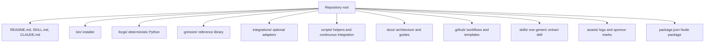
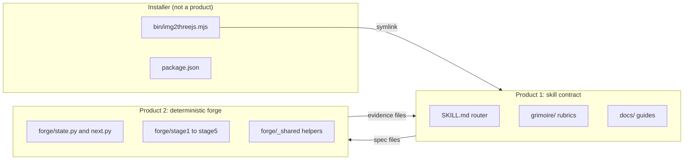
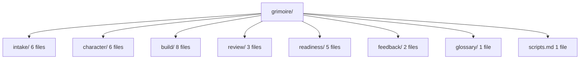

# Repository Anatomy: Directories, Products, and Rules

The repository has two products and one installer. The products are the skill contract and the deterministic forge. The installer is a small Node package. This document maps every top-level directory, gives the file counts, and states the dependency rules that keep the parts apart.

The installer is a delivery tool, not a third product. It ships the skill. It holds no product logic. A *checkout* is a local working copy of a Git repository. The *skill* is the installed tree in that checkout: `SKILL.md` plus the `grimoire/`, `docs/`, and `forge/` trees. A *release copy* is one fixed checkout under the release directory that the installer creates.

## The top level

The checkout is a skill first. The Markdown files at the root are the entry surface for a human and for an agent. The `bin/` directory holds the only Node executable.



The root also holds `CHANGELOG.md`, `CONTRIBUTING.md`, `LAB-FINDINGS.md`, `LICENSE`, and `ROADMAP.md`. These files are release-facing. The change rules require them to stay consistent with `SKILL.md` and `README.md`.

The project instructions state the highest rule in one line. It is the rule that separates the two halves.

```markdown
# CLAUDE.md:11
- Treat `forge/` as deterministic tooling and `grimoire/` as routed reference material.
```

"Deterministic" means the same input gives the same output. "Routed" means the agent reads a file only when a step names it. These are different jobs, and they live in different directories.

## The two products

The first product is the skill contract. It is the Markdown part of the installed tree that a host agent reads. The second product is the forge. It is the Python tree that the host runs. They share one checkout and one release tree, but they do not share code.



The installer is outside the two-product count. It moves the skill onto a host machine. It does not judge an image and it does not build a model.

The installer does not contain the skill. It writes a symlink to a pinned release of the checkout. The pin is not a constant in the file. The installer resolves the latest release or takes a `--ref` value at run time. It fetches that one commit into `~/.img2threejs/releases/<sha>` and links the host to it.

```javascript
// bin/img2threejs.mjs:10-11
const SKILL_REPO = 'img2threejs/img2threejs'
const SKILL_URL = `https://github.com/${SKILL_REPO}.git`
```

The host table shows where each symlink goes. Detection is a simple directory test.

```javascript
// bin/img2threejs.mjs:18-23
const HOSTS = {
  hermes: {
    label: 'Hermes Agent',
    detect: () => fs.existsSync(path.join(os.homedir(), '.hermes')),
    skills: () => path.join(os.homedir(), '.hermes', 'skills'),
  },
```

The installer uses four exit codes. The codes let a host script tell success from refusal.

```javascript
// bin/img2threejs.mjs:47
const EXIT = { OK: 0, FAIL: 1, REFUSED: 2, NEEDS_INPUT: 3 }
```

Document [02 Installer command-line interface](02-installer-cli.md) covers the installer in full. Document [03 Skill contract](03-skill-contract.md) covers the skill.

## The Node package

The package is deliberately thin. It uses the Node Package Manager (npm) for two scripts.

```json
# package.json:13-16
  "scripts": {
    "test": "node --test bin/img2threejs.mjs-test.mjs",
    "package:check": "npm pack --dry-run"
  },
```

```json
# package.json:17-19
  "files": [
    "bin/img2threejs.mjs"
  ],
```

So an npm install fetches only the installer. The skill itself comes from Git at a pinned reference. The installer fetches the whole repository checkout, so the skill and the forge ship in one release tree. The npm package version `0.2.0` and the skill version `2.0.1` are independent; the source records no compatibility rule between them.

## Counts

The following table gives measured counts at commit `0c0c49bc168e648dbaf9c8c080474de0b3a941b6`. A count is a file count unless the note says otherwise.

| Area | Count | Note |
| --- | --- | --- |
| `bin/` | 2 files | The installer and its test |
| `forge/` | 215 Python files | 71,209 lines in total |
| `forge/tests/` | 103 Python files | 101 test modules, 2 support modules, plus a `fixtures/` directory |
| `grimoire/` | 32 files | 8 build, 6 character, 2 feedback, 1 glossary, 6 intake, 5 readiness, 3 review, 1 root `scripts.md` |
| `docs/` | 33 files | 26 Markdown documents and 7 other files |
| `integrations/` | 31 files | 3 top-level adapters |
| `scripts/` | 14 files | 11 Python files, 1 shell script, 2 data files |
| `.github/workflows/` | 8 files | Continuous integration, docs, release, triage |
| `skills/` | 1 file | `generic-extract-skill.md` |
| `assets/` | 8 files | Logo and sponsor marks |
| Repository root | 7 Markdown files | Plus `package.json` and non-Markdown `LICENSE` |

A directory listing can show extra entries. The `forge/tests` tree has 103 Python files, 101 of them test modules. The other two are the support modules `oracle_support.py` and `showcase_test_support.py`. The `fixtures/` directory is separate and holds seven files.

## The forge tree

The forge has five stages, a shared package, a material registry, and tests. The stage names follow the pipeline order. The intake stage probes a Graphics Library Transmission Format (GLB) binary file and extracts physically based rendering (PBR) evidence. A "probe" is a small measurement. PBR is a material model that uses physical light behavior.

| Directory | Job |
| --- | --- |
| `forge/stage1_intake/` | Probe the image and GLB, build detail inventory, extract landmarks, camera pose, PBR evidence, hair evidence, materials. |
| `forge/stage2_spec/` | Pre-spec assessment, spec authoring, validation, material wiring, hair profile. |
| `forge/stage3_build/` | Pass orchestration, factory generation, visual hull, texture coordinate (UV) unwrap, texture bake. |
| `forge/stage4_review/` | Comparison sheets, Divine Eye, interior difference, chirality, gates, material comparator. |
| `forge/stage5_rig/` | Rig spec, geodesic skinning, rig emission, rig payload validation. |
| `forge/_shared/` | Workflow state, pipeline routing, artifact cache, domains, and common gates. |
| `forge/materials/` | The material reference registry contract. |
| `forge/tests/` | Unit and fixture tests for every stage. |

The shared package is imported through a path insert. A "path insert" adds a directory to the Python module search path before an import. Every entry script does this, so the script can run from the checkout without an install. An "entry script" is a script that a user or the agent runs directly.

```python
# forge/state.py:9-13
ROOT = Path(__file__).resolve().parent
sys.path.insert(0, str(ROOT / "_shared"))

from domains import DomainRegistryError, registered_domains  # noqa: E402
from workflow_state import (  # noqa: E402
```

The shared package imports the domain registry the same way. A "domain registry" is a table that maps a profile name, such as `character`, to its steps, gates, and reference files. A "domain" is a subject family. The registry lets the base provide `generic` and `character`, while an installed plugin provides a domain such as `cs2`.

```python
# forge/_shared/workflow_state.py:12-14
sys.path.insert(0, str(Path(__file__).resolve().parent))

from domains import DomainRegistryError, domain_profile  # noqa: E402
```

This pattern has one consequence. `forge/` must stay importable with no third-party package. The next rule makes that requirement explicit.

## The standard-library rule

Forge scripts use only the Python 3.10 or later standard library. The rule is stated in three places: `docs/ARCHITECTURE.md` line 105, `grimoire/scripts.md` lines 3 to 5, and `CLAUDE.md`. The scripts reference is the shortest form.

A "gate" is a script check that blocks progress when evidence is missing or wrong.

```markdown
# grimoire/scripts.md:3-5
All scripts are pure Python 3.10+ **standard library** — no pip install, no PIL/numpy, no
Playwright/Chromium. PNG read/write is done via `struct`/`zlib`. Run from the skill root so
paths resolve as `forge/<name>.py`. Non-zero exit = a gate failed; read the printed reasons.
```

"PIP" means the Python package installer. "PIL" means the Python Imaging Library. "PNG" means Portable Network Graphics. The scripts decode and encode it with `struct` and `zlib` only.

The reason is operational. A host agent runs these scripts inside a user project. An install step would add a failure mode that the agent cannot repair. The standard-library rule removes that failure mode.

## The grimoire tree

The grimoire is the reference library. It is not code. It holds the contracts that the agent reads at the moment of use.

```markdown
# docs/ARCHITECTURE.md:185-187
`grimoire/scripts.md`; the gate-by-gate contract is `grimoire/review/gates_reference.md`. The rest of
`grimoire/` holds the rubrics each gate applies (validation, pre-spec assessment, procedural patterns,
material and lighting realism, attachment correctness, action-ready models, self-correction).
```

The directory split follows the pipeline. `intake/` holds image and quality rules. `character/` holds anatomy and likeness rules. `build/` holds geometry and render patterns. `review/` holds gate and correction rules. `readiness/` holds animation and rig contracts. `feedback/` holds capture rules. `glossary/` holds vocabulary.



Document [10 Grimoire](10-grimoire.md) explains each rubric and the order in which the agent reads them.

## The optional integrations

Three adapters live under `integrations/`. They are optional. They are not part of the forge core.

| Adapter | Job |
| --- | --- |
| `integrations/vision/` | Local vision evidence: segmentation, depth, landmarks. |
| `integrations/mesh3d/` | Mesh import and conversion helpers. |
| `integrations/glb_character_pipeline/` | Graphics Library Transmission Format (GLB) character import and rig bridge. |

Each adapter has its own dependency manifest. The vision adapter shows the pattern. It pins Python 3.11 to 3.13 and lists its packages.

```toml
# integrations/vision/pyproject.toml:1-5
[project]
name = "img2threejs-vision"
version = "0.1.0"
description = "Optional local vision evidence adapters for the img2threejs procedural pipeline"
requires-python = ">=3.11,<3.13"
```

The `requires-python` field accepts Python 3.11 and 3.12 only. Python 3.13 is excluded. The dependency list follows that field.

The forge calls an adapter through a subprocess at a known path. `forge/stage1_intake/run_vision_adapter.py` uses a default virtual-environment Python at `integrations/vision/.venv/bin/python`. The `IMG2THREEJS_VISION_PYTHON` environment variable can override it. The forge core never imports the adapter packages.

**Aha:** The dependency rule is not a style preference. It is a recovery rule. The forge must run on a fresh machine with only Python installed. Every optional feature therefore sits behind a process boundary. A broken integration cannot stop the deterministic core. This is why `forge/` has no `requirements.txt` while `integrations/` has locked dependency files.

## The scripts directory

The two data files are `scripts/ci/link-baseline.txt` and `scripts/ci/skill-budget.json`. The table above names all 11 Python files. The continuous integration files are the largest group.

One contrast matters. `scripts/capture_threejs_playwright.py` needs Playwright. That is why it lives in `scripts/`, not in `forge/`. The standard-library rule covers the forge, not the helper tools.

| File | Job |
| --- | --- |
| `scripts/ci/md_links.py` | Check relative Markdown links and anchors. |
| `scripts/ci/md_tables.py` | Check GitHub Flavored Markdown table shape. |
| `scripts/ci/plugin_table.py` | Render the plugin table from the live catalog. |
| `scripts/ci/showcase_table.py` | Render the demo table from the gallery. |
| `scripts/ci/pr_scope.py` | Check that a documentation pull request only touches documentation. |
| `scripts/ci/skill_budget.py` | Fail when `SKILL.md` exceeds its word budget. |
| `scripts/ci/mdcommon.py` | Shared fence, front-matter, and file-selection helpers. |
| `scripts/ci/tests/test_ci_scripts.py` | Tests for the continuous integration helpers. |
| `scripts/capture_threejs_playwright.py` | Browser capture helper. |
| `scripts/character_audit.sh` | Character audit shell helper. |
| `scripts/issue_triage.py` | Issue triage helper. |
| `scripts/release_metadata.py` | Release metadata helper. |

The `docs/` tree holds the long-form guides. The `.github/` tree holds the workflows that run the tests. Document [13 Testing and continuous integration](13-testing-and-ci.md) covers both.

## The workflow that protects the tree

Continuous integration ("CI") runs the Python tests and the Node tests. The Python job calls a reusable workflow at a pinned commit. A "reusable workflow" is a workflow file in another repository that this workflow calls by name.

```yaml
# .github/workflows/ci.yml:12-17
  test:
    # ci-workflows v1.1.0
    uses: img2threejs/ci-workflows/.github/workflows/python-ci.yml@dd3a7730cacb6ab00cc853be606ce72de389a54c
    with:
      python-version: "3.10"
      test-command: python3 -m unittest discover -s forge/tests
```

The same file has a second job for the Node tests.

```yaml
# .github/workflows/ci.yml:18-29
  cli:
    runs-on: ubuntu-latest
    strategy:
      matrix:
        node-version: [18, 22]
    steps:
      - uses: actions/checkout@v4
      - uses: actions/setup-node@v4
        with:
          node-version: ${{ matrix.node-version }}
      - run: npm test
      - run: npm run package:check
```

The `cli` job runs on Node 18 and Node 22. It runs the installer test and a dry-run package check. The pinned commit hash in the first job is the same discipline that the installer applies to the skill. A workflow reference cannot move under the project.

The same test command appears in the project instructions. A contributor can run it locally with no workflow.

```markdown
# CLAUDE.md:22
python3 -m unittest discover -s forge/tests -p 'test_*.py'
```

The two commands are equivalent. `unittest discover` uses `test*.py` as its default pattern. That pattern also matches a name such as `testing.py`. The project has no such file, and the explicit `test_*.py` pattern is narrower.

## How the pieces reference each other

The table lists five allowed directions and two forbidden ones. The forbidden directions are the important ones.

| Direction | Example | Allowed |
| --- | --- | --- |
| Skill to forge | A state step runs `forge/stage1_intake/probe_image.py`. | Yes |
| Forge to skill | `forge/next.py` prints the next step, whose text names a rubric path. | Yes, as text only |
| Forge to shared | `state.py` imports `workflow_state`. | Yes |
| Shared to stage | `_shared` imports a stage module. | No |
| Forge to integration | A subprocess call with an explicit path. | Yes, optional |
| Installer to skill | A symlink into a release directory. | Yes |
| Skill to installer | The installer is not imported. | No |

The first forbidden direction protects the state machine. The shared layer must not depend on a stage. If it did, a change in one stage could break the state machine for every profile. The second forbidden direction protects the boundary. The skill never imports the installer, because the skill must run without Node.

The same rule shapes the plugin boundary. A plugin adds steps, evidence, and gates. It does not change the terminal phase.

```markdown
# README.md:171-175
An installed domain plugin contributes its checklist steps, evidence collection, spec
augmentation (quality floors merge raise-only), and blocking review gates. With no plugins
installed, the base has `generic` and `character` profiles. A profile whose plugin is
missing (`cs2`, `animated-character`) fails loud naming what is installed; it never silently
downgrades. The base skill is not a plugin: **do not use `img2 add` to install this repository.**
```

The phrase "merge raise-only" means a plugin can raise a quality floor. It cannot lower one.

## The shared checkout rule

Every host must enter the same checkout. The installer enforces this by symlink.

```markdown
# SKILL.md:28-33
Keep one checkout of this repository and let every host enter it through a symlink, so the hosts
execute the same code instead of drifting apart. `npx --yes img2threejs@latest install` does this
for the hosts it detects (`hermes`, `claude`, `codex`, `opencode`); it refuses (exit 2) to replace a
link it does not manage, so a hand-made link is never silently swapped for a release copy.
**Hermes** reads skills per profile: also link `~/.hermes/profiles/<profile>/skills/img2threejs`
(the installer writes only `~/.hermes/skills/`). Install, manual symlinks, and troubleshooting:
```

Two copies of the skill would drift. One copy with many symlinks cannot drift. The refusal at exit code 2 protects a user-managed link.

The Hermes sentence adds a second path. The installer writes `~/.hermes/skills/`. Hermes also reads skills per profile, so a user with profiles must add `~/.hermes/profiles/<profile>/skills/img2threejs` by hand. The installer does not write that path. The quote says so directly with "the installer writes only `~/.hermes/skills/`".

## The one generic skill

The `skills/` directory holds a single extraction helper. It is a generic skill, not the main skill. It shows how a host can wrap the contract for a narrow case. The main skill remains `SKILL.md` at the root.

This directory is small on purpose. The product is one skill. A second full skill would split the contract. The generic file also gives a host a safe example. A host author can read it without reading the full router and without running a gate.

The `assets/` directory holds presentation files only. It has one logo and seven sponsor marks. No script reads these files at run time. They exist for the README and for the hosted gallery. A contributor can change them without a test, but the change rule still asks for an honest claim.

The root Markdown files also have different audiences. `README.md` is for a human who evaluates the project. `SKILL.md` is for the host agent. `CLAUDE.md` is for a coding agent that changes the repository. `CONTRIBUTING.md` is for a human who sends a change. `ROADMAP.md` and `LAB-FINDINGS.md` are for a reader who wants the limits. One file does not replace another.

## Rules for a new file

A contributor who adds a file must follow five rules.

1. Put the file in the directory that matches its job. Forge code goes in `forge/`, installer code goes in `bin/`, tooling goes in `scripts/`, and prose goes in `grimoire/` or `docs/`.
2. Keep the standard-library rule for `forge/`. The rule does not cover `bin/`, `scripts/`, or `integrations/`.
3. Name every new gate in `grimoire/scripts.md` and `grimoire/review/gates_reference.md`.
4. Add a test for any code change. Forge tests go under `forge/tests/`, and the installer test is `bin/img2threejs.mjs-test.mjs`.
5. Keep the counts and tables in this exploration honest if the source changes. This fifth rule is for the exploration, not for the repository.

The repository does not define a linter for these rules. It enforces the important ones through tests and workflows. "Important" here means the rules that a workflow can check: Markdown links, table shape, and the skill word budget.

## What the anatomy does not show

The map does not show the content of the pipeline. It shows where the content lives. The order of a run, the state file, and the routing threshold are in [04 Forge orchestration](04-forge-orchestration.md). The intake scripts are in [05 Stage intake](05-stage-intake.md). The rubrics are in [10 Grimoire](10-grimoire.md). The checks are in [13 Testing and continuous integration](13-testing-and-ci.md).

The map also does not claim that every directory is complete. The project is active. The counts in this document are correct at commit `0c0c49bc168e648dbaf9c8c080474de0b3a941b6`.

## Cross-references

- [00 Overview](00-overview.md) gives the thesis and the vocabulary.
- [02 Installer command-line interface](02-installer-cli.md) explains `bin/img2threejs.mjs`.
- [03 Skill contract](03-skill-contract.md) explains `SKILL.md`.
- [04 Forge orchestration](04-forge-orchestration.md) explains the state tools.
- [05 Stage intake](05-stage-intake.md) explains `forge/stage1_intake/`.
- [10 Grimoire](10-grimoire.md) explains the reference library.
- [13 Testing and continuous integration](13-testing-and-ci.md) explains the checks.
