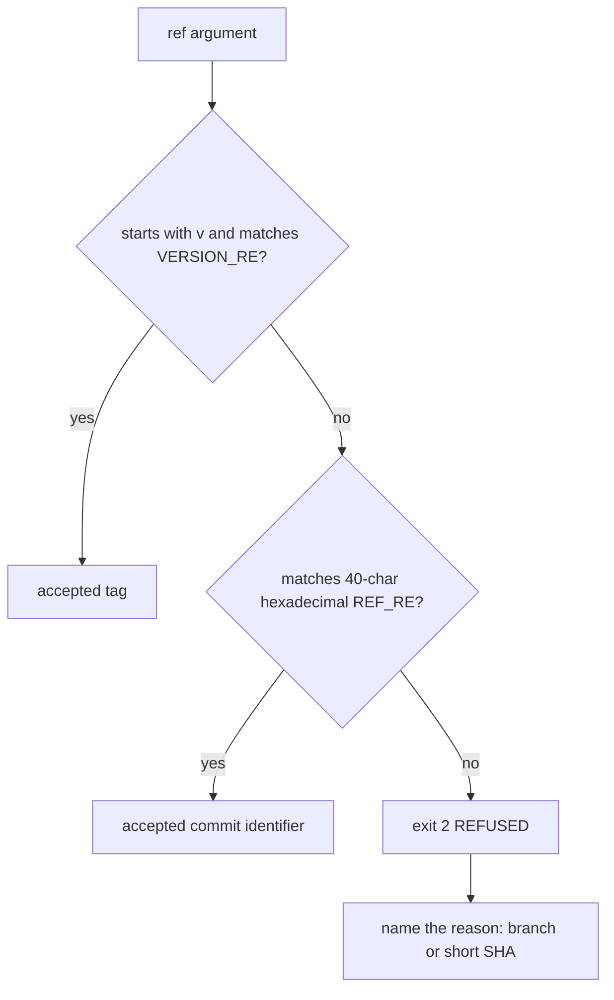
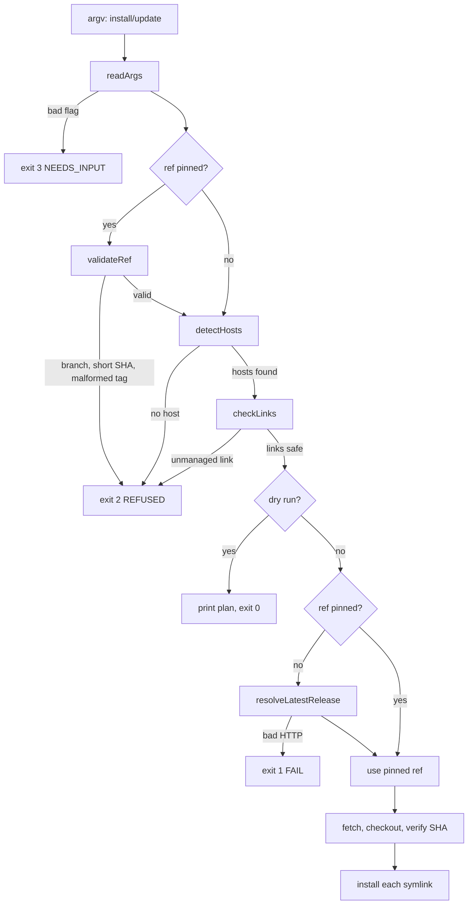

# Installer Command-Line Interface: Hosts, References, and Exit Codes

The installer is one JavaScript file. It detects agent hosts, fetches one pinned release, and writes one symlink per host. It refuses every mutable reference. This document explains each decision and every exit code.

Four terms carry the rest of the document. A *skill* is the tree that an agent reads: `SKILL.md` plus the `grimoire/`, `docs/`, and `forge/` trees. A *host* is a program that loads skills from a skills directory, such as Claude Code. A *symlink* is a file-system entry that points at another path. A *mutable reference* is a Git reference that can point at different commits on different days. The installer fetches the whole repository checkout, so the skill tree includes the forge.

## The job of the installer

The Node package is not the skill. It is the delivery tool. The file header states the boundary.

```javascript
// bin/img2threejs.mjs:2-3
// Installs the base skill from a pinned Git ref. The img2 harness installs plugins,
// not this repository (which intentionally has no plugin.json).
```

"Git" is the version control system. A "ref" is a named pointer into a Git repository. The installer resolves a ref, fetches it, and links the result into a host.

The installer supports four hosts. The name of the upstream repository is a constant.

```javascript
// bin/img2threejs.mjs:10-16
const SKILL_REPO = 'img2threejs/img2threejs'
const SKILL_URL = `https://github.com/${SKILL_REPO}.git`
// Without --ref, install the latest GitHub Release: it exists only after the governed tag
// workflow passes, unlike a raw tag. The env override is a test hook.
const RELEASES_LATEST = process.env.IMG2THREEJS_RELEASES_LATEST_URL ||
  `https://github.com/${SKILL_REPO}/releases/latest`
const STABLE_TAG_RE = /^v(0|[1-9]\d*)\.(0|[1-9]\d*)\.(0|[1-9]\d*)$/
```

"HTTPS" means Hypertext Transfer Protocol Secure. "URL" means uniform resource locator. The environment override exists only for tests. A normal user never sets it.

A "GitHub Release" is a publication attached to a repository tag. The comment calls the release workflow "governed" because a tag alone can be pushed by hand. A "raw tag" is a tag with no release record behind it. The comment states the difference: a release exists only after the project workflow passes. So the default path follows a release, not a raw tag.

The header also names a second tool. The "img2 harness" is a separate command-line interface for domain plugins. A "plugin" is an optional package that adds checklist steps and gates. This repository has no `plugin.json`, so the plugin harness does not install it. The base skill always comes from the release.

"Node" means the Node.js JavaScript runtime. A "Node package" is a directory with a `package.json` file that Node can run or install.

## The four hosts

Each host has a label, a detection test, and a skills directory. Detection is a simple file-system check.

```javascript
// bin/img2threejs.mjs:18-23
const HOSTS = {
  hermes: {
    label: 'Hermes Agent',
    detect: () => fs.existsSync(path.join(os.homedir(), '.hermes')),
    skills: () => path.join(os.homedir(), '.hermes', 'skills'),
  },
```

```javascript
// bin/img2threejs.mjs:24-33
  claude: {
    label: 'Claude Code',
    detect: () => fs.existsSync(path.join(os.homedir(), '.claude')),
    skills: () => path.join(os.homedir(), '.claude', 'skills'),
  },
  codex: {
    label: 'OpenAI Codex',
    detect: () => fs.existsSync(path.join(os.homedir(), '.codex')),
    skills: () => path.join(os.homedir(), '.codex', 'skills'),
  },
```

A host exists when its configuration directory exists. The installer writes into a `skills` directory under that configuration directory. Hermes uses `~/.hermes/skills`, Claude Code uses `~/.claude/skills`, and OpenAI Codex uses `~/.codex/skills`.

OpenCode uses the X Desktop Group ("XDG") base directory when the environment defines it. The variable is `XDG_CONFIG_HOME`. When the variable is set, the code uses `$XDG_CONFIG_HOME/opencode`. When it is unset, the code falls back to `~/.config/opencode`.

```javascript
// bin/img2threejs.mjs:34-44
  opencode: {
    label: 'OpenCode',
    detect: () => fs.existsSync(
      path.join(process.env.XDG_CONFIG_HOME || path.join(os.homedir(), '.config'), 'opencode'),
    ),
    skills: () => path.join(
      process.env.XDG_CONFIG_HOME || path.join(os.homedir(), '.config'),
      'opencode',
      'skills',
    ),
  },
```

The four entries have the same shape. Each has a label, a directory test, and a skills path. A host that is not installed is not written to.

## Exit codes

The program defines four exit codes. A host script can branch on them without reading text.

```javascript
// bin/img2threejs.mjs:47
const EXIT = { OK: 0, FAIL: 1, REFUSED: 2, NEEDS_INPUT: 3 }
```

| Code | Name | Meaning |
| --- | --- | --- |
| 0 | OK | The command completed, or help was printed. |
| 1 | FAIL | A technical step failed, such as network access or a Git command. |
| 2 | REFUSED | The tool understood the request and declined it, such as an unmanaged link or an absent host. |
| 3 | NEEDS_INPUT | The command line is incomplete or invalid, or names an unknown host. |

The difference between 2 and 3 is a difference of understanding. Code 3 means the tool could not accept the request as written. Code 2 means the request was well formed and a safety rule stopped it. A named host that is not installed is well formed, so it returns 2. An unknown host name is not a known choice, so it returns 3.

## The pinned-reference rule

The installer accepts two reference shapes only. The first is a semantic version tag. The second is a full 40-character secure hash algorithm ("SHA") commit identifier.

A "semantic version" is a version with three numeric fields, `major.minor.patch`. It can carry a prerelease suffix, such as `-beta.1`. A "tag" is a Git name for one commit. The installer writes the tag with a leading `v`, such as `v2.0.0`. The validation code removes the `v` before it tests the numeric fields. So `ref.slice(1)` turns `v2.0.0` into `2.0.0`, and that text must match `VERSION_RE`.

```javascript
// bin/img2threejs.mjs:49-53
// Ref validation: must be a tag like `v1.2.3`, `v2.0.0-beta.1` or a full 40-char SHA.
// Anything mutable (branch name, HEAD, short SHA) is rejected — a moved branch is a different
// skill on a different day, and a short SHA can become two things after a push.
const VERSION_RE = /^(0|[1-9]\d*)\.(0|[1-9]\d*)\.(0|[1-9]\d*)(?:-((?:0|[1-9]\d*|\d*[A-Za-z-][0-9A-Za-z-]*)(?:\.(?:0|[1-9]\d*|\d*[A-Za-z-][0-9A-Za-z-]*))*))?$/
const REF_RE = /^[0-9a-f]{40}$/
```

The validation function applies both shapes. The error names the reason.

```javascript
// bin/img2threejs.mjs:115-120
function validateRef(ref) {
  if (!(ref?.startsWith('v') && VERSION_RE.test(ref.slice(1))) && !REF_RE.test(ref)) {
    die(EXIT.REFUSED, `ref must be a vX.Y.Z tag or 40-char SHA — got: ${ref}`,
        'branches and short SHAs are refused because a moving ref would be a different skill')
  }
}
```

A branch is mutable. The comment names the reason for the short-SHA ban. A short SHA is the first few characters of a commit identifier. Git accepts it as long as exactly one commit starts with those characters. A later push can add a commit with the same prefix. The short SHA then names two commits, so it is no longer a stable reference. A long SHA cannot become ambiguous. Its 160-bit space makes a collision impractical.

The rule also refuses a malformed tag. The regex requires a non-zero leading digit in each numeric field. So `v01.2.3` and `v2.0.0-01` are refused even though they look like tags. Both would create a second spelling of an existing version.



The decision has two accepted shapes and one refusal path. A branch name fails both tests, so it cannot slip through. A malformed tag also fails both tests, and the error text names the accepted shapes.

**Aha:** The pinned-reference rule is a supply-chain control, not a convenience. A skill file can run shell commands in a user project. If the reference could move, a repository owner could change the code under an installed link without any user action. Requiring a tag or a full SHA makes the installed skill a fixed artifact. The user must choose to update. "Supply-chain control" means control over the code that enters a machine.

## Argument parsing

The parser is small and strict. It accepts three flags. Any other flag stops the command with code 3.

```javascript
// bin/img2threejs.mjs:62-74
function readArgs(argv) {
  const out = { cmd: argv[2], host: 'all', ref: null, dryRun: false }
  for (let i = 3; i < argv.length; i++) {
    const a = argv[i]
    if (a === '--host' || a === '--ref') {
      const value = argv[++i]
      if (!value || value.startsWith('--')) die(EXIT.NEEDS_INPUT, `${a} needs a value`)
      out[a === '--host' ? 'host' : 'ref'] = value
    } else if (a === '--dry-run') out.dryRun = true
    else die(EXIT.NEEDS_INPUT, `unknown argument: ${a}`)
  }
  return out
}
```

The parser reads the command from `argv[2]` and fills a `cmd` field. The dispatch in `main` reads `process.argv[2]` again. The two reads agree because `main` calls `readArgs(process.argv)` first. A flag value that starts with `--` is refused, so a missing value cannot consume the next flag as its value.

The default host value is `all`. The default ref value is `null`, and `null` means "resolve the latest release". The default dry-run value is `false`.

## Help text and command list

The help text is also the contract for a human reader. It states the platform limit.

```javascript
// bin/img2threejs.mjs:79-91
Usage:
  img2threejs install [--host <host>] [--ref <tag|sha>] [--dry-run]
  img2threejs update   [--host <host>] [--ref <tag|sha>] [--dry-run]
  img2threejs doctor
  img2threejs version

Hosts:
  hermes, claude, codex, opencode, all (default: auto-detect all installed)

Ref:
  Default: the latest GitHub release (${RELEASES_LATEST}).
  --ref takes a semantic tag (vX.Y.Z, optionally prerelease) or 40-char commit SHA.
  Branches and short SHAs are refused. Requires Git and network access.
```

The file states that macOS and Linux are supported. Windows is not supported yet. The help text names two reasons.

```javascript
// bin/img2threejs.mjs:94-95
Platforms: macOS and Linux. Windows is not supported yet (directory symlinks
  need Developer Mode and the skill expects \`python3\`).
```

The first reason is the symlink. A Windows directory symlink needs Developer Mode or an elevated shell. The second reason is the Python command. The skill calls `python3`, and a default Windows Python install does not always provide that name.

## Host detection

The detection function has two modes. In `all` mode it returns every detected host. In named mode it returns one host or refuses.

```javascript
// bin/img2threejs.mjs:105-113
function detectHosts(hostArg) {
  if (hostArg === 'all') {
    return Object.entries(HOSTS).filter(([, h]) => h.detect()).map(([name]) => name)
  }
  if (!HOSTS[hostArg]) die(EXIT.NEEDS_INPUT, `unknown host: ${hostArg}`, Object.keys(HOSTS).join(', '))
  const host = HOSTS[hostArg]
  if (!host.detect()) die(EXIT.REFUSED, `host ${hostArg} not detected on this machine (${host.label} not installed)`)
  return [hostArg]
}
```

An unknown name returns code 3. A known but missing host returns code 2 in a named host request. In `all` mode a machine with no host returns code 2. This distinction again separates a bad request from a refused request.

The order below follows `cmdInstall`. The code validates a pinned reference first. It then detects hosts and checks the links. Only a real run resolves the latest release and fetches a commit.



## Latest release resolution

The default reference is the latest GitHub Release. The installer reads the redirect target of the release page. It does not trust the tag list.

```javascript
// bin/img2threejs.mjs:122-138
async function resolveLatestRelease() {
  let res
  try {
    res = await fetch(RELEASES_LATEST, { method: 'HEAD', redirect: 'manual', signal: AbortSignal.timeout(30_000) })
  } catch (err) {
    die(EXIT.FAIL, `cannot resolve the latest release from ${RELEASES_LATEST}: ${err.cause?.message || err.message}`,
      'check network access to github.com; behind HTTPS_PROXY this lookup cannot pass the proxy, so pass --ref <tag>')
  }
  const location = res.headers.get('location')
  let tag
  try { tag = /\/releases\/tag\/([^/]+)$/.exec(new URL(location, RELEASES_LATEST).pathname)?.[1] } catch {}
  if (![301, 302, 303, 307, 308].includes(res.status) || !STABLE_TAG_RE.test(tag || '')) {
    die(EXIT.FAIL, `latest release lookup returned HTTP ${res.status} with location ${location || '(none)'}`,
      'expected a redirect to a stable vX.Y.Z release; pass --ref <tag> to install a specific release')
  }
  return tag
}
```

"HTTP" means Hypertext Transfer Protocol. The five accepted status codes are the redirect family. Every one of them tells a client to look at the `location` header. The reason for manual redirects is that the code reads that header. A stable release tag must match `STABLE_TAG_RE`. A prerelease tag is not accepted as the default. A `301` with no `location` header fails the lookup, and the installer exits with `FAIL`.

The method is `HEAD`, so the body is never downloaded. The redirect is manual, so the code can read the target. The timeout is 30 seconds.

The error text names a proxy limit. The `fetch` call does not read `HTTPS_PROXY`, so a machine that needs that proxy cannot complete the lookup. The later Git fetch uses Git's own proxy settings. The text therefore tells the user to pass `--ref <tag>` on such a machine.

## Version comparison

The update path must know which version is newer. The comparison uses a semantic version order and `BigInt` for the numeric fields.

```javascript
// bin/img2threejs.mjs:159-166
function compareVersions(a, b) {
  const left = VERSION_RE.exec(a), right = VERSION_RE.exec(b)
  for (let i = 1; i <= 3; i++) {
    if (BigInt(left[i]) !== BigInt(right[i])) return BigInt(left[i]) > BigInt(right[i]) ? 1 : -1
  }
  if (left[4] === right[4]) return 0
  if (!left[4]) return 1
  if (!right[4]) return -1
```

A stable version beats a prerelease with the same numeric fields. Prerelease identifiers compare field by field. A numeric identifier compares as a number and ranks below an alphanumeric identifier. An alphanumeric identifier compares as text. A shorter set of fields loses when all shared fields match.

The `BigInt` type supplies exact integer arithmetic. A version field has no stated size limit. Ordinary JavaScript numbers lose precision above about nine quadrillion, so a large field could compare as equal when it is not. `BigInt` avoids that error.

```javascript
// bin/img2threejs.mjs:167-177
  const x = left[4].split('.'), y = right[4].split('.')
  for (let i = 0; i < Math.max(x.length, y.length); i++) {
    if (x[i] === undefined) return -1
    if (y[i] === undefined) return 1
    if (x[i] === y[i]) continue
    const xn = /^\d+$/.test(x[i]), yn = /^\d+$/.test(y[i])
    if (xn && yn) return BigInt(x[i]) > BigInt(y[i]) ? 1 : -1
    if (xn !== yn) return xn ? -1 : 1
    return x[i] > y[i] ? 1 : -1
  }
  return 0
```

The function reads the same `VERSION_RE` that the reference check uses. It tests the numeric fields first, then the prerelease fields. A result of `1` means the left version is newer, `-1` means the right version is newer, and `0` means they are equal.

## The managed link

The installer will only replace a link that it owns. Ownership means the link resolves inside `~/.img2threejs/releases` and ends in `img2threejs`. The helper `releasesDir()` builds that path. The install flow creates the directory on the first real run.

The check uses `lstat` to see the link itself and `realpath` to see its target. `lstat` does not follow the link, so the code can tell a symlink from a directory. `realpath` follows every link and returns the final path. The comparison then works on real paths, not on link text. A relative link that points outside the release root is not managed. A "dangling link" is a symlink whose target does not exist. The helper `danglingTarget` returns that target, or `null` for a live link. The install flow replaces a dangling link and prints the old target.

```javascript
// bin/img2threejs.mjs:180-191
function managedLink(link) {
  try {
    if (!fs.lstatSync(link).isSymbolicLink()) return false
    const target = fs.realpathSync(link)
    const root = fs.realpathSync(releasesDir())
    const relative = path.relative(root, target)
    return relative !== '' && !relative.startsWith(`..${path.sep}`) && relative !== '..' &&
      !path.isAbsolute(relative) && path.basename(target) === 'img2threejs'
  } catch {
    return false
  }
}
```

The guard function reports a refusal with a repair instruction.

```javascript
// bin/img2threejs.mjs:211-218
    if (managedLink(link) || danglingTarget(link) !== null) continue
    let origin = ''
    try { origin = git(['-C', link, 'remote', 'get-url', 'origin']) } catch {}
    die(EXIT.REFUSED, `refusing to replace an unmanaged skill at ${link}`,
      /[/:]img2threejs\/img2threejs(\.git)?$/.test(origin)
        ? `it is a git checkout of ${SKILL_REPO}: keep yours with \`git -C ${link} pull --ff-only\`, ` +
          'or move the link and re-run to let this CLI manage it'
        : 'move the existing entry yourself before installing with this CLI')
```

A user who keeps a hand-made Git checkout gets a safe update command. A user with an unrelated directory gets a move instruction. The installer never deletes a user directory.

## The install flow

The install command starts with validation and detection. A dry run stops before any download.

```javascript
// bin/img2threejs.mjs:222-234
async function cmdInstall(args) {
  const latest = args.ref === null
  if (!latest) validateRef(args.ref)
  const hosts = detectHosts(args.host)
  if (hosts.length === 0) die(EXIT.REFUSED, 'no supported agent host detected on this machine')
  checkLinks(hosts)
  if (args.dryRun) {
    process.stdout.write(`→ ${args.cmd} skill ${SKILL_REPO} @ ${args.ref || 'latest release (resolved at run time)'} into: ${hosts.join(', ')}\n` +
      '(dry-run: no downloads or filesystem changes; ref availability and downgrade checks require a real run)\n')
    return
  }
  if (latest) args.ref = await resolveLatestRelease()
  process.stdout.write(`→ ${args.cmd} skill ${SKILL_REPO} @ ${args.ref} into: ${hosts.join(', ')}\n`)
```

The dry run is honest about its limit. It cannot check that the reference exists. It cannot check for a downgrade. Both need a real run. A dry run is not fully passive. It calls `checkLinks` before it returns. That check can call `git` to read the origin of an unmanaged directory. The dry-run test uses a fresh home directory with no links, so no `git` call happens in that test.

A real run creates a staging directory and fetches one commit.

```javascript
// bin/img2threejs.mjs:236-248
  const root = releasesDir()
  fs.mkdirSync(root, { recursive: true })
  const staging = fs.mkdtempSync(path.join(root, '.staging-'))
  const checkout = path.join(staging, 'img2threejs')
  try {
    fs.mkdirSync(checkout)
    git(['init', '--quiet', checkout])
    git(['remote', 'add', 'origin', SKILL_URL], checkout)
    const fetchRef = args.ref.startsWith('v') ? `refs/tags/${args.ref}` : args.ref
    git(['fetch', '--quiet', '--depth=1', 'origin', fetchRef], checkout)
    git(['checkout', '--quiet', '--detach', 'FETCH_HEAD'], checkout)
    const sha = git(['rev-parse', 'HEAD'], checkout)
    if (REF_RE.test(args.ref) && sha !== args.ref) die(EXIT.FAIL, 'fetched commit does not match requested SHA')
```

The fetch depth is one. A detached checkout means the repository has no current branch. The code checks out the fetched commit itself, not a branch name. `FETCH_HEAD` is the temporary Git record of the last fetch, so it names the exact commit that the depth-one fetch received. A full SHA request is verified against the fetched commit. A mismatch is a hard failure. The `finally` block later in the function removes the staging directory, so a failed run does not leave a partial release.

The downgrade rule has two branches. The `latest` branch applies when no reference is pinned. If the installed skill is ahead of the latest stable release, the installer skips that host and prints a notice. The `update` branch applies only when the user pins a reference. In that case an older pinned reference is a downgrade, and the installer refuses it with exit code 2. A plain `install` with a pinned reference does not run this downgrade check. The check sits inside the `update` branch of the code, so a pinned install can deliberately place an older reference.

```javascript
// bin/img2threejs.mjs:254-259
      if (latest) {
        process.stdout.write(`${h}: ${skillVersion(link)} is ahead of latest stable ${args.ref}; nothing to do (use --ref to pin)\n`)
        skip.add(h)
      } else if (args.cmd === 'update') {
        die(EXIT.REFUSED, `refusing downgrade for ${h}: ${skillVersion(link)} → ${version}`)
      }
```

Here `h` is the host name, `skillVersion(link)` reads the version from the installed `SKILL.md`, and `version` is the version of the fetched release.

The final link write is atomic. The installer creates a temporary link and renames it over the old one. In the excerpt `dir` is the host skills directory, `target` is the release checkout, `sha` is the fetched commit identifier, and `dangling` is the old target or `null`.

```javascript
// bin/img2threejs.mjs:284-294
      // Rename a temporary symlink over an owned link; never delete a user directory.
      const temporary = path.join(dir, `.img2threejs-${process.pid}`)
      try {
        fs.symlinkSync(target, temporary, 'dir')
        fs.renameSync(temporary, link)
      } finally {
        if (fs.existsSync(temporary)) fs.unlinkSync(temporary)
      }
      if (fs.realpathSync(link) !== fs.realpathSync(target)) die(EXIT.FAIL, `host link verification failed: ${link}`)
      if (dangling !== null) process.stdout.write(`replaced dangling link ${link} (was -> ${dangling})\n`)
      process.stdout.write(`✓ ${h}: ${link} → ${target} (${version}, ${sha})\n`)
```

A rename over a link is atomic on the same file system. The temporary name uses the process identifier. A failed run cleans up the temporary link.

## Doctor

The doctor command prints one line per host. It reports detection and link state.

```javascript
// bin/img2threejs.mjs:304-319
async function cmdDoctor() {
  process.stdout.write('img2threejs — host detection report\n\n')
  for (const [name, h] of Object.entries(HOSTS)) {
    const dir = h.skills()
    const link = path.join(dir, 'img2threejs')
    let state = '(no link)'
    try {
      fs.lstatSync(link)
      state = `${managedLink(link) ? 'managed' : 'unmanaged'} → ${fs.realpathSync(link)} (${skillVersion(link)})`
    } catch (err) {
      if (err.code !== 'ENOENT' || fs.existsSync(dir) && fs.readdirSync(dir).includes('img2threejs')) {
        state = `invalid skill: ${err.message}`
      }
    }
    process.stdout.write(`  ${name.padEnd(10)}  ${h.detect() ? '✓ detected' : '✗ not detected'}  ${dir}  ${state}\n`)
  }
```

A "managed" state means the link points into the release root. An "unmanaged" state means the link exists but the installer will not replace it. An invalid state means the entry exists and cannot be read. `skillVersion(link)` reads the `version` field from the installed `SKILL.md`.

The condition on the catch branch handles two cases. The first case is an error other than "file not found". The second case is a missing `img2threejs` entry that still appears in the directory listing. That second case can occur with a broken directory entry. The code prints "invalid skill" for both. A plain missing link leaves the state at `(no link)`.

## Command dispatch

The dispatch table maps two names to one function. `install` and `update` share the same code path. The `'--version'` entry is unreachable. `main` scans every argument for `--version` before dispatch, so the table entry never runs. Dispatch reads `process.argv[2]` directly, and `readArgs` later copies the same value into `cmd`. The two agree because both read the same position in the same array.

The top-level scan has a side effect. `img2threejs install --help` prints help and exits 0. It does not install. Any position of `--help` is a help request.

```javascript
// bin/img2threejs.mjs:333-352
const commands = {
  install: cmdInstall,
  update: cmdInstall,
  doctor: cmdDoctor,
  version: cmdVersion,
  '--version': cmdVersion,
}

async function main() {
  // Top-level flags: handle before command dispatch so `img2threejs --help` works
  // without first naming a subcommand.
  for (const a of process.argv.slice(2)) {
    if (a === '-h' || a === '--help' || a === 'help') { printHelp(); process.exit(EXIT.OK) }
    if (a === '--version') { await cmdVersion(); process.exit(EXIT.OK) }
  }
  if (!commands[process.argv[2]]) {
    if (process.argv[2]) process.stderr.write(`unknown command: ${process.argv[2]}\n\n`)
    printHelp()
    process.exit(process.argv[2] ? EXIT.NEEDS_INPUT : EXIT.OK)
  }
```

A top-level help flag works before a subcommand. A missing command prints help and exits 0. An unknown command prints help and exits 3.

## The test file

The test file runs the real installer against real Git fixtures. A "fixture" is a small prepared repository that the test builds in a temporary directory. The test creates commits and tags in that repository. It uses a temporary home directory and a local HTTP release server. "It never touches the network" means it never reaches the public internet. The local server answers the release lookup on the loopback address.

`home()` creates a temporary home with one host directory, `claude`, by default. `home([])` creates a temporary home with no host directories, so host detection finds nothing. `run()` and `runEnv()` start the installer with that home, and `hitCount()` reports how many requests the local server received.

```javascript
// bin/img2threejs.mjs-test.mjs:1-3
#!/usr/bin/env node
// Real Git fixtures; no network and no writes outside a disposable temp directory.
import assert from 'node:assert/strict'
```

The fixture repository tags six versions. One tag exists but is never released. This proves that the default path follows the release redirect, not the tag list.

```javascript
// bin/img2threejs.mjs-test.mjs:25-27
// v2.2.0 is tagged but never released: only the releases/latest redirect may select a default.
for (const version of ['1.5.2', '2.0.0-beta.2', '2.0.0-beta.10', '2.0.0', '2.1.0', '2.2.0']) {
  fs.writeFileSync(path.join(repo, 'SKILL.md'), `---\nname: img2threejs\nversion: ${version}\n---\nfixture ${version}\n`)
```

The tests assert the exit codes directly.

```javascript
// bin/img2threejs.mjs-test.mjs:90-95
test('unknown commands and missing values fail without a host', () => {
  const dir = home([])
  assert.equal(run(dir, 'unknown').status, 3)
  assert.equal(run(dir, 'install', '--host').status, 3)
  assert.equal(run(dir, 'install', '--ref', '--dry-run').status, 3)
})
```

The refusal test covers branches, short SHAs, and malformed tags.

```javascript
// bin/img2threejs.mjs-test.mjs:97-103
test('branches, short SHAs and malformed tags are refused', () => {
  const dir = home()
  for (const ref of ['main', '123abcd', 'v01.2.3', 'v2.0.0-beta..1', 'v2.0.0-01']) {
    assert.equal(run(dir, 'install', '--ref', ref).status, 2, ref)
  }
  assert.ok(!fs.existsSync(path.join(dir, '.img2threejs')))
})
```

The test also proves that a refused run creates no state directory. A refusal is clean. Three malformed tags test the leading-zero rule. `v01.2.3` has a leading zero in the major field. `v2.0.0-01` has one in the prerelease field. `v2.0.0-beta..1` has an empty field. All three fail `VERSION_RE`.

The dry-run test proves that no request reaches the server and the home directory does not change.

```javascript
// bin/img2threejs.mjs-test.mjs:110-120
test('dry-run is offline and does not modify the home', () => {
  const dir = home()
  const before = fs.readdirSync(dir)
  const requests = hitCount()
  const noGit = path.join(root, 'no-git')
  fs.mkdirSync(noGit, { recursive: true })
  const result = runEnv({ PATH: noGit }, dir, 'install', '--dry-run')
  success(result)
  assert.match(result.stdout, /@ latest release \(resolved at run time\)/)
  assert.equal(hitCount(), requests)
  assert.deepEqual(fs.readdirSync(dir), before)
```

The dry run removes Git from the path. It still succeeds. This proves that the dry run needs neither Git nor network access.

The suite has 20 tests. `grep -cE "^test\\(" bin/img2threejs.mjs-test.mjs` prints 20 at the pinned commit. They cover unknown commands, malformed references, and missing hosts. They also cover a dry run, version output, and latest release resolution. They then cover update, a beta ahead of stable, a failed lookup, and redirect status codes. Host skipping, dangling links, unmanaged links, and a pinned install follow. The last tests cover one shared checkout, idempotent reinstallation, downgrade refusal, prerelease precedence, unmanaged directories, a missing value, staging cleanup, and local edits in a managed release.

## What the installer does not do

The installer does not install plugins. The separate `img2` harness does that. The installer does not copy files. It only links. The installer does not run the skill. Running a skill means that a host agent reads `SKILL.md` and follows its steps. The installer only makes the skill reachable.

These limits keep the installer small and auditable. A user can read the whole file in one sitting.

## Cross-references

- [01 Repository anatomy](01-repository-anatomy.md) shows where the installer sits.
- [03 Skill contract](03-skill-contract.md) explains what the link points to.
- [13 Testing and continuous integration](13-testing-and-ci.md) explains how the test runs in continuous integration (CI).
