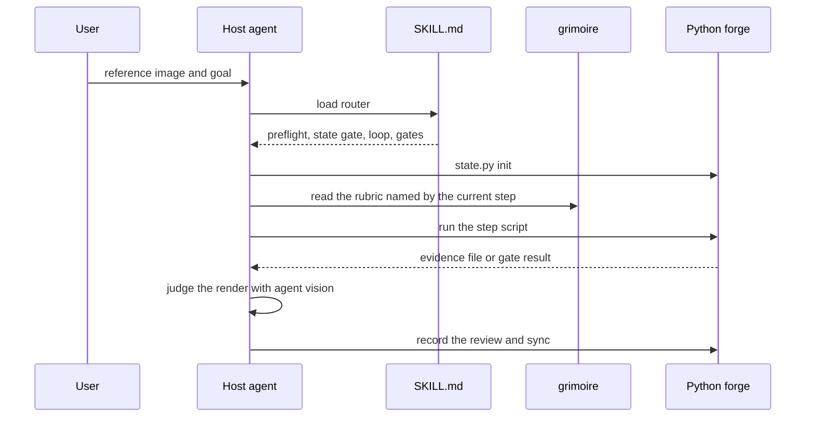
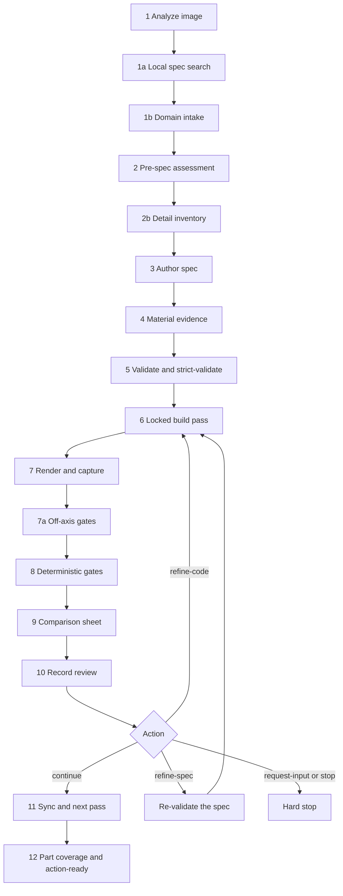

# Skill Contract: The Always-Loaded Router

`SKILL.md` is the contract that a host agent reads before any work. It holds the order of operations, the hard rules, and the paths to deeper reference files. This document explains the contract, the state gate, the loop, the gates, and the output rules.

Six terms recur. A *skill* is the installed tree that an agent reads: `SKILL.md` plus the `grimoire/`, `docs/`, and `forge/` trees. A *host* is a program that loads skills, such as Claude Code. An *agent* is the model that the host runs. The *grimoire* is the reference library of rubrics and gate contracts. The *forge* is the deterministic set of Python scripts under `forge/`. "Three.js" is the browser JavaScript library in which the generated model runs. The model is written as code for that library.

## What the file is

The file begins with front matter that identifies the skill. A host reads this block to register the skill.

```markdown
# SKILL.md:1-6
---
name: img2threejs
description: Turn an object or character reference image into a quality-gated, animation-ready procedural Three.js model built in code. Use for image-to-3D reconstruction, detail-accurate object rebuilds, stylized/likeness-maximized human characters, sculpt specs, and staged code generation.
license: Apache-2.0
version: 2.0.1
---
```

The skill version is `2.0.1`. The installer reads this same field to compare installed versions.

The contract is agent-agnostic. The host supplies vision and a browser tool.

```markdown
# SKILL.md:18-20
Agent-agnostic: works under Hermes, Claude Code, Codex, or OpenCode. Wherever this doc says "agent vision" or "agent browser tool", use
whatever the host provides — native image reading, a browser MCP (playwright/chrome-devtools), the
project preview, or a user-supplied screenshot.
```

"MCP" means Model Context Protocol. A browser MCP is an optional tool that lets the agent capture a page. The contract does not require one specific host.

The first check is whether the job belongs to this skill. The "When To Use" section is the entry test.

```markdown
# SKILL.md:36-40
## When To Use

The user attaches/points to an object image and wants a procedural Three.js model, a
reconstruction/animation/destruction plan, a sculpt spec, or code. Also for material studies,
action-ready props, game objects, botanical/mechanical parts, and stylized reconstructions.
```

A request outside this list is not a refusal. It is a different task. The agent must not force the pipeline onto a job that the contract does not cover. "Sculpt spec" is the `ObjectSculptSpec` file that the pipeline authors and builds from.

The file is a router, not a manual. It names the deeper file at the moment the agent needs it.

```markdown
# SKILL.md:22-24
This file is the always-loaded router: it holds the order of operations and every hard rule as one
line. The full contract behind each rule lives in the `grimoire/` or `docs/` file that rule names —
read the named file at the moment you reach that stage, not before.
```

This design has a cost and a benefit. The cost is that the agent must follow a path. The benefit is that the always-loaded text stays small.

## How a host reads the contract

A host agent does four things with this file.

1. It matches the user request to the "When To Use" rule.
2. It runs the profile preflight once per run.
3. It obeys the mandatory local state gate.
4. It follows the loop and reads each named reference at the named step.

The first two items have a fixed order. The preflight runs once per run. The state gate runs after it and before every loop action. The heading in the preflight section says exactly that: "once per run, before `forge/next.py`". The word "first" in the contract belongs to the loop, not to the whole session.

A *rubric* is a written judgment rule that the agent applies at a step. A *profile* is a named checklist variant, such as `generic`, `character`, or `cs2`.



The host is not free to reorder the steps. The contract states the order. The state file enforces it.

## Profile preflight

Domain knowledge lives in plugins, not in the base checkout. The preflight checks that the chosen profile can start. A *plugin* is an optional installed package that adds steps, evidence, and gates for one domain. The *base checkout* is the repository without plugins. A *profile* is the checklist variant that a plugin or the base provides. A *domain* is a subject family, such as game skins or animated characters. The agent picks the profile from the subject, such as `character` for a human figure. A fallback profile `generic` exists for objects that have no special domain. Routing is a separate choice: it maps the classification kind `weapon` or `character` to a track, and a `hybrid` or `unknown` kind can fail closed. A domain profile such as `cs2` is not a routing track.

```markdown
# SKILL.md:42-45
## Profile preflight (once per run, before `forge/next.py`)

Domain knowledge (CS2 skins, animated characters, emission targets) lives in plugins, not in this
checkout. Pick the profile from the subject, then confirm this environment can start it:
```

A missing profile is a setup gap. The contract forbids a silent downgrade.

```markdown
# SKILL.md:52-55
- A missing domain profile (e.g. `cs2`) is a setup gap: never downgrade to
  `generic` silently. Installing it edits the user's machine, so give them the commands in
  [`docs/INSTALL.md` §3](docs/INSTALL.md#3-add-a-plugin-only-if-you-need-one), get their go-ahead,
  re-check, and continue.
```

"CS2" means Counter-Strike 2. The example is a domain plugin. The rule applies to every domain.

The preflight has one more duty. The agent must read the plugin's own contract at the moment the plugin's steps appear. A plugin adds a contract-read step that names its own file; the test fixture uses `fx-contract-read` with `{plugin_dir}/grimoire/contract.md` (`forge/tests/test_workflow_state.py:72`).

## The core promise

The promise is a staged build. The agent never one-shots a mesh.

```markdown
# SKILL.md:62-66
Sculpt from a photo, in order — never one-shot a mesh:
1. **Run `python3 forge/next.py --state .img2threejs/state.json [<spec>]` first**, at every start,
   resume, and before every correction iteration. It reports the ordered checklist, exact next
   command, evidence status, and bounded correction-loop status; it never replaces the spec/pass
   gates. Obey a hard stop; never continue from memory.
```

The word "first" is literal inside the loop. The state gate runs before every build, review, and correction action in a session. It runs after the one-time profile preflight, which the preflight heading places before `forge/next.py`.

"One-shot" means that the agent writes the whole model in a single generation with no review stage. A "mesh" is the set of vertices and faces that forms a surface in a three-dimensional scene. The contract forbids that single step. It requires eight reviewed passes instead. The code list in `DEFAULT_PASS_ORDER` is authoritative and includes `surface-pass`; the `SKILL.md` arrow line omits it.

The contract also requires honesty about uncertainty.

```markdown
# SKILL.md:74-75
State explicitly when output is approximate/stylized/low-poly. A single image cannot reveal
hidden sides or guarantee exact geometry — say so instead of faking confidence.
```

This rule is a quality rule, not a style rule. A false claim of exactness is a contract violation.

## The mandatory local state gate

The state file is the authority for progress. Conversation memory is not.

```markdown
# SKILL.md:77-80
## Mandatory Local State Gate

Conversation context is disposable; `.img2threejs/state.json` is the local checklist authority.
Initialize once per reconstruction, then gate every step through it:
```

Three commands carry the whole gate. `state.py init` creates the checklist. `next.py` reports the next legal action. `state.py mark` records evidence. The contract shows all three forms.

```markdown
# SKILL.md:83-85
python3 forge/state.py init --state .img2threejs/state.json --reference  --profile <generic|character|installed-domain> --spec object-sculpt-spec.json
python3 forge/next.py --state .img2threejs/state.json [object-sculpt-spec.json]
python3 forge/state.py mark <step-id> --state .img2threejs/state.json --evidence <path>
```

The gate has teeth. Exit code 3 is a hard stop.

```markdown
# SKILL.md:88-93
- `next.py` prints the current step, pass, incomplete mandatory steps, exact next command, and
  `loop/max`. Exit code 3 or `status=stopped` is a hard stop: report the reason and request input.
  Never bypass it by reconstructing progress from chat history.
- Every completed step needs evidence; mark a non-applicable step `skipped` only with `--reason` —
  silent omission is forbidden. Loop counts derive from `reviewHistory` actions
  (`refine-spec`/`refine-code`), not agent memory. Defaults: 3 corrections per pass, 6 total.
```

The important terms are `reviewHistory`, `refine-spec`, and `refine-code`. `reviewHistory` is a field inside the `ObjectSculptSpec` file. It records each review decision and each refinement action. The correction count comes from those actions, not from the agent's memory. A step is marked `skipped` only through `state.py mark` with a `--reason`. "Loop/max" means the current correction count against the limit.

**Aha:** The state gate turns a chat session into a resumable process. An agent can lose all context and still resume correctly. It cannot claim progress that the file does not record. This is the mechanism that makes a long, multi-session build honest.

## The loop

The loop has twelve numbered steps, with sub-steps. Each step has a script or a named reference. The eight `PASS_STEPS` in `forge/_shared/workflow_state.py:52-61` govern one pass. They are the repeated inner loop: build, render, read the review contract, diagnose, check multi-angle evidence, check the pass gate, record one review, and sync. The twelve skill steps govern the whole run, including setup, spec authoring, and completion.

```markdown
# SKILL.md:117-120
## The Loop (scripts do enforcement; agent vision does judgment)

Run scripts from the skill root (`forge/...`). Pure Python 3.10+ stdlib, no pip installs.
Full flags: `grimoire/scripts.md`. Never let a script *score* visuals — that is the agent's job.
```

The order is the product. A different order would allow a shallow spec or an unverified render to pass.



Step 1 is visual analysis by the agent. Step 1a searches the local checkout for an existing spec or evidence. The diagram shortens that label to "Local spec search". The contract forbids inventing domain facts.

The remaining steps have short jobs. Step 2b writes the detail inventory. Step 3 authors the spec. Step 4 extracts material evidence. Step 5 validates the spec and runs the strict check. Step 7 renders and captures the current pass. Step 7a runs the off-axis gates that need a second angle. Step 8 runs the deterministic gates. Step 9 assembles the comparison sheet. Step 10 records the review action. Step 11 syncs the state and opens the next pass. Step 12 checks part coverage and action readiness. The numbered sub-steps come from the source headings; there is no step 2a.

Step 2 writes the quality contract before any code.

```markdown
# SKILL.md:149-151
2. **Pre-Spec Assessment Gate** — classify + score complexity + write the quality contract:
   `forge/stage2_spec/new_pre_spec_assessment.py "Name" --image  --complexity <simple|moderate|complex|ultra-complex> --out assessment.json`. Rules: `grimoire/intake/quality_contract.md`.
   Set `objectClass.primaryDomain` (`object` | `character` | `hybrid`) and fill the seeded
```

The assessment sets the subject class and the complexity tier. A plugin can raise the floor. It cannot lower one.

Step 6 is the locked build. Only the current pass may change.

```markdown
# SKILL.md:217-225
6. **Locked build passes** — only touch the currently unlocked pass:
   `forge/stage3_build/orchestrate_passes.py status object-sculpt-spec.json`
   `forge/stage3_build/generate_threejs_factory.py object-sculpt-spec.json --out src/createObjectModel.ts`
   The generator is fail-closed: `strict-quality` must pass before it writes any factory, and a
   future `--pass-id` fails until prior passes are reviewed `continue`. If blocked, preserve the
   `BLOCKED` artifact and refine the subject-specific spec; do not substitute a generic template.
   The local state adds `--force` only for a new pass or `refine-spec`; `refine-code` edits the
   current artifact without regenerating it. Before overwriting, carry valid hand refinement back
   into the spec; generated code must not be the only copy of reconstruction decisions.
```

"Fail-closed" means the default is refusal. A future pass cannot run early. A shallow spec cannot generate. A `refine-code` action edits the existing file and does not regenerate it.

## The gates

The gates section names every blocking check. It also states the order of review.

```markdown
# SKILL.md:296-312
## Gates (do not skip)

Before any visual review or `continue` decision, MUST read the full gate-by-gate contract in
`grimoire/review/gates_reference.md` (Divine Eye, VLM rescue, multi-angle, interior difference,
chirality, hair, domain review, bounded correction, Divine Eye fitting, screenshot feedback, assembly,
attachment, material, detail inventory, rig payload, character track). In short:

- Validate references first (`grimoire/intake/validation_rubric.md`, `check_reference_admission.py`).
- `divine_eye.py` is deterministic-first; the VLM (`vlm_gate.py`) is a gated last layer, never
  consulted on a hard-gate failure.
- A non-planar form must hold from ≥2 angles (`diagnose_render_multi_angle.py`).
- Measure INSIDE the silhouette every visual pass (`interior_difference.py`). Silhouette IoU reads
  ~11% of figure cells: a model with its face deleted scored the same 0.8803 as the finished face.
- Every `-l`/`-r` pair is a MIRROR, not a rotation — hard at spec time (`validate_chirality`). A pair
  wrong the same way on both sides still passes, and needs `medial_lateral_bias` vs a reference.
- Hair subjects: `scalp_exposure.py` is HARD and runs on geometry before any render; `hair_gate.py`
  is soft and subordinate to it. A coverage shortfall never authorises widening the masses.
```

"VLM" means vision language model. "IoU" means intersection over union. The number `0.8803` is a measured example from the project. It shows why a silhouette-only score cannot prove a face.

Three gate names need a short meaning. The "Divine Eye" is the deterministic render evaluator. It computes structural signals from the image and the render. The VLM is a second model that can review a render as a last layer. It is never consulted when a hard gate fails. "Reference admission" is the intake check that decides whether the image is usable at all.

The gate list has one job per name. The table gives the short form.

| Gate | Job |
| --- | --- |
| Divine Eye | Deterministic image comparison across several signals. |
| VLM rescue | A gated last review layer after the deterministic gates. |
| Multi-angle | A non-planar form must hold from at least two angles. |
| Interior difference | Compare the inside of the silhouette, not only its outline. |
| Chirality | A left/right pair must be a mirror, not a rotation. |
| Hair | Scalp exposure is hard; hair shape is soft. |
| Domain review | A plugin's own review rules for its domain. |
| Bounded correction | Stop at 3 corrections per pass and 6 in total. |
| Divine Eye fitting | Check that the fitted camera matches the reference. |
| Screenshot feedback | Record the review from a captured screenshot. |
| Assembly | Check that parts join into one model. |
| Attachment | Check that props and parts attach at the right place. |
| Material | Check material finish and color against the reference. |
| Detail inventory | Check that the listed details exist in the model. |
| Rig payload | Check the rig data before animation use. |
| Character track | Apply the character-specific rules. |

The `continue` decision has two stated requirements in this excerpt. First, a render, a comparison sheet, and an AI-vision score at or above the threshold. Second, every critical feature at or above its own threshold. A third rule bounds the loop: the state enforces 3 corrections per pass and 6 in total, and `correction_loop.py` may stop earlier. These limits are not a requirement for `continue`; they are a stop condition on refinement.

```markdown
# SKILL.md:328-331
- Local state enforces 3 corrections per pass and 6 total by default; reaching either limit is a
  hard stop. `correction_loop.py` may stop earlier on repeated defects, oscillation, or plateau.
- `continue` requires a render + comparison sheet + AI-vision score ≥ threshold, every critical
  feature ≥ its own threshold (`grimoire/feedback/render_capture.md`).
```

"AI" means artificial intelligence. The overall score is `aiVisionScore`. The pass threshold is `visualAcceptanceThreshold`, which defaults to `0.7` and can come from `selfCorrectLoop.visualAcceptance.threshold` or `qualityTargets.targetFidelity`. Each critical feature can set its own `minimumScore`. The routing threshold `0.82` is a different number: it is the confidence floor for choosing a subject track, not a render score. Below `0.82` the router returns `request-input` instead of a guess. The `continue` gate is a set of per-feature checks, so a high overall score cannot hide one failed critical feature.

The seven visual passes are listed in `VISUAL_PASS_IDS`: `blockout`, `structural-pass`, `form-refinement`, `material-pass`, `surface-pass`, `lighting-pass`, and `interaction-pass`. `optimization-pass` is the eighth pass and is not in that set.

## Self-correction

After a pass, the agent chooses exactly one action.

```markdown
# SKILL.md:339-345
## Self-Correction

After every pass, decide exactly one: `continue | refine-spec | refine-code | request-input | stop`.
`refine-spec` fixes a wrong/missing/shallow spec (re-validate, don't patch code around it);
`refine-code` fixes geometry/material/lighting that doesn't match a sound spec. Before making the
decision, MUST read the root-cause guide + fidelity scale in `grimoire/review/self_correction.md`,
record the decision, and re-run the local state gate.
```

The action is exclusive. The agent cannot both refine the spec and refine the code in one iteration. The choice forces a root-cause decision.

The correction limits are bounded. Three per pass, six total, by default. A limit is a safety stop, not a target.

## Left and right

Chirality is a hard rule at spec time. A reflection is not a rotation.

```markdown
# SKILL.md:363-368
A left/right pair is a **reflection**, never a rotation: negate the lateral axis and nothing else,
`(x, y, z) → (-x, y, z)`. With `forward: +Z`, Y up and a right-handed frame, the character's own
left is **+X**. The convention lives as code in `forge/_shared/chirality.py`
(`CHARACTER_LEFT_SIGN`), with two different gates for the two defects that shipped from getting it
wrong: `validate_chirality` catches a rotation-mistaken-for-reflection at spec time, and
`medial_lateral_bias` vs a reference catches a pair that is wrong the same way on both sides.
```

The frame is a right-handed coordinate frame with the forward axis `+Z` and the up axis `Y`. In that frame the character's own left is `+X`. The contract fixes that sign in `CHARACTER_LEFT_SIGN`. The first gate catches a rotation that was mistaken for a reflection. A 180-degree rotation about the up axis can look like a mirror in a single view, so a builder can mislabel it. The second gate catches a pair that is wrong the same way on both sides. A laterality measurement against the reference finds that case.

The contract also names a rendering detail. A reflection inverts triangle winding. "Winding" is the order of a triangle's vertices as seen from outside. Most renderers use that order to decide which face is front. The mirrored side must flip the order back, or the surface renders inside out.

## Hair

Hair has its own rules because it has failure modes that other gates cannot see.

```markdown
# SKILL.md:378-385
- Roots bind to the scalp as `(u, v)`, never absolute positions (hard validation error).
- `standProud` is enforced by the generator, not advisory.
- `scalp_exposure.py` is a HARD gate on geometry before any render; a coverage shortfall never on
  its own authorises widening the masses.
- Default representation tier is `shell`, not locks; strand impression comes from faceting and
  material (`hair.human.code-only`), since this skill emits no textures.
- `plane-card` is rejected for hair (needs an alpha texture this skill cannot emit).
- Hair is rigidly parented, never smooth-skinned (the geodesic field runs through the skull).
```

A root in `(u, v)` space stays on the scalp when the head changes. `u` and `v` are texture-style coordinates on the scalp surface. An absolute root would float after a proportion edit. The hard error prevents that.

`standProud` is a clearance rule. A hair component names another component, a clearance distance, and a maximum push. The fields are `againstComponentId`, `clearance`, and `maxPush`. The generator moves each hair vertex out of the named component up to that distance. A "shell" is a thin surface layer that follows the scalp. A "plane card" is a flat rectangle that carries a painted hair texture. `hair.human.code-only` is the material name that the hair rules use. The source does not define the "geodesic field" beyond the parenthetical "runs through the skull". Hair is parented to the head rigidly because a smooth skin would let it slide across the skull. The generator records an unresolved count in `geometry.userData.standProud.unresolved`; a nonzero count is a runtime warning, and `grimoire/scripts.md` requires zero for an exact pass.

The default tier is `shell`. A plane card is rejected because the skill emits no texture. This is a direct consequence of the code-only promise.

## Domain plugins

A plugin adds domain exactness. It does not change the core order.

```markdown
# SKILL.md:389-399
A domain plugin makes a run exact where this pipeline would otherwise infer. It contributes its own
checklist steps and gates, and publishes a `spec-augmentation.json` that this pipeline pulls at
`spec-authoring`. With no plugin serving the item, nothing here changes: author the skeleton and
infer the shape from the reference, as for any other object.

- The steps a plugin contributes appear in the checklist with their own ids and resolved paths. Read
  what each step names -- a plugin ships its own contract, and it governs its own domain.
- A plugin may **raise** this pipeline's quality floors and can never lower one; the merge clamps.
- A plugin that does not serve an item publishes no augmentation. That is not an error and not a
  blocked run: it is the generic path, and the reconstruction proceeds by inference.
- This pipeline names no domain. If a rule is domain-specific, it lives in that domain's plugin.
```

The merge rule is raise-only. This protects the base quality floor from a weak plugin. It also keeps the base free of domain logic. The three terms connect directly. A *plugin* supplies a *profile*, and the profile adds steps and gates. The plugin's *augmentation* is a JSON file that raises quality floors at the spec step. `spec-authoring` is the step name that the plugin contract uses for step 3. The pipeline pulls the augmentation when it reaches that step. A quality *floor* is the minimum value that a quality field may take. A resolved path is a full path that the checklist prints, so the agent does not have to search for the plugin file.

## The img2 harness

Plugins come from a separate command-line interface. The skill vendors no plugin code.

```markdown
# SKILL.md:403-407
Plugins are installed and managed by the `img2` harness
([img2threejs/img2](https://github.com/img2threejs/img2)), a separate dependency-free CLI (Node
launcher, Python core). This skill vendors no domain logic and never writes a substitute for it;
a missing profile is handled by the preflight above, and only a plugin that does not exist
upstream is a blocker to report.
```

"CLI" means command-line interface. "Node" means the Node.js runtime. The "launcher" is the small Node entry point that starts the Python commands. The "core" is the Python code that performs the work. That split lets a user install one command while the logic stays in the standard library. The harness is a separate tool with its own release cycle.

The base skill is not a plugin. The README states this directly. `img2 add` installs a domain plugin, not this repository. The distinction matters because the base skill has no domain logic. A user who runs `img2 add` with this repository would not add a domain. That is why the installer and the README both keep the two paths apart.

## Forge runtime contracts

Some tests compile generated TypeScript against a showcase checkout. The "showcase checkout" is a local copy of a separate demonstration project that contains a TypeScript tool chain. "Subdivision" means the geometry subdivision feature that those tests exercise. The skill states the environment variable.

A runtime-only test needs that external project. It skips when the variable is absent. A static contract test only reads generated text, so it still runs. "TypeScript" is the typed language that the generated model file uses.

```markdown
# SKILL.md:420-423
Subdivision runtime tests compile generated TypeScript against the showcase checkout. Set
`IMG2THREEJS_SHOWCASE_ROOT` to that checkout; without it, local runtime-only tests skip with an
actionable message while static contracts still run. CI should set `IMG2THREEJS_REQUIRE_SHOWCASE=1`
to turn a missing showcase checkout into a test failure.
```

"CI" means continuous integration. A skipped test is not a passing test. The second variable turns a skip into a failure. The workflow files in this repository do not set either variable, so a separate CI configuration must set them for that behavior.

## Output rules

The contract defines three output modes.

```markdown
# SKILL.md:460-466
## Output

- **Analysis-only**: suitability verdict + scores, object extraction, macro→micro hierarchy,
  geometry strategy, material/lighting recipe, animation/destruction feasibility, plan + risks.
- **Implementation**: the above briefly, then edit code; verify with typecheck/build + a screenshot.
- **Not feasible**: name the blocker, ask for more views / cleaner image / accepted stylization /
  a narrower target. "This cannot reach the requested fidelity from this image" is a valid result.
```

The third mode is a real outcome, not an error. A refusal with a reason is better than a false success. This matches the routing refusal at `0.82` and the state hard stop. The "Analysis-only" list repeats the evidence from steps 1 to 3. It contains a suitability verdict, object extraction, a macro-to-micro hierarchy, a geometry strategy, a material and lighting recipe, a feasibility check, and a plan with risks.

## What the contract does not do

The contract does not contain the full rubric. It points to the grimoire. It does not score a render. It requires agent vision. It does not replace the spec gates. It records state.

The division is consistent across the whole product. The contract routes. The grimoire explains. The forge enforces. The agent judges. The harness installs plugins. The installer puts the base skill on a host. Each part has one job, and no part trusts another part's memory.

## How a host should fail

A host agent must stop in four cases. The contract names each case.

1. The state gate returns code 3 or `status=stopped`.
2. A profile is missing and the user has not approved an install.
3. A deterministic gate fails, even if the overall vision score passes.
4. The image is not a suitable target under the "When To Use" rule and the suitability rubric, and no better image is available.

In each case the agent reports the reason and asks for input. It does not guess.

## Cross-references

- [00 Overview](00-overview.md) gives the two-half thesis.
- [01 Repository anatomy](01-repository-anatomy.md) shows where `SKILL.md` sits.
- [02 Installer command-line interface](02-installer-cli.md) explains how the file reaches a host.
- [04 Forge orchestration](04-forge-orchestration.md) explains the state machine behind the gate.
- [05 Stage intake](05-stage-intake.md) explains the scripts named in steps 1 and 2.
- [10 Grimoire](10-grimoire.md) explains the reference files the contract names.
