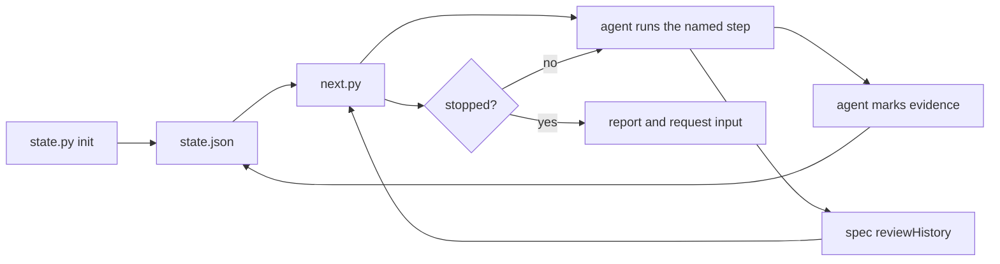
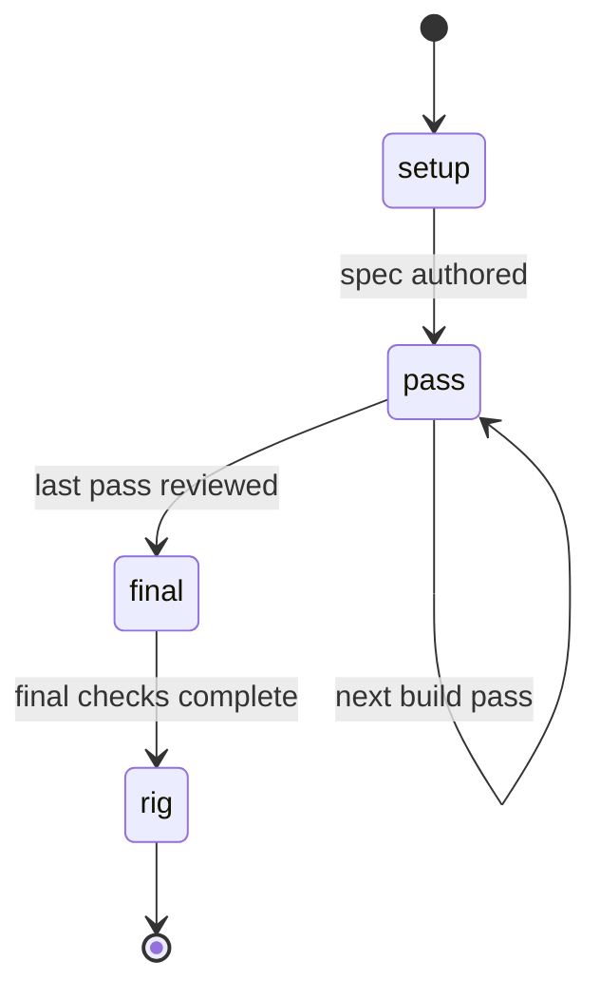

# Forge Orchestration: State, Next Action, and Bounded Correction

The forge keeps a run resumable with one file and one ordered checklist. It also refuses work that is out of order. This document explains the state schema, the next-action reporter, the routing decision, and the correction bounds.

The *forge* is the deterministic Python tree under `forge/`. The *control plane* is the small set of scripts that decide what may happen next: `state.py`, `next.py`, `report.py`, and the shared state library. The correction record is the `reviewHistory` list inside the spec. This document uses that field name; "pass ledger" and "spec ledger" are aliases for it.

## The four tools

Four scripts form the control plane. Each has one job.

| Script | Job | Exit codes |
| --- | --- | --- |
| `forge/state.py` | Create, print, and update the local checklist. | 0 OK, 2 error, 3 stopped |
| `forge/next.py` | Report the exact next action or resume point. | 0 OK, 2 error, 3 stopped |
| `forge/report.py` | Print a completion report from the pass ledger. | 0 |
| `forge/_shared/workflow_state.py` | The library that holds the state rules. | Not a command |

The state file is the authority for progress. The spec is the evidence for review actions. A state entry alone grants nothing. "Grants" means that the state does not approve a pass; only the spec, the render, and the gates do. The two authorities divide by question. "Where am I?" comes from the state file. "How many corrections happened?" comes from the spec's review history.



"JSON" means JavaScript Object Notation. The state file is JSON, and every write is atomic.

The diagram shows one cycle. `state.py init` writes `state.json`. `next.py` reads that file and the spec's `reviewHistory`. It returns either a stopped result `G` or the next step `D`. The agent runs the step, records evidence with `state.py mark`, and the cycle repeats. The spec is an input to `next.py` because the correction count lives there.

## Creating the state

The command-line interface ("CLI") has three subcommands. `init` creates the file, `status` prints it, and `mark` records evidence.

```python
# forge/state.py:23-24
def build_parser() -> argparse.ArgumentParser:
    parser = argparse.ArgumentParser(description="Minimal local checklist state for img2threejs")
```

The argument defaults set the loop bounds and the state path.

```python
# forge/state.py:27-35
    init = commands.add_parser("init")
    init.add_argument("--state", type=Path, default=Path(".img2threejs/state.json"))
    init.add_argument("--reference", required=True)
    # Choices come from the registry, so installing a domain makes its profile available here without
    # editing the base CLI. new_state() re-checks and names the available set on a bad value.
    # Guarded: registered_domains() at argparse-construction time is exactly the shape targets.py
    # documents avoiding -- a broken registry (e.g. a duplicate domain id during a half-applied
    # extraction) must degrade THIS parser to generic-only choices, not kill `status`/`mark` for
    # every profile on the machine. new_state() then reports the real registry error.
```

The `--state` default is `.img2threejs/state.json`. The `--reference` value is required. The `--profile` default is `generic`, and its choices come from the domain registry. The `--spec` value records where the spec will be written.

The two loop limits have their own defaults.

```python
# forge/state.py:42-43
    init.add_argument("--max-per-pass", type=int, default=3)
    init.add_argument("--max-total", type=int, default=6)
```

The default is three corrections per pass and six in total. A caller can lower or raise the limit, subject to one rule: both values must be at least one, and the per-pass limit cannot exceed the total limit.

An existing state file is never overwritten.

```python
# forge/state.py:82-84
        if args.command == "init":
            if args.state.expanduser().exists():
                raise WorkflowStateError(f"refusing to overwrite existing state: {args.state}")
```

This refusal protects a long run. A second `init` cannot erase the evidence of the first.

## The checklist scopes

The checklist has four scopes. They run in a fixed order: setup, pass, final, rig.

Setup steps run before a spec exists.

```python
# forge/_shared/workflow_state.py:22-30
SETUP_STEPS: Final = (
    ("image-analysis", "Read grimoire/intake/image_analysis.md and analyze {reference}"),
    (
        "reference-suitability",
        "Read grimoire/intake/validation_rubric.md and record a pass, conditional, or reject verdict for {reference}",
    ),
    ("reference-admission",
     "python3 forge/stage1_intake/check_reference_admission.py {reference}"
     " --out admission.json --probe-out probe.json"),
```

Each entry has an identifier and a command. The command can be a script call or a reading instruction. The state library treats both kinds the same way. The `{reference}` placeholder is filled from `state["artifacts"]["reference"]`, which `init` records. The `{spec}` and `{pass_id}` placeholders are filled the same way at print time.

Pass steps run once for each build pass.

```python
# forge/_shared/workflow_state.py:52-61
PASS_STEPS: Final = (
    ("build-current-pass", "python3 forge/stage3_build/generate_threejs_factory.py {spec} --out src/createObjectModel.ts --pass-id {pass_id}"),
    ("render-capture", "Render {pass_id} and capture the fixed review view plus meaningful orbit views"),
    ("review-contract-read", "Read grimoire/review/gates_reference.md and grimoire/review/self_correction.md completely"),
    ("tier1-diagnostics", "python3 forge/stage4_review/diagnose_render.py --reference {reference} --render <shot> --spec {spec} --pass-id {pass_id} --in-place"),
    ("multi-angle-review", "python3 forge/stage4_review/diagnose_render_multi_angle.py --reference <fixed-shot> --orbit <orbit-shot> --orbit <orbit-shot>"),
    ("pass-gate-check", "python3 forge/stage3_build/orchestrate_passes.py check {spec} --pass-id {pass_id}"),
    ("ai-review-recorded", "Create the comparison sheet, inspect it with agent vision, and append exactly one review action"),
    ("pipeline-sync", "python3 forge/stage3_build/orchestrate_passes.py sync {spec} --in-place"),
)
```

The pass order is the contract. Generate, render, read the review contract, run diagnostics, run multi-angle review, check the gate, record the artificial intelligence (AI) review, and sync. A shortcut would let a render pass without a diagnostic.

The checklist is data, so it cannot stop a host from running a script directly. Enforcement happens in two places. The mark guard accepts only the step that `next_entry` returns. The generator and gate scripts also check their own preconditions. So a direct render does not advance the state, and a later mark fails as out of order.



A state can move forward only. The scope order prevents a rig step from starting on an unfinished mesh.

The diagram shows the four scopes. The setup scope ends when the spec is authored. The pass scope repeats for each build pass. The `final` scope follows the last reviewed pass, and the `rig` scope follows the final checks. The `currentPass` value becomes `"complete"` when the spec marks the last pass as reviewed. The source comment at `workflow_state.py:214` names the reason that rig steps run last.

Forward-only has a precise meaning. The scope order and the pass order never reverse. The pass checklist itself does reset when the run enters a new pass, or when a refinement starts. `set_current_pass` archives the old entries in `passHistory` and sets the live pass entries back to `pending`. That reset is not a step backwards. It starts a new iteration of the same forward scope.

Final steps run after the last pass. Rig steps run last, because rigging is additive to a finished mesh.

## Building a new state

The constructor validates the profile and the loop limits.

```python
# forge/_shared/workflow_state.py:144-145
    if max_per_pass < 1 or max_total < 1 or max_per_pass > max_total:
        raise WorkflowStateError("loop limits require 1 <= max-per-pass <= max-total")
```

The rule `1 <= max-per-pass <= max-total` rejects the impossible configuration where the per-pass limit is larger than the whole budget. A value below one is also a hard error. Weird limits are a hard error.

The constructor then builds the full checklist. A *domain* is a subject family, such as a game skin. A *profile* is the named checklist variant that the domain provides. A *plugin* supplies a domain. An *anchor* is the identifier of an existing base step. Domain steps are spliced at named anchors, never at an index. "Spliced" means inserted into the base list at that named point. `SCHEMA_VERSION` is `1`, the version of the state file layout. `FINAL_STEPS` has four entries: `part-coverage`, `action-ready`, `emission-target`, and `plugin-gates` (`forge/_shared/workflow_state.py:63-92`). `rigSteps` is the optional domain list for the rig scope.

```python
# forge/_shared/workflow_state.py:147-161
    setup = [_step(sid, cmd.replace("{profile}", profile), scope="setup") for sid, cmd in SETUP_STEPS]
    pass_steps = list(PASS_STEPS)
    if domain is not None:
        setup = _splice(setup, domain.get("setupSteps"), domain.get("setupAnchorBefore"), profile, scope="setup")
        pass_steps = _splice_raw(pass_steps, domain.get("passSteps"), domain.get("passAnchorBefore"), profile)
    state = {
        "schemaVersion": SCHEMA_VERSION,
        "status": "active",
        "profile": profile,
        "currentStep": setup[0]["id"],
        "currentPass": "",
        "checklist": setup
        + [_step(*item, scope="pass") for item in pass_steps]
        + [_step(*item, scope="final") for item in FINAL_STEPS]
        + [_step(*item, scope="rig") for item in ((domain.get("rigSteps") or ()) if domain else ())],
```

The splice uses a named anchor, not an index. An unknown anchor is a hard error. `_splice` inserts fully formed step dictionaries into the setup list. `_splice_raw` inserts identifier-and-command pairs into the pass list, and the list comprehension later turns them into step dictionaries.

```python
# forge/_shared/workflow_state.py:102-104
    # An unknown anchor is a contribution the base cannot place. Failing loud beats appending at the
    # end, which would put a domain's setup step after the steps that depend on it.
    raise WorkflowStateError(f"profile {profile!r} anchors a step before unknown base step {anchor!r}")
```

A plugin author must name a base step that exists. A silent append could put a domain intake after spec authoring. That order would be wrong.

## Saving without corruption

Every save validates the state and writes it atomically. The validation checks the schema version, the loop object, the required reference artifact, and the cursor values. A malformed state stops the save before any write.

```python
# forge/_shared/workflow_state.py:231-245
def save_state(path: Path, state: dict[str, Any]) -> None:
    validate_state(state)
    target = path.expanduser().resolve()
    target.parent.mkdir(parents=True, exist_ok=True)
    handle, temporary = tempfile.mkstemp(prefix=f".{target.name}.", suffix=".tmp", dir=target.parent)
    try:
        with os.fdopen(handle, "w", encoding="utf-8") as stream:
            json.dump(state, stream, indent=2, ensure_ascii=False)
            stream.write("\n")
            stream.flush()
            os.fsync(stream.fileno())
        os.replace(temporary, target)
    finally:
        if os.path.exists(temporary):
            os.unlink(temporary)
```

The write goes to a temporary file in the same directory. `fsync` forces the data to disk. `os.replace` is atomic on the same file system. A crash leaves either the old file or the new file, never a mix.

## Reading the next action

The dispatcher walks the scopes in order. Setup first, then pass, then final, then rig.

```python
# forge/_shared/workflow_state.py:272-295
def next_entry(state: dict[str, Any]) -> dict[str, Any] | None:
    setup_pending = _pending(_entries(state, "setup"))
    if setup_pending:
        return setup_pending[0]
    if state.get("currentPass") != "complete":
        pass_pending = _pending(_entries(state, "pass"))
        if pass_pending:
            return pass_pending[0]
        return {
            "id": "await-pass-transition",
            "scope": "pass",
            "status": "pending",
            "command": "python3 forge/next.py --state .img2threejs/state.json {spec}",
        }
    final_pending = _pending(_entries(state, "final"))
    if final_pending:
        return final_pending[0]
    # Stage R runs LAST, after the static model is complete and its coverage gates have passed:
    # rigging is additive to a finished mesh, and binding a model whose parts are still moving
    # would freeze geometry that has not settled. Dispatching it here is what makes the rig steps
    # reachable at all -- a checklist entry no dispatcher returns is a step `next.py` never asks
    # for, which is the same defect as a gate nothing invokes.
    rig_pending = _pending(_entries(state, "rig"))
    return rig_pending[0] if rig_pending else None
```

"Stage R" is the animation readiness stage. The rig scope is its dispatch. It runs last on purpose. The comment names the reason: a rig bound before the mesh settles would freeze moving geometry.

The dispatcher returns `await-pass-transition` when the pass checklist is empty but the pipeline is not complete. This entry tells the agent to re-run `next.py`. The new run calls `pass_order`, `completed_passes`, and `current_pass` on the spec. A pass counts as completed when `review_completes_pass` finds an entry that completes it (`forge/stage4_review/append_review.py:157`). Completion is counted from the first pass forward. The next incomplete pass then becomes current, and `sync_from_spec` resets the live pass checklist for it.

## Formatting the command

The formatter fills artifacts into the command template. It also handles two special cases.

```python
# forge/_shared/workflow_state.py:256-269
def _format_command(state: dict[str, Any], entry: dict[str, Any]) -> str:
    artifacts = state.get("artifacts", {})
    command = str(entry["command"])
    if entry["id"] == "build-current-pass":
        action = state.get("iterationAction")
        if action == "refine-code":
            return "Refine the existing src/createObjectModel.ts from the latest review; do not regenerate it"
        if action in {"new-pass", "refine-spec"}:
            command += " --force"
    return command.format(
        reference=shlex.quote(str(artifacts.get("reference") or "<reference>")),
        spec=shlex.quote(str(artifacts.get("spec") or "<spec>")),
        pass_id=shlex.quote(str(state.get("currentPass") or "<pass>")),
    )
```

Two rules shape the output. A `refine-code` action edits the existing file and does not regenerate it. A `new-pass` or `refine-spec` action adds `--force`, so the generator may overwrite.

`shlex.quote` protects a path with spaces. A command with only the three named fields is safe to print and safe to run. Some pass commands contain angle-bracket placeholders such as `<shot>` and `<orbit-shot>`. The formatter leaves those untouched, because the agent must replace them with the actual captured image paths at run time. Those entries are instructions, not literal commands.

The formatter reads `iterationAction` from the state. `sync_from_spec` sets it to the last refinement action, or to `new-pass` when the pass changes.

## Marking steps

The mark function enforces three rules. Evidence is required for `done`. A reason is required for `skipped`. The order is enforced.

```python
# forge/_shared/workflow_state.py:324-327
    if status == "done" and not evidence:
        raise WorkflowStateError("completing a mandatory step requires at least one --evidence value")
    if status == "skipped" and not reason.strip():
        raise WorkflowStateError("skipping a mandatory step requires --reason")
```

An out-of-order update is a hard error. The message names the expected step.

```python
# forge/_shared/workflow_state.py:332-339
    if status in {"done", "skipped"}:
        for step_id in step_ids:
            expected = next_entry(state)
            if expected is None or expected["id"] != step_id:
                expected_id = expected["id"] if expected else "complete"
                raise WorkflowStateError(
                    f"out-of-order checklist update: expected {expected_id}, received {step_id}"
                )
```

The guard compares against the dispatcher, not a stored index. A "hidden step" is an entry that the status payload omits because its scope is not visible yet, such as the rig steps during the pass scope. Such a step cannot be skipped, because its identifier will not match `next_entry`. A hard-stopped state also refuses any new mark. `mark_steps` checks `state.get("status") == "stopped"` first and raises `WorkflowStateError` (`forge/_shared/workflow_state.py:320-321`).

A mark call can carry more than one identifier. The loop calls `recompute` after each id, so a list of consecutive steps advances correctly. A list with a gap fails at the first id that the dispatcher does not expect.

## Resuming from the spec

The spec's review history is the source of truth for correction counts.

```python
# forge/_shared/workflow_state.py:376-389
def sync_from_spec(state: dict[str, Any], spec: dict[str, Any], current_pass: str) -> None:
    set_current_pass(state, current_pass)
    history = spec.get("reviewHistory", [])
    if not isinstance(history, list):
        history = []
    review_cursor = min(int(state.get("reviewCursor", 0)), len(history))
    new_reviews = history[review_cursor:]
    refinements = [
        entry
        for entry in new_reviews
        if isinstance(entry, dict)
        and entry.get("passId") == current_pass
        and entry.get("action") in REFINE_ACTIONS
    ]
```

`REFINE_ACTIONS` is the set `{"refine-spec", "refine-code"}`. A "review cursor" is the index of the first history entry that the state has not read yet. `reviewCursor` advances to the end of the history after each sync, so an entry is counted once.

A new refinement resets the pass checklist. The iteration action becomes the last refinement action. The reset archives the old pass entries in `passHistory` and sets the live entries to `pending`. It does not move the scope or the pass backwards.

The counts are then recomputed from the whole history. They are not incremented from memory. The code walks every entry with an action in `REFINE_ACTIONS`, adds one to `per_pass[passId]`, and adds one to `total`. The `loops` object then stores `perPass` and `total` for the next status read.

```python
# forge/_shared/workflow_state.py:415-425
    pass_count = per_pass.get(current_pass, 0)
    if pass_count >= loops["maxPerPass"]:
        state["status"] = "stopped"
        state["currentStep"] = "stopped"
        state["stopReason"] = f"max-correction-loops-reached:{current_pass}:{pass_count}/{loops['maxPerPass']}"
    elif total >= loops["maxTotal"]:
        state["status"] = "stopped"
        state["currentStep"] = "stopped"
        state["stopReason"] = f"max-total-correction-loops-reached:{total}/{loops['maxTotal']}"
    else:
        recompute(state)
```

The stop reason is machine-readable. The format is `max-correction-loops-reached:<pass>:<count>/<max>` or `max-total-correction-loops-reached:<total>/<max>`.

**Aha:** The correction count is derived, not accumulated. A state file can be copied, merged, or rebuilt, and the count stays correct. The spec's review history is the single ledger. This is why the limit cannot be gamed by editing a counter. To raise the count, an agent must add a real review with a real action.

## The status payload

The status function returns one object. It is the contract between the state library and every caller. The `loops` object has four fields: `maxPerPass`, `maxTotal`, `perPass`, and `total`. `perPass` is a map from pass identifier to its correction count.

```python
# forge/_shared/workflow_state.py:428-452
def status_payload(state: dict[str, Any]) -> dict[str, Any]:
    entry = next_entry(state)
    current_pass = str(state.get("currentPass") or "")
    loops = state["loops"]
    visible_scopes = {"setup", "final", "rig"}
    if current_pass != "complete":
        visible_scopes.add("pass")
    return {
        "status": state["status"],
        "currentStep": state["currentStep"],
        "currentPass": current_pass,
        "loop": {
            "passCount": loops.get("perPass", {}).get(current_pass, 0),
            "maxPerPass": loops["maxPerPass"],
            "totalCount": loops["total"],
            "maxTotal": loops["maxTotal"],
        },
        "nextCommand": None if state["status"] != "active" or entry is None else _format_command(state, entry),
        "stopReason": state.get("stopReason") or None,
        "pending": [
            entry["id"]
            for entry in state["checklist"]
            if entry["scope"] in visible_scopes and entry["status"] == "pending"
        ],
    }
```

The `pending` list hides pass steps when the current pass is complete. This keeps the report short. The next pass has not started, so its steps are not yet pending.

## The next-action reporter

`next.py` loads the state and checks the positional spec against the stored spec.

```python
# forge/next.py:56-63
            stored_spec = local_state.get("artifacts", {}).get("spec")
            if isinstance(stored_spec, str) and stored_spec:
                if Path(stored_spec).expanduser().resolve() != spec_path.expanduser().resolve():
                    print(
                        f"state error: positional spec {spec_path} does not match stored spec {stored_spec}",
                        file=sys.stderr,
                    )
                    return 2
```

This refusal stops a common error. A user can run two projects in one shell. A state file made for project A would otherwise report steps for project B. The resolved paths must match, and a mismatch returns code 2 before any write.

The reporter handles the pre-spec phase with a fallback.

```python
# forge/next.py:67-72
    if spec_path is not None and local_state is not None and not spec_path.expanduser().is_file():
        # `state.py init --spec <path>` records where the spec WILL be written, so between init
        # and spec-authoring that path does not exist yet. That is the normal pre-spec state, not
        # an error: fall back to the local checklist report so the mandatory gate stays runnable
        # for the whole pre-spec phase instead of hard-failing on its own documented first step.
        spec_path = None
```

The recorded spec path may not exist yet. The state is created before spec authoring. The fallback keeps the gate runnable during that phase.

When a spec exists, the reporter syncs the state and prints the result.

```python
# forge/next.py:92-99
    if local_state is not None:
        sync_from_spec(local_state, spec, current)
        save_state(args.state, local_state)
        payload = status_payload(local_state)
        emit_local_state(payload)
        if payload["status"] == "stopped":
            return 3
        return 0
```

Exit code 3 means a hard stop. The caller must report the reason and request input.

Without a state file, `next.py` reports from the spec's `reviewHistory` directly. This case occurs when the caller passes a spec path but no `--state`. The script has no checklist to advance, so it prints the current pass and the next command from that list.

## The completion report

`report.py` reads the spec and prints a short report. The opening sentence states completeness. `missing` is the tail of the pass order after the completed prefix. An "uncleared pass" is one of those passes. The last pass in this pipeline is `optimization-pass`, so a complete run ends there.

```python
# forge/report.py:27
    opening = "PIPELINE COMPLETE through optimization-pass." if not missing else "INCOMPLETE: uncleared passes: " + ", ".join(missing) + "."
```

The report also prints the target name, the completed passes, the current pass, and the number of review history entries. It does not decide acceptance. It summarizes the ledger.

## Fail-closed routing

Routing chooses between the weapon track and the character track. It can also refuse.

```python
# forge/_shared/pipeline_routing.py:8-16
CONFIDENCE_THRESHOLD: Final[float] = 0.82
TRACK_BY_KIND: Final[dict[str, str]] = {
    "weapon": "weapon-v1.4",
    "character": "character-v1.5",
}
VALID_TRACKS: Final[frozenset[str]] = frozenset(TRACK_BY_KIND.values())
VALID_KINDS: Final[frozenset[str]] = frozenset({"weapon", "character", "hybrid", "unknown"})
VALID_SOURCES: Final[frozenset[str]] = frozenset({"explicit", "classification", "legacy"})
VALID_STATUSES: Final[frozenset[str]] = frozenset({"resolved", "request-input"})
```

The resolver combines the explicit request and the classification. A "track" is an authoring route. The two routes are `weapon-v1.4` and `character-v1.5`. A "classification" is the subject kind plus a confidence value. `hybrid` means the subject mixes both kinds. `unknown` means the classifier could not decide. A `legacy` source means an older record had no classification. The pre-spec assessment calls the resolver and stores the record as `pipelineRouting` in its output. A reliable classification is one with a known kind and a confidence at or above the threshold.

```python
# forge/_shared/pipeline_routing.py:132-141
    reliable_kind = kind in TRACK_BY_KIND and confidence >= CONFIDENCE_THRESHOLD
    requested_track = explicit_track or TRACK_BY_KIND.get(kind, "weapon-v1.4")
    if kind in {"hybrid", "unknown"}:
        conflicts.append(f"classification kind {kind!r} requires input")
    elif confidence < CONFIDENCE_THRESHOLD:
        conflicts.append(f"classification confidence {confidence:.2f} is below {CONFIDENCE_THRESHOLD:.2f}")
    elif explicit_track is not None and reliable_kind and TRACK_BY_KIND[kind] != explicit_track:
        conflicts.append(f"explicit track {explicit_track!r} contradicts reliable classification {kind!r}")

    status = "resolved" if reliable_kind and not conflicts else "request-input"
```

A hybrid or unknown kind always needs input. A low confidence always needs input. An explicit track that contradicts a reliable classification also needs input.

A saved routing record is validated against the same contract. The record has five fields: `version`, `track`, `source`, `status`, and `conflicts`, plus the nested `classification`. `requested_track` is the explicit request when one exists, and the classification's default route otherwise. It becomes the record's `track` field even when the status is `request-input`, so a caller can see which route was under consideration.

```python
# forge/_shared/pipeline_routing.py:158-165
    if routing.get("version") != 1:
        errors.append("pipelineRouting.version must be 1")
    if routing.get("track") not in VALID_TRACKS:
        errors.append("pipelineRouting.track must be weapon-v1.4 or character-v1.5")
    if routing.get("source") not in VALID_SOURCES:
        errors.append("pipelineRouting.source must be explicit, classification, or legacy")
    if routing.get("status") not in VALID_STATUSES:
        errors.append("pipelineRouting.status must be resolved or request-input")
```

One more rule closes the loop. A resolved record cannot contain conflicts. The validator checks that `conflicts` is a list of strings, and it rejects a `resolved` status with a non-empty list.

## The artifact cache

The cache avoids repeated expensive work. Its key has two parts.

```python
# forge/_shared/artifact_cache.py:25-26
def cache_key(crop_path: Path, script_path: Path) -> str:
    return f"{file_sha256(crop_path)}:{file_sha256(script_path)[:12]}"
```

"SHA-256" means secure hash algorithm with a 256-bit digest. The first part hashes the crop. The second part hashes the extracting script itself. The script hash is truncated to 12 hexadecimal characters. That prefix is a readability choice, not a uniqueness proof: 12 characters give 48 bits. The prefix is enough to notice an ordinary edit, and it keeps the key readable.

The module docstring explains why. "Plan 1.3 Workstream E" and "Risk R3" are internal project planning labels. This exploration does not define them beyond what the docstring says.

```python
# forge/_shared/artifact_cache.py:1-11
"""Lightweight hash-based artifact cache (Plan 1.3 Workstream E).

Cache key = crop file content hash + the extracting script's OWN source-file
hash, both computed automatically at every run — no manually-maintained
version string exists to forget bumping (closes Risk R3: a cache keyed on a
human-maintained version constant will eventually serve stale results after
someone edits the algorithm without remembering to bump it).

This is NOT full module/spec-hash reuse (no dependency graph, no partial-
object hashing) — just "don't redo expensive-ish work on unchanged inputs."
"""
```

The cache is deliberately small. It does not build a dependency graph, so it does not know that one cached result depends on another. It does not hash partial objects, so it caches whole files only. It only avoids repeated work on unchanged inputs.

**Aha:** The cache key includes the extractor's own source hash. An edit to the algorithm invalidates every cached result with no version bump. A manual version string would eventually go stale. This design removes the human step that fails.

## Limits of the orchestration

The state layer does not prove a render. It does not grant a pass. The spec, the review history, and the deterministic gates still decide.

The state layer also does not merge two runs. One state file belongs to one spec. Using a state file with a different spec is an error, not a merge. The positional spec check catches that mistake before any state is written.

## Cross-references

- [03 Skill contract](03-skill-contract.md) explains the state gate in `SKILL.md`, which the project calls the router.
- [05 Stage intake](05-stage-intake.md) explains the setup step scripts.
- [10 Grimoire](10-grimoire.md) explains the rubrics named in the steps.
- [13 Testing and continuous integration](13-testing-and-ci.md) explains the tests for these modules.
