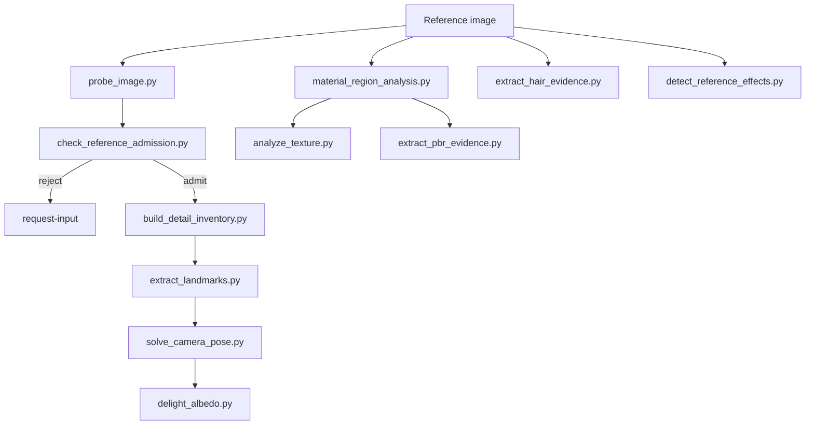
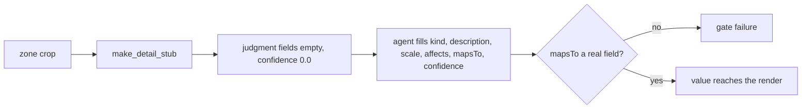

# Stage Intake: Turning a Reference Into Evidence

The intake stage measures the reference image before any spec exists. It probes the file, admits or rejects the reference, slices detail zones, extracts landmarks and camera hints, and gathers material and hair evidence. This document explains each intake script and the evidence file it produces.

Four terms carry the document. The *forge* is the deterministic Python tree under `forge/`. A *spec* is the `ObjectSculptSpec` file that describes the model to build. The *agent* is the model inside a host program that looks at images and writes code. The *grimoire* is the reference library that holds the intake rules. The forge measures. The agent judges.

## The job of intake

Intake answers five questions. Is the file readable? Is it a valid target? What small details exist? Where is the camera? What material and surface evidence does the image hold?



The diagram shows the main chain. The probe feeds admission. Admission then feeds the detail inventory, the landmarks, the camera, and the de-lighting. The material, hair, and effect branches read the reference directly. `bake_projected_texture.py` is not an intake step; it is a Stage 3 build consumer of the de-lit albedo and camera evidence, so it is outside this chain. The diagram omits six scripts that this document also covers: `check_intake_correctness.py`, `bind_detail_properties.py`, `label_glb_nodes.py`, `probe_glb.py`, `semantic_decomposition.py`, and `run_vision_adapter.py`. They are side checks or optional paths, not part of the serial chain.

The forge calls these scripts. The agent judges their outputs. No intake script scores visual fidelity.

The stage rules are strict about one point. The scripts describe and measure. They do not invent. Where a measurement is impossible, the output says so. Some scripts still make a bounded guess, such as a default field of view. In every such case the output marks the value as a guess or an assumption, so the agent knows what to review. A guess with a visible marker is not an invention.

## Image probing

`probe_image.py` reads technical metadata. It does not judge the subject.

```python
# forge/stage1_intake/probe_image.py:2
"""Probe basic technical properties of a reference image before visual analysis."""
```

The script parses the size of six formats with the standard library alone. It reads Portable Network Graphics ("PNG"), Graphics Interchange Format ("GIF"), Joint Photographic Experts Group ("JPEG"), WebP, bitmap ("BMP"), and Tagged Image File Format ("TIFF").

The probe emits warnings, not a verdict on beauty.

```python
# forge/stage1_intake/probe_image.py:139-153
        if width < 512 or height < 512:
            warnings.append("low resolution; small geometry/material details may be unreliable")
        if aspect and (aspect > 3.0 or aspect < 0.33):
            warnings.append("extreme aspect ratio; object may be cropped or surrounded by empty space")
    return {
        "path": str(path),
        "type": image_type,
        "bytes": len(data),
        "width": width,
        "height": height,
        "aspectRatio": aspect,
        "technicalSuitability": "conditional" if warnings else "pass",
        "warnings": warnings,
        "note": "This is only technical image probing. Semantic object suitability still requires visual inspection.",
    }
```

The `note` field is a contract. It stops a caller from treating a technical pass as a semantic pass. A "semantic pass" is a judgment that the image shows a usable subject. The probe cannot make that judgment, because it never looks at the content. `"technicalSuitability": "conditional"` means that the image is readable but has a warning. A warning does not reject the image.

## Reference admission

The admission gate rejects a meaningless reference before any model token is spent. A "model token" is one unit of text or image input that costs an inference call. The gate runs first, so a bad image costs nothing.

The thresholds are constants at the top of the file. The foreground coverage must lie between 5 percent and 97 percent. The short side must be at least 64 pixels. The largest connected component must hold at least 60 percent of the foreground. `COHERENCE_GRID` is the 96-pixel grid on which the component analysis runs.

```python
# forge/stage1_intake/check_reference_admission.py:31-36
MIN_FOREGROUND_COVERAGE = 0.05
MAX_FOREGROUND_COVERAGE = 0.97
MIN_SHORT_SIDE_PX = 64
MIN_LARGEST_COMPONENT_FRACTION = 0.60  # largest blob must be ≥60% of all foreground
DUPLICATE_HAMMING_THRESHOLD = 6  # pHash distance ≤ this vs an admitted ref ⇒ duplicate
COHERENCE_GRID = 96  # downsample mask to this side for connected-component analysis
```

The largest-component rule catches a scattered silhouette. A subject split into many fragments is a bad target for a silhouette comparison.

```python
# forge/stage1_intake/check_reference_admission.py:42-44
    """Fraction of foreground occupied by its single largest 4-connected blob,
    computed on a downsampled grid. ~1.0 = one coherent subject; low = scattered
    fragments (a meaningless silhouette for IoU/DCD)."""
```

"IoU" means intersection over union. "DCD" means the directional chamfer distance used by the render comparator. The "render comparator" is the code that compares a render with the reference. A fragmented mask would make both metrics meaningless, because each fragment would score against the wrong part of the reference.

The gate also detects a duplicate view. It computes a perceptual hash ("pHash") and compares the Hamming distance to an admitted reference. A "perceptual hash" is a short fingerprint of the image's appearance. The "Hamming distance" is the number of bits that differ between two fingerprints. A distance of six or less is a duplicate.

## Intake correctness

The admission gate proves the image is a valid target. The correctness check proves the intake understood the subject. The "objectness signal" is a second opinion about what the image shows. The source names OSIM as the planned deterministic, zero-token objectness source. The source does not expand the acronym, so this exploration does not invent an expansion.

```python
# forge/stage1_intake/check_intake_correctness.py:28
CONTRADICTION_CONFIDENCE_MIN = 0.6
```

A contradiction only halts when the objectness signal is confident. A weak signal does not stop the run.

When no objectness source exists, the script proceeds with an exposed assumption. It does not claim confirmation.

```python
# forge/stage1_intake/check_intake_correctness.py:56-65
    if objectness_verdict is None:
        return {
            "action": "proceed",
            "confirmed": False,
            "assumptionsExposed": assumptions,
            "reason": (
                "no objectness source available yet — confirmation DEFERRED to Phase 3 (OSIM). "
                "Proceeding on exposed assumptions; they remain falsifiable at Divine-Eye review."
            ),
        }
```

"OSIM" is the deterministic objectness source planned for a later phase. "Phase 3" is the project phase in which that source would exist. "Divine-Eye review" is the later render review stage run by the Divine Eye evaluator. Until OSIM exists, the assumption stays visible in the artifact and can be falsified at that review.

A confident contradiction halts the run.

```python
# forge/stage1_intake/check_intake_correctness.py:71-81
    if not matches and confidence >= CONTRADICTION_CONFIDENCE_MIN:
        return {
            "action": "halt",
            "confirmed": False,
            "assumptionsExposed": assumptions,
            "reason": (
                f"intake declared object class {assumptions.get('primaryType')!r} but the objectness "
                f"check detected {detected!r} (confidence {confidence:.2f} ≥ {CONTRADICTION_CONFIDENCE_MIN}). "
                "Halting to request-input rather than building a wrong spec (§4.6)."
            ),
        }
```

The exit code is 1 on halt. A pipeline runner can gate on it.

```python
# forge/stage1_intake/check_intake_correctness.py:111-112
    # Exit 1 on halt so a pipeline runner can gate on it; 0 on proceed.
    return 1 if result["action"] == "halt" else 0
```

**Aha:** A vague prompt can make intake confidently wrong. A knife described as a "spoon" would drive the whole spec down the wrong path. The correctness check does not try to be smart. It exposes the guess and stops only when a second signal disagrees with high confidence. This is cheaper than building the wrong object.

## Detail inventory

A single glance misses small identity details. The inventory slices the image into zones and scaffolds a detail list.

The target count depends on the complexity tier. The caller sets the tier with `--complexity`, and `--target-min-details` can override the count. The four tiers run from `simple` to `ultra-complex`.

```python
# forge/stage1_intake/build_detail_inventory.py:30-35
TARGET_MIN_DETAILS = {
    "simple": 3,
    "moderate": 6,
    "complex": 10,
    "ultra-complex": 16,
}
```

The default zone layout is three horizontal bands, from top to bottom: `upper`, `middle`, and `lower`. The regions are normalized: each band is one third of the image height. The constant `DEFAULT_COMPONENT_ZONES` holds the boundaries, and the source comment calls these thirds a default, not a limit. The layout is a scaffold for inspection, not a detection result. A caller can use a uniform grid or named component regions instead.

Each zone gets a detail stub. The stub has empty fields for the agent to fill.

```python
# forge/stage1_intake/build_detail_inventory.py:232-243
def make_detail_stub(zone: dict, crop_path: Path) -> dict:
    return {
        "id": zone["id"],
        "kind": "",
        "description": "",
        "region": zone["region"],
        "scale": "",
        "affects": "",
        "mapsTo": {"type": "", "ref": ""},
        "evidenceRef": str(crop_path),
        "confidence": 0.0,
    }
```

The stub cannot pass a gate on its own. The identifier, the region, and the evidence reference are already filled. The fields that need judgment start empty: `kind`, `description`, `scale`, `affects`, `mapsTo`, and `confidence`. The confidence is zero. The agent must fill each detail and map it to a real spec field.

The output is JavaScript Object Notation (JSON). The script's docstring states the limit.

```python
# forge/stage1_intake/build_detail_inventory.py:5-9
identity-defining marks are not missed by a single glance at the whole image. Writes one
crop PNG per zone plus a detailInventory skeleton JSON (see docs/UPGRADE_PLAN.md 4.1 and
grimoire/intake/detail_inventory.md) with one detail stub per zone for the agent to classify,
describe, and link to a component/material field. This script only scaffolds zones and
crops; it does not judge what is in them.
```

The last clause is the division of labor again. Scaffolding is mechanical. Judgment is the agent's.



The stub is a question, not an answer. The mapping test is the only path from a prose detail to the generated model. "Gate failure" means that a later inventory gate finds an empty required field or an unmapped detail.

## Material evidence

Material evidence starts with a verified crop. A crop is verified when the bounding box is clamped into the image and the crop is written as a new PNG. The function also returns the coverage fraction, so a later step can see how much of the image the crop used.

```python
# forge/stage1_intake/material_region_analysis.py:56-66
def crop_region(source: Path, bbox: dict[str, Any], output: Path) -> dict[str, Any]:
    width, height, pixels, warnings = load_image(source)
    x0, y0, crop_width, crop_height = _bounded_bbox(bbox, width, height)
    rgb = bytearray()
    for y in range(y0, y0 + crop_height):
        for x in range(x0, x0 + crop_width):
            red, green, blue, alpha = pixels[y * width + x]
            if alpha < 16:
                red = green = blue = 0
            rgb.extend((red, green, blue))
    write_png_rgb(output, crop_width, crop_height, bytes(rgb))
```

"RGB" means red, green, blue. A transparent pixel becomes black, so the extraction script does not read background color as material.

The texture analyzer maps a crop to one of seven finish presets.

```python
# forge/stage1_intake/analyze_texture.py:27-29
# MeshPhysicalMaterial scalar presets per finish (see grimoire threejs_texture_reference.md)
RECIPES: dict[str, dict[str, Any]] = {
    "gem-metal":      {"metalness": 0.75, "roughness": 0.14, "clearcoat": 0.60, "clearcoatRoughness": 0.06, "transmission": 0.0, "ior": 1.5,  "envMapIntensity": 1.3, "anisotropy": 0.0, "procedural": "gradient-smoke"},
```

The preset is a starting point. The analysis adjusts it from the crop's statistics. The presets are grounded in the texture reference file, not invented. `MeshPhysicalMaterial` is the Three.js material class that these fields configure. `transmission` lets light pass through the surface. `clearcoat` adds a second glossy layer. `anisotropy` stretches the highlight along a direction. The `procedural` field names a code pattern that the generator uses in place of a texture.

The physically based rendering ("PBR") extractor produces a confidence score. The score is a weighted sum with a hard cap.

```python
# forge/stage1_intake/extract_pbr_evidence.py:573-584
    single_image_cap = 0.86 if single_image else 0.93
    confidence = (
        0.44
        + resolution_score * 0.14
        + mask_score * 0.14
        + dynamic_score * 0.12
        + detail_score * 0.16
        - warning_penalty
    )
    confidence = min(single_image_cap, clamp01(confidence))
    if single_image:
        confidence_notes.append("single-image inverse rendering cannot prove true physical PBR; confidence is capped")
```

A single image cannot reach a confidence above `0.86`. This is not a tuning choice. A single view cannot separate albedo from light. The formula weights four sub-scores and subtracts a penalty. The names are `resolution_score`, `mask_score`, `dynamic_score`, and `detail_score`, with `warning_penalty`. The source computes those values earlier in the function and does not define them in this block. The weights sum to `1.00`. The source does not derive them; it records no calibration study, so this document cannot say whether they are measured or chosen. The non-single-image cap is `0.93`, because extra views add evidence but still cannot prove the true material.

The part color recipe adds a palette and a material class. It converts the crop through the sRGB, CIE XYZ, and CIE Lab color spaces and clusters the foreground colors.

```python
# forge/stage1_intake/extract_part_color_recipe.py:351-357
def build_recipe(
    component_id: str,
    crop_path: Path,
    target_threshold: float = 0.7,
    material_class_hint: str | None = None,
    size: int = 96,
) -> dict[str, Any]:
```

"CIE" means the International Commission on Illumination. "Lab" is the perceptually uniform color space. "sRGB" means the standard red, green, blue color space. "CIE XYZ" is the device-independent tristimulus space between sRGB and Lab. The conversion makes color clustering less sensitive to brightness. A "palette" is the small set of dominant colors that the clustering finds. A "material class" is a named category, such as metal or fabric. `target_threshold` is the minimum confidence for the material class assignment.

The recipe also detects a gradient. The hue names come from a fixed table.

```python
# forge/stage1_intake/extract_gradient_stops.py:30-40
_HUE_NAMES = [
    (15, "red"), (45, "orange"), (70, "yellow"), (165, "green"),
    (195, "cyan"), (255, "blue"), (290, "violet"), (345, "magenta"), (360, "red"),
]


def hue_name(h_deg: float) -> str:
    for upper, name in _HUE_NAMES:
        if h_deg < upper:
            return name
    return "red"
```

The threshold `0.7` in `build_recipe` is the function's default. `SKILL.md:205-206` applies a `0.7` stop/refine rule to PBR confidence. The source does not state that the two thresholds are the same rule. A material-class confidence below `0.7` is a stop or refine signal. The agent can re-crop the region, or choose the material class by hand.

## Camera and de-lighting

The camera helper does not calibrate a camera. Its docstring is explicit.

```python
# forge/stage1_intake/solve_camera_pose.py:2-12
"""Estimate a starting referenceCamera block for a reference image.

This is not camera calibration and it does not solve for the true focal
length, sensor, or 6-DoF pose that produced the photo. A single 2D image
under-constrains that problem. Instead this script emits a reasonable
default guess (FOV) plus image-derived facts (aspect ratio) and explicit
agent-fill placeholders (orientation, position) that the agent is expected
to refine by rendering the fitted mesh from this camera and visually
overlaying it against the reference image until silhouettes line up. The
`agentFill` flag on each field marks what still needs that visual pass.
"""
```

"FOV" means field of view. The docstring's "6-DoF" means six degrees of freedom: position on three axes and rotation on three axes. This is not depth of field; that second sense of the abbreviation appears later in the presentation-effects section.

The default path writes a starting camera block. The `agentFill` flag marks each value that the agent must refine by visual overlay. The fitting path is separate. `fit_camera_to_correspondences` accepts point pairs and calls `camera_fitting_solver.fit_parameters`. The default command uses `build_camera`, which writes the guess and the agent-fill fields. The fit path runs only when a caller supplies the correspondences.

The fitting math is deterministic and bounded. A "correspondence" is a matched pair: one three-dimensional point and its two-dimensional image position. "Damping" is a step-size control that the solver lowers when a step fails. A "finite difference step" is the small offset used to estimate a derivative numerically.

```python
# forge/stage1_intake/camera_fitting_types.py:16-25
MINIMUM_CORRESPONDENCES: Final = 6
MINIMUM_FOV_DEGREES: Final = 10.0
MAXIMUM_FOV_DEGREES: Final = 120.0
MINIMUM_CAMERA_DEPTH: Final = 1e-8
DEFAULT_MAXIMUM_ITERATIONS: Final = 80
DEFAULT_MAXIMUM_DAMPING_RETRIES: Final = 12
INITIAL_DAMPING: Final = 1e-3
MAXIMUM_DAMPING: Final = 1e12
CONVERGED_RMS_PIXELS: Final = 1e-6
FINITE_DIFFERENCE_STEPS: Final[ParameterVector] = (1e-3, 1e-4, 1e-4, 1e-4, 1e-5, 1e-5, 1e-5)
```

"RMS" means root mean square. The solver needs at least six point pairs. Each pair is a three-dimensional landmark position and its two-dimensional position in the image. It caps the iterations and the damping. `MINIMUM_FOV_DEGREES` and `MAXIMUM_FOV_DEGREES` bound the result.

The de-lighting step is also an approximation.

```python
# forge/stage1_intake/delight_albedo.py:2-14
"""Approximate a neutral (de-lit) albedo from a single reference photo.

This is an approximation, not true inverse rendering. A single photo bakes
together albedo, direct light, ambient occlusion, and specular response
into one signal, and there is no way to fully separate those from pixels
alone. This script applies a per-pixel normalization against a low-frequency
luminance estimate (a box-blur "lighting" proxy): pixels darker than their
local neighborhood get brightened, pixels brighter than their neighborhood
get darkened, pulling the image toward flat, even lighting. Strong specular
hotspots, deep occlusion shadows, and directional cues that vary faster than
the blur radius will not be fully removed. Always review the output next to
the source image before treating it as a projection albedo.
"""
```

"Albedo" means the diffuse color of a surface under neutral light. A "projection albedo" is an albedo image that a later step projects back onto the geometry. A specular hotspot survives the blur. The docstring says so, and the agent must check the output.

## Landmarks

The landmark overlay draws guide lines on the reference. The lines are starting positions, never measurements.

```python
# forge/stage1_intake/extract_landmarks.py:2-10
"""Overlay a labelled proportion/landmark guide grid on a reference image and scaffold anatomy.

Draws head-unit ticks, a rule-of-thirds grid, a center symmetry axis, default face-line
guides (hairline/eye/nose/mouth), and default shoulder/hip lines onto a copy of the
reference (see docs/UPGRADE_PLAN.md 5.3-5.4 and grimoire/character/reconstruction.md),
then emits an anatomy skeleton JSON for the agent to fill from what the overlay reveals.
The drawn lines are generic starting positions, not measurements - the agent's vision
supplies the actual proportions, pose, and landmark coordinates.
"""
```

The overlay uses its own color per guide, but this document does not list the constants. The output is a scaffold. The anatomy skeleton JSON records named landmark positions for the agent to fill. The source does not define the full schema in this excerpt. A filled landmark coordinate must come from the agent's visual pass.

## Hair evidence

Hair needs its own measurement because a normal silhouette gate cannot see it. A "silhouette gate" compares the outer outline of the render with the reference. Hair sits inside that outline, so the gate misses it. The script finds a hair and skin split with Otsu's method. "Otsu's method" picks the threshold that best separates two brightness classes.

```python
# forge/stage1_intake/extract_hair_evidence.py:43-47
OTSU_BINS = 64
# If the two classes Otsu finds are barely separated there is no hair/skin split to speak of -- a
# bald head, or a subject cropped so tightly that only hair is in frame. Reported rather than
# silently returning a threshold through the middle of one population.
MIN_CLASS_SEPARATION = 12.0
```

A fixed percentile was tried first. It always reports the chosen percentage as hair, so the measurement is true by construction. Otsu finds the real split. A "wide single population" means one brightness distribution with no hair/skin pair. The comments record the measured endpoints of a separability score: the bald capture floor is `1.119`, and the reference front view ceiling is `2.450`. The value `2.0` sits between them. The source does not give the score a unit.

```python
# forge/stage1_intake/extract_hair_evidence.py:66
MIN_SEPARABILITY = 2.0
```

The second constant catches a wide single population, such as a bald head under strong light.

The script does not guess lock geometry. "Lock geometry" is the shape of a separate hair lock. The docstring states that a single image does not carry it.

## Detail binding

A plain-language detail must become a real material property. The binder uses ordered keyword rules.

```python
# forge/stage1_intake/bind_detail_properties.py:23-28
# Each rule: (name, keyword-regex, material-properties dict, primitive hint or None, note).
# Ordered most-specific first; all matching rules contribute (union of properties).
_RULES: list[tuple[str, str, dict[str, Any], str | None, str]] = [
    ("gemstone/glass", r"jade|gem|glass|crystal|translucent|transparent|amber|resin",
     {"transmission": 0.6, "ior": 1.6, "thickness": 0.5, "roughness": 0.1, "requiresEnvMap": True},
     None, "translucent → transmission+ior+thickness; needs an environment map to read correctly"),
```

"IOR" means index of refraction. The rules cover ten property families: gemstone and glass, brushed metal, metal, glossy coat, iridescent, fabric, emissive, rubber and matte, fastener, and decal.

The order resolves conflicts. All matching rules add their properties, but the first rule to set a property wins. The code uses `setdefault`, so a later, less specific rule cannot replace an earlier value. The same rule sets the primitive hint once.

A fastener rule returns a primitive hint, not a material property. The hint is `instanced-cluster`, so repeated screws do not become many separate meshes.

## Graphics Library Transmission Format nodes

A Graphics Library Transmission Format (GLB) file is a binary three-dimensional scene. "GLB" is the short form used below. A GLB node label is a hypothesis, not a fact. The labeler refuses to read names, because a name can lie about the part it labels.

```python
# forge/stage1_intake/label_glb_nodes.py:37-46
BANDS: tuple[tuple[str, float, float], ...] = (
    ("footwear", 0.00, 0.12),
    ("lower-leg", 0.10, 0.30),
    ("knee", 0.28, 0.42),
    ("thigh", 0.38, 0.55),
    ("hip-waist", 0.50, 0.62),
    ("torso", 0.60, 0.80),
    ("shoulder-neck", 0.78, 0.88),
    ("head", 0.86, 1.00),
)
```

The bands overlap on purpose. The numbers are normalized height fractions, where `0.00` is the base and `1.00` is the top. A node that spans two bands gets a lower confidence and a named ambiguity. That is the honest answer.

The GLB probe reports readiness and a clear limit.

```python
# forge/stage1_intake/probe_glb.py:277-279
        "referenceReadiness": "pass" if meshes and bin_payload else "reject",
        "warnings": sorted(set(warnings)),
        "note": "Metadata only. Render the GLB through the target Three.js route before using it as a visual baseline; do not copy its topology into a procedural factory.",
```

"BIN" means the binary payload chunk. The probe is metadata only. It never copies topology, which is the vertex and face structure of the mesh. A "procedural factory" is the generated code that builds the model from parameters. The note says to render the GLB through Three.js rather than copy its mesh into that code. The readiness check needs meshes and a binary payload; the source does not say that materials or textures affect it.

The semantic assessment lists the allowed strategies.

```python
# forge/stage1_intake/semantic_decomposition.py:15-23
SEMANTIC_STRATEGIES = (
    "named-node",
    "primitive-material-boundary",
    "uv-texture-boundary",
    "connected-component-hypothesis",
    "curvature-normal-region-growing-hypothesis",
    "multiview-id-mask",
    "multipart-glb",
)
```

"UV" means the two-dimensional texture coordinate. Each strategy is a way to split the scene into parts. `named-node` uses an existing node name. `primitive-material-boundary` splits where the material changes. `uv-texture-boundary` splits along a texture seam. `connected-component-hypothesis` and `curvature-normal-region-growing-hypothesis` are guesses from geometry. `multiview-id-mask` uses a browser capture with a per-part identifier mask, which the prose calls a browser identifier mask. Intake does not perform that capture. The Stage 3 build render capture owns it, and `semantic_decomposition.py` marks the strategy as required for runtime region evidence. `multipart-glb` uses an existing multi-part file. A connected component or a curvature region is a hypothesis. The last two are confirmation.

## The optional vision adapter

The vision adapter is isolated. The forge calls it through a subprocess.

```python
# forge/stage1_intake/run_vision_adapter.py:13-24
ROOT = Path(__file__).resolve().parents[2]
DEFAULT_PYTHON = ROOT / "integrations" / "vision" / ".venv" / "bin" / "python"
ADAPTER = ROOT / "integrations" / "vision" / "reference_vision.py"


def resolve_python(explicit: str | None) -> Path:
    configured = explicit or os.environ.get("IMG2THREEJS_VISION_PYTHON")
    return Path(configured).expanduser().resolve() if configured else DEFAULT_PYTHON


def build_command(python: Path, forwarded: list[str]) -> list[str]:
    return [str(python), str(ADAPTER), *forwarded]
```

A vision language model (VLM) is not used here. The adapter provides segmentation, depth, and landmarks. It does not score the model.

The adapter is optional. The "standard-library core" is the forge code that needs no extra package. It stays authoritative, so an adapter result never replaces a core measurement. Every adapter output must name its provenance, which is the source and method that produced it. The adapter's segmentation and landmarks can overlap the core's own `extract_landmarks.py` and `semantic_decomposition.py`, so the agent compares the two rather than trusting either alone.

## Presentation effects

Some reference images show background blur or glow. The detector recommends effects for the presentation render only.

```python
# forge/stage1_intake/detect_reference_effects.py:237-250
def recommend_effects(png_path: Path) -> dict[str, Any]:
    """Run both detectors and recommend which post-fx the reference warrants."""
    blur = detect_background_blur(png_path)
    glow = detect_highlight_glow(png_path)
    return {
        "dof": blur["blurred"],
        "bloom": glow["glow"],
        "blur": blur,
        "glow": glow,
        "note": (
            "post-fx authorized only for effects the reference actually exhibits; "
            "applied on the presentation render only, never the Eye's evaluation render"
        ),
    }
```

"DoF" here means depth of field, the background blur effect. This is the second sense of the abbreviation in this document; the camera section used degrees of freedom. "Post-fx" means post-processing effects added after the render. The "presentation render" is the image made to look like the reference. The "evaluation render" is the plain image that the Divine Eye measures. The note is a hard boundary. An effect may not enter the evaluation render, because it would change the evidence.

**Aha:** The intake stage never makes the model look better. It makes the reference measurable. Every artifact either records a fact, exposes an assumption, or names a limit. The de-lighting script, the confidence cap, and the hypothesis label all follow the same pattern: state what the single image cannot prove.

## Evidence map

This table lists the scripts that write a named evidence file. This document also covers six side or optional scripts, and the diagram omits them. `check_intake_correctness.py` writes a proceed-or-halt result. `bind_detail_properties.py` writes material properties from a detail. `label_glb_nodes.py` writes node hypotheses. `probe_glb.py` writes GLB metadata. `semantic_decomposition.py` writes part strategies. `run_vision_adapter.py` writes optional adapter evidence.

| Script | Output | Consumed by |
| --- | --- | --- |
| `probe_image.py` | Technical metadata and warnings | Admission and the assessment |
| `check_reference_admission.py` | Admitted or rejected, with reasons | The state gate |
| `check_intake_correctness.py` | Proceed or halt | Spec authoring |
| `build_detail_inventory.py` | Zone crops and detail stubs | The quality contract and the spec |
| `extract_landmarks.py` | Overlay and anatomy skeleton | Character reconstruction |
| `solve_camera_pose.py` | Camera block with agent-fill fields | Projection and render matching |
| `delight_albedo.py` | Neutral albedo approximation | Texture projection |
| `material_region_analysis.py` | Crops and material analysis | The material reference pipeline |
| `extract_part_color_recipe.py` | Palette, material class, and color recipe | Spec material fields |
| `extract_gradient_stops.py` | Banded gradient stops | The texture and material recipe |
| `extract_pbr_evidence.py` | PBR evidence with confidence | The material spec |
| `extract_hair_evidence.py` | Banded coverage and shading | The hair gate |
| `detect_reference_effects.py` | Presentation effect advice | The presentation render only |
| `bake_projected_texture.py` | Projected texture (Stage 3, not intake) | The built model material |

## What intake does not do

Intake does not author the spec. It does not generate code. It does not score a render. It does not confirm a hidden side. A single image cannot show the back of an object, and the artifacts say so.

The next stage uses these files. Document 06 covers spec authoring. Document 10 covers the rubrics that intake reads.

## Cross-references

- [03 Skill contract](03-skill-contract.md) places these scripts in the loop.
- [04 Forge orchestration](04-forge-orchestration.md) explains the state steps that call them.
- [10 Grimoire](10-grimoire.md) explains the intake rubrics.
- [01 Repository anatomy](01-repository-anatomy.md) shows where `stage1_intake` sits.
