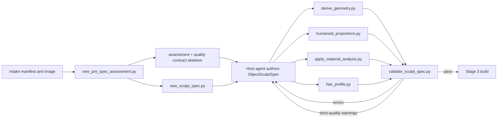
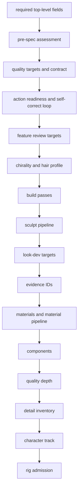

# Stage 2: The Sculpt Spec and Its Quality Contract

img2threejs is an agent skill and a deterministic forge. It converts one reference image into a TypeScript Three.js `Group` factory. This document explains how it turns an intake assessment into an `ObjectSculptSpec`, and how the forge blocks a shallow spec before any code is written. The thesis is simple: Stage 2 is not a prompt. It is a contract. The spec author must record measured evidence, a quality bar, and a minimum depth. The validator then measures the spec against that bar. A missing or weak spec fails closed in strict-quality mode.

The source snapshot is commit `0c0c49bc168e648dbaf9c8c080474de0b3a941b6`. All paths are relative to the repository root. Stage 1 produces the intake evidence. Stage 3 consumes the spec. This document covers only Stage 2. For the surrounding pipeline, read [04 Forge orchestration](04-forge-orchestration.md) and [07 Stage build](07-stage-build.md).

## 1. Where Stage 2 sits

Stage 2 has seven scripts. Each script has one job.

| Script | Job |
|--------|-----|
| `forge/stage2_spec/new_pre_spec_assessment.py` | Build the assessment skeleton and the quality contract skeleton |
| `forge/stage2_spec/new_sculpt_spec.py` | Author the default spec and the quality contract content |
| `forge/stage2_spec/validate_sculpt_spec.py` | Validate every field, and enforce strict-quality mode |
| `forge/stage2_spec/derive_geometry.py` | Derive a lathe profile from the reference mask |
| `forge/stage2_spec/humanoid_proportions.py` | Fill character anatomy from a canon table |
| `forge/stage2_spec/hair_profile.py` | Validate the hair profile schema |
| `forge/stage2_spec/apply_material_analysis.py` | Copy analyzed material regions into the spec |

The stage is not a single program. It is a set of deterministic tools. The host agent is the model-driven assistant that runs the skill; it calls the tools and writes the spec. Each tool refuses an input it cannot trust. That is the design rule. The model supplies judgment. The scripts supply arithmetic and refusal.



## 2. The pre-spec assessment

`new_pre_spec_assessment.py` creates two things before the spec exists: a pre-spec assessment and a quality contract. Both are skeletons. The agent fills them. The caller sets the complexity tier with `--complexity`. The script supplies a default (ultra-complex for CS2, moderate otherwise), writes the tier, and applies the minimum detail count. The validator later checks the contract against that tier.

Complexity has four tiers. Each tier carries a numeric floor for six depth measures.

```python
# forge/stage2_spec/new_pre_spec_assessment.py:43-51
COMPLEXITY_MINIMUMS = {
    "simple": {
        "macroComponents": 1,
        "mesoComponents": 0,
        "microFeatureGroups": 0,
        "materialLayers": 1,
        "repetitionSystems": 0,
        "reviewViewpoints": 2,
    },
```

The full table continues to `ultra-complex` at line 68-75. An ultra-complex object needs at least five macro components, sixteen meso components, eight micro feature groups, four material layers, two repetition systems, and five review viewpoints. These numbers are not advice. `validate_quality_depth` compares the actual spec counts against them.

The detail floor is separate from the structural floor.

```python
# forge/stage2_spec/new_pre_spec_assessment.py:79-84
DETAIL_MINIMUMS = {
    "simple": 3,
    "moderate": 6,
    "complex": 10,
    "ultra-complex": 16,
}
```

A simple object needs three identity-defining details. An ultra-complex object needs sixteen. The table at `new_pre_spec_assessment.py:79-85` gives three, six, ten, and sixteen. The Counter-Strike 2 (CS2) domain has its own floor.

```python
# forge/stage2_spec/new_pre_spec_assessment.py:90-91
CS2_DOMAIN_ID = "cs2"
CS2_DETAIL_MINIMUM = 9
```

The CS2 floor never drops below nine, even when the caller sets a lower complexity. The floor is not global. It applies only when the CS2 flag or a CS2 intake manifest sets `is_cs2`. The reason is in the source comment: a weapon skin always carries finish patterns, wear layers, hardware, and stitching. Those details define identity more than raw structure does.

`make_payload` applies the floors and writes the authoring instruction.

```python
# forge/stage2_spec/new_pre_spec_assessment.py:184-195
    target_min_details = DETAIL_MINIMUMS[complexity]
    if is_cs2:
        target_min_details = max(target_min_details, CS2_DETAIL_MINIMUM)
    assessment["detailInventory"]["targetMinDetails"] = target_min_details
    if complexity in {"complex", "ultra-complex"}:
        assessment["specDepthDecision"]["needsRepetitionSystems"] = True
        assessment["specDepthDecision"]["needsMaterialLocalOverrides"] = True
        assessment["specDepthDecision"]["minimumComponentLevels"] = ["macro", "meso", "micro"]
    elif complexity == "moderate":
        assessment["specDepthDecision"]["minimumComponentLevels"] = ["macro", "meso"]
    contract["qualityBar"] = complexity
    contract["minimumSpecDepth"] = COMPLEXITY_MINIMUMS[complexity]
```

The payload also carries an authoring instruction, a local spec search bundle, and an optional pipeline routing decision. The routing decision is where Stage 2 hands a character or a CS2 weapon to a track-specific pipeline. The source comment at `new_sculpt_spec.py:123-130` states the rule for the evidence collection. A target name is not evidence, so the collection comes from an explicit request or from the resolved domain profile, never from keyword matching. The blade keyword rule in `inject_geometry_rules` controls a geometry instruction; it does not collect evidence.

## 3. The quality contract

`new_sculpt_spec.py` defines `make_quality_contract`. The contract has five feature groups. Every group is required. Each group has quality criteria, evidence references, and failure modes.

```python
# forge/stage2_spec/new_sculpt_spec.py:106-119
def make_quality_contract() -> dict:
    return {
        "qualityBar": "unassessed",
        "definitionOfDone": [
            "The rendered model matches the reference silhouette, primary proportions, visible component hierarchy, material response, and most recognizable local features for the selected fidelity tier.",
        ],
        "minimumSpecDepth": {
            "macroComponents": 1,
            "mesoComponents": 0,
            "microFeatureGroups": 0,
            "materialLayers": 1,
            "repetitionSystems": 0,
            "reviewViewpoints": 3,
        },
```

These are authoring defaults. `new_pre_spec_assessment.py` later replaces `qualityBar` and `minimumSpecDepth` with the selected complexity tier. The default `reviewViewpoints` of 3 applies only until that replacement.

The five groups are `overall-silhouette`, `primary-structure`, `attachment-joint-correctness`, `surface-material-response`, and `reference-lookdev`. They map to the five ways a generated model usually fails. It is a generic placeholder instead of the object. It merges parts that should be separate. A child part floats away from its parent. The surface looks like flat plastic. The lighting cannot reproduce the source value range.

The contract also holds a list of prohibitions named `antiShallowSpecRules`.

```python
# forge/stage2_spec/new_sculpt_spec.py:201-205
        "antiShallowSpecRules": [
            "Do not proceed to code if qualityContract.qualityBar is unassessed.",
            "Do not proceed to code if the spec only contains a root component for a moderate or complex object.",
            "Do not proceed to code if required featureGroups are not represented by componentTree, materials, or repetitionSystems.",
            "Do not proceed to code if visible local features are described only in prose and not attached to components/materials/evidenceRefs.",
```

These rules become `mustNotDo` entries. `inject_geometry_rules` adds two geometry rules to every spec. The first is a minimum seam overlap of 0.02 world units. The second says raised or recessed relief must be geometry or displacement, not a map alone. It also adds a blade-specific rule when the target name contains a blade token.

**Aha:** The quality contract is not a checklist for the model to read. It is the data source for the validator. `validate_quality_depth` reads `minimumSpecDepth` from the same contract that `new_pre_spec_assessment.py` wrote. A caller cannot raise the quality bar without raising the matching counts. The contract and the gate speak the same numbers.

## 4. The spec validator

`validate_sculpt_spec.py` is the largest Stage 2 module. `validate_spec` calls twenty-six sub-validators in a fixed order.

```python
# forge/stage2_spec/validate_sculpt_spec.py:2811-2828
    validate_pre_spec_assessment(spec, errors, warnings)
    validate_terminology_profile(spec, errors, warnings)
    validate_score_block(spec, errors, warnings)
    validate_quality_targets(spec, errors, warnings)
    validate_quality_contract(spec, errors, warnings)
    validate_action_readiness(spec, errors, warnings)
    validate_self_correct_loop(spec, errors, warnings)
    validate_feature_review_targets(spec, errors, warnings)
    validate_chirality(spec, errors, warnings)
    validate_hair_profile(spec.get("hairProfile"), errors, warnings)
    validate_review_history(spec, errors, warnings)
    validate_visual_evidence_history(spec, errors)
    build_pass_ids = validate_build_passes(spec, errors, warnings)
    validate_sculpt_pipeline(spec, build_pass_ids, errors, warnings)
    validate_look_dev_targets(spec, errors, warnings)
    evidence_ids = validate_evidence(spec, errors, warnings)
    material_ids = validate_materials(spec, errors, warnings)
    validate_material_pipeline_contract(spec, material_ids, errors, warnings)
```

The excerpt is partial. It stops after the material pipeline check. The sequence then runs `validate_cs2_contract`, `validate_pipeline_routing_contract`, `validate_cs2_view_dependent_environment`, and `validate_components`. Four final calls run `validate_quality_depth`, `validate_detail_inventory`, `validate_character_track`, and `validate_rig_admission`.

The depth check is a separate call at line 2839. The function `validate_quality_depth` is defined at line 1712. The function returns two lists: errors and warnings. Errors fail the spec. Warnings are advisory by default. Strict-quality mode changes that.

```python
# forge/stage2_spec/validate_sculpt_spec.py:2865-2872
    if args.strict_quality:
        errors.extend(
            f"strict quality failure: {warning.removeprefix('quality: ').strip()}"
            for warning in warnings
            if warning.startswith("quality:")
        )

    ok = not errors
```

The prefix is the mechanism. Every quality warning starts with `quality:`. Strict-quality mode promotes exactly those warnings to errors, and leaves technical warnings alone. The command then exits with status 1. Stage 3 reads that status and refuses to generate code.

The depth check is the heart of the contract.

```python
# forge/stage2_spec/validate_sculpt_spec.py:1716-1736
    minimums = contract["minimumSpecDepth"]
    components = [item for item in spec.get("componentTree", []) if isinstance(item, dict)]
    level_counts = {
        "macroComponents": sum(1 for item in components if item.get("level") == "macro"),
        "mesoComponents": sum(1 for item in components if item.get("level") == "meso"),
        "microFeatureGroups": sum(
            len(item.get("localFeatures", []))
            for item in components
            if isinstance(item.get("localFeatures", []), list)
        ),
        "materialLayers": len([item for item in spec.get("materials", []) if isinstance(item, dict)]),
        "repetitionSystems": len([item for item in spec.get("repetitionSystems", []) if isinstance(item, dict)]),
        "reviewViewpoints": len(spec.get("qualityTargets", {}).get("reviewViewpoints", []))
        if isinstance(spec.get("qualityTargets"), dict)
        and isinstance(spec.get("qualityTargets", {}).get("reviewViewpoints"), list)
        else 0,
    }
    for field, actual in level_counts.items():
        required = minimums.get(field)
        if isinstance(required, int) and actual < required:
            warnings.append(f"quality: {field} below qualityContract minimum ({actual} < {required})")
```

Note the design. A depth shortfall is a warning, not an error. The spec can still be validated for structure. But in strict-quality mode the warning becomes an error. This two-level design lets an exploratory run stay possible. It also lets the production path refuse.

The detail inventory has the same shape.

```python
# forge/stage2_spec/validate_sculpt_spec.py:2574-2578
    if len(details) < target:
        warnings.append(
            f"quality: detailInventory has {len(details)} details but targetMinDetails is {target}; "
            "enumerate identity-defining details (gloss, bevel, fasteners, linework, stains) before code generation"
        )
```

Each detail must also map to a component local feature or a material override. A prose-only detail produces this warning at line 2592-2595: "does not map to a component.localFeatures or material.localOverrides entry (no prose-only details)". That rule closes the easiest way to fake depth, which is to list details that nothing implements.

## 5. Gate order inside the validator

The sub-validator order is not arbitrary. Later checks consume the identifiers that earlier checks collect. The dependency order is shown below.



`validate_evidence` returns a set of evidence identifiers. `validate_materials` returns a set of material identifiers. `validate_components` needs both sets, because every component references a material and an evidence item. The quality depth check runs late because it needs the final component tree, the final materials, and the final repetition systems. The character track runs after depth because it reads the final anatomy block. The rig admission runs last; it reads the `rig` block and does not depend on the character track. The character track emits `quality:` warnings when a character or hybrid domain lacks anatomy, head-unit proportions, face landmarks, or the four review targets. Strict-quality turns each warning into an error. The rig admission emits hard errors such as `NAME_UNIQUENESS`, a root count other than one, a missing parent, and `POOL_FLOOR`.

## 6. Character anatomy from canon

A character spec must set `anatomy.applies` to true. The anatomy block needs a style head count, torso and leg proportions, a pose, and face landmarks. When a reference image exists, the author measures those values. When no reference exists, `humanoid_proportions.py` supplies a canon table.

```python
# forge/stage2_spec/humanoid_proportions.py:55-66
CANON_BY_HEADS: dict[int, dict[str, float]] = {
    8: {
        "shoulderWidth": 0.25,
        "waistWidth": 0.125,
        "hipWidth": 0.1875,
        "hipLineY": 0.50,
        "kneeLineY": 0.25,
        "upperArmLength": 0.187,
        "forearmLength": 0.187,
        "shinLength": 0.25,
    },
}
```

Only the eight-head figure is complete. The four-head figure has limb lengths but no hip line, so the module refuses to derive it.

```python
# forge/stage2_spec/humanoid_proportions.py:172-187
def apply_to_spec(spec: dict[str, Any], style_heads: float) -> dict[str, Any]:
    """Write a canon anatomy block into a spec's `preSpecAssessment`.

    Refuses a spec that names a reference image: when a reference exists the anatomy is
    supposed to be measured from it, and silently substituting canon would turn a gate that
    demands evidence into one that accepts a default.
    """
    source_image = spec.get("sourceImage")
    if isinstance(source_image, str) and source_image.strip() and source_image != "/dev/null":
        raise ValueError(
            f"spec names a reference image ({source_image}); measure anatomy from it rather "
            "than substituting the canon table"
        )
    assessment = spec.setdefault("preSpecAssessment", {})
    assessment["anatomy"] = derive_anatomy(style_heads)
    return spec
```

This refusal is important. A canon table is public figure-drawing convention, not evidence about a specific person. The module marks its output with `source: "canon-table"` and lists unsourced landmarks under `unsourced`. The six unsourced landmarks are chest width, shoulder line height, waist line height, hand length, thigh length, and foot length. The research corpus did not supply them, so the module does not invent them.

## 7. Derived geometry

`derive_geometry.py` computes a lathe profile from the object silhouette. It does not guess the profile.

```python
# forge/stage2_spec/derive_geometry.py:53-66
def derive_lathe_profile(
    mask: list[bool],
    width: int,
    height: int,
    samples: int = 24,
) -> dict[str, Any]:
    """Derive a revolve profile from the mask by sweeping inscribed half-width along
    the object's major axis. Returns {axis, points:[[radius, axisPos],...], samples}."""
    x0, y0, bw, bh = mask_bbox(width, height, mask)
    x1, y1 = x0 + bw - 1, y0 + bh - 1
    vertical = bh >= bw  # revolve around the LONGER dimension's axis
    long_len = bh if vertical else bw
    if long_len <= 1:
        return {"axis": "vertical" if vertical else "horizontal", "points": [], "samples": 0}
```

The function sweeps twenty-four samples along the longer axis. For each sample it measures the inscribed half-width of the foreground mask. It normalizes the result so the axis position sits in `[-0.5, 0.5]` and the radius is a fraction of the long dimension. The output is directly usable as `LatheGeometry` points. The geometry is still authored by the generator, but its profile comes from measurement.

## 8. The hair profile

Hair has its own schema and its own validator. The schema has three representation tiers.

```python
# forge/stage2_spec/hair_profile.py:45-51
VALID_REPRESENTATION_TIERS = ("shell", "masses", "locks")
DEFAULT_REPRESENTATION_TIER = "shell"

VALID_HAIR_REGIONS = {
    "crown", "fringe", "temple-left", "temple-right", "side-left", "side-right",
    "rear", "nape", "sideburn-left", "sideburn-right", "tail", "stray",
}
```

The default is a shell, not locks. The reason is measured: on the calibrated reference scan, hair surface roughness is 0.00338 against a torso control of 0.00312. A difference of eight percent. At that fidelity the hair is a smooth shell, and the strand detail lives in textures. The pipeline emits code and no textures, so the default representation cannot copy locks that do not exist in the reference.

The most important hair rule is the root rule.

```python
# forge/stage2_spec/hair_profile.py:193-208
    # THE ROOT RULE. A root held as an absolute position can drift off the skull the moment the mass
    # is resized -- which is the measured failure this whole subsystem exists to prevent. Held as
    # (u, v) on the scalp it cannot: the surface carries it. This is the same binding Blender uses
    # for hair, where a curve's root is a `surface_uv_coordinate` on the emitter mesh.
    root = mass.get("root")
    if not isinstance(root, dict):
        errors.append(
            f"{label}.root is required and must be {{u, v}} on the scalp surface"
        )
    elif "position" in root or "xyz" in root:
        errors.append(
            f"{label}.root must be scalp (u, v), not an absolute position: an absolute root slides "
            f"off the skull when the mass is resized, which renders as a bald patch"
        )
    elif not _unit(root.get("u")) or not _unit(root.get("v")):
        errors.append(f"{label}.root needs u and v in [0,1] on the scalp surface")
```

A root in scalp surface coordinates cannot slide off the skull. An absolute root can. The validator rejects the absolute form. This rule is the mechanical version of the "stand proud of the skull" invariant that the [09 Stage rig and character](09-stage-rig-and-character.md) document explains.

The module also names what it cannot calibrate. `UNCALIBRATED_FIELDS` lists four lock-tier numbers: mass taper, cross-section aspect, flow-field gravity, and whorl strength. No multipart reference with separated hair geometry exists. So the bounds are derived from anatomy and reported as derived. The module says this out loud rather than presenting plausible numbers as measurements.

## 9. Material analysis hand-off

`apply_material_analysis.py` copies analyzed material regions into the spec. It is the Stage 2 end of the material pipeline.

```python
# forge/stage2_spec/apply_material_analysis.py:20-23
SCALAR_FIELDS = (
    "metalness", "roughness", "clearcoat", "clearcoatRoughness", "ior",
    "anisotropy", "sheen", "sheenRoughness", "transmission", "dispersion",
)
```

Only these ten physically based rendering (PBR) scalars can pass from the analysis into a material. Each value becomes a layer object with a `base` value and a `variation` value. That preserves the ability to vary the value across a surface later.

The module refuses an analysis that is not ready.

```python
# forge/stage2_spec/apply_material_analysis.py:49-52
    if analysis_status != "proceed" and not allow_probe:
        raise ValueError("material analysis is not proceed; review unresolved material regions before wiring")
    if not allow_probe and statuses - {"proceed"}:
        raise ValueError("material analysis contains probe/unknown regions; pass --allow-probe after review")
```

An unresolved region blocks the hand-off. The caller can override with `--allow-probe`, but the override is explicit. The spec then records `status: "probe"` in `materialPipeline`, so a later reader can see that the materials are provisional. The document [12 Materials and rendering](12-materials-and-rendering.md) covers the analysis side of this contract.

## 10. What blocks code generation

The stage produces several blocking conditions. They fall into six groups.

| Group | Condition | Evidence |
|-------|-----------|----------|
| Structure | Missing top-level field or wrong type | `validate_spec` line 2803-2807 |
| Quality | `qualityBar` unassessed or depth below minimum | `validate_quality_contract` line 1666-1667, `validate_quality_depth` |
| Detail | Fewer details than `targetMinDetails` | `validate_detail_inventory` line 2574 |
| Character | Anatomy missing when the domain is character | `validate_character_track` line 2620-2625 |
| Hair | Absolute hair root, or an unknown tier | `validate_hair_profile` |
| Material | Region without a resolved profile | `apply_material_analysis` line 66-67 |

Warnings block only in strict-quality mode. Errors block in every mode. Stage 3 adds a second layer. `generate_threejs_factory.py` runs `strict_quality_failures` and refuses to emit code when the spec does not pass. The build document explains that layer. The important point for Stage 2 is that the spec is the only place the contract can be fixed. A build cannot repair a shallow spec.

## 11. Verification commands

The stage is usable from the command line. The pre-spec assessment takes a target name and a complexity tier.

```text
python3 -m forge.stage2_spec.new_pre_spec_assessment "brass lantern" \
  --complexity complex --out assessment.json
```

The validator takes the spec. `--strict-quality` promotes quality warnings to errors.

```text
python3 -m forge.stage2_spec.validate_sculpt_spec spec.json --strict-quality
```

The geometry deriver takes a crop image. It prints the profile, or writes it with `--json`.

```text
python3 -m forge.stage2_spec.derive_geometry lantern.png --samples 24 --json
```

The character helper takes a spec and a head count.

```text
python3 -m forge.stage2_spec.humanoid_proportions spec.json --style-heads 8 --in-place
```

Every command uses only the Python standard library. No package install is needed. This is a project rule, and it applies to every forge stage.

## 12. Summary

Stage 2 converts evidence into a contract. The pre-spec assessment sets a complexity tier and a minimum depth. The quality contract names the five feature groups and the prohibitions. The validator measures the authored spec against those numbers. Strict-quality mode turns every quality warning into a hard error. Character anatomy comes from measurement or from a labelled canon table. Hair roots bind to scalp surface coordinates. Material analysis enters only after it passes its own status check.

The next stage consumes this contract. Read [07 Stage build](07-stage-build.md) to see how the eight locked passes use it. Read [08 Stage review](08-stage-review.md) to see what happens when the built result does not match the reference.
