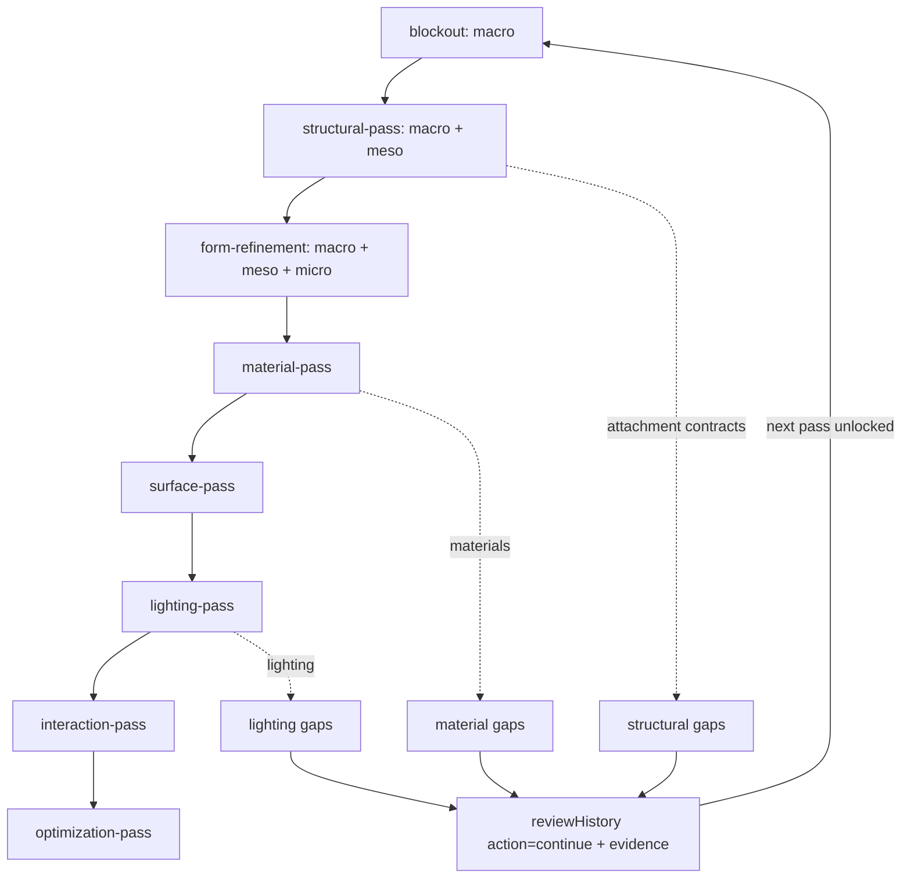
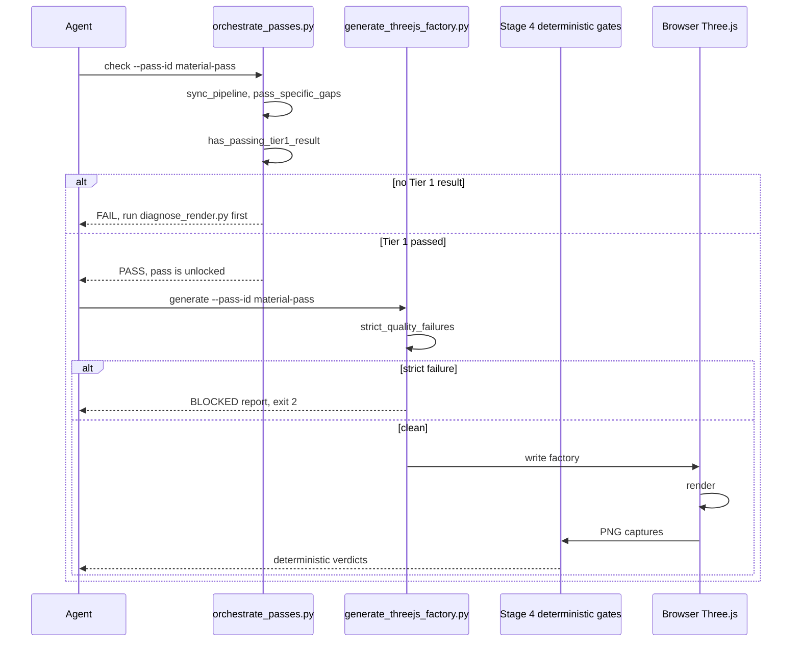

# Stage 3: Eight Locked Passes and Fail-Closed Generation

This document explains how Stage 3 turns a validated spec into a TypeScript Three.js factory. The thesis is: Stage 3 is sequential and fail-closed. One pass unlocks at a time. A visual pass completes only when a review entry records `action=continue` with a render screenshot, a comparison image, a passing score, and no feature-gate failure. Geometry gates run before any browser capture, and strict-quality failure writes a `BLOCKED` artifact and exits with code 2.

The source snapshot is commit `0c0c49bc168e648dbaf9c8c080474de0b3a941b6`. Stage 2 authored the spec. Read [06 Stage spec](06-stage-spec.md) first. Stage 4 reviews the rendered result. Read [08 Stage review](08-stage-review.md) after this document.

## 1. The eight passes

Stage 3 has a fixed pass order. The order is defined twice, in `orchestrate_passes.py` and in `generate_threejs_factory.py`. Both copies are identical. The document set found no test that asserts the two copies stay equal.

```python
# forge/stage3_build/orchestrate_passes.py:18-27
DEFAULT_PASS_ORDER = [
    "blockout",
    "structural-pass",
    "form-refinement",
    "material-pass",
    "surface-pass",
    "lighting-pass",
    "interaction-pass",
    "optimization-pass",
]
```

The visual set is the eight passes minus `optimization-pass`. It has seven members: `blockout`, `structural-pass`, `form-refinement`, `material-pass`, `surface-pass`, `lighting-pass`, and `interaction-pass`.

The order is not a preference. It is a dependency chain. A later pass can assume the earlier passes are correct.

The unlock is not circular. `PASS_STEPS` in `forge/_shared/workflow_state.py:52-61` puts `build-current-pass` before `render-capture`. Generation therefore happens before the review that `check_pass` gates. `check_pass` is a review gate, not a generation gate.

| Pass | What it adds |
|------|--------------|
| `blockout` | The macro silhouette and the major masses |
| `structural-pass` | Meso components, joints, and attachment contracts |
| `form-refinement` | Micro features and local form |
| `material-pass` | Albedo, roughness, normal, and local material masks |
| `surface-pass` | Tactile surface detail per component |
| `lighting-pass` | Key, fill, rim or environment light, exposure, and shadows |
| `interaction-pass` | Handles, moving parts, and action profiles |
| `optimization-pass` | Budget control and level of detail (LOD) |

The generator also maps each pass to the component levels it may emit.

```python
# forge/stage3_build/generate_threejs_factory.py:59-68
PASS_LEVELS = {
    "blockout": {"macro"},
    "structural-pass": {"macro", "meso"},
    "form-refinement": {"macro", "meso", "micro"},
    "material-pass": {"macro", "meso", "micro"},
    "surface-pass": {"macro", "meso", "micro"},
    "lighting-pass": {"macro", "meso", "micro"},
    "interaction-pass": {"macro", "meso", "micro"},
    "optimization-pass": {"macro", "meso", "micro"},
}
```

The first three passes grow the component set. `blockout` emits only macro components. `structural-pass` adds meso components. `form-refinement` adds micro components. From `material-pass` onward the geometry set is stable, and the work is appearance and behavior. This is why a material problem cannot be fixed by rewriting geometry in the material pass. The generator filters components by pass level.



The dashed edges are the requirement checks. Each pass has its own gap function. If a gap exists, the pass is not unlocked. The build document now follows one object through the state machine.

## 2. The pass state machine

`orchestrate_passes.py` owns the state machine. It reads `reviewHistory` and writes `sculptPipeline`. A review entry completes a pass only when four conditions hold.

```python
# forge/stage3_build/orchestrate_passes.py:87-100
def review_completes_pass(spec: dict[str, Any], entry: dict[str, Any], pass_id: str) -> bool:
    if entry.get("passId") != pass_id or entry.get("action") != "continue":
        return False
    if pass_id in VISUAL_PASS_IDS:
        visual = visual_evidence(entry)
        if not visual.get("renderScreenshot") or not visual.get("comparisonImage"):
            return False
        score = entry.get("aiVisionScore")
        threshold = entry.get("visualAcceptanceThreshold", 0.7)
        if not has_number(score) or not has_number(threshold) or float(score) < float(threshold):
            return False
        if feature_gate_failures(spec, entry, pass_id):
            return False
    return True
```

The four conditions are: the pass identifier matches, the action is `continue`, the visual evidence exists and scores above the threshold, and the feature gates pass. A pass without a screenshot cannot complete. A pass with a score below 0.7 cannot complete. A pass with a failed feature gate cannot complete. The review author sets `visualAcceptanceThreshold` in the entry. `append_review.py:171` defaults it to 0.7 when absent. `validate_sculpt_spec.py:1887` requires a unit-interval value, so legal values are 0 to 1 inclusive.

The completion scan is ordered.

```python
# forge/stage3_build/orchestrate_passes.py:103-116
def completed_passes(spec: dict[str, Any], ids: list[str]) -> list[str]:
    history = spec.get("reviewHistory", [])
    if not isinstance(history, list):
        return []
    completed: list[str] = []
    for pass_id in ids:
        if any(
            isinstance(entry, dict) and review_completes_pass(spec, entry, pass_id)
            for entry in history
        ):
            completed.append(pass_id)
        else:
            break
    return completed
```

The `break` is the lock. A missing pass stops the scan. A later review entry cannot skip an earlier incomplete pass, because the scan stops at the first gap. This makes the order enforced by data, not by convention.

`check_pass` is the command-line gate. It returns an allowed flag and a reason string.

```python
# forge/stage3_build/orchestrate_passes.py:541-552
def check_pass(spec: dict[str, Any], requested_pass: str) -> tuple[bool, str, dict[str, Any]]:
    pipeline = sync_pipeline(spec)
    ids = list(pipeline["passOrder"])
    if requested_pass not in ids:
        return False, f"unknown build pass {requested_pass!r}", pipeline
    current = str(pipeline["currentPass"])
    completed = list(pipeline.get("completedPasses", []))
    if requested_pass in completed or current == "complete":
        gaps = pass_specific_gaps(spec, requested_pass)
        if gaps:
            return False, f"pass {requested_pass!r} needs spec refinement: {'; '.join(gaps)}", pipeline
        return True, f"pass {requested_pass!r} is already completed and can be regenerated", pipeline
```

A completed pass may be regenerated only if its spec-level gaps are still absent. The current pass has a second condition.

```python
# forge/stage3_build/orchestrate_passes.py:553-570
    if requested_pass == current:
        gaps = pass_specific_gaps(spec, requested_pass)
        if gaps:
            return False, f"pass {requested_pass!r} needs spec refinement: {'; '.join(gaps)}", pipeline
        if requested_pass in VISUAL_PASS_IDS and not has_passing_tier1_result(spec, requested_pass):
            return (
                False,
                f"Tier 1 diagnostics have not passed for this render — run diagnose_render.py first",
                pipeline,
            )
        return True, f"pass {requested_pass!r} is the current unlocked pass", pipeline
    previous_index = ids.index(requested_pass) - 1
    previous = ids[previous_index] if previous_index >= 0 else ""
    return (
        False,
        f"pass {requested_pass!r} is locked; complete {previous!r} with reviewHistory.action=continue and screenshot evidence first",
        pipeline,
    )
```

The Tier 1 check is the important one. Before a visual pass unlocks, the deterministic diagnostics must pass. The comment at line 528-531 states the rule: Tier 2 artificial intelligence (AI) vision must never run against a render that has not passed Tier 1. The refusal happens before any expensive review step is attempted.

**Aha:** The lock is not enforced by a counter or a flag. It is derived from `reviewHistory` on every call. `sync_pipeline` recomputes the completed list, the current pass, and the required evidence. A hand-edited pipeline block is overwritten on the next call. The review history is the only source of truth.

## 3. Required evidence per pass

Each pass names its evidence. `next_required_evidence` combines the spec's own acceptance list with the pass-specific list.

```python
# forge/stage3_build/orchestrate_passes.py:143-150
def next_required_evidence(spec: dict[str, Any], pass_id: str) -> list[str]:
    if pass_id == "complete":
        return []
    evidence = pass_acceptance(spec, pass_id)
    evidence.extend(pass_specific_evidence(pass_id))
    if pass_id in VISUAL_PASS_IDS:
        evidence.append("browser render screenshot from your agent's browser/screenshot tool")
        evidence.append("side-by-side reference/render comparison sheet for AI vision review")
```

The comment that follows is a recorded finding, not an opinion. Silhouette intersection over union (IoU) is computed from the roughly eleven percent of figure cells that lie on the outline. A model with its face deleted scored 0.8803, the same as the finished face. So an outline score says nothing about the interior. The required evidence therefore includes a banded interior difference, not just an outline score.

Hair adds two more evidence items, but only when the subject has hair.

```python
# forge/stage3_build/orchestrate_passes.py:166-174
        if spec_has_hair(spec):
            evidence.append(
                "scalp exposure below the hard maximum, measured on geometry before rendering "
                "(forge/stage4_review/scalp_exposure.py)"
            )
            evidence.append(
                "hair gate comparing banded coverage, hairline offset and highlight-band position "
                "against the reference (forge/stage4_review/hair_gate.py)"
            )
```

`spec_has_hair` checks two signals: a `hairProfile` block, or any component whose role is hair. A chair or a knife gets no hair evidence demand. A character gets both the geometric scalp check and the rendered hair comparison.

## 4. Fail-closed code generation

`generate_threejs_factory.py` is the largest Stage 3 module. Before it writes a byte of factory code, it runs the spec validator in strict-quality mode.

```python
# forge/stage3_build/generate_threejs_factory.py:78-87
def strict_quality_failures(spec: dict[str, Any]) -> tuple[list[str], list[str], list[str]]:
    """Return normal validation output plus the failures that block production codegen."""
    errors, warnings = validate_spec(spec)
    failures = list(errors)
    failures.extend(
        f"strict quality failure: {warning.removeprefix('quality: ').strip()}"
        for warning in warnings
        if warning.startswith("quality:")
    )
    return errors, warnings, failures
```

This repeats the Stage 2 strict-quality rule at the build boundary. The repetition is deliberate. A caller can bypass the Stage 2 command-line flag. The generator cannot be bypassed in production, because it is the only code path that writes the factory.

A failure produces a machine-readable report.

```python
# forge/stage3_build/generate_threejs_factory.py:90-110
def blocked_report(
    spec_path: Path,
    failures: list[str],
    warnings: list[str],
    pass_id: str | None,
) -> dict[str, Any]:
    """Build a machine-readable fail-closed report without touching the factory output."""
    return {
        "status": "BLOCKED",
        "phase": "strict-quality",
        "gate": "strict-quality",
        "artifact": str(spec_path),
        "metric": {
            "failureCount": len(failures),
            "qualityWarningCount": sum(1 for warning in warnings if warning.startswith("quality:")),
        },
        "cause": failures,
        "warnings": warnings,
        "requestedPass": pass_id,
        "nextAction": "refine-spec: author a subject-specific ObjectSculptSpec, then rerun strict-quality",
    }
```

The report names the phase, the gate, the cause list, and one next action. It does not overwrite the previous factory output. The generator writes the report to standard error and to an optional `--blocked-report` path.

The exit path is short.

```python
# forge/stage3_build/generate_threejs_factory.py:4072-4078
    _errors, warnings, strict_failures = strict_quality_failures(spec)
    if strict_failures and not args.allow_nonstrict:
        emit_blocked(
            blocked_report(spec_path, strict_failures, warnings, args.pass_id),
            args.blocked_report,
        )
        return 2
```

Exit code 2 means blocked. Exit code 0 means a factory was written. There is no partial success. The `--allow-nonstrict` flag is a test-fixture escape hatch. The parser refuses to combine it with `--pass-id`, so it cannot produce a production pass.

## 5. Pass-specific gaps

Each pass has a gap function. The gap functions are the contract between the spec and the pass. `material-pass` has the largest set.

```python
# forge/stage3_build/orchestrate_passes.py:381-395
def material_pass_gaps(spec: dict[str, Any]) -> list[str]:
    materials = [item for item in spec.get("materials", []) if isinstance(item, dict)]
    if not materials:
        return ["materials array is empty"]
    if not any(material_has_palette(item) for item in materials):
        return ["no material has a reference-derived albedo palette or secondary color zones"]
    gaps: list[str] = []
    if not any(material_has_response(item) for item in materials):
        gaps.append("no material defines roughness variation or normal/bump/displacement response")
    if not any(material_has_locality(item) for item in materials):
        gaps.append("no material defines local overrides, AO, dirt, wear, stains, moss, chips, or scratches")
    material_pipeline = spec.get("materialPipeline")
    if material_pipeline is not None:
        if not isinstance(material_pipeline, dict) or material_pipeline.get("status") != "proceed":
            gaps.append("materialPipeline must be wired and have status=proceed before material-pass")
```

The palette check is a hard stop. A material set with no reference-derived palette returns immediately. The response and locality checks are additive gaps. When `lookDevTargets.qualityPriority` is `reference-fidelity`, the function also checks texture resolution, surface frequency bands, and reference physically based rendering (PBR) maps. `pass_specific_gaps` returns a gap list for `structural-pass`, `form-refinement`, `material-pass`, `surface-pass`, and `lighting-pass`. It returns no gap list for `blockout`, `interaction-pass`, or `optimization-pass`.

`lighting_pass_gaps` demands at least three concrete entries. It then searches for five semantic groups in the text: key light, fill light, rim or environment light, exposure or tone mapping, and contact shadow. A lighting block that names only "good lighting" produces five gaps.

`surface_pass_gaps` demands at least one component with a non-empty `surfaceDetail`. The check is deliberately simple. A surface pass without tactile detail has nothing to do.

`attachment_gaps` walks the component tree. A component that needs an attachment is one with a parent and a role in `ATTACHMENT_ROLES`, or a primitive in `ATTACHMENT_PRIMITIVES`. Such a component must define a parent socket, local start and end, a contact type, an embed depth or overlap, and a gap tolerance.

```python
# forge/stage3_build/orchestrate_passes.py:228-240
def attachment_complete(component: dict[str, Any]) -> bool:
    attachment = component.get("attachment")
    if not isinstance(attachment, dict):
        return False
    has_endpoint = is_vector3(attachment.get("localStart")) and is_vector3(attachment.get("localEnd"))
    has_socket = has_non_empty(attachment.get("parentSocket")) or has_non_empty(attachment.get("parentId"))
    has_contact = has_non_empty(attachment.get("contactType"))
    has_overlap = (
        number_from_layer(attachment.get("embedDepth"), ("base", "amount", "value")) > 0
        or number_from_layer(attachment.get("overlap"), ("base", "amount", "value")) > 0
    )
    has_tolerance = has_number(attachment.get("gapTolerance"))
    return has_endpoint and has_socket and has_contact and has_overlap and has_tolerance
```

All five conditions are required. A socket name alone is not an attachment. An endpoint pair alone is not an attachment. The six attachment fields come from the readiness reference `grimoire/readiness/joint_attachment.md`.

## 6. Verification before browser

The pipeline spends tokens in the browser. A render costs a capture, a readback, and a vision score. A geometry defect found after the render wastes all three. So the build runs deterministic checks first.

The design rule is visible in `has_passing_tier1_result`. A visual pass cannot unlock until a Tier 1 diagnostic result exists with `passed: true` for that pass. The Tier 1 gates are pixel and geometry analyses that need no model opinion. They include silhouette comparison, interior difference, turntable coverage, self-intersection, attachment anchor, joint loops, pairwise penetration, geometry integrity, and scalp exposure. The review document covers each gate.



The sequence shows the order. The generator never renders. The browser never validates. The gates never generate. Each layer has one job.

## 7. Gate execution

`run_gates.py` runs domain plugin gates. It is a separate command, not chained inside `emit_target.py`. The module docstring states the reason: every other checklist step is a distinct command, and gate execution follows the same discipline.

The runner command mirrors the Node harness.

```python
# forge/stage3_build/run_gates.py:48-49
KIND_RUN = "img2.gate-run"
GATE_TIMEOUT_SECONDS = 300  # same default as gate_runner.py's own DEFAULT_GATE_TIMEOUT_SECONDS
```

```python
# forge/stage3_build/run_gates.py:68-74
def gate_runner_argv(home: Path, plugin_dir: Path) -> list[str]:
    """Mirrors img2.mjs's `gateRunnerArgv` (`bin/img2.mjs:807-809`) exactly. `{workspace}` is left
    as its own argv element for the caller to replace by value -- same discipline as `stepArgv`."""
    return [
        "python3", str(home / "harness" / "img2_core" / "gate_runner.py"),
        "--plugin-dir", str(plugin_dir), "--workspace", "{workspace}",
    ]
```

A drift-guard test asserts that the Python command and the Node command never disagree. The test is `test_gate_runner_argv_matches_the_harness_capabilities_output` in `forge/tests/test_run_gates.py`. The timeout is per gate, and the outer bound multiplies the per-gate timeout by the declared gate count. The formula is `per_gate * max(gate_count, 1) + 30` at `run_gates.py:244`, and the count is `len(gates.json)`. A flat outer bound killed a legitimate multi-gate run in the recorded failure that the comment describes.

The envelope parser is strict. A malformed envelope is an error, never a pass. A status and exit disagreement is an error. A blocking failure stops the entire run across every plugin.

```python
# forge/stage3_build/run_gates.py:200-212
def parse_gate_run_envelope(stdout: bytes) -> dict[str, Any]:
    text = stdout.decode("utf-8", errors="replace")
    try:
        doc = json.loads(text)
    except json.JSONDecodeError as exc:
        raise GateExecutionError(f"gate runner produced no parseable {KIND_RUN} envelope: {exc}") from exc
    if not isinstance(doc, dict) or doc.get("kind") != KIND_RUN:
        raise GateExecutionError(f"gate runner stdout is not an {KIND_RUN} envelope")
    if doc.get("version") != 1:
        raise GateExecutionError(f"{KIND_RUN} envelope version {doc.get('version')!r} is not 1")
    if not isinstance(doc.get("results"), list):
        raise GateExecutionError(f"{KIND_RUN} envelope is missing a results array")
    return doc
```

## 8. Emission targets

`emit_target.py` resolves an optional external target. With no `--target` it is a successful no-op. It writes nothing and changes no byte. This matters because a malformed plugin registry must not break the default path.

The constants define the safety envelope.

```python
# forge/stage3_build/emit_target.py:46-53
DEFAULT_TIMEOUT_SECONDS = 300
MAX_TIMEOUT_SECONDS = 1800
MAX_STDOUT_BYTES = 1024 * 1024
MAX_STDERR_BYTES = 64 * 1024
MAX_ARTIFACT_BYTES = 512 * 1024 * 1024
ENV_ALLOWLIST = ("PATH", "HOME", "LANG", "LC_ALL")
ARTIFACT_OF_RECORD = "src/createObjectModel.ts"
DETERMINISM_CACHE_NAME = ".determinism-verified.json"
```

The environment allowlist is four variables. The subprocess does not inherit the caller's environment. The artifact of record is the generated TypeScript file. The runner records provenance and, when declared, verifies determinism.

Before a target runs, the workspace must record `action-ready`. That is the `FINAL_STEPS` row at `forge/_shared/workflow_state.py:65`. `emit_target.py:101-106` and `run_gates.py:269` both enforce it.

```python
# forge/stage3_build/emit_target.py:100-107
    by_id = {entry["id"]: entry for entry in state["checklist"]}
    action_ready = by_id.get("action-ready")
    if action_ready is None or action_ready.get("status") != "done":
        payload = status_payload(state)
        unmet = payload["currentStep"]
        raise EmitTargetError(
            f"target run refused: action-ready is not recorded yet (next required step: {unmet!r})"
        )
```

The refusal names the unmet step. A target run out of checklist order fails with a useful message.

## 9. The per-module cache

Regenerating the whole factory on every fix is wasteful. It also regresses parts that already passed review. `module_cache.py` caches generated code per module.

```python
# forge/stage3_build/module_cache.py:36-55
def canonical_module_hash(module_spec: dict) -> str:
    """sha256 of the module spec serialized deterministically (sorted keys).

    Two specs with the same content but different key insertion order hash
    identically, so cache hits don't depend on dict ordering.
    """
    blob = json.dumps(
        module_spec, sort_keys=True, ensure_ascii=False, separators=(",", ":")
    ).encode("utf-8")
    return hashlib.sha256(blob).hexdigest()


def module_cache_key(module_spec: dict, generator_source: Path) -> str:
    """Key changes if EITHER the module's spec OR the generator source changes.

    Mirrors artifact_cache.cache_key: pairing the spec hash with the generator's
    own source hash closes the stale-cache risk (edit the generator, forget to
    bump a version -> serve stale code).
    """
    return f"{canonical_module_hash(module_spec)}:{file_sha256(generator_source)[:12]}"
```

The key has two parts. The first part is the canonical module spec hash. The second part is the generator source hash. Either change invalidates the entry. The cache also invalidates neighbors. `invalidate_attached` finds every component whose parent or attachment parent is the changed module, and removes that component's cached entries. A moved neighbor can invalidate code that depends on it.

## 10. The geometry support modules

Five Stage 3 modules produce geometry or geometry plans. Each one states a limit in its docstring.

`visual_hull.py` validates a `visualHull` descriptor and carves the hull it describes. The docstring states the central limit: a visual hull is the intersection of silhouette cones, so it is an upper bound on the true shape. It cannot represent a concavity that does not break a supplied silhouette.

```python
# forge/stage3_build/visual_hull.py:9-15
What a visual hull can and cannot do, stated here because the caller must not over-read the result:
it is the INTERSECTION OF SILHOUETTE CONES, so it is an upper bound on the true shape. It can never
represent a concavity that does not break the silhouette from some supplied view -- an eye socket, the
inside of a cupped ear, the hollow of a bowl. With two views it is the intersection of two prisms,
which is loose; the third axis is unconstrained and the result extrudes along it. `carve_visual_hull`
reports `unconstrainedAxes` and `limitations` for exactly this reason: a hull is evidence about the
silhouette, not about the surface.
```

`uv_unwrap.py` produces texture coordinate (UV) charts. Before it existed, the repository had no UV layout, so the whole material track was unreachable. The module uses three analytic stages and no machine learning.

```python
# forge/stage3_build/uv_unwrap.py:46-54
# Measured on a real 4162-vertex organic skull, sweeping the threshold and counting inverted
# triangles: 50 deg -> 40 flips, 35 -> 2, 25 -> 0, 18 -> 2, 12 -> 13. 25 is the widest setting that
# folded nothing, and wider charts mean fewer seams, so it is the default. Hard-surface subjects
# tolerate more; the flag exists for that.
DEFAULT_CHART_ANGLE_DEGREES = 25.0
DEFAULT_CG_ITERATIONS = 400
DEFAULT_CG_TOLERANCE = 1e-8
DEFAULT_CHART_PADDING = 0.004
MIN_TRIANGLE_AREA = 1e-12
```

The chart angle is measured, not chosen. Twenty-five degrees is the widest setting that produced zero inverted triangles on the fixture. The solver is least-squares conformal mapping (LSCM), solved by conjugate gradient. The module reports area distortion per chart, because a conformal map preserves angles and not areas.

`decimate.py` produces LOD tiers. It refuses two collapse types outright.

```python
# forge/stage3_build/decimate.py:13-20
Two collapses are refused outright, because both produce a mesh that still passes a triangle count but
is no longer a surface:

* a collapse that would FLIP a face -- the neighbouring normal reversing means the surface folded
  through itself, exactly the defect `self_intersection.py` exists to catch, and creating it here
  while reporting a successful decimation would be the pipeline sabotaging its own gate;
* a collapse on a BOUNDARY edge -- an open border erodes inward and the silhouette visibly retreats,
  which is the classic "the LOD is smaller than the original" artefact.
```

`morph_targets.py` produces position deltas for expression and for corrective shapes. It refuses a vertex count mismatch.

```python
# forge/stage3_build/morph_targets.py:41-51
    """Delta between two vertex arrays that must correspond one-to-one.

    A mismatched count is refused rather than zip-truncated. Silently pairing the first N vertices of
    two different meshes produces a morph that looks like a plausible deformation and is nonsense,
    and nothing downstream can tell.
    """
    if len(base_vertices) != len(target_vertices):
        raise ValueError(
            f"morph target {name!r} has {len(target_vertices)} vertices but the base has "
            f"{len(base_vertices)}; targets must share the base's vertex order"
        )
```

The delta form is a memory choice. Three.js `morphTargetsRelative` expects offsets from the base, and a delta array is mostly zeros.

`bake_projected_texture.py` writes a descriptor, not pixels. The docstring is explicit: the script does not rasterize or bake. The actual projection is a Three.js runtime operation. The descriptor records the camera, the source image, the mesh, the projection mode, and the strategy for unseen regions.

```python
# forge/stage3_build/bake_projected_texture.py:25-26
VALID_PROJECTION_MODES = ("perspective-camera-projection", "orthographic-front-projection", "triplanar-fallback")
VALID_UNSEEN_STRATEGIES = ("mirror-symmetry", "palette-continue", "request-additional-view", "leave-unprojected")
```

Four unseen strategies exist. `request-additional-view` is one of them. The review stage can therefore ask for a new image instead of inventing the back of a subject.

## 11. What the stage emits

A successful build emits a TypeScript module. The module exports a factory that returns a Three.js `Group`. It contains the geometry calls, the material definitions, the light rig, and the runtime metadata under `root.userData.sculptRuntime`. For a character build, `root.userData.rig` is a second property on the same root Group. It is a sibling of `sculptRuntime`, not a child or an alias. It holds the bones, one shared `Skeleton`, the bone order, an index map, and the `bound` flag. The factory is code. The pipeline does not download a mesh or a texture.

The stage also emits evidence artifacts. The `BLOCKED` report is one. The pass status payload is another. The module cache manifest is a third. Each artifact is JavaScript Object Notation (JSON). The `BLOCKED` report has no schema version field; it names its gate, its cause, and its next action.

## 12. Summary

Stage 3 has eight locked passes. The lock is derived from `reviewHistory`, not stored as a flag. A visual pass needs a passing Tier 1 diagnostic before it unlocks. The generator re-runs strict quality and writes a `BLOCKED` report with exit code 2 on failure. Five support modules produce geometry plans, and each one states its limit in its own source.

The next question is what happens after a render. Read [08 Stage review](08-stage-review.md) for the deterministic gates and the five review decisions.
