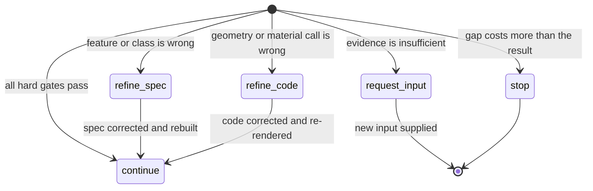
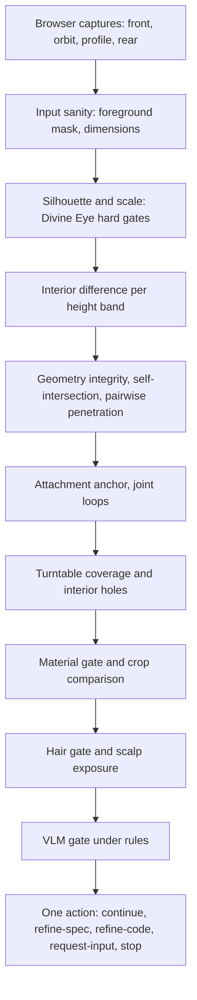

# Stage 4: Deterministic Gates, Vision, and Five Review Decisions

This document explains how img2threejs judges a render. Stage 4 is the review stage. It reads the render and the generated factory, and it decides the next step. The thesis is: Stage 4 separates arithmetic from opinion. Deterministic gates measure geometry and pixels first. A vision language model (VLM) runs last, under rules, and it can never overrule a hard geometric failure. Every review ends with exactly one of five actions.

The source snapshot is commit `0c0c49bc168e648dbaf9c8c080474de0b3a941b6`. Stage 3 produced the render and the TypeScript `Group` factory. Read [07 Stage build](07-stage-build.md) first. The rig track continues in [09 Stage rig and character](09-stage-rig-and-character.md).

One correction to earlier planning documents is necessary. `docs/ARCHITECTURE.md` lists `forge/stage4_review/cs2_review.py`. That file is not present at this commit. The directory listing contains thirty-three Python modules, and `cs2_review.py` is not one of them. The CS2 review path now runs through the generic `append_review.py` domain review argument, which still accepts `--cs2-review-json` as a backwards-compatible alias. This document does not describe a file that does not exist.

## 1. The five decisions

Every review writes one action. The validator accepts exactly five values.

```python
# forge/stage4_review/append_review.py:33
VALID_ACTIONS = {"continue", "refine-spec", "refine-code", "request-input", "stop"}
```

The five actions have precise meanings.

| Action | Meaning | Typical cause |
|--------|---------|---------------|
| `continue` | The pass is accepted; unlock the next pass | Silhouette, interior, and material all pass |
| `refine-spec` | The spec is wrong; change the description | A feature group is missing, or the object class is wrong |
| `refine-code` | The spec is right; change the generated code | A transform, material value, or geometry call is wrong |
| `request-input` | The pipeline cannot decide without a new input | An occluded side, a low-confidence landmark, or a material ambiguity |
| `stop` | The honest bounded stop | The remaining gap costs more than the result is worth |



`probe` is an internal gate verdict, not a review action. The five values above are the only actions that `append_review.py` accepts. The harness has no automatic mapping; the reviewer reads the probe reason and records one of the five actions.

The distinction between `refine-spec` and `refine-code` is the most important one. A wrong face shape is a spec problem. A wrong face position is a code problem. The validator refuses a visual pass that claims `continue` without a render screenshot.

```python
# forge/stage4_review/append_review.py:273-277
    if args.pass_id in VISUAL_PASS_IDS and args.action == "continue" and not args.render_screenshot:
        raise ValueError(
            "visual pass cannot use action=continue without --render-screenshot; "
            "capture a browser screenshot or choose refine-code/request-input"
        )
```

The review entry must also be in order. `append_review.py` computes the expected pass from the review history, and it refuses an out-of-order entry unless the caller passes `--force-out-of-order`. That flag exists for a deliberate re-review, not for skipping.

## 2. The gate order

Stage 4 runs gates in a fixed order. Cheap deterministic checks run first. Expensive or opinion-based checks run last.



The order has three reasons. First, a bad foreground mask makes every later pixel number meaningless, so it is checked first. Second, geometry gates are cheaper than a VLM call and catch defects that pixels cannot show, such as a hole through a skull. Third, the VLM is the only layer that can be confidently wrong, so it sees only renders that already passed every hard rule.

The build stage enforces the same order from the other side. A visual pass cannot unlock until a Tier 1 diagnostic result exists with `passed: true`. That rule lives in `orchestrate_passes.py:528-538`. This document explains what those Tier 1 gates measure.

## 3. Divine Eye: the deterministic ensemble

`divine_eye.py` is the central deterministic gate. It compares a reference image and a render with several signals. The silhouette score is intersection over union (IoU), the overlap area divided by the union area. The thresholds are constants at the top of the file.

```python
# forge/stage4_review/divine_eye.py:59-65
IOU_HARD_MIN = 0.85
SCALE_HARD_MAX = 0.08
# Ensemble: fidelity target + disagreement (self-uncertainty) spread.
FIDELITY_TARGET = 0.85
DISAGREEMENT_SPREAD = 0.35  # if soft-signal spread exceeds this ⇒ low-confidence → probe
ASPECT_SOFT_MAX = 0.05      # aspect-ratio delta allowed for a reconstruction-mode soft pass.
RECON_OBJ_MIN = 0.48        # objectness ≥ this rescues an IoU-only hard reject → probe (recon mode).
```

The hard gates are three.

```python
# forge/stage4_review/divine_eye.py:342-345
    if iou < IOU_HARD_MIN:
        hard_failures.append(f"silhouette IoU {iou:.3f} < {IOU_HARD_MIN}")
    if scale_delta > SCALE_HARD_MAX:
        hard_failures.append(f"scale delta {scale_delta:.3f} > {SCALE_HARD_MAX}")
```

The third hard failure is a fallback mask. If the foreground mask covers the whole frame, the silhouette, scale, and aspect numbers describe the background, not the subject. The module records that as a hard failure rather than a low score.

The soft signals form a weighted ensemble. Each signal has a score and a weight. The weights are provisional and auditable in the source. The source gives no derivation; treat them as hand-set until the planned calibration corpus exists.

```python
# forge/stage4_review/divine_eye.py:350-359
    soft = {
        "proportion": (max(0.0, 1.0 - aspect_delta / 0.05), 1.0),
        "symmetry": (sym, 0.5),
        "phash": (phash_sim, 1.0),
        "ssim": (ssim, 1.5),
        "edgeOverlap": (edges, 1.0),
        "blowoutParity": (blow, 0.8),
        "flatRegion": (flat, 0.8),
        "tonalParity": (tonal, 1.0),
    }
```

Objectness is added when it is available, with the largest weight at 1.5. Objectness is a structural similarity measure that survives background, pose, scale, and brightness differences. It is the one signal that stays meaningful when a photograph is compared against a procedural render.

The verdict is a deterministic function of which signal failed.

```python
# forge/stage4_review/divine_eye.py:369-377
    # Verdict + routing (deterministic function of which signal failed — §3.5).
    if hard_failures:
        verdict, action = "reject", "refine-code"
    elif spread > DISAGREEMENT_SPREAD and fidelity < FIDELITY_TARGET:
        verdict, action = "low-confidence", "probe"
    elif fidelity >= FIDELITY_TARGET:
        verdict, action = "pass", "continue"
    else:
        verdict, action = "reject", "refine-code"
```

A hard failure routes to `refine-code`. A wide spread between soft signals with low fidelity routes to a probe. A fidelity at or above 0.85 passes. Everything else rejects.

The 0.85 fidelity target is the Divine Eye verdict. It is not the review threshold. The review entry carries `aiVisionScore` and `visualAcceptanceThreshold` (default 0.7). `append_review.py` requires the score to meet that field before a pass completes. The review author writes both fields; the script stores them.

The module also has a reconstruction-mode rescue. A photograph and a procedural render disagree on framing and background, so silhouette IoU alone can reject a faithful build. When the only hard failure is IoU and objectness confirms the same object, the module can downgrade the reject to a probe. It can even pass when the soft ensemble already meets the target and scale and aspect are within bounds. It never rescues a scale failure or a low objectness.

## 4. Interior difference

Silhouette IoU cannot see a defect inside the outline. The source records the measurement: a model with its face deleted scored the same 0.8803 as the finished face. So the pipeline compares the interior directly.

```python
# forge/stage4_review/interior_difference.py:41
GRID = 192  # the lattice the audit's published numbers were computed on; changing it changes them
```

`compare` samples both images on a 192 by 192 grid. It compares only cells that are solid in both images, inside an optional height band. The result reports the number of cells compared, because a small difference over four cells is not evidence.

The module refuses an inverted mask for the same reason Divine Eye does.

```python
# forge/stage4_review/interior_difference.py:141-153
    if mask_is_inverted(baseline_warnings) or mask_is_inverted(render_warnings):
        result["interiorDifference"] = None
        result["status"] = "foreground-mask-fell-back-to-whole-frame"
        return result
    if not shared:
        result["interiorDifference"] = None
        result["status"] = "no-overlapping-figure-cells"
        return result

    total = sum(abs(baseline_values[i] - render_values[i]) for i in shared)
    result["interiorDifference"] = total / len(shared) / 255.0
    result["status"] = "measured"
    return result
```

The height band matters for characters. The command line exposes `--from` and `--to`, so a review can measure the face alone. The source does not fix per-band tolerance values; the caller supplies the band, and the report states the compared cell count.

## 5. Geometry gates

Five modules check geometry directly. They need no browser, no graphics processing unit (GPU), and no model opinion.

`geometry_integrity.py` checks watertightness, non-manifold edges, normals, and blade thickness.

```python
# forge/stage4_review/geometry_integrity.py:236-243
        if item.get("boundaryEdges", 0) not in (0, None):
            message = f"{item['id']}: openEdges={item['boundaryEdges']} ({item['realization']})"
            failures.append(message)
            issues.append({"severity": "error", "code": "watertight", "mesh": item["id"], "message": message})
        if item.get("nonManifoldEdges", 0):
            message = f"{item['id']}: nonManifoldEdges={item['nonManifoldEdges']}"
            failures.append(message)
            issues.append({"severity": "error", "code": "non-manifold", "mesh": item["id"], "message": message})
```

The module also checks the triangle budget and whether the level of detail (LOD) plan has real reduced tiers. A declared LOD plan with no reduced tiers is not evidence.

`self_intersection.py` reports whether a surface passes through its own volume. The sample offset scales with the model.

```python
# forge/stage4_review/self_intersection.py:318-327
    """Report whether a mesh's surface passes through its own volume.

    `mesh` takes the same shape `geometry_integrity` uses:
    `{"vertices": [[x, y, z], ...], "indices": [...] or [[a, b, c], ...],
      "normals": [[x, y, z], ...] (optional), "name": str (optional)}`.

    `epsilon` is the distance the sample point is stepped along its outward direction. It defaults
    to `EPSILON_BBOX_FRACTION` of the bounding-box diagonal so it scales with the model instead of
    being an absolute number that is correct at exactly one scale.
    """
```

`pairwise_penetration.py` checks two meshes against each other. A bounding-box rejection is reported as a rejection, not as a pass with zero penetrations.

```python
# forge/stage4_review/pairwise_penetration.py:247-255
    if not _boxes_overlap(a_box, b_box):
        # Cheap rejection, and reported as such: "0 inside" from a test that never ran and "0 inside"
        # from a test that ran are different claims.
        return {
            "a": name_a, "b": name_b, "boundsOverlap": False, "penetrating": False,
            "insideVertexCount": 0, "undecidedVertexCount": 0,
            "sampledVertexCount": 0, "totalVertexCount": len(a_samples), "samplingStride": 0,
            "penetrationDepth": 0.0,
        }
```

The source comment is a statement about evidence. A skipped test and a passing test must not produce the same claim.

`attachment_anchor.py` checks that a child part touches its parent anchor. It reads the component tree and the rig bone tree, and it cross-checks measured world positions when a runtime parts manifest is available.

```python
# forge/stage4_review/attachment_anchor.py:150-159
def analyze_attachments(spec: dict[str, Any], *, measured: dict[str, list[float]] | None = None) -> dict[str, Any]:
    """Run the attachment-anchor gate over `spec`'s component tree, optionally cross-checked
    against `measured` (world positions keyed by component or bone id, e.g. from a runtime
    parts manifest). See module docstring for the five checks.

    Returns a dict with `errors`, `warnings`, per-attachment `attachments` records (component,
    anchor, anchorKind, distance, maxOffset, offsetRule, withinLimit -- the last four are None
    until a measured position resolves them), `unmeasuredAttachments`, `attachmentCount`, and
    `passed` (True iff `errors` is empty).
    """
```

The record distinguishes "not measured" from "measured and inside the limit". That distinction prevents a missing runtime manifest from looking like a pass.

`joint_loops.py` checks that a joint has enough vertex rings to bend.

```python
# forge/stage4_review/joint_loops.py:36-38
MIN_LOOPS_PER_JOINT = 3
DEFAULT_RADIUS_SCALE = 0.35
BAND_TOLERANCE = 0.5
```

The count uses an axial window, not a sphere. A sphere around a thick limb excludes the rings on either side of the joint, and it scores a perfectly bendable joint as a single loop. The comment at line 82-87 records that failure.

## 6. Turntable and hair gates

`turntable_gate.py` makes orbit coverage mandatory. A missing required angle is a failure, not a warning.

```python
# forge/stage4_review/turntable_gate.py:55-65
REQUIRED_AZIMUTHS: tuple[float, ...] = (0.0, 90.0, 180.0, 270.0)
DEFAULT_AZIMUTH_TOLERANCE = 5.0
DEFAULT_COLLAPSE_RATIO = 0.15

# A hole must clear BOTH floors to trip the gate: an absolute pixel count
# (absorbs anti-aliasing speckle around edges -- a stray 1-2px background
# pixel next to a jagged silhouette edge is not a hole through the model)
# and a fraction of the silhouette area (so a huge, legitimate silhouette
# with a tiny enclosed pocket of background isn't over-flagged either).
INTERIOR_HOLE_PIXEL_FLOOR = 4
INTERIOR_HOLE_FRACTION_THRESHOLD = 0.01
```

The module also flood-fills the background from the image border. Any background pixel the fill cannot reach is enclosed by the silhouette, which means a hole through the object. A silhouette area check cannot see that hole, because the head is still roughly the same size.

The pass condition combines four checks.

```python
# forge/stage4_review/turntable_gate.py:298-303
    passed = (
        covered
        and not degenerate
        and not unsegmented
        and (allow_holes or not any_holed)
    )
```

`unsegmented` blocks the gate even when `allow_holes` is true. A gate that cannot isolate its subject must say so, not pass. The recorded failure was a turntable on a dark gradient background that reported `area=0.9966` and a confident pass while never measuring the character.

`scalp_exposure.py` finds bald patches before anything is rendered. It works on points, so it supports the shell, masses, and locks representations. In each representation it reads the hair root points, filters out points inside the skull field, and measures the uncovered patches.

```python
# forge/stage4_review/scalp_exposure.py:49-62
DEFAULT_REACH_FRACTION = 0.22
# ... and within this far off that normal, laterally, again as a fraction of skull height. This is
# the sampling radius, not a physical property: it must be a little wider than the gap between
# adjacent scalp samples or the test reports stripes of exposure between the samples themselves.
DEFAULT_LATERAL_FRACTION = 0.075
# Azimuth and height sampling of the scalp. 32x16 is 512 patches over a head, which resolves a strip
# roughly a finger wide -- finer than the failure being caught and coarse enough to stay instant.
DEFAULT_U_SAMPLES = 32
DEFAULT_V_SAMPLES = 16
# Anything above this fraction of scalp area uncovered is a hard failure rather than a soft signal.
# Not calibrated against a reference: no multipart hair reference exists yet, so this is a
# deliberately loose bound chosen to catch the recorded failure and flagged as uncalibrated in the
# report rather than presented as a measurement.
DEFAULT_HARD_MAX = 0.05
```

The most important line is the filter. Only hair outside the skull counts as coverage.

```python
# forge/stage4_review/scalp_exposure.py:123-126
    # Only hair OUTSIDE the skull can cover it. This single filter is the difference between a gate
    # that catches the recorded failure and one that waves it through.
    outside = [p for p in hair_points if field.distance(*p) > 0.0]
    sunk = len(hair_points) - len(outside)
```

A naive test that asks "is a hair vertex near this patch" would pass a mass that sank below the surface. The vertices are still nearby. They are simply inside the skull. The filter is the whole gate.

`hair_gate.py` compares banded coverage, hairline offset, and the highlight band position against the reference.

```python
# forge/stage4_review/hair_gate.py:34-43
# A band whose coverage is this far below the reference is worth reporting. Not calibrated: chosen
# to sit just under the smallest shortfall that proved visible by eye (the profile mid band, which
# read 41.5% against 7.8%).
BAND_SHORTFALL_SOFT = 0.08
# Hairline offset, as a fraction of figure height, beyond which the face has visibly the wrong
# amount of forehead. Derived from the head being roughly 0.13 of figure height: a tenth of a head.
HAIRLINE_OFFSET_MAX = 0.013
# Specular band position difference, in scalp v units, beyond which the highlight reads as sitting
# on the wrong part of the head. Uncalibrated.
SPECULAR_OFFSET_MAX = 0.15
```

Two of the three thresholds are marked uncalibrated. The module reports that honestly instead of presenting a derived number as a measurement.

## 7. Material gates

The material path has two layers. `material_comparator.py` compares a reference crop and a render crop. It scores four properties with fixed weights.

```python
# forge/stage4_review/material_comparator.py:128-134
    scores["overall"] = round(
        scores["baseColor"] * 0.40
        + scores["meanLuma"] * 0.20
        + scores["microstructure"] * 0.25
        + scores["directionalResponse"] * 0.15,
        4,
    )
```

Base color carries the most weight at 0.40. Microstructure carries 0.25. Mean luminance carries 0.20. Directional response carries 0.15. The pass condition is stricter than the overall score.

```python
# forge/stage4_review/material_comparator.py:154-156
        "passed": scores["overall"] >= 0.7 and not {"wrong-base-color", "missing-environment-response"} & set(unique_mismatches),
        "nextAction": "continue" if scores["overall"] >= 0.7 and not unique_mismatches else "refine-code",
        "limitation": "Deterministic crop metrics are evidence; material identity still requires vision review for ambiguous cases.",
```

A wrong base color fails even when the overall score is high. A missing environment response fails for metal, glass, and gemstone. The limitation line states that the crop metric is evidence, not identity.

`material_gate.py` is the blocking acceptance gate for the whole material pipeline.

```python
# forge/stage4_review/material_gate.py:27-31
    pipeline = spec.get("materialPipeline")
    if not isinstance(pipeline, dict):
        failures.append("spec is not wired to materialPipeline")
    elif pipeline.get("status") != "proceed":
        failures.append(f"materialPipeline status is {pipeline.get('status')!r}, not proceed")
```

The gate also requires comparison evidence, at least four camera views, a stable environment, and a compatibility check. The checks are at `material_gate.py:63-71`. A material that is not observed is a failure, not a warning.

## 8. The VLM gate

`vlm_gate.py` is the only place a model opinion enters the review. The module enforces five rules. The first rule is absolute.

```python
# forge/stage4_review/vlm_gate.py:34-36
CRITERIA = ("objectness", "semantic", "structural", "specular")
DEFAULT_CRITERIA_MIN = 0.80
VARIANCE_SPREAD_MAX = 0.20  # spread across samples above this ⇒ uncertain → probe
```

```python
# forge/stage4_review/vlm_gate.py:103-111
    hard_failures = eye_result.get("hardGateFailures") or []
    if hard_failures:
        # RULE 1: never consult the VLM on a hard-gate failure.
        return {
            "verdict": "reject",
            "action": "refine-code",
            "ranVlm": False,
            "reason": f"deterministic hard gate failed ({'; '.join(hard_failures)}); VLM not consulted",
        }
```

The module runs the sampler three times by default. It takes the median per criterion. A spread above 0.20 across samples means the opinion is unstable, and the module routes to `probe`. It cross-checks the claimed object class against the geometric descriptor. A contradiction routes to `probe`.

The VLM can rescue a soft rejection. It cannot override a hard failure, because it never runs. The rescue is code, not description: `vlm_gate.py:145-150` rescues a soft reject only when every VLM criterion meets its minimum and the deterministic hard gates already passed. When a criterion is below 0.80, the module routes by criterion. Objectness or semantic below the minimum means the spec is wrong, so the action is `refine-spec`. Structural or specular below the minimum means the code is wrong, so the action is `refine-code`.

**Aha:** The VLM is a lubricant, not a judge. The source docstring calls it "gated, calibrated, cross-checked lubricant". It can turn a soft near-threshold reject into a pass, and it can turn a confident pass into a probe. It cannot turn a geometric failure into a pass, because the hard-gate branch returns before the sampler is ever called. Token cost is a side effect. The primary reason is reliability.

## 9. Comparison sheets and rendering support

`make_comparison_sheet.py` builds the image that a human or a VLM reviews. It does not score.

```python
# forge/stage4_review/make_comparison_sheet.py:254-262
    return {
        "comparisonImage": str(out.resolve()),
        "referenceImage": str(reference.resolve()),
        "renderScreenshot": str(render.resolve()),
        "layout": "left=reference,right=render",
        "panelWidth": panel_w,
        "panelHeight": panel_h,
        "note": "Send this image to AI vision for global, layer, and semantic feature scores; this script does not score.",
    }
```

The layout is fixed: reference on the left, render on the right, with a gold divider. The note states the division of labour. The script makes the evidence. The vision layer scores it.

`material_views.py` plans the material capture set. It builds eight azimuths and five validation views. These 8 by 5 views are a material capture contract. The turntable gate's four required azimuths are a separate contract. `crop_visible_footprint` crops the visible subject and reports coverage, so a render of empty background cannot pass as a material view.

`validate_render_profile.py` validates the shared browser render profile. The profile has six passes and seven feedback groups in a fixed order.

```python
# forge/stage4_review/validate_render_profile.py:17-26
PASS_IDS = (
    "beauty",
    "alpha-silhouette",
    "semantic-id",
    "depth",
    "normal",
    "roughness-material-id",
)
FEEDBACK_GROUPS = ("camera", "silhouette", "face", "clothing", "accessory", "materials", "lighting")
TONE_MAPPINGS = {"NoToneMapping", "ACESFilmicToneMapping", "AgXToneMapping", "NeutralToneMapping"}
```

`compare_region_passes.py` compares a reference pass and a render pass on the same grid. Its pass identifiers match the profile.

```python
# forge/stage4_review/compare_region_passes.py:21
PASS_IDS = ("beauty", "alpha-silhouette", "semantic-id", "depth", "normal", "roughness-material-id")
```

The paired definition appears in two modules. That is a drift risk. A test should assert that the two tuples stay equal. The source does not state whether such a test exists, so this document does not claim one.

## 10. Parameter fitting

`fit_params.py` closes the loop between the deterministic score and the generator. It searches a bounded parameter vector, calls a supplied render function for each candidate, and scores it with Divine Eye. No production caller exists in the pinned snapshot; the caller injects `render_for_parameters` and the evaluator.

```python
# forge/stage4_review/fit_params.py:149-156
def fit_against_divine_eye(
    initial: Sequence[float],
    bounds: Sequence[Sequence[float]],
    render_for_parameters: RenderForParameters,
    reference_png: str | Path,
    evaluator: DivineEyeEvaluator | None = None,
    config: FitConfig = FitConfig(),
) -> DivineEyeFitResult:
```

The render function is injected. The evaluator is injected. The fit is deterministic and testable with a stub. The result keeps every candidate and every score, plus a correction history. A fit that cannot improve is visible in that history.

## 11. Gate summary

| Gate | Input | Failure means |
|------|-------|---------------|
| Foreground mask | PNG | The measurement is not about the subject |
| Divine Eye | Reference and render PNG | Silhouette, scale, or fidelity is out of tolerance |
| Interior difference | Reference and render PNG | The inside of the shape does not match |
| Geometry integrity | Mesh vertices and indices | The surface is open, non-manifold, or over budget |
| Self-intersection | Mesh | The surface passes through itself |
| Pairwise penetration | Two meshes | One part is inside another |
| Attachment anchor | Spec and optional measured positions | A child part floats off its parent |
| Joint loops | Mesh and bone axis | The joint cannot bend cleanly |
| Turntable | Orbit PNGs | A required angle is missing, or a hole exists |
| Scalp exposure | Scalp field and hair points | The skull is bare above the hairline |
| Hair gate | Two hair-evidence reports | Coverage, hairline, or highlight is wrong |
| Material comparator | Two crops | Base color, value, or microstructure is wrong |
| Material gate | Spec pipeline | A material is unresolved or unproven |
| Render profile | Profile JavaScript Object Notation (JSON) | The browser contract is incomplete |
| VLM gate | Eye result and samples | The opinion is unstable or a criterion is low |

## 12. Summary

Stage 4 measures before it judges. Divine Eye provides hard gates and a weighted soft ensemble. Interior difference closes the blind spot inside the silhouette. Geometry gates catch defects that no image can show. Turntable and scalp gates catch off-axis and hair failures. Material gates require crop evidence. The VLM runs last, under rules, and cannot override a hard failure. Every review ends with one of five actions, and every visual acceptance needs a screenshot.

The character track continues in [09 Stage rig and character](09-stage-rig-and-character.md). The rendering contract that these gates assume is in [12 Materials and rendering](12-materials-and-rendering.md).
