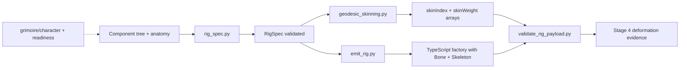
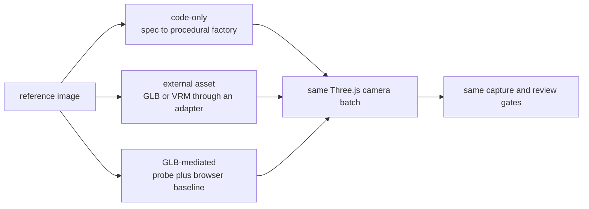

# Stage 5: Rig, Skinning, Hair, and the Character Track

This document explains how img2threejs makes a generated character animatable. The thesis is: the rig is a data contract, not an inference. A `RigSpec` names every joint and every parent. A deterministic emitter turns the spec into TypeScript. Skinning weights come from distance through the solid, not through the air. Hair is parented rigidly to the skull, because smooth skinning breaks the one guarantee the hair pipeline can make. The guarantee is that hair and skull keep their relation in every pose.

The source snapshot is commit `0c0c49bc168e648dbaf9c8c080474de0b3a941b6`. Stage 4 reviewed the render. Read [08 Stage review](08-stage-review.md) first. The character references that feed the spec are in the grimoire. The spec authoring document is [06 Stage spec](06-stage-spec.md).

## 1. The rig track in one picture

Stage 5 holds twelve Python files. The four core modules below own the contract; the other files hold the twelve gates, animation emission, mesh parity, the GLB reference, and payload validation.

| Module | Output | Refuses |
|--------|--------|---------|
| `forge/stage5_rig/rig_spec.py` | `RigSpec` data model and semantic validation | Duplicate identifiers, zero or many roots, unresolved parents, ambiguous tips |
| `forge/stage5_rig/geodesic_skinning.py` | Skin indices and weights per vertex | Meshes with no vertices, too many bones, missing vertex ownership |
| `forge/stage5_rig/emit_rig.py` | Standalone TypeScript rig module | A spec that fails validation, a non-vertical chain, a missing component extent |
| `forge/stage5_rig/validate_rig_payload.py` | Structural payload report | Wrong schema, wrong coordinate system, bad matrices, bad weights |

In a normal code-only run, Stage 5 does not produce the character rig. `new_sculpt_spec.py:derive_character_rig` writes the `rig` block, and Stage 3 emits the TypeScript hierarchy from it. The Stage 5 emitter is a Milestone 0 test harness for a synthetic capsule.

The character track also has references. They live under `grimoire/character/` and `grimoire/readiness/`. Those documents are not code. They are the rules that the spec and the review must follow.



The dashed dependency is conceptual: the readiness documents tell the author what to write, and the code enforces what it can. Not every rule in a Markdown reference has a matching code check. This document states which ones do.

## 2. The RigSpec data model

`rig_spec.py` transcribes a schema from the animation plan. It is explicit that it is not a competing schema. Field names, optionality, and meaning come from the plan. Where the plan is ambiguous for a three-bone case, the module states the reading it chose.

```python
# forge/stage5_rig/rig_spec.py:17-20
BindPose = Literal["T", "A"]
Forward = Literal["+Z", "-Z"]
Role = Literal["skinned", "attachment"]
Chain = Literal["spine", "head", "arm", "leg", "tail", "wing", "digit", "prop"]
```

A bone has an identifier, a parent, a joint position, a component, a role, a chain, an optional tip position, optional ellipsoids, and optional inverse-kinematics data. The root bone is the only bone with a null parent.

`validate_rig_spec` is the semantic gate.

```python
# forge/stage5_rig/rig_spec.py:124-139
def validate_rig_spec(spec: RigSpec) -> list[str]:
    """Minimal semantic gate for Milestone 0 (a scaled-down stand-in for the
    full Joint Admission Gate Half A in PLAN_1.5 §5.2 — WS-B is out of scope
    here). Returns a list of error strings; empty list means valid.
    Fail-closed: callers must treat a non-empty list as a hard rejection.
    """
    errors: list[str] = []

    ids = [b.id for b in spec.bones]
    if len(ids) != len(set(ids)):
        dupes = sorted({i for i in ids if ids.count(i) > 1})
        errors.append(f"NAME_UNIQUENESS: duplicate bone id(s) {dupes}")

    roots = [b for b in spec.bones if b.parent is None]
    if len(roots) != 1:
        errors.append(f"exactly one root bone required (parent: null), found {len(roots)}")
```

The function returns strings, not a boolean. The caller must treat a non-empty list as a hard rejection. The docstring states that rule. The emitter follows it.

`PLAN_1.5` is the rig plan for version 1.5. `Milestone 0` is its first milestone: a scaled-down stand-in test. `WS-B` is a workstream in that plan and is out of scope for the semantic gate. `Pillar 2` is the rule that the emitter does not invent geometry. `ADR-8` is the architecture decision record that defines the zero-sum weight fallback.

The tip position is the interesting ambiguity. The plan says a tip position defaults to the child's joint position. That default is only well defined when a bone has exactly one child.

```python
# forge/stage5_rig/rig_spec.py:80-100
    def resolve_tip_positions(self) -> dict[str, tuple[float, float, float]]:
        """Resolve every bone's segment end point.

        READING CHOSEN (schema ambiguity, PLAN_1.5 §6):

        The plan says tipPos "Defaults to the child's jointPos" but does not
        say what happens for a bone with zero children (a leaf) or more than
        one child. The minimal reading adopted here, applied uniformly and
        fail-closed rather than silently guessing:

          - exactly one child, no explicit tipPos  -> default to that child's jointPos
          - explicit tipPos given                  -> always wins, no defaulting
          - zero children (leaf) and no tipPos      -> REJECTED. A leaf skinned
            bone has nothing to default from, so the spec author must supply
            tipPos explicitly. This is a spec-authoring responsibility, not
            something the emitter may invent (Pillar 2 — the emitter is
            deterministic code, it does not propose geometry).
          - more than one child and no tipPos        -> REJECTED. "the child's
            jointPos" is only well-defined for a single child; defaulting to
            an arbitrary one would be a silent, unreproducible choice.
        """
```

The emitter refuses to invent geometry. That is the project rule that the docstring calls Pillar 2. A deterministic emitter can calculate. It cannot choose.

The envelope radius is derived with a stated formula.

```python
# forge/stage5_rig/rig_spec.py:158-174
def derive_envelope_radius(
    width: float,
    depth: float,
    overlap_factor: float = 1.2,
) -> float:
    """PLAN_1.5 §4.3 — envelope radius is DERIVED, never proposed.

        R_b = 0.5 * max(W_component, D_component) * F

    `width`/`depth` are the component bounding-box extents perpendicular to
    the bone axis; `overlap_factor` is F (plan default 1.2).
    """
    if width <= 0 or depth <= 0:
        raise ValueError(f"component extents must be positive, got width={width} depth={depth}")
    if overlap_factor <= 0:
        raise ValueError(f"overlap_factor must be positive, got {overlap_factor}")
    return 0.5 * max(width, depth) * overlap_factor
```

The radius depends on the component bounding box and an overlap factor. It does not depend on a number the model guessed. This is the same principle as the Stage 2 geometry derivation: measure what can be measured, and derive what follows from the measurement.

## 3. The emitter

`emit_rig.py` is a Milestone 0 test. Its docstring is careful about scope.

```python
# forge/stage5_rig/emit_rig.py:12-16
MILESTONE-0 SCOPE NOTE: the geometry this emitter builds is a synthetic
watertight capsule constructed directly from the bone chain span, not a
subject-derived mesh from the real pipeline (stage1/stage2 output). Wiring
this weight function to real emitted geometry is future work; this file only
answers "can a generator emit a working skinned rig from a spec at all."
```

The emitter answers one question: can a generator emit a working skinned rig from a spec. It does not claim to rig the reference mesh. That integration is future work. This document repeats the limit because a later reader could over-read the module.

The emitter writes plain TypeScript. It does not use `str.format` or an f-string on the JavaScript body, because that body is full of literal braces. It uses token replacement with a fixed template. The template tokens are checked before replacement, so a template edit that loses a token fails loudly.

The generated weight function is the plan's continuous weight function.

```javascript
// forge/stage5_rig/emit_rig.py:190-200
/** Returns { indices: number[4], weights: number[4], fallback: boolean }. */
function computeVertexWeights(p, boneIndexOf) {
  const scored = BONE_IDS.map((id) => {
    const d = distanceToSegment(p, JOINT_POS[id], TIP_POS[id]);
    const u = d / ENVELOPE_RADIUS[id];
    const w = Math.max(0, 1 - u * u) ** 2;
    return { id, d, w };
  });
  scored.sort((a, b) => b.w - a.w);
  const kept = scored.slice(0, 4);
  const total = kept.reduce((sum, c) => sum + c.w, 0);
```

Four influences per vertex. The weight falls smoothly to zero at the envelope radius. The top four are kept and normalized.

The zero-sum case is a known trap. If a vertex sits outside every envelope, every weight is zero. Three.js would normalize that to `(1, 0, 0, 0)` against bone zero, whatever the distance. The emitter handles it explicitly.

```javascript
// forge/stage5_rig/emit_rig.py:215-231
  // Mandatory zero-sum fallback (PLAN_1.5 §4 / ADR-8): every kept weight is
  // zero (vertex outside every envelope). three.js's own
  // normalizeSkinWeights() would otherwise rewrite this to (1,0,0,0) against
  // bone 0 regardless of distance. Instead: find the absolutely nearest bone
  // ignoring R_b and pin weight 1.0 to it.
  let nearestId = BONE_IDS[0];
  let nearestDistance = Infinity;
  for (const id of BONE_IDS) {
    const d = distanceToSegment(p, JOINT_POS[id], TIP_POS[id]);
    if (d < nearestDistance) {
      nearestDistance = d;
      nearestId = id;
    }
  }
  indices[0] = boneIndexOf.get(nearestId);
  weights[0] = 1;
  return { indices, weights, fallback: true };
```

The fallback pins weight 1.0 to the nearest bone. It only considers the base skinning case; the geodesic module has a separate rigid-pinning path.

The `Chain` literal includes arm, leg, and tail, but the Milestone 0 emitter is narrower. It requires every joint and tip to share one x and one z value. A bent arm or a tail fails with `Milestone-0 capsule builder requires a straight chain along the Y axis`. The limit is the test fixture, not the `Chain` vocabulary.

The emitter also builds a watertight capsule, because a pose-sweep gate needs geometry near a joint. The template comment records that `THREE.CapsuleGeometry` in Three.js r169 leaves roughly 98 boundary edges after a merge. The module therefore builds its own capsule with a wrapped radial seam. This capsule belongs to the Milestone 0 harness. The roadmap lists pose-sweep gating as not shipped in version 1.5, so a normal character run builds no capsule for that gate.

## 4. Geodesic skinning

`geodesic_skinning.py` replaces straight-line distance with distance through the solid. The docstring states the defect that this fixes.

```python
# forge/stage5_rig/geodesic_skinning.py:36-45
DEFAULT_RESOLUTION = 32
MAX_RESOLUTION = 96
MAX_INFLUENCES = 4
# Measured on the arm-beside-torso fixture, where the geodesic field correctly reports 1.37 world
# units to the spine and 4.45 to the arm: power 2 still leaves 8.6% arm influence on the far chest
# corner, power 3 leaves 2.8%, power 4 leaves 0.9%. The residual is a property of THIS constant, not
# of the distance field. Higher is tighter and lower is smoother across a joint, so 3 is the middle
# that removes the visible cross-talk without pinching the elbow.
DEFAULT_FALLOFF_POWER = 3.0
UNREACHABLE = float("inf")
```

The resolution is a voxel count across the mesh's largest extent. The grid step is that extent divided by the resolution. A higher value costs memory and time; 96 is the hard maximum.

The falloff power is measured. At power 2 the far chest corner still takes 8.6 percent arm influence. At power 3 it takes 2.8 percent. At power 4 it takes 0.9 percent. The default is 3, because it removes the visible cross-talk without pinching the elbow.

`bind` is the geodesic method and the authoritative one. `euclidean_bind` is kept as a control so a test can measure the leak. The TypeScript factory does not call either function; Stage 3 recomputes weights in the browser module.

The method is geodesic voxel binding. It voxelizes the mesh, seeds each bone's voxels, and propagates through solid voxels only. An arm resting against the ribs is close through the air but far through the shoulder. The field reports the long path, so the arm bone does not claim chest vertices.

The module also separates components that must not be skinned at all.

```python
# forge/stage5_rig/geodesic_skinning.py:47-66
# Roles that must be rigidly parented to a joint rather than smooth-skinned to the skeleton.
#
# WHY HAIR IS FIRST ON THIS LIST. The geodesic field measures distance THROUGH THE SOLID, which is
# exactly right for a limb and exactly wrong for hair. Hair sits ON the skull, so the path from the
# neck joint to a crown vertex runs up through the head and arrives short -- the crown then takes a
# real share of neck weight, and turning the neck DEFORMS the hair, shearing it against the very
# skull it is supposed to sit on.
#
# The deformation also voids the one guarantee the hair pipeline has. `standProud` and the
# `scalpExposure` gate are build-time geometric checks against the bind pose; smooth-skin the hair
# and every other pose is unverified, so the model can go bald when the head turns with no gate able
# to see it. Rigid parenting keeps hair and skull on a single shared transform, which makes the
# relation between them invariant under every pose.
#
# It is also simply more correct. Short hair on a skull genuinely does move rigidly with it; smooth
# skinning would introduce a deformation that does not exist in the subject.
#
# Long hair that crosses a joint is the real exception, and it is served by a short chain of bones
# with one mesh segment rigidly parented per bone -- still no blended vertex weights.
RIGID_ROLES = frozenset({"hair", "detail", "decal", "panel"})
```

This is the most important decision in the module. Hair, detail, decal, and panel components do not receive blended weights. They receive weight 1.0 on one joint.

The partition reports which components are rigid and which joint each one rides.

```python
# forge/stage5_rig/geodesic_skinning.py:238-251
    def is_rigid(component: dict[str, Any]) -> bool:
        return str(component.get("role") or "").lower() in rigid_roles

    def ride(component: dict[str, Any]) -> str | None:
        """First ancestor that is skinned, so the rigid piece has a joint to hang from."""
        seen: set[str] = set()
        parent_id = component.get("parent")
        while isinstance(parent_id, str) and parent_id in by_id and parent_id not in seen:
            seen.add(parent_id)
            parent = by_id[parent_id]
            if not is_rigid(parent):
                return parent_id
            parent_id = parent.get("parent")
        return None
```

A lock parented to a hair mass parented to the head rides the head, not the mass. The walk finds the first skinned ancestor. If there is none, the module warns that the rigid component has no joint to attach to.

The weight formula uses inverse geodesic distance.

```python
# forge/stage5_rig/geodesic_skinning.py:344-346
            # A vertex sitting on the bone itself would divide by zero; clamp to half a voxel, the
            # finest distinction this grid can represent anyway.
            scored.append((1.0 / max(distance, 0.5) ** falloff_power, bone_index))
```

The clamp prevents a division by zero. It also states the grid's resolution limit honestly.

The exclusion is applied, not merely reported.

```python
# forge/stage5_rig/geodesic_skinning.py:404-406
                skin_indices[index] = [slot] + [0] * (max_influences - 1)
                skin_weights[index] = [1.0] + [0.0] * (max_influences - 1)
                rigid_pinned += 1
```

This requires `mesh.vertexComponents`, one component identifier per vertex. Without it, the module says that the exclusion could not be applied. The comment at line 374-382 calls this out: returning geodesic weights and also reporting the partition would leave the caller holding exactly the wrong numbers. Exclusion is the only safe behaviour.

`euclidean_bind` is kept so the difference can be measured. A test can bind the same mesh both ways and show the leak in one and not the other. The module also reports unreachable vertices. A vertex that no bone reaches through the solid usually means a hole or a detached island.

## 5. The rig payload contract

`validate_rig_payload.py` checks the code-only alpha payload. It is a structural gate, not a rigging model. It uses only the standard library and never downloads or executes a checkpoint.

```python
# forge/stage5_rig/validate_rig_payload.py:18-20
EPSILON = 1e-6
WEIGHT_TOLERANCE = 1e-4
MAX_INFLUENCES = 4
```

The payload must declare the coordinate system and the joint arrays. The root is joint zero with a null parent. Every later parent index must be less than the child index.

```python
# forge/stage5_rig/validate_rig_payload.py:108-116
    if parents and parents[0] is not None:
        errors.append("parents[0] must be null for the single root")
    for index, parent in enumerate(parents[1:], start=1):
        if not isinstance(parent, int) or isinstance(parent, bool):
            errors.append(f"parents[{index}] must be an integer parent index")
        elif parent < 0 or parent >= index:
            errors.append(f"parents[{index}] must satisfy 0 <= parent < child index")
        elif index < len(joints) and parent < len(joints) and distance(joints[index], joints[parent]) <= EPSILON:
            errors.append(f"joint {index} has zero-length parent bone {parent}")
```

The parent-order rule makes the array a topological order. A parent always appears before its child. The validator does not require a specific traversal such as breadth-first or depth-first. The readiness contract says the traversal is an authoring choice, not a runtime invariant.

Each vertex has exactly four influence slots, and the weights must sum to one. The payload validator checks structure: schema version, coordinate frame, joint order, matrices, and weight sums. The twelve gates in `rig_gates.py` test behaviour on that payload. The validator does not run the gates; it catches structural errors before they do.

```python
# forge/stage5_rig/validate_rig_payload.py:145-152
        if not all(finite_number(weight) and float(weight) >= 0 for weight in weights):
            errors.append(f"skinWeight[{vertex}] must contain finite non-negative values")
        else:
            total = sum(float(weight) for weight in weights)
            if abs(total - 1.0) > WEIGHT_TOLERANCE:
                errors.append(f"skinWeight[{vertex}] must sum to 1 (got {total:.6f})")
            if total <= EPSILON:
                errors.append(f"skinWeight[{vertex}] must influence at least one joint")
```

The validator also reports joints with no active influence. That is a warning, not an error, because a ribbon or a hair joint can legitimately carry no surface weight. The report names each inactive joint.

The final report is careful about scope.

```python
# forge/stage5_rig/validate_rig_payload.py:158-170
    return {
        "schemaVersion": 1,
        "passed": not errors,
        "errors": errors,
        "warnings": warnings,
        "summary": {
            "jointCount": joint_count,
            "vertexCount": vertex_count,
            "maxInfluences": MAX_INFLUENCES,
            "activeVertexCountByJoint": active_counts,
        },
        "evidenceBoundary": "structural payload only; runtime deformation and screenshot gates are separate",
    }
```

The evidence boundary line is the honest limit. A valid payload is not deformation proof. Stress poses and screenshots still come from the browser. The readiness contract repeats this: a rig must pass the deterministic payload gate and produce readable screenshots before any likeness claim.

**Aha:** The hair rule and the rig contract agree by construction. The hair profile binds each root to scalp surface coordinates. The skinning module refuses to blend hair weights. The scalp exposure gate measures coverage against the bind pose. Together, these three rules make the hair-to-skull relation invariant under every pose. That is why a bald patch cannot appear when the head turns.

## 6. The character track

The character track has three routes. Two of them use a GLB (binary Graphics Library Transmission Format) file. The readiness contract states the routes.

```markdown
# grimoire/readiness/standard_character_pipeline.md:10-18
code-only:
  reference → spec → procedural TypeScript factory → authored/validated rig → Three.js

external-asset (opt-in):
  reference → CharacterGen/Tripo/etc. → GLB/VRM → UniRig/adapter → Three.js

glb-mediated-reference (opt-in, new):
  image (optional) → user/adapter-produced GLB → GLB probe → Three.js GLB baseline
  → procedural TypeScript factory → same Three.js camera batch → comparison
```

The code-only route is the product claim. The external route is opt-in. Its artifact must not be reported as a procedural factory. The GLB-mediated route uses a Graphics Library Transmission Format binary (GLB) as a structural reference and a browser baseline, but it still generates a separate procedural factory. All routes share the same capture and review gates.



The required artifacts are fixed. They include `reference-set.json`, `assessment.json`, `character-sculpt-spec.json`, `rig-payload.json`, `render-manifest.json`, `comparison-sheet.png`, and `diagnose-render.json`. A GLB-mediated run also records a reference kind of `glb` and a browser-rendered baseline for each camera.

For a Virtual Reality Model (VRM) export, the contract requires meter units, right-handed Y-up, the model facing negative Z, humanoid mapping, and a T-pose. The conversion is recorded, not hidden in loader code. `RigSpec.forward` accepts `+Z` or `-Z`. The authoring convention in the skill contract is `+Z`; the VRM target requires `-Z`. The exporter records the conversion instead of rotating the source silently.

## 7. Head proportions

`grimoire/character/reconstruction.md` covers the stylized path. It measures everything in head-units (HU).

```markdown
# grimoire/character/reconstruction.md:5-12
## Proportion System (head-units)

Measure everything in head-units (HU): total body height divided by head height. Pick the style axis from the image, do not assume realistic by default:

- realistic: ~7.5 HU (adult human)
- stylized / anime-adjacent: ~5-6 HU
- chibi / figurine: ~2-3 HU
```

The document demands measured ratios, not assumed ones. If the image crops the legs or feet, the author marks the leg and hip values as inferred and lowers confidence. The document does not allow a stock adult ratio to replace a missing measurement.

Facial landmarks are normalized to the head bounding box, not the full image, so they survive a scale change. The eye line is near the vertical middle. The nose base and mouth line divide the lower half. The document warns that a stylized face with large eyes violates realistic ratios on purpose. The author must match what the image shows.

The pose section defines a minimal skeleton and asks for limb angles read from the silhouette. If a joint is occluded, the author marks low confidence and uses a neutral rest angle for that joint only. The document forbids inventing an angle.

## 8. Likeness maximization

`grimoire/character/likeness_maximization.md` covers the projection-first path. Its first section states why freehand sculpting cannot reach high likeness.

```markdown
# grimoire/character/likeness_maximization.md:7-9
## Why Freehand Sculpting Cannot Reach High Likeness

Hand-authored primitives (capsules, spheres, blend shapes tuned by eye) can approximate proportions but cannot reproduce the exact geometry and surface information encoded in a photo. The two levers that actually move likeness are: (1) getting the mesh's shape and camera to align precisely with the photo, and (2) putting the photo's own pixels onto that mesh as texture. Everything else is secondary.
```

The pipeline has six steps. Fit a parametric template to landmarks. Match the camera. De-light the photo. Project and bake. Infer unseen regions and report confidence. Rig for deformation.

The de-light step is a hard requirement, not an improvement.

```markdown
# grimoire/character/likeness_maximization.md:30
A raw photo bakes in shadows, highlights, and ambient occlusion from whatever light was present when it was taken. Using it directly as albedo means the projected texture fights the new scene's lights. Run a de-lighting pass (`forge/stage1_intake/delight_albedo.py`) — high-pass/overlay neutralization at minimum, an AI delighter equivalent if available — to recover a neutral base color, then derive roughness/normal/AO independently. Treat "album must be free of baked lighting" as a hard requirement, not a nice-to-have.
```

The source line says "album"; the intended word is "albedo". The last sentence is the rule. A photo used as albedo carries its old lighting. The result fights the new scene.

The unseen-region section has an ordered preference. First, request another view. Second, mirror the front texture across the symmetry plane where anatomy allows it. Third, continue from the nearest observed edge. Every inferred region carries its own confidence and a note of the strategy.

The honesty note is explicit: a single image cannot yield a guaranteed 100 percent likeness. The pipeline never claims a 100 percent match. It reports confidence per region.

## 9. Hair references

`grimoire/character/stylized_hair_threejs.md` is a full design reference. It classifies hair representations and picks a hybrid route for the target case.

The parameter contract is the machine-readable part.

```markdown
# grimoire/character/stylized_hair_threejs.md:161-173
Important fields:

- `scalpMass`: ellipsoid/low-poly anchor that receives roots.
- `locks[].family`: `primary`, `bang`, `secondary`, `rear` or `micro`.
- `locks[].layer`: depth ordering for deterministic assembly.
- `locks[].controlPoints`: 3–5 centreline points in head-local space.
- `locks[].widthProfile` and `thicknessProfile`: normalized profiles from root to tip.
- `locks[].rootEmbedDepth`: overlap into the scalp mass, not a visual gap.
- `locks[].twistDegrees`: controlled section rotation, clamped to avoid flips.
- `locks[].visibility`: hero-view eye/face occlusion constraints.
- `materials`: base, root shadow and highlight variants.
- `lod`: sample/radial budgets for hero and orbit views.
- `reviewCameras`: fixed plus positive/negative orbit contracts.
```

The fields are head-local and deterministic, so a script can generate both a spec artifact and TypeScript inputs. The root is embedded into the scalp mass by a stated depth. It is not a visible gap.

The document also lists face constraints. No primary bang may cross both eye centres in the hero view. A bang may overlap a small part of the forehead or outer eye only when the reference shows it. The nose-to-hair clearance in profile must stay open.

The build order is layer-based. Rear locks first, then primary crown locks, then side locks and bangs, then secondary tubes only where they improve the profile. Materials are tuned only after the silhouette review. Micro-cards are added only after a screenshot shows a missing scale band.

The source register cites Three.js `TubeGeometry`, `CatmullRomCurve3`, custom `BufferGeometry`, the transparency guide, `MeshPhysicalMaterial`, `InstancedMesh`, and three research papers on fur and hair scattering. That gives the reader the primary sources rather than the model's memory.

## 10. Readiness contracts

`grimoire/readiness/procedural_rigging_contract.md` states who owns what. The procedural factory owns geometry and authored rig data. Python owns deterministic validation and evidence packaging. The browser owns bone updates, skinning, pose application, dynamic bounds, and final pixels.

The runtime invariants are seven rules.

```markdown
# grimoire/readiness/procedural_rigging_contract.md:21-30
- Use one shared `THREE.Skeleton` for all skinned meshes that share the character rig.
- Bind in rest pose before applying animation; do not treat a posed mesh as the bind pose.
- Update `skeleton.update()`/world matrices before measuring bounds or capturing a pose.
- Keep `skinIndex` and `skinWeight` attributes aligned with the geometry vertex count.
- Recompute or conservatively expand bounds after bone motion; a static load-time box may
  cull an animated limb or hair mass.
- Use semantic aliases only through an explicit map (`mixamo:LeftArm` → local joint id);
  never infer a joint from a string suffix alone.
- Keep auxiliary joints (ribbon, hair, skirt) explicitly tagged; their lack of direct
  surface influence is a warning, not an accidental missing bone.
```

The bounds rule is easy to miss. A static bounding box can cull an animated limb. The fix is to recompute or expand the box after bone motion.

The pose probes are mechanical. Neutral rest, elbow flexion, shoulder abduction, hip and knee bend, wrist and ankle reach, head turn, spine bend, a hair or ribbon attachment check, and four camera views. These probes prove deformation and attachment. They are not likeness scores.

`grimoire/readiness/joint_attachment.md` states the attachment contract for every child part.

```markdown
# grimoire/readiness/joint_attachment.md:13-22
- `parent`: parent component id.
- `attachment.parentId`: same semantic parent id.
- `attachment.parentSocket`: named socket or contact region on the parent.
- `attachment.localStart`: child root point in parent-local coordinates.
- `attachment.localEnd`: child tip/end point in parent-local coordinates.
- `attachment.baseRadius` and `attachment.endRadius` when the child is tube/limb/branch-like.
- `attachment.embedDepth` or `attachment.overlap`: how far the child penetrates or blends into the parent.
- `attachment.contactType`: `embedded`, `socket`, `overlap`, `hinge`, `surface-contact`, or `glued`.
- `attachment.gapTolerance`: maximum acceptable visible gap.
- `attachment.evidenceRefs`: image regions that justify this attachment.
```

The generator rule follows: place the pivot at `localStart`, build the visible mesh from start to end, and orient it along that direction. Do not centre the mesh at an arbitrary transform position. An attachment that cannot be inferred becomes `request-input`, not a part floating in mid-air.

## 11. What the code does not enforce

Several readiness rules have no matching Python check at this commit.

| Rule | Source | Code check |
|------|--------|------------|
| One shared skeleton | `procedural_rigging_contract.md` | No validator in Stage 5 |
| Bind in rest pose | `procedural_rigging_contract.md` | The emitter updates the world matrix before `Skeleton`, but this is one code path |
| Dynamic bounds after motion | `procedural_rigging_contract.md` | No Stage 5 check; it is a browser evidence item |
| Alias map, never a suffix | `procedural_rigging_contract.md` | No Stage 5 check |
| Auxiliary joint tagging | `procedural_rigging_contract.md` | `partition_for_binding` reports rigid roles, but the "warning" semantics are in the report, not a gate |
| Six full-body captures | `standard_character_pipeline.md` | No Stage 5 check; it is a manifest contract |

This table is a finding, not a criticism. The repository states in its own files that structural validation is not deformation proof. The missing checks belong to the browser evidence loop, not to the payload validator.

## 12. Summary

The rig track has four parts. `rig_spec.py` defines and validates the contract. `emit_rig.py` turns a valid spec into TypeScript with a continuous weight function and a zero-sum fallback. `geodesic_skinning.py` measures distance through the solid and pins rigid components to one joint. `validate_rig_payload.py` checks the payload structure and states its evidence boundary.

The character references supply what code cannot. They give proportions, landmarks, likeness strategy, hair parameters, and attachment rules. Some of those rules are enforced in code. Some are browser evidence. The difference is visible in the table above.

The material and rendering contract that the browser follows is in [12 Materials and rendering](12-materials-and-rendering.md). The release and operations story is in [14 Release and operations](14-release-and-operations.md).
