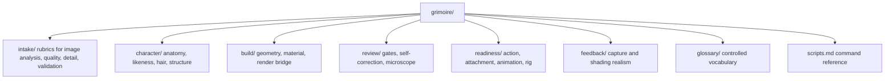
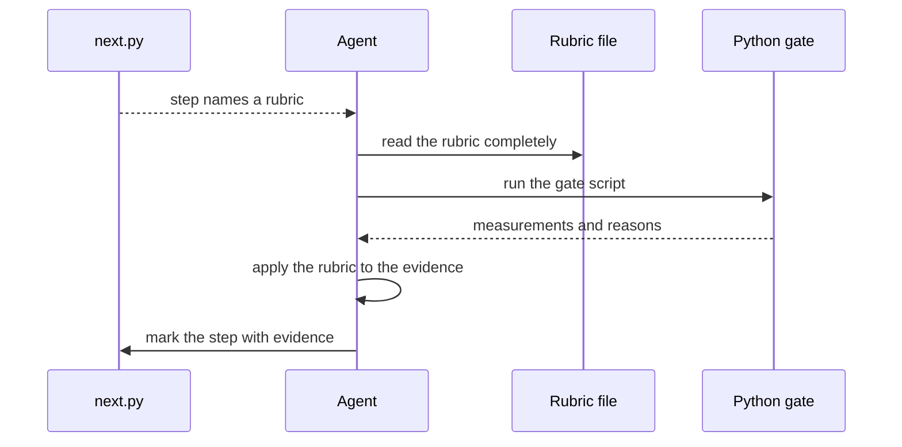

# The Grimoire: Rubrics the Gates Apply

The grimoire is a reference library of contracts. The agent reads one file at the moment a step needs it. This document maps the library, explains the role of each part, and shows how a rubric becomes a gate decision.

## What the grimoire is for

`SKILL.md` is the always-loaded skill contract. A host agent reads it before any work, so its text is a cost on every run. The file is a router: it holds one line per rule and names a deeper file for the full rule. The grimoire is that deeper library. The forge is the Python program set that runs the steps and measures the result. The split keeps the always-loaded text small.

```markdown
# grimoire/review/gates_reference.md:3-4
Read this reference completely before any visual review or `continue` decision. `SKILL.md` keeps
only the executable order and one-line summary; this file defines the mandatory gate behavior.
```

In this library, the word "reference" has two roles. A rubric is a contract, not a suggestion. An input reference is the image the user supplies. The context makes the role clear. A gate that names a file expects the agent to have read it.

The library has seven directories and one command-reference file.



The groups follow the pipeline. Intake rules govern the first steps. Build rules govern geometry. Review rules govern the gates. Readiness rules govern the end. Character rules cover a human subject. Feedback rules cover render capture and shading. The glossary fixes terms. `scripts.md` documents the commands. The first six groups follow the pipeline; the glossary and `scripts.md` support every stage.

## How the agent uses a rubric

The agent does not read the whole library at the start. It reads a file when a checklist step names it. `next.py` is the forge reporter that prints the next checklist action. A checklist step is one entry in the local state file. Evidence is a file that proves the step happened, such as a probe, a render, or a review record. The state steps make the timing explicit.



The rubric supplies the judgment rule. The script supplies the measurement. The agent joins them.

This division is why a rubric can talk about meaning. A script cannot decide whether a groove is part of the identity. A sentence can.

## The gates reference

`grimoire/review/gates_reference.md` is the master gate contract. It defines every blocking check.

The first gate covers the reference itself. A weak reference stops the run before planning.

```markdown
# grimoire/review/gates_reference.md:6-10
- **Suitability + reference integrity**: pass / conditional / reject before any planning
  (`grimoire/intake/validation_rubric.md`), AND every reference admitted via
  `forge/stage1_intake/check_reference_admission.py` (rejects empty/fragmented/tiny/duplicate/
  undecodable refs with a reason). Intake understanding cross-checked by
  `forge/stage1_intake/check_intake_correctness.py` (halts on a confident class contradiction).
```

A class contradiction means the declared object class conflicts with what the intake scripts measured. The second gate is the render evaluator. It is deterministic first and model last.

```markdown
# grimoire/review/gates_reference.md:11-17
- **Divine Eye (the harness heart) — deterministic-first, model-last**: the render evaluator is
  `forge/stage4_review/divine_eye.py` — a zero-token multi-signal ensemble (IoU/scale HARD gates;
  proportion/symmetry-parity/pHash/SSIM/edge/blowout/flat/tonal-parity soft) with self-uncertainty
  (`probe` on signal disagreement) and deterministic routing (`continue`/`refine-spec`/`refine-code`/
  `probe`). The VLM (`forge/stage4_review/vlm_gate.py`) is a gated, calibrated, cross-checked
  last layer: **never consulted on a hard-gate failure**, multi-sample-voted, and can rescue a
  soft near-threshold reject but never grant past a hard geometric failure.
```

"IoU" means intersection over union. "SSIM" means structural similarity index measure. "pHash" means perceptual hash. "VLM" means vision language model. Divine Eye is the deterministic render evaluator. "Zero-token" means it uses no model tokens. A hard gate is a pass or fail limit. A soft signal is a score near a threshold. The model is asked several times, and the answers are compared. The VLM cannot override a hard gate. It can only rescue a soft near-threshold reject.

The interior-difference gate exists because a silhouette is blind to the inside.

```markdown
# grimoire/review/gates_reference.md:42-49
- **Interior difference (required per visual pass)**: `forge/stage4_review/interior_difference.py`
  measures appearance INSIDE the silhouette, banded by height. Silhouette IoU is computed from
  roughly 11% of figure cells — the ones on the outline — so it is blind to the other 89%. Measured:
  a finished face and the same model with its face DELETED both scored 0.8803, identical to four
  decimals, and adding an entire mouth moved the outline metric −0.0002, in the wrong direction. An
  outline metric must never be the signal a correction loop optimises for interior work. It refuses
  to score when either foreground mask fell back to whole-frame coverage, and reports `cellsCompared`
  so a difference measured over a handful of cells cannot pass as evidence.
```

The metric is silhouette IoU. Figure cells are the grid cells that contain the figure. The gate bands them by height. A mask that covers the whole frame is not a figure mask, so the gate refuses to score. `cellsCompared` reports how many cells carried the comparison. Adding a mouth should raise the interior score. A change of −0.0002 on the outline means the outline moved away from the reference, not toward it. The measured example is the strongest argument in the library. A deleted face scored exactly the same as a finished face on the outline metric.

The chirality gate catches a specific geometry error.

```markdown
# grimoire/review/gates_reference.md:50-55
- **Chirality (spec time, HARD)**: `validate_chirality` in `forge/stage2_spec/validate_sculpt_spec.py`
  requires every `-l`/`-r` pair to be a sagittal MIRROR, not a rotated copy. Negating x *and* z is a
  180° rotation about Y, and rotation preserves handedness, so both limbs come out the same hand.
  What this CANNOT catch, so nobody trusts a green result too far: a pair wrong the SAME way on both
  sides is still a perfect mirror of itself, and needs `chirality.medial_lateral_bias` against a
  reference. Convention as code: `forge/_shared/chirality.py`.
```

A sagittal plane divides left from right. Handedness is the difference between a left hand and a right hand. Negating x and z rotates the part; it does not mirror it. Two left hands are not a mirror pair, because a mirror of a left hand is a right hand. The gate's blind spot is a pair that is wrong the same way on both sides, because a consistent error can still look symmetric. That is why the gate also checks `medial_lateral_bias` against the reference. "Convention as code" means the rule lives in `forge/_shared/chirality.py`. The gate documents its own blind spot. That is the pattern of the library. A gate states what it can prove and what it cannot.

## Self-correction

`grimoire/review/self_correction.md` holds the transparency rule and the action guide.

The transparency rule is a behavior contract.

```markdown
# grimoire/review/self_correction.md:9-15
**Rule:** Be transparent + don't over-claim. State exactly what changed each pass, with evidence, and name what still doesn't match:
- After each pass, explicitly list what changed: "Updated guard shape to extend left edge from -0.56 to -0.48 for handle overlap"
- Provide evidence: reference the specific values, coordinates, or parameters that changed
- Name what still doesn't match: "Handle silhouette traced but still flat plane (no Z palm-swell), procedural crosshatch not reference's exact dot-grid knurl"
- Explain why a change was made: "Extended guard left edge because handle ends at X=-0.42 and guard ended at X=-0.20, causing visual gap"
- Never claim a feature is "done" when it's only "improved" — use precise language
- When a gate passes but visual inspection shows issues, explain the limitation: "2D gate passed (fidelity 0.83) but three-quarter render shows blade reads as toy (no grind wedge) — 2D gates are blind to 3D realism"
```

The rule demands values, not adjectives. A change report without coordinates is not evidence.

The review order is fixed. Eight steps end with one action.

```markdown
# grimoire/review/self_correction.md:21-33
1. Capture or collect a rendered screenshot for the current browser view.
2. Select at most five critical semantic systems for the current pass and only the suspicious important systems.
3. Create one full reference/render comparison sheet with `stage4_review/make_comparison_sheet.py`.
4. Inspect the sheet once with your agent's vision and score the global image, relevant visual layers, and each selected semantic feature visible in that pair.
5. Compare the rendered result to current `ObjectSculptSpec`.
6. Decide whether the mismatch is caused by the spec, the implementation, lighting/camera, missing evidence, or performance tradeoff.
7. Choose exactly one action:
   - `continue`
   - `refine-spec`
   - `refine-code`
   - `request-input`
   - `stop`
8. Record the screenshot paths, comparison image, overall score, layer scores, feature scores, and AI critique in `reviewHistory`.
```

"AI" means artificial intelligence. `ObjectSculptSpec` is the JSON model specification. `reviewHistory` is the spec list of past review actions. "Semantic systems" are the named parts of the subject, such as a blade, guard, and handle. "Visual layers" are the base shape, material, surface, and lighting. The score scale is defined in the review contract; this document does not restate it. Step 6 diagnoses the cause. Step 7 turns that diagnosis into one action. The action is singular. The agent cannot split a correction between the spec and the code.

The root-cause guide maps a symptom to an action.

```markdown
# grimoire/review/self_correction.md:39-47
Use `refine-spec` when:

- a component is missing or invented incorrectly
- the primitive family is wrong
- proportions or coordinate frame are wrong
- material layer is under-specified
- local features are missing from the spec
- evidence refs are absent or contradict the image
- user expectation cannot be represented by current build passes
```

A wrong primitive or a wrong proportion is a spec defect. Patching the code would hide it. The guide forces the deeper repair. `refine-code` applies when the spec is sound but the generated code does not match it. `request-input` applies when the evidence is missing. `stop` applies when the target is not reachable. The file defines each case; this document shows the spec case as the example.

**Aha:** The grimoire is not documentation for a human reader. It is the decision table that the agent consults at the moment of judgment. The same file that says "do not over-claim" also gives the exact sentence pattern for a limitation. The rule and the example live together so the agent cannot separate them.

## The microscope

`grimoire/review/divine_eye_microscope.md` explains why a small feature needs a different instrument.

```markdown
# grimoire/review/divine_eye_microscope.md:3-7
Divine Eye today scores a whole silhouette against a whole silhouette. That answers "is this the
right shape" and cannot answer "is tear-04 on the right wing the right width", because the two
questions live at different scales. This document specifies the microscope: a review that descends
macro → component → feature → micro, and where **one critical feature failing fails the iteration
regardless of a high global score**.
```

The file names the resolution limit with exact constants.

```markdown
# grimoire/review/divine_eye_microscope.md:27-30
`divine_eye.py` sets `LUMA_SIZE = 64` and `EDGE_SIZE = 96`. Every SSIM, tonal, blowout and
edge-overlap signal is computed on those grids. A tear a few pixels wide in a 1920px reference is
sub-pixel at 64×64 — it is not scored badly, it is **absent**. No threshold tuning recovers it; the
information is gone before any comparison happens.
```

A sub-pixel feature is not a low score. It is missing information. The microscope solves that with zoom patches and extra render passes. A zoom patch is a crop rendered at a larger scale. Extra render passes supply that crop. "tear-04" is a feature identifier from the reference.

The four tiers are macro, component, feature, and micro. Macro is the whole object. Component is a named part. Feature is one local shape. Micro is pixel-scale detail. A critical feature failure fails the iteration, whatever the global score says. The luma grid holds brightness samples. The edge grid holds edge samples. "Tonal" compares brightness distribution. "Blowout" detects clipped highlights. "Edge-overlap" compares edge maps.

## Intake rubrics

`grimoire/intake/quality_contract.md` defines the pre-spec assessment. It scores eight complexity axes.

```markdown
# grimoire/intake/quality_contract.md:20-29
Score each axis from 0 to 3:

- silhouette complexity: simple outline to heavily interrupted/organic silhouette
- component count: one piece to many visible subparts
- hierarchy depth: flat object to deep parent-child structure
- repetition density: none to thousands of repeated marks/leaves/scales/rivets
- material layer count: one material to many layered local material responses
- local detail density: plain surface to dense scratches, bumps, moss, seams, chips, pores, or grain
- occlusion risk: fully visible to many hidden/inferred parts
- action readiness need: static to many pivots/sockets/colliders/destruction seams
```

The sum maps to one of four tiers: simple, moderate, complex, or ultra-complex. The file describes those tiers by qualitative features, not by numeric cut points. This document does not invent cut points that the source does not give.

A plugin is an optional domain pack. "Spec augmentation" is the plugin file that adds requirements. A plugin can raise a floor. It cannot lower one.

```markdown
# grimoire/intake/quality_contract.md:42-44
publishes higher floors in its spec augmentation, and the merge applies them RAISE-ONLY: it can lift
`complexity.tier`, `targetMinDetails` and `minimumSpecDepth`, and can never lower one. `targetMinDetails`
never drops below the **9** floor whatever a plugin proposes.
```

`targetMinDetails` is the minimum detail count. `minimumSpecDepth` is the minimum spec depth. `complexity.tier` is the tier field. The hard floor of nine details applies even to a simple object in a demanding domain plugin. A plugin cannot weaken it.

`grimoire/intake/validation_rubric.md` defines the reject list.

```markdown
# grimoire/intake/validation_rubric.md:22-28
## Reject

- target object is ambiguous
- photo is a scene, not an object reference
- important shape is hidden, cropped, blurred, or transparent
- request demands exact mesh extraction or manufacturing-grade dimensions
- object relies primarily on smoke, liquid, glass caustics, or lace (no reconstruction path exists for these)
```

A reject with a reason is a valid outcome. A false pass is not. "Glass caustics" are the light patterns that glass throws. "No reconstruction path" means the pipeline has no method for that material. "Character-conditional" means the verdict depends on the user's chosen style. "Stylized-clump" means hair built as grouped masses. "Fold-normal" means cloth folds carried by surface normals. "Projection-first" means the photo is projected onto the mesh before hand modeling.

The same rubric has special character routes.

```markdown
# grimoire/intake/validation_rubric.md:34-36
- **character-conditional -> stylized**: humanoid subject, at least one clear frontal view, pose readable, hair/cloth is present but the user accepts the stylized-clump/fold-normal treatment rather than photoreal strands or drape simulation. Proceed with the standard character pipeline.
- **character-conditional -> maximum likeness**: user explicitly wants the closest possible match to a specific person/character. Confirm this intent before starting, then route through `grimoire/character/likeness_maximization.md` (projection-first: template fit, camera match, de-lighting, texture projection). State up front that a single image cannot guarantee 100 percent likeness; report per-region confidence instead of claiming an exact match.
- **still reject**: no humanoid silhouette is discernible at all, the figure is fully occluded/cropped below usable proportions, or the request demands photoreal skin/hair microstructure from a single low-resolution image with no willingness to provide more views or accept stylization.
```

The route is a user choice. The agent must confirm the intent. It must not assume the maximum-likeness path.

## Character rubrics

`grimoire/character/reconstruction.md` replaces guessed proportions with a measured system.

```markdown
# grimoire/character/reconstruction.md:7-11
Measure everything in head-units (HU): total body height divided by head height. Pick the style axis from the image, do not assume realistic by default:

- realistic: ~7.5 HU (adult human)
- stylized / anime-adjacent: ~5-6 HU
- chibi / figurine: ~2-3 HU
```

"HU" means head-unit. The three ranges give the agent a starting axis. The image decides which one applies.

Landmarks use normalized coordinates inside the head box.

```markdown
# grimoire/character/reconstruction.md:25-32
Store landmarks as normalized coordinates (0-1) relative to head bounding box, not the full image, so they survive scale changes:

- `hairline`: ~0.0-0.15 from crown depending on hairstyle bulk
- `eyeLine`: ~0.45-0.55 (near vertical mid-head; lower for chibi, higher forehead for stylized)
- `eyeSpacing`: horizontal gap between inner eye corners, ~0.2-0.35 of head width (wider spacing reads as more stylized/cute)
- `noseBase`: ~0.6-0.7
- `mouthLine`: ~0.75-0.85
- `earTop` / `earBottom`: roughly bracket `eyeLine` to `noseBase`
```

"Crown" is the top of the head. The rubric gives fractions of the head box, not an axis origin; the spec carries the frame. "Lower for chibi" means a smaller coordinate value. Head-box coordinates survive a crop or a resize. Full-image coordinates do not.

`grimoire/character/likeness_maximization.md` states the two real levers.

```markdown
# grimoire/character/likeness_maximization.md:9
Hand-authored primitives (capsules, spheres, blend shapes tuned by eye) can approximate proportions but cannot reproduce the exact geometry and surface information encoded in a photo. The two levers that actually move likeness are: (1) getting the mesh's shape and camera to align precisely with the photo, and (2) putting the photo's own pixels onto that mesh as texture. Everything else is secondary.
```

The first lever is shape and camera alignment. The second is photo pixels on the mesh. A freehand sculpt cannot reach the same result.

A blend shape is a pre-authored shape variant. The file is honest about the limit. A single image cannot guarantee a perfect likeness. The pipeline reports a confidence value for each face or body region instead.

## Readiness rubrics

`grimoire/readiness/animation_contract.md` governs a rig that must move. It states one rule.

```markdown
# grimoire/readiness/animation_contract.md:14-15
> Nothing about a rig is believed until it has been evaluated at a sampled time and compared
> against the value the track says it should have. **A clip that exists is not a clip that plays.**
```

A rig is the bone and joint structure. A clip is one animation. A track is the channel that drives one property. This is the animation sense of "track", not the routing sense that names an authoring route in document 00. "Sampled time" is a chosen moment in the clip. The rule comes from two real bugs. Both produced a plausible scene with zero motion. Neither was visible in code review. The file records both bugs.

The hard rules are one line each.

```markdown
# grimoire/readiness/animation_contract.md:38-48
- A node is a `Bone` **iff it appears in `skin.joints`**. Never infer from names — clips target
  technical nodes that are not joints, and building those as bones corrupts the index space.
- Build all nodes, then attach children, then attach roots. Any other order leaves world matrices
  stale at skeleton time.
- `mesh.bind(skeleton, new THREE.Matrix4())` — identity, always, in attached bind mode. The
  armature transform is already inside `skinMatrix`; adding it again double-counts.
- Display offset comes from the **mesh bounds alone**: `(−centre.x, −min.y, −centre.z)`.
- `scaleDelta ≠ 0` is a tripwire, not a descriptor. Surface it before anything else proceeds: a
  rig that scales joints changes what R2 may legally do to skin weights.
- Loop is decided by **poseReturn**, not by travel: `poseReturn ≤ 0.5°` **and**
  `‖hip(T) − hip(0)‖ ≤ 0.01H`. The 1.5.1 rule contradicted its own data.
```

`skin.joints` is the list of nodes that act as joints. `skinMatrix` is the transform that binds the mesh to the skeleton. "Attached bind mode" means the mesh follows the armature. `poseReturn` measures how close the last pose is to the first. "Travel" is the distance the figure moves. The file records a measured failure behind each rule. The identity bind rule is a direct consequence of a double transform. The loop rule is a direct consequence of a bad data assumption.

The file also sets the stage order. Seven stages exist, R0 through R6. R0 runs payload validation, R1 sets the bind space, R2 conditions skin weights, R3 identifies clips, R4 designs actions, R5 assembles the runtime, and R6 runs the gates. A gate whose input is missing reports `unevaluated`, never a pass.

## Build rubrics

`grimoire/build/geometry_patterns.md` maps a shape to a primitive family.

```markdown
# grimoire/build/geometry_patterns.md:13-19
- tube along curve: cables, roots, branches, straps, hoses — constant radius, so never for anything
  that must come to a point
- tapered-sweep: hair locks, horns, tails, claws, blade tips — anything with a curved spine that
  narrows to a real point. `rx`/`rz` vary per station and framing uses parallel transport, because
  `extrudePath`'s Frenet frames flip 180° at an inflection. Prefer this over `tube` whenever the
  cross-section changes: a lock that does not taper reads as a noodle, and the validator warns when
  authored stations do not actually taper.
```

A station is one cross-section along the sweep. `rx` and `rz` are the cross-section radii. A Frenet frame is a local coordinate frame along a curve. An inflection is a point where the curve changes direction. `extrudePath` builds a mesh along a path. The frame can flip at an inflection, so the sweep uses parallel transport instead. The Frenet frame flip is a real geometry trap. A tapered sweep avoids it.

`grimoire/build/python_threejs_render_bridge.md` sets the rendering authority.

```markdown
# grimoire/build/python_threejs_render_bridge.md:8-10
Python is the deterministic controller and evidence producer. The browser-hosted Three.js
runtime is the rendering authority. A Python image, Blender image, notebook preview, or GLB
export is not a substitute for a screenshot of the target Three.js route.
```

"GLB" means Graphics Library Transmission Format, binary form. A route is the page path that renders the model. A Python render is not evidence. A Blender image or a notebook preview is not the target route. Only the target browser route is.

## Feedback rubrics

`grimoire/feedback/render_capture.md` defines a deterministic viewer.

```markdown
# grimoire/feedback/render_capture.md:25-32
**The problem:** OrbitControls' per-frame `controls.update()` overrides a scripted `setView`, rendering the object tilted and making screenshots non-deterministic. This breaks comparison integrity.

**Rule:** For review screenshots, the viewer must be deterministic:
- Disable interactive controls before capture: `window.__interactive = false; controls.enabled = false`
- Only enable controls when the user explicitly opts into interaction (e.g., `controls.addEventListener('start', () => { window.__interactive = true; })`)
- In the render loop, only call `controls.update()` when `window.__interactive` is true
- Emulate the exact reference viewport (e.g., 1600×900×1) so the screenshot equals the canvas
- A browser restart resets emulation — be aware of this when comparing across sessions
```

OrbitControls is the interactive camera control. `setView` is a scripted camera pose. "Comparison integrity" means the two images show the same view. The `×1` is the device pixel ratio. An interactive control can move the camera after a script sets it. The comparison would then measure a different view. The rule removes that source of error.

`grimoire/feedback/shading_realism.md` covers the material and light rules. "Albedo aliased into roughness" means color detail is stored as surface roughness. "Real lights" means lights in the scene, not brightness painted into the texture.

## The controlled vocabulary

`grimoire/glossary/3d_vocabulary.md` fixes the terms for a spec. The agent must not write vague praise.

```markdown
# grimoire/glossary/3d_vocabulary.md:7-9
- `silhouette`: the outer read of the object from a given camera angle.
- `primitive family`: box, sphere, ellipsoid, cylinder, cone, capsule, torus, lathe, extrusion, tube, plane card, instanced cluster.
- `topology intent`: hard-surface blockout, subdivision-ready surface, low-poly prop, organic deformed mesh, alpha-card cluster.
```

The glossary list names twelve families. The code set `VALID_PRIMITIVES` in `forge/stage2_spec/validate_sculpt_spec.py:43-59` has fifteen members. The three the glossary leaves out are `ground-blade`, `curve-sweep`, and `tapered-sweep`. The glossary says `extrusion` where the code says `extrude`. The source does not explain why the glossary list is shorter; the code set is the validation authority.

The glossary also holds material and surface terms. A spec sentence such as "make it shiny" is not allowed. The agent must name a property, a value, and a region.

The glossary file gives bad and better examples for the same reason. For example, it pairs a vague phrase with a value-bearing phrase. A term without a value is still vague.

## The detail rubric

`grimoire/intake/detail_inventory.md` turns a detail into a spec field.

```markdown
# grimoire/intake/detail_inventory.md:10-14
Every `detail` entry records: where (`region`, normalized), what changes (`kind` + `affects`),
how strong (`scale`, intensity implied by the recipe below), evidence region (`evidenceRef`),
and confidence. It MUST set `mapsTo` a real `component.localFeatures[]` entry or
`material.localOverrides[]` entry. A detail described only in prose is a gate failure - if it
does not map to a field the generator reads, it will not reach the render.
```

The "recipe below" is in the detail-inventory file, not in this document. `kind` is the detail type. `affects` is the surface property it changes. `evidenceRef` points to the crop. The last sentence is the whole point. If a detail has no field, the generator never reads it. A prose detail cannot affect the render.

## The command reference

`grimoire/scripts.md` is the longest file in the library, at 468 lines. It documents every script flag and every threshold. It also repeats the division of labor. "Command reference" means it documents commands that can run. The file itself is Markdown and does not execute.

The file covers state, intake, spec, build, review, and rig. These are the pipeline stage names. It is the reference the agent reads when a command needs a flag. It is not a tutorial.

The file also records hard-won patterns. The "Left and right" section explains the reflection rule. The triangle budget section explains the tiers. The skinning section explains the geodesic measurement.

## What the grimoire does not do

The grimoire is Markdown, so it does not execute. It quotes commands; the forge runs them. It does not score a render. It supplies the rule that the agent applies.

The grimoire also does not replace the forge. The forge is the Python program set under `forge/`. A gate script must still run. A rubric cannot pass a step by itself.

## Cross-references

- [03 Skill contract](03-skill-contract.md) explains when the router names a rubric.
- [04 Forge orchestration](04-forge-orchestration.md) explains the state steps.
- [05 Stage intake](05-stage-intake.md) explains the intake scripts the rubrics describe.
- [01 Repository anatomy](01-repository-anatomy.md) maps the directory.
- [13 Testing and continuous integration](13-testing-and-ci.md) explains the checks that protect these files.
