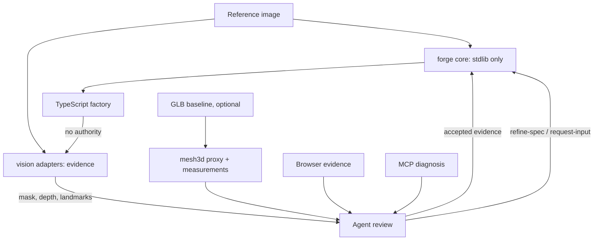
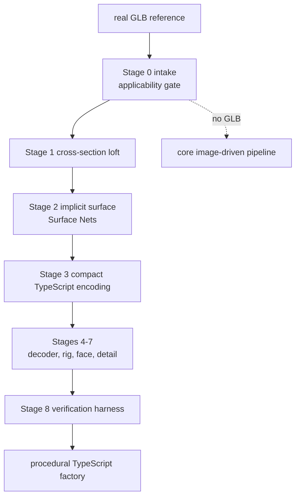

# Integrations: Vision Evidence, Reference Meshes, and the GLB Pipeline

This document explains the optional tools around the core forge. The forge is the `forge/` directory of deterministic Python stages, and a build pass is one generate-render-review cycle. The thesis is: every integration in this repository produces evidence or a measurement instrument. No integration produces the mesh or approves a build pass. The core stays Python standard library only. They live outside it, in their own environments, behind explicit flags.

The source snapshot is commit `0c0c49bc168e648dbaf9c8c080474de0b3a941b6`. The core stages are in [06 Stage spec](06-stage-spec.md) and [07 Stage build](07-stage-build.md). Rig and character work is in [09 Stage rig and character](09-stage-rig-and-character.md). Release mechanics are in [14 Release and operations](14-release-and-operations.md).

## 1. The authority rule

`docs/integrations/reference_fidelity_tooling.md` states the rule in one paragraph.

```markdown
# docs/integrations/reference_fidelity_tooling.md:3-5
This integration layer strengthens image matching without changing the core contract: output remains
procedural, reviewable Three.js code. External tools may produce evidence and diagnostics; they may
not silently provide meshes, decide hidden geometry, mutate the accepted source, or approve a pass.
```

Four verbs carry the rule: provide, decide, mutate, approve. An integration may produce a mask, a depth map, a landmark set, a proxy mesh, or a browser trace. It may not become the model, the author, or the judge.

The routing table names each tool and its boundary.

```markdown
# docs/integrations/reference_fidelity_tooling.md:9-17
| Need | Primary tool | Output | Authority boundary |
| --- | --- | --- | --- |
| Browser render, console, network and performance trace | Chrome DevTools MCP | screenshot, trace, console/network evidence | diagnostic only |
| Three.js scene/material/renderer inspection | threejs-devtools MCP | scene tree, material/texture state, renderer metrics | read-only findings until reflected in code |
| Cross-browser reproduction | Playwright MCP | Chrome/Firefox/WebKit screenshot and trace | fallback; do not duplicate the default Chrome loop |
| Version-aware Three.js documentation | Context7 | cited, version-specific API context | local installed Three.js and typecheck remain authoritative |
| Thin/complex foreground or component mask | SAM2 adapter | binary PNG mask + provenance JSON | agent confirms the intended subject/component |
| Character face or body evidence | MediaPipe adapter | normalized landmark JSON | anatomy/spec review required |
| Weak front/back depth cues | Depth Anything V2 adapter | 16-bit relative-depth PNG + provenance JSON | relative prior only, never metric or hidden geometry |
```

In this table, API means application programming interface, PNG means portable network graphics, and JSON means JavaScript Object Notation. The Model Context Protocol (MCP) servers are pinned to exact versions in the same document. Chrome DevTools uses `chrome-devtools-mcp@1.6.0`. Three.js inspection uses `threejs-devtools-mcp@0.4.1`. Playwright uses `@playwright/mcp@0.0.78` for Chromium, Firefox, and WebKit. Context7 uses `@upstash/context7-mcp@3.2.5`.

A version pin matters: a live documentation answer can describe a newer Three.js than the project runs. The installed package and typecheck are authoritative.



The diagram has no arrow from vision to the geometry pipeline. Evidence flows to the agent, and the agent writes the spec.

## 2. Why the integrations are outside `forge`

`forge/` is standard library only. This is a house rule, and `CONTRIBUTING.md` permits exceptions only as explicit, flagged, opt-in modes. The vision adapter needs Torch and Transformers. The mesh tool needs `gradio_client`, `trimesh`, and `huggingface_hub`. The GLB (binary Graphics Library Transmission Format) pipeline needs `numpy`, `Pillow`, Playwright, and `esbuild`.

```python
# forge/stage1_intake/run_vision_adapter.py:13-15
ROOT = Path(__file__).resolve().parents[2]
DEFAULT_PYTHON = ROOT / "integrations" / "vision" / ".venv" / "bin" / "python"
ADAPTER = ROOT / "integrations" / "vision" / "reference_vision.py"
```

`forge/stage1_intake/run_vision_adapter.py` is 45 lines. It resolves the isolated interpreter, builds a subprocess command, and forwards the remaining arguments. It does not import Torch or the adapter module. If the interpreter is absent, it stops with an install instruction.

```python
# forge/stage1_intake/run_vision_adapter.py:33-39
    if not python.exists():
        parser.error(
            f"optional vision interpreter not found at {python}; "
            "run `uv sync --project integrations/vision --python 3.11`"
        )
    if not args.adapter_args:
        parser.error("provide an adapter command: health, prefetch, segment, depth, or landmarks")
```

The isolation has one cost. A user must sync a second environment. The benefit is that a clean checkout of the core still runs. A missing integration degrades to evidence-free intake, not to a broken install.

## 3. The vision adapters

`integrations/vision/reference_vision.py` exports five commands: `health`, `prefetch`, `segment`, `depth`, and `landmarks`. The module docstring states the boundary before any code runs.

```python
# integrations/vision/reference_vision.py:2-7
"""Optional local vision evidence for img2threejs.

This module is deliberately outside ``forge`` so the core pipeline remains Python
stdlib-only. Every command emits provenance JSON. The outputs are evidence for the
agent and deterministic gates; they never choose geometry or approve a build pass.
"""
```

The models are fixed, small, and local.

```python
# integrations/vision/reference_vision.py:24-35
DEFAULT_MODELS = DEFAULT_RUNTIME / "models"
DEFAULT_HF_CACHE = DEFAULT_RUNTIME / "huggingface"
SAM_MODEL = "facebook/sam2.1-hiera-tiny"
DEPTH_MODEL = "depth-anything/Depth-Anything-V2-Small-hf"
FACE_MODEL_URL = (
    "https://storage.googleapis.com/mediapipe-models/face_landmarker/"
    "face_landmarker/float16/latest/face_landmarker.task"
)
POSE_MODEL_URL = (
    "https://storage.googleapis.com/mediapipe-models/pose_landmarker/"
    "pose_landmarker_lite/float16/latest/pose_landmarker_lite.task"
)
```

Segment Anything Model 2 (SAM2) uses the tiny Hierarchical Image Encoder variant. Depth Anything V2 uses the Small model. MediaPipe uses the float16 face landmarker and the lite pose landmarker. Small models keep the evidence cheap to produce and easy to re-run.

The environment path is fixed. `integrations/vision/.venv/` holds the interpreter. `runtime/vision/huggingface/` holds the model cache. `runtime/vision/models/` holds the MediaPipe task files and the manifest. Nothing is downloaded into the user's global cache by default.

### 3.1 Health

`command_health` reports what the environment can do.

```python
# integrations/vision/reference_vision.py:73-86
    payload = {
        "status": "ok",
        "python": sys.version.split()[0],
        "platform": sys.platform,
        "device": _device_name(torch),
        "packages": _versions(),
        "models": {
            "sam2": SAM_MODEL,
            "depth": DEPTH_MODEL,
            "faceTask": str(Path(args.models_dir) / "face_landmarker.task"),
            "poseTask": str(Path(args.models_dir) / "pose_landmarker_lite.task"),
        },
        "boundary": "evidence-only; never geometry truth or pass authority",
    }
```

`_device_name` prefers Metal Performance Shaders (MPS), then CUDA, then the central processing unit. `_versions` reports seven packages and marks a missing package as `missing` instead of failing. A health report that crashes is not a health report.

### 3.2 Segmentation

`command_segment` runs SAM2 with positive point prompts. It picks the mask with the highest predicted intersection over union (IoU). It writes the mask as an 8-bit portable network graphics (PNG) image and writes a JSON sidecar.

```python
# integrations/vision/reference_vision.py:196-209
    payload = {
        "kind": "segmentation-mask",
        "model": SAM_MODEL,
        "sourceImage": str(image_path),
        "sourceSha256": _sha256(image_path),
        "output": str(output),
        "outputSha256": _sha256(output),
        "prompt": {"positivePoints": [[round(float(px), 3), round(float(py), 3)] for px, py in points]},
        "predictedIou": round(float(scores[best].item()), 6),
        "foregroundPixels": int((mask > 0).sum()),
        "imageSize": [image.width, image.height],
        "device": device,
        "boundary": "mask evidence only; agent must confirm the selected subject/component",
    }
```

Both files carry SHA-256 (Secure Hash Algorithm, 256-bit) digests. The prompt points are recorded to three decimal places. The predicted IoU is recorded. A later reader can reproduce the mask or explain why it differed.

The point argument is repeatable for a measured reason. The source comment records one failure.

```python
# integrations/vision/reference_vision.py:372-378
    # Repeatable. SAM2 resolves a single point to whatever region that point sits in, which on a
    # character in a busy scene is one garment, not the character: a single click on the sash of a
    # forest render returned the sash alone at predictedIou 0.604. Several positive points spread over
    # head, torso and legs tell it they belong to ONE object.
    segment.add_argument(
        "--point", nargs=2, type=float, metavar=("X", "Y"), action="append", dest="point",
    )
```

One point selects one region, and a garment is a region. Several points across the body tell the model that the parts belong to one object. The README still says that a human or agent must confirm the selection.

### 3.3 Depth

`command_depth` runs Depth Anything V2. It normalizes the predicted depth to the 16-bit range and writes a PNG.

```python
# integrations/vision/reference_vision.py:256-267
    payload = {
        "kind": "relative-depth-prior",
        "model": DEPTH_MODEL,
        "sourceImage": str(image_path),
        "sourceSha256": _sha256(image_path),
        "output": str(output),
        "outputSha256": _sha256(output),
        "rawRange": [minimum, maximum],
        "imageSize": [image.width, image.height],
        "device": device,
        "boundary": "relative depth prior only; never metric scale or hidden geometry truth",
    }
```

The raw range is recorded, but the output is normalized. The values are relative, not metric. The boundary line forbids two uses: metric dimensions and invented back sides. The same rule appears in the routing table.

### 3.4 Landmarks

`command_landmarks` supports a face kind and a pose kind. The face path asks for blendshapes and transformation matrices. The pose path asks for world landmarks and no segmentation mask.

```python
# integrations/vision/reference_vision.py:337-348
    payload = {
        "kind": f"{args.kind}-landmarks",
        "model": {
            "path": str(model_path),
            "sha256": _sha256(model_path),
        },
        "sourceImage": str(image_path),
        "sourceSha256": _sha256(image_path),
        "landmarks": landmarks,
        **extras,
        "boundary": "observed landmark evidence; geometry and anatomy still require agent review",
    }
```

The model digest is recorded, not just the model path. A changed task file would otherwise change the landmarks with no trace.

The tooling document adds an operating detail for macOS. MediaPipe Tasks creates a Metal graphics context even when the inference delegate is the central processing unit. A restricted or headless sandbox must grant graphics access. This is a real failure mode, not a warning about performance.

The accepted landmarks go into `preSpecAssessment.anatomy`. The source image hash and the model hash stay in the evidence references. That connects this document to [06 Stage spec](06-stage-spec.md), where the anatomy block is consumed.

## 4. The reference mesh tool

`integrations/mesh3d/generate_reference_mesh.py` generates a proxy mesh from one or more images. It uses a hosted TRELLIS space (a remote three-dimensional generation model), not a local model. The docstring gives the reason.

```python
# integrations/mesh3d/generate_reference_mesh.py:5-9
Why a hosted Space and not a local model: TRELLIS states "the code is currently tested only on
Linux" and "an NVIDIA GPU with at least 16GB of memory is necessary", and its submodules (spconv,
nvdiffrast, diff-gaussian-rasterization, flash-attn) are CUDA-only. There is no MPS path. The Space
runs on the provider's CUDA hardware, so an Apple Silicon machine gets TRELLIS output without
TRELLIS ever running locally.
```

The tool writes two formats from one generation. Each format has a different job.

```python
# integrations/mesh3d/generate_reference_mesh.py:11-24
Why BOTH formats, from one generation:
  GLB  — transport/render format. Three.js loads it natively (GLTFLoader), so the reference can be
         rendered with the SAME camera and shader as the candidate model. That identical-domain
         render is the entire point: comparing a PBR render against a photograph is what pins
         `ssim` at 0 and `tonalParity` at 0.11.
  OBJ  — scoring format. `forge/` gates are pure-stdlib by house rule, and OBJ is `v/vn/f` ASCII
         that a ~30-line stdlib parser reads. Decoding GLB accessors/bufferViews in pure Python is
         200-400 fiddly lines and impossible outright if the file is Draco-compressed.

Both files are written from ONE generation and ONE transform, because the most dangerous failure
here is silent: if the GLB and the OBJ disagree on axis convention, the Three.js render and the
Python metric score two different objects and neither complains. glTF fixes Y-up/right-handed/metres
by spec; OBJ fixes nothing. `--assert-axes` compares their bounding boxes and refuses to continue on
a mismatch.
```

The two-format design solves a real conflict. The renderer wants a Graphics Library Transmission Format binary (GLB). The pure-Python metric wants an ASCII format that a short parser can read. A single transform keeps both views on the same object.

The axis check is the safety net. A silent mismatch would compare two different objects and still look plausible.

Before anything depends on the file, `inspect_glb` reads the JSON chunk with `struct` and `json` only.

```python
# integrations/mesh3d/generate_reference_mesh.py:128-148
def inspect_glb(glb_path: Path) -> dict:
    """Read the glTF JSON chunk with stdlib only, to catch compression before anything depends on it.

    Draco or meshopt compression is common in generated GLB and is the one condition that makes the
    pure-Python scoring path impossible — it must be detected at intake, not discovered later.
    """
    data = glb_path.read_bytes()
    magic, _version, _length = struct.unpack_from("<III", data, 0)
    if magic != 0x46546C67:
        sys.exit(f"{glb_path} is not a GLB (bad magic)")
    chunk_length, chunk_type = struct.unpack_from("<II", data, 12)
    if chunk_type != 0x4E4F534A:
        sys.exit("first GLB chunk is not JSON")
    gltf = json.loads(data[20:20 + chunk_length])
    required = gltf.get("extensionsRequired", [])
    return {
        "extensionsRequired": required,
        "compressed": any("draco" in e.lower() or "meshopt" in e.lower() for e in required),
        "meshes": len(gltf.get("meshes", [])),
        "materials": len(gltf.get("materials", [])),
    }
```

The magic values are `0x46546C67` for `glTF` and `0x4E4F534A` for the JSON chunk. A compressed file is detected at intake. The scoring path can then stop early with a clear cause.

The final note is the most important text in the file.

```python
# integrations/mesh3d/generate_reference_mesh.py:196-201
    if glb_info["compressed"]:
        print("\nWARNING: GLB declares compression in extensionsRequired. Three.js needs DRACOLoader "
              "and the pure-Python path cannot read it. The OBJ above is still usable.", file=sys.stderr)
    print("\nNOTE: this mesh is a generative PROXY, not ground truth. Score it against the original "
          "reference image before using it as a scoring reference — a hallucinated back side is "
          "exactly what a confident-but-wrong metric would optimise toward.", file=sys.stderr)
```

A proxy is a hypothesis. It has a generated back side that no image confirms. Scoring against a proxy without an image check optimizes toward the model's guess. The tool cannot prevent that use. It can state the risk on every run.

The argument parser also keeps a cheap rule: `--from-glb` skips generation. Generation spends a finite shared graphics processing unit quota. A local conversion failure must not force a new generation. The tool supports reuse by design.

## 5. The GLB character pipeline

`integrations/glb_character_pipeline/` is the largest integration. It reconstructs a multipart GLB baseline as code-only TypeScript. The baseline is a measurement target, never a shipped asset.

The README opens with the applicability gate.

```markdown
# integrations/glb_character_pipeline/README.md:3-7
**GLB reference is optional. If the character build has none, skip this integration entirely** — do
not error, do not partially apply it, do not substitute anything. Build through the core img2threejs
image-driven pipeline (`forge/`) instead; nothing here has a code path that runs without a real GLB
point cloud to measure. Only reach for anything below once you've confirmed a GLB reference actually
exists for this character (see `PIPELINE.md`'s "Applicability gate").
```

The gate is a routing rule: no GLB means no integration, not an error.

`PIPELINE.md` expands the gate and explains why every stage needs real measured points.

```markdown
# integrations/glb_character_pipeline/PIPELINE.md:37
- **A GLB reference exists** → proceed through Stage 0 onward, as described below.
```

The next line states the other outcome: skip every stage and use the core pipeline.

The pipeline runs against a separate `img2threejs-showcase` checkout, located by `IMG2THREEJS_SHOWCASE_ROOT`. Every path resolves against it, and the integration never writes into its own tree.



### 5.1 The two meanings of "code-only"

The README separates two claims that sound identical.

```markdown
# integrations/glb_character_pipeline/README.md:28-29
- **Stage 1 (cross-section loft)** measures a SPARSE set of ring samples per node (girl-character: 748
  rings, 86,240 points total, from a 2.1-million-vertex source) and a small set of tuning numbers
```

At runtime, a loft function synthesizes new geometry between those rings. The walls between ring i and ring i+1 do not exist in the measurement. They are generated.

The second form measures densely and decodes the measurement without interpolation. Both ship no binary asset at runtime. They differ in how much of the surface is measured and how much is synthesized.

A sparse loft is a reconstruction from control data. A dense surface encoding is a compressed copy. Calling both "procedural" without the difference hides which one a build used.

### 5.2 Stage 1: measured cross-sections

`build_cross_sections.py` produces a TypeScript array of rings. The ring budget is measured, not chosen.

```python
# integrations/glb_character_pipeline/python/build_cross_sections.py:14-23
THE BUDGET IS MEASURED, NOT CHOSEN, AND THIS SCRIPT DOES NOT MEASURE IT FOR YOU. Run
measure_density_convergence.py against each node first, read its printed convergence/density tables,
and decide the final per-node spoke count by hand: min(convergence, density), raised only where a
material-patch boundary genuinely needs finer cutting (a patch can only be cut along the (ring, spoke)
lattice). Put the RESULT of that judgment in CHARACTER_SPOKES_JSON as a plain {"<node>": <spokes>} map.
"Measured, not assumed" means a human/agent reads the actual error numbers for THIS character's own
GLB -- reusing another character's numbers, or a formula that skips reading them, is exactly the
mistake this script exists to prevent. See PIPELINE.md Stage 1 for the two failure modes measured on
girl-character (spokes under-sampled at low counts; naively maximising spokes bulges nodes whose point
density can't support them).
```

The script measures nothing. It reads a JSON map that a person produced from a measurement table. That is an unusual design. It is deliberate: a generator that also picks its own density removes the measurement from the loop.

The ring order is deterministic.

```python
# integrations/glb_character_pipeline/python/build_cross_sections.py:86-89
    # Canonical order is load-bearing, not tidiness: the loft chains each ring onto the nearest strand
    # tip below it in ARRIVAL order, so an unspecified emission order can change the mesh with no
    # geometry changing. Sorting by height, then centroid, makes the input deterministic.
    rings.sort(key=lambda r: (r["y"], r["node"], r["centroid"][0], r["centroid"][1]))
```

A different emission order can produce a different mesh with the same geometry set. The sort removes that source of drift.

### 5.3 Stage 2: signed distance field and Surface Nets

A radial cross-section stores one radius per angular bin. An eyelid has several surfaces at one angle. The face needs another method.

```python
# integrations/glb_character_pipeline/python/build_head_surface.py:8-15
WHY SURFACE NETS AND NOT MARCHING CUBES. Only numpy and PIL are available here. Marching cubes needs a
256-case table that is easy to get subtly wrong; Surface Nets emits one vertex per sign-changing cell
and one quad per sign-changing grid edge, which is a few dozen lines and cannot be half-right.

The field is the signed distance to the point cloud's local tangent planes, splatted: every vertex
contributes dot(cell - p, n_p) to the cells within RADIUS, weighted by a smooth falloff. Using the GLB's
own NORMAL attribute is what makes this reliable -- unoriented reconstruction has to guess inside from
outside, and oriented does not.
```

The signed distance field (SDF) needs oriented normals. The GLB supplies them. Without normals, the builder must guess which side is inside. Surface Nets is chosen because it is short and hard to get subtly wrong.

The field is splatted in chunks of 4,000 points. The weights use a smooth quadratic falloff. The cell size is set per node: 1.5 millimetre for the head, 2.5 millimetre for the trousers, 2.0 millimetre by default. A finer cell captures the eyelid. A coarser cell keeps the largest surface from doubling the file for no measured gain.

### 5.4 Stage 3: the encoding

The encoding is the strongest idea in this integration. Surface Nets places exactly one vertex per sign-changing cell. The cell coordinate identifies the vertex. The index buffer is therefore derivable.

`PIPELINE.md` states the measured result.

```markdown
# integrations/glb_character_pipeline/PIPELINE.md:119-123
The insight that makes this stage possible: **Surface Nets places exactly one vertex per sign-changing
voxel cell.** A vertex's cell coordinate identifies it, so the index buffer is derivable from cell
adjacency and does not need to be stored — that was 50.6 MB of 107.6 on this model. Normals are similarly
derivable by recomputing them from the rebuilt triangles (another 25 MB). **Verify this claim on the real
data before encoding anything**, on every node, not just the ones that look regular:
```

The claim is verified before an encoder is written. `verify_cells.mjs` rebuilds every triangle from cell adjacency alone and compares the triangle sets. It must show zero collisions.

```javascript
// integrations/glb_character_pipeline/node/verify_cells.mjs:48-55
/**
 * The grid origin, taken from the builder's own rule rather than searched for.
 *
 * scripts/build_head_surface.py sets `lo = P.min(axis=0) - PAD` with PAD = RADIUS * 2 and
 * RADIUS = CELL * 2.5, so the origin is the node's point-cloud minimum less five cells. A first
 * version of this script swept the sub-cell phase instead and put 29% of vertices in a cell already
 * taken -- the phase is set by the CLOUD's minimum, and the surface's minimum is a different number.
 */
```

The origin comes from the builder's formula, not from a search. A sweep found a wrong phase and put 29 percent of vertices in an occupied cell.

The connection bits need four bits per axis, not two. Each axis records whether the face exists, its winding, and the corner that starts the diagonal split. A quad is split from its first corner. A rotation of the same four corners cuts the other diagonal. On a non-planar quad, that is a different surface. The document records that two bits produced diamond-shaped facets across a third of one region.

The final size is 9.0 to 9.1 bytes per vertex. That is about 20 to 24 percent of the emitted binary's size. The data is base64 in a committed TypeScript module, because a plain number array is about ten times larger as source text.

### 5.5 Stage 5: the rig lessons

The pipeline's rig stage is independent of `forge/stage5_rig`. It records several measured failures that the core rig also avoids.

```markdown
# integrations/glb_character_pipeline/PIPELINE.md:179-182
- **Capsule-radius weighting** per bone, with a **region → bone whitelist** (a glove only takes arm-chain
  bones, a boot only takes leg-chain bones) and a **trunk-exclusion shield** with smooth attenuation —
  plain distance-to-bone-segment weighting reads the body inside out (a shoulder joint dominating the
  torso's own weights) and drags the wrong body part when an adjacent limb moves.
```

The whitelist and the trunk shield do what the geodesic field does in the core rig. They stop an adjacent bone from claiming the wrong region. The GLB pipeline uses allowed-region lists and a shield.

The document also derives the spine axis from the legs, not from the whole bounding box. The box average includes both arms. The source states the rule, not the fitting method: derive from the legs, then check lateral influence per height band.

### 5.6 Stage 6: the eye socket

The eye socket is the longest section and the most honest one. The baseline painted the eye into the diffuse texture and drew the lashes as thin cards inside the head. A distance field has no interior for a card, so it contours a torn shell. The document states that this is not a bug in Stage 2 and cannot be fixed downstream.

Four approaches were tried. A ball in the socket fails structurally. Sculpting a lid tears the face into flaps. A dome over the bowl is promising but needs one-sided rim error, three separate blend channels, and a shared boundary description. The shipped approach is an analytic ellipse for the eye alone. It has no edge to blend and leaves the source's torn socket visible around the lens.

The project states the tradeoff and does not re-solve it silently. The appendix records it as an open item. Closing it means going back to Stage 2 with a finer cell or excluding the lash cards before splatting.

A reader should notice what this section is: a negative result with measurements. The repository keeps it because the next character may hit the same shape.

### 5.7 Stage 8: verification

The verification harness has one habit at the top.

```markdown
# integrations/glb_character_pipeline/PIPELINE.md:285-289
The single highest-leverage habit in this whole project: **when a fix looks done, hide the thing you just
added and re-render the same shot.** More defects were correctly diagnosed by "render with the new mesh
hidden and see if the problem is still there" than by any other technique — it is what separated "this is
geometry I introduced" from "this is damage already in the source," and got the fix effort pointed at the
right layer more than once after it had been pointed at the wrong one.
```

The metrics are computed the same way on both sides. Intersection over union (IoU) measures the silhouettes. Mean absolute red-green-blue difference measures colour inside the intersection. Mean absolute Laplacian of luma measures surface noise. A noise value below the baseline is evidence of smoothing, not fidelity.

Two rules generalize. Compare sets, not counts: the same triangle count can describe a wrong mesh. Derive a tolerance from the encoding's stated precision, not from a round number. A tolerance the same size as the error measures nothing.

## 6. The orchestrator

`build-character.sh` chains the stages. It is written for the stock macOS `/bin/bash` 3.2, so it uses no associative arrays and no `readarray`. Every path and node list comes from a `.env` config.

```bash
# integrations/glb_character_pipeline/build-character.sh:61-64
: "${CHARACTER_GLB:?config must set CHARACTER_GLB}"
: "${CHARACTER_DEMO_ID:?config must set CHARACTER_DEMO_ID}"
: "${CHARACTER_NODES:?config must set CHARACTER_NODES}"
: "${CHARACTER_LEVELS:?config must set CHARACTER_LEVELS}"
```

The parameter expansion stops the script when a required value is absent. A missing node list is a configuration error, not an empty loop.

The script also carries a safety net after one real mistake.

```bash
# integrations/glb_character_pipeline/build-character.sh:146-156
  # SAFETY NET, carried over from the showcase pipeline after this exact mistake happened once: a
  # swapped x2/x3 destination mapping wrote the wrong level's data into an already-shipped, committed
  # file with no error -- npm run build, tsc and the round-trip check all still passed, because the
  # file was still perfectly valid TypeScript carrying a perfectly valid (just wrong) level. Only
  # `git diff` caught it. Never rely on catching this by eye again.
  if git -C "$REPO_ROOT" rev-parse --is-inside-work-tree >/dev/null 2>&1 \
    && git -C "$REPO_ROOT" ls-files --error-unmatch "$dest" >/dev/null 2>&1 \
    && ! git -C "$REPO_ROOT" diff --quiet -- "$dest"; then
    echo "  !! $dest CHANGED relative to the last commit. If this was already shipped, that is worth a"
    echo "     second look before it gets committed -- run: git diff -- $dest"
  fi
```

The check is a warning, not a failure. A changed tracked file can be correct. The point is that no typecheck and no round-trip test can see a wrong label on valid data. Only a diff can.

Stage 9 removes the geometry directory before capture.

```bash
# integrations/glb_character_pipeline/build-character.sh:178-186
echo "== Stage 9: renders with $CHARACTER_BIN_DIR moved out of the way =="
tmp="$(mktemp -d)"
if [ -e "$CHARACTER_BIN_DIR" ]; then mv "$CHARACTER_BIN_DIR" "$tmp/bin_dir"; fi
node "$NODE_SCRIPTS/capture-character.mjs" \
  --base http://127.0.0.1:5200/img2threejs-showcase/ \
  --demo "$CHARACTER_DEMO_ID" \
  --out "work/cmp/pipeline-check${CHARACTER_WORK_TAG}"
if [ -e "$tmp/bin_dir" ]; then mv "$tmp/bin_dir" "$CHARACTER_BIN_DIR"; fi
rmdir "$tmp" 2>/dev/null || true
```

If the page still renders, it did not fetch the binary. That is the literal proof of the no-fetch claim. The directory is restored after capture.

The capture script uses six fixed review angles: front, two orbits at plus and minus 35 degrees, two profiles, and rear. The Stage 4 turntable gate is a different contract: it requires four azimuths (0, 90, 180, 270). The six capture angles are evidence for the render review, not a turntable replacement. Read [08 Stage review](08-stage-review.md) for the turntable gate.

The browser is resolved from the environment. CloakBrowser is the configured default browser automation adapter named at `capture-character.mjs:7`; Playwright is the fallback. If neither is present, the script exits non-zero rather than reporting zero screenshots as success.

## 7. The loop placement

The tooling document puts the integrations in one order.

```text
# docs/integrations/reference_fidelity_tooling.md:128-138
reference admission
  -> optional SAM2 / MediaPipe / relative-depth evidence
  -> pre-spec assessment and local spec search
  -> camera solve, de-light and projection bake
  -> strict ObjectSculptSpec
  -> pass-gated Three.js generation
  -> deterministic repository capture
  -> MCP diagnosis when needed
  -> Divine Eye + feature microscope
  -> refine-spec / refine-code / request-input / continue
  -> performance trace after fidelity acceptance
```

The order is the authority order too. Optional evidence comes before the spec. MCP diagnosis comes after a deterministic capture. The performance trace comes last, after fidelity is accepted. A fast but wrong render is not a success.

The text also states a limit that applies to every tool. Projection can make the reference camera match closely. It cannot replace thickness, attachment, component coverage, or multi-angle truth.

**Aha:** Every integration in this repository is designed to fail into the core. A missing vision environment, a missing GLB, a compressed mesh, or a missing browser does not stop the image-driven pipeline. Each tool either produces evidence with a recorded boundary or exits with a clear cause. The product claim survives because the optional layer cannot become load-bearing.

## 8. What these tools cannot do

- SAM2 returns a region, not a component tree. A mask still needs human or agent confirmation.
- Depth Anything V2 returns relative depth. It cannot set a metric size or reveal a hidden back side.
- MediaPipe returns observed landmarks. Anatomy review is still required.
- TRELLIS returns a proxy. Its back side is generated, not observed.
- The GLB pipeline returns a reconstruction. The eye socket may keep the source's torn cards. The pipeline says so.
- An MCP scene edit has no standing until the source or spec contains it.

Each item is a boundary, not a defect. The tools are useful because their limits are written down. The same habit appears in [15 Limits and findings](15-limits-and-findings.md).

## 9. Summary

The integration layer has three parts. Vision adapters produce masks, depth, and landmarks in an isolated environment. The mesh tool produces a two-format proxy for rendering and scoring, with an axis check and a compression check. The GLB character pipeline turns a measured baseline into committed TypeScript and verifies the encoding round trip.

All three obey one rule: evidence may inform the agent, and it may never become the geometry, the spec, or the approval. The core remains standard library only and remains the product. The material rules that the generated code must follow are in [12 Materials and rendering](12-materials-and-rendering.md).
