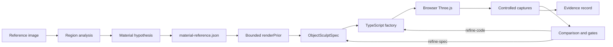
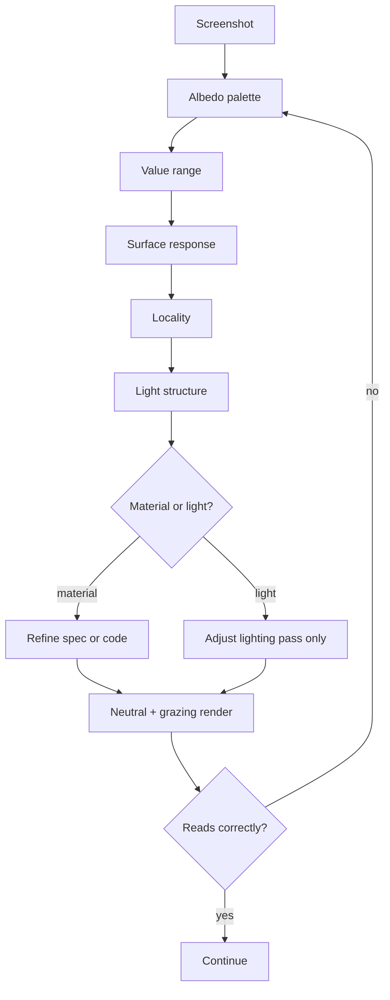

# Materials and Rendering: Priors, Physics, and Browser Authority

img2threejs is an agent skill and a deterministic forge. The `forge/` directory holds the deterministic Python stages. The `grimoire/` directory holds the reference documents that state the rules. This document explains how img2threejs turns image evidence into Three.js material values. The thesis is: a material value is a claim about engine behaviour, not a label. The repository stores bounded starting priors. It checks every value against what `three@0.169.0` actually does with it. It keeps standard red-green-blue (sRGB) colour and linear data separate. It lets the browser render decide, because a Python preview is not evidence.

The source snapshot is commit `0c0c49bc168e648dbaf9c8c080474de0b3a941b6`. The spec that carries material assignments is in [06 Stage spec](06-stage-spec.md). The pass that emits materials is in [07 Stage build](07-stage-build.md). The gates that review them are in [08 Stage review](08-stage-review.md).

## 1. The rendering authority

`grimoire/build/python_threejs_render_bridge.md` states the contract first.

```markdown
# grimoire/build/python_threejs_render_bridge.md:8-10
Python is the deterministic controller and evidence producer. The browser-hosted Three.js
runtime is the rendering authority. A Python image, Blender image, notebook preview, or GLB
export is not a substitute for a screenshot of the target Three.js route.
```

GLB is the binary form of the Graphics Library Transmission Format. Three roles follow. Python prepares inputs, runs deterministic checks, and records evidence. The browser runs the exact scene and produces pixels. The review compares those pixels to the reference.

The routing order is fixed. Chrome DevTools Model Context Protocol (MCP) comes first when it exists. Playwright is the fallback. Blender is allowed only for optional reference passes. `pythreejs` is a notebook tool and never the final fidelity gate unless the target is itself a `pythreejs` application.



The diagram has one feedback edge to the spec and one to the code. There is no edge from Python directly to the final image. That absence is the contract.

## 2. The reference library

`docs/materials/` holds three files. `THREEJS_MATERIAL_REFERENCE.md` explains the rules. `IMAGE_MATERIAL_ANALYSIS.md` defines the per-component analysis gate. `material-reference.json` is the machine-readable table.

The README states what the table is for.

```markdown
# docs/materials/README.md:10-13
The library stores **starting priors**, not universal truth. Roughness, clearcoat, transmission and
other appearance parameters depend on finish, wear, scale, lighting and the actual reference. The
pipeline must first classify a visible material region, then use the matching record as a bounded
starting point, fit it against the admitted image evidence, and verify it under controlled renders.
```

A prior is a range, not a value. The registry stores a default point and a legal range for each property. The table in §4 lists that default point. The analyzer classifies a region. The library gives a starting point inside a legal range. Image evidence moves the value inside that range. A render must confirm the result.

### 2.1 The hypothesis

The analyzer must emit a structured hypothesis, not one word.

```markdown
# docs/materials/README.md:31-37
Resolution order:

1. Exact canonical `materialId` supplied by authoritative metadata or a reviewed spec.
2. Exact `family + subtype + finish` match.
3. Alias match, retaining every matching candidate rather than choosing silently.
4. Family fallback with reduced confidence.
5. `unknown` and `request-input` when the distinction affects a critical visible region.
```

The order is a trust order. Explicit metadata wins. A reviewed spec wins. A semantic match is next. An alias is weaker. A family fallback is weaker still. Ambiguity becomes a request for input, not a guess.

`forge/materials/reference.py` implements this order. The module is standard library only, so every forge stage and the continuous integration jobs can use it.

```python
# forge/materials/reference.py:1-8
#!/usr/bin/env python3
"""Load and resolve the canonical Three.js material reference library.

This is the runtime bridge for ``docs/materials/material-reference.json``.  The
registry is intentionally data-driven: profile numbers seed a candidate, while
image evidence and user metadata decide whether that candidate may proceed.
The module is stdlib-only so it can be used by every forge stage and in CI.
"""
```

CI means continuous integration. The validator is strict about the registry's own form. The schema version must be 1. The renderer must be Three.js. Every source must be a secure Hypertext Transfer Protocol (HTTPS) address. `reference.py:62` rejects any source URL that does not start with `https://`. Every material must declare that its recipe is a prior.

```python
# forge/materials/reference.py:84-88
        if material.get("recipeBasis") != "inferred-starting-prior":
            errors.append(f"material {material_id!r} must label its recipeBasis as a prior")
        for source_ref in material.get("sourceRefs", []):
            if source_ref not in source_ids:
                errors.append(f"material {material_id!r} has unresolved sourceRef {source_ref!r}")
```

A material cannot cite a source that the registry does not list. A prior cannot describe itself as measured truth. Both rules protect the same property: a reader can trace every number.

The resolver keeps alternatives instead of collapsing them.

```python
# forge/materials/reference.py:136-150
def resolve_material(hypothesis: dict[str, Any], payload: dict[str, Any] | None = None) -> dict[str, Any]:
    """Resolve one hypothesis while retaining alternatives and uncertainty.

    Explicit user/metadata identity wins.  Alias and family matching never
    silently chooses between materially different candidates.
    """
    registry = payload or load_reference()
    materials = _material_index(registry)
    by_id = {str(item.get("id")): item for item in materials}
    explicit = hypothesis.get("materialId")
    if isinstance(explicit, str) and explicit in by_id:
        result = _candidate(by_id[explicit], "explicit-material-id", 1.0, "authoritative material id")
        result["status"] = "proceed"
        result["alternatives"] = []
        return result
```

The resolver uses four statuses: `proceed`, `probe`, `request-input`, and `unknown`. An explicit identifier has confidence 1.0 and status `proceed`. A semantic match at confidence 0.7 or higher also proceeds. A lower match returns `probe`. A family match with several candidates returns `request-input`.

```python
# forge/materials/reference.py:191-199
    return {
        "materialId": None,
        "profile": None,
        "method": "unresolved",
        "confidence": 0.0,
        "reason": "ambiguous or unknown material; request more evidence",
        "status": "request-input" if family_matches else "unknown",
        "alternatives": alternatives,
    }
```

`build_assignment` copies the result into a spec-ready record without mutating the hypothesis. It records the method, the confidence, the alternatives, the evidence, the required maps, the optional maps, and the validation views. A reviewer can see why a material was chosen and what else was possible.

## 3. What the engine does with a value

`forge/_shared/material_physics.py` exists because a value can pass authoring, validation, and emission and still never reach a pixel.

```python
# forge/_shared/material_physics.py:4-20
WHY THIS MODULE EXISTS. A material number can be authored, validated, emitted, rendered -- and still
never reach a pixel, because the engine gates it behind another value, clamps it, adds to it, or folds
it into a different uniform. None of that is on the docs page. All of it is in the source, and every
constant below cites the file:line in `three@0.169.0` it came from.

The two failure modes this prevents:

    AUTHORING A VALUE THE ENGINE IGNORES.  `sheen: 0.65` with three's default `sheenColor` of
                                           0x000000 contributes exactly zero, because the sheen term
                                           is `sheenColor * (D * V)` -- a multiply by black.

    EXPOSING ONE DEGREE OF FREEDOM TWICE.  `sheen` and `sheenColor` are multiplied together before
                                           upload, so `sheen 1.0 / #808080` is bit-identical to
                                           `sheen 0.5 / #ffffff`. Extracting both from a reference as
                                           independent evidence extracts the same number twice and
                                           produces priors that contradict each other on paper while
                                           rendering identically.
```

This is the most useful idea in the material system. A physical property can be gated, clamped, added to, or folded into another value. Each case changes what an authored number means.

### 3.1 The constants

```python
# forge/_shared/material_physics.py:34-46
THREE_VERSION: Final = "0.169.0"

# `material.clearcoatRoughness = max( clearcoatRoughness, 0.0525 )`
#   ShaderChunk/lights_physical_fragment.glsl.js:72
# Anything below this renders identically to it, so accepting a smaller number as meaningful is
# accepting a value the engine will not honour.
CLEARCOAT_ROUGHNESS_FLOOR: Final = 0.0525

# `float sheenEnergyComp = 1.0 - 0.157 * max3( material.sheenColor );`
# `outgoingLight = outgoingLight * sheenEnergyComp + sheenSpecularDirect + sheenSpecularIndirect;`
#   ShaderLib/meshphysical.glsl.js:205,207
# Turning sheen on DARKENS the diffuse base by this coefficient times the effective sheen strength.
SHEEN_ENERGY_COMPENSATION_COEFFICIENT: Final = 0.157
```

The clearcoat roughness floor is 0.0525. A value below it renders as the floor. Reporting the smaller value reports a precision the engine does not have.

The sheen energy coefficient is 0.157. Turning sheen on scales the diffuse base down before the sheen lobe is added. A white sheen at full strength scales the base by 0.843.

The module also lists the zero-gated features and the collapsed degrees of freedom.

```python
# forge/_shared/material_physics.py:61-72
ZERO_GATED_FEATURES: Final = frozenset({
    "sheen", "clearcoat", "transmission", "iridescence", "anisotropy", "dispersion",
})

# Pairs the engine collapses into a single degree of freedom. Authoring both as independent
# reference-derived evidence is authoring one number twice.
#   sheen x sheenColor: WebGLMaterials.js:408
#   ior <-> reflectivity: MeshPhysicalMaterial.js:34-44
COLLAPSED_DEGREES_OF_FREEDOM: Final = (
    ("sheen", "sheenColor", "multiplied into one uniform before upload"),
    ("ior", "reflectivity", "reflectivity is a derived accessor over ior"),
)
```

A zero-gated feature has no effect at zero and forces a shader recompile when it crosses zero. The collapsed pairs are one control. A spec that lists both halves looks richer than it is.

### 3.2 The sheen calculation

```python
# forge/_shared/material_physics.py:81-91
def effective_sheen_strength(sheen: float, sheen_color: str | None) -> float:
    """What the engine actually applies, after folding the scalar into the colour.

    `uniforms.sheenColor = sheenColor x sheen` (WebGLMaterials.js:408), and the BRDF multiplies by
    that colour, so the strength that matters is the scalar times the colour's largest channel --
    `max3` is exactly what the energy term reads.
    """
    if sheen <= 0.0:
        return 0.0
    channel = _max_channel(sheen_color if sheen_color is not None else THREE_DEFAULT_SHEEN_COLOR)
    return sheen * channel
```

`sheen_base_darkening` multiplies that strength by 0.157. `compensated_base_luminance` divides the target by one minus the darkening. The three functions make the darkening predictable before the render exists.

The validator turns this into an error and a warning.

```python
# forge/_shared/material_physics.py:149-161
    # A no-op, not a subtle mis-tune: the term is a multiply by colour and the default colour is black.
    if sheen is not None and sheen > 0.0:
        if sheen_color is None:
            errors.append(
                f"material {material_id!r} sets sheen {sheen} but no sheenColor. three's default "
                f"sheenColor is {THREE_DEFAULT_SHEEN_COLOR} and the sheen term is a multiply by that "
                f"colour, so this contributes exactly zero. Declare sheenColor."
            )
        elif _max_channel(str(sheen_color)) == 0.0:
            errors.append(
                f"material {material_id!r} sets sheen {sheen} with sheenColor {sheen_color!r}, whose "
                f"channels are all zero, so the sheen term evaluates to zero."
            )
```

A sheen value with no colour is an error. A sheen value with a black colour is an error. A valid pair produces a warning with the exact darkening percentage and the exact base multiplier.

### 3.3 Open garment boundaries

```python
# forge/_shared/material_physics.py:220-247
def check_open_boundary_sides(component_id: str, component: dict[str, Any]) -> list[str]:
    """A garment shell with an open boundary must render both sides.

    `Material.side` defaults to `FrontSide` (Material.js:24), which culls backfaces. A sleeve, hem or
    collar opening therefore shows a HOLE rather than the inside of the garment: the geometry is
    there, the engine simply does not draw the faces pointing away. Reported as an error because a
    hole at a hem is indistinguishable at a glance from a garment that is too short, and the two want
    completely different fixes.
    """
    garment = component.get("garment")
    if not isinstance(garment, dict):
        return []
    boundaries = garment.get("boundaries")
    if not isinstance(boundaries, list) or not boundaries:
        return []
    has_open = any(
        isinstance(entry, dict) and entry.get("closed") is not True for entry in boundaries
    )
    if not has_open:
        return []
    if str(component.get("side") or THREE_DEFAULT_SIDE) == "FrontSide":
        return [
            f"component {component_id!r} is a garment with an open boundary but leaves side at "
            f"'FrontSide', so backfaces are culled and the opening renders as a hole rather than as "
            f"the inside of the garment. Set side to 'DoubleSide', or author the garment as a closed "
            f"offset volume and mark its boundaries closed."
        ]
    return []
```

This check is a good example of a material rule that depends on geometry. A closed volume can stay `FrontSide` and cost less. An open shell needs `DoubleSide`. The validator asks the component, not the material alone. The schema is a `garment` object with a `boundaries` list. Each boundary entry has a `closed` boolean. A closed offset volume is a shell authored with no open boundary, with every boundary entry marked closed.

### 3.4 Skin rules

The module forbids transmission, thickness, and attenuation distance on skin.

```python
# forge/_shared/material_physics.py:74-78
# Skin's real signature at this fidelity is a broad soft dielectric highlight over a warm diffuse
# base, which is a low-strength mid-roughness clearcoat. `transmission` is a SCREEN-SPACE REFRACTION
# model -- glass, not subsurface -- and on a closed opaque body mesh it produces a glassy figure at
# the cost of an extra render target. The registry states the same limit for skin.human.
SKIN_FORBIDDEN_PROPERTIES: Final = frozenset({"transmission", "thickness", "attenuationDistance"})
```

Transmission is a screen-space refraction model. It samples the back buffer. On a closed body it makes a glass figure. It does not make skin.

The fabric and hair families get a warning when they carry no sheen. With no textures, sheen is the whole woven or fibre cue that the pipeline can emit.

**Aha:** The sheen rule turns a subjective complaint into arithmetic. When a garment renders too dark, the validator already predicts the darkening as 0.157 times the effective sheen strength. The base colour can be divided by one minus that value before the render. A reviewer does not need to guess whether the mismatch is colour, lighting, or material.

## 4. Colour space and difference

`grimoire/build/threejs_texture_reference.md` opens with the rule that breaks the most renders.

```markdown
# grimoire/build/threejs_texture_reference.md:7-16
## Colour space — get this right or everything looks wrong
- **Albedo / `map` / `emissiveMap` / `sheenColorMap` → `THREE.SRGBColorSpace`.**
- **Data maps (`roughnessMap`, `metalnessMap`, `normalMap`, `aoMap`, `bumpMap`, `displacementMap`,
  `thicknessMap`, `anisotropyMap`) → `THREE.NoColorSpace`** (linear data, never sRGB).
- `CanvasTexture`: `flipY = true` (default), auto `needsUpdate` on construct.
- `DataTexture`: `flipY = false` (default) — memory (0,0) is bottom-left. Set `needsUpdate = true`.
- After changing `wrapS/wrapT` on an already-used texture you MUST set `needsUpdate = true`.
- `aoMap`/`lightMap` read UV channel 1 — geometry needs a 2nd UV set, or set `texture.channel = 1`.
- Tiling: `wrapS = wrapT = THREE.RepeatWrapping` + `repeat.set(u,v)`; set `anisotropy =
  renderer.capabilities.getMaxAnisotropy()` so oblique angles stay sharp.
```

In this list, UV means texture coordinate. Colour maps are sRGB. Data maps are linear. A roughness map decoded as sRGB changes the roughness curve at every texel. A normal map decoded as sRGB bends every normal.

The same document gives five starter recipes. Each row is a prior, not a truth.

```markdown
# grimoire/build/threejs_texture_reference.md:19-25
| finishClass | metalness | roughness | clearcoat | ccRoughness | transmission | ior | envMapIntensity | anisotropy | author maps |
|---|---|---|---|---|---|---|---|---|---|
| `gemstone` (translucent quartz/glass) | 0.0 | 0.05 | 1.0 | 0.0 | 1.0 | 1.54 | 1.0 | 0.0 | map(gradient), thicknessMap |
| `gem-metal` (chromed doppler blade — our blend) | 0.75 | 0.14 | 0.6 | 0.06 | 0.0 | 1.5 | 1.3 | 0.0 | map(gradient+smoke), roughnessMap |
| `painted-metal` (glossy paint) | 0.0 | 0.5 | 1.0 | 0.05 | 0.0 | 1.5 | 1.0 | 0.0 | map, roughnessMap, clearcoatRoughnessMap |
| `worn-composite` (aged rubber/grip) | 0.0 | 0.9 | 0.0 | 0.0 | 0.0 | 1.5 | 0.5 | 0.0 | map(mottled), roughnessMap, bumpMap |
| `brushed-steel` | 1.0 | 0.35 | 0.0 | 0.0 | 0.0 | 1.5 | 1.0 | 1.0 | anisotropyMap, roughnessMap, normalMap |
```

The paragraph below the table records a real correction. Pure gemstone with transmission 1.0 is see-through glass. A painted or anodised metal blade is opaque. It needs the `gem-metal` blend, not the gemstone row.

### 4.1 Perceptual colour difference

`forge/_shared/color_metrics.py` implements sRGB to CIELAB conversion and the full CIEDE2000 difference. The module docstring states why the extra complexity is necessary.

```python
# forge/_shared/color_metrics.py:1-10
#!/usr/bin/env python3
"""Perceptual colour math for the harness — pure stdlib (sRGB→CIELAB + CIEDE2000).

Canonical sRGB→CIELAB and the full CIEDE2000 (ΔE00) difference, used by the Divine Eye
hue-zone signal and any per-region colour check. CIEDE2000 corrects CIELAB's non-uniformity
(the ~275° blue region especially — exactly where the M9 violet→blue failure lives) via the
R_T hue-rotation term, so it is the right metric for "is this the same hue zone?".

Verified against Sharma et al.'s published CIEDE2000 test pairs (see test_color_metrics.py).
"""
```

The reference white is D65 (a standard daylight illuminant) with a two-degree observer. The conversion linearises each channel, applies the standard matrix, and applies the cube-root transfer. The difference function implements the full formula, including the hue rotation term that fixes the blue region.

```python
# forge/_shared/color_metrics.py:90-102
    d_theta = 30.0 * math.exp(-(((hp_bar - 275.0) / 25.0) ** 2))
    rc = 2.0 * math.sqrt(Cp_bar ** 7 / (Cp_bar ** 7 + 25.0 ** 7)) if Cp_bar > 0 else 0.0
    sl = 1.0 + (0.015 * (Lp_bar - 50.0) ** 2) / math.sqrt(20.0 + (Lp_bar - 50.0) ** 2)
    sc = 1.0 + 0.045 * Cp_bar
    sh = 1.0 + 0.015 * Cp_bar * t
    rt = -math.sin(math.radians(2.0 * d_theta)) * rc

    return math.sqrt(
        (dLp / sl) ** 2
        + (dCp / sc) ** 2
        + (dHp / sh) ** 2
        + rt * (dCp / sc) * (dHp / sh)
    )
```

The `d_theta` term peaks at 275 degrees. That is the blue region where CIELAB is least uniform. The repository records a violet-to-blue failure in that zone. The metric was chosen to detect exactly that failure.

## 5. Skin and cloth at the engine level

`grimoire/build/threejs_skin_and_cloth_materials.md` is the long derivation behind the physics module. It cites the installed source, not the documentation site.

The central warning about sheen is direct.

```markdown
# grimoire/build/threejs_skin_and_cloth_materials.md:42-46
**S-2. `sheen` and `sheenColor` are ONE degree of freedom, not two.** They are multiplied before
upload, so `sheen: 1.0, sheenColor: #808080` is bit-identical to `sheen: 0.5, sheenColor: #ffffff`.
A spec that extracts both from the reference as independent evidence is extracting the same number
twice and will produce contradictory-looking priors that render identically. **Extract one: the
sheen tint. Keep `sheen` as a scalar strength with a fixed authored default.**
```

The extraction rule is the practical result. Measure the tint. Keep the strength authored. Do not pretend the pair carries two independent measurements.

For skin, the document rejects transmission and chooses clearcoat.

```markdown
# grimoire/build/threejs_skin_and_cloth_materials.md:119-121
Skin's real signature at this fidelity is a **broad soft dielectric highlight sitting over a warm
diffuse base** — which is exactly a low-strength, mid-roughness clearcoat over a warm base colour.
`clearcoat 0.1–0.3` with `clearcoatRoughness 0.3–0.5` produces it with two numbers and no maps.
```

Two numbers and no maps matter because this pipeline cannot emit arbitrary texture maps for every material. A code-only path needs values that work without them.

The document also lists what Three.js cannot provide.

```markdown
# grimoire/build/threejs_skin_and_cloth_materials.md:199-206
- **No true skin subsurface scattering.** `MeshPhysicalMaterial` has no multilayer SSS. `transmission`
  is a glass model (§3).
- **No cloth simulation.** Three.js has no cloth solver, and a single reference image contains no
  motion and no material parameters to fit one against.
- **No per-fibre or per-thread detail without textures.** Sheen is the whole of the woven cue
  available to a code-only pipeline.
- **No alpha-cut silhouette detail.** Which is why `plane-card` is rejected for hair and for cloth
  trim alike.
```

A planner who ignores this list will plan features the engine cannot deliver. The list is a budget, not a complaint.

## 6. The compatibility gate

`forge/materials/compatibility.py` connects materials to geometry, texture coordinates (UV), rig, collision, and level of detail (LOD).

```python
# forge/materials/compatibility.py:13-18
def check_compatibility(spec: dict[str, Any]) -> dict[str, Any]:
    materials = {str(item.get("id")): item for item in spec.get("materials", []) if isinstance(item, dict) and item.get("id")}
    components = [item for item in spec.get("componentTree", []) if isinstance(item, dict)]
    failures: list[str] = []
    warnings: list[str] = []
    component_ids = {str(item.get("id")) for item in components if item.get("id")}
```

Every component that names a material must name one that exists. A component with material regions but no binding fails.

```python
# forge/materials/compatibility.py:39-43
        if required_maps and not has_uv_contract:
            failures.append(f"material {material_id!r} requires maps but no UV/textureProjection contract exists")
        missing_maps = [channel for channel in required_maps if channel.endswith("Map") and channel not in maps and channel not in {"map", "normalMap"}]
        if missing_maps and pbr:
            warnings.append(f"material {material_id!r} profile requires map slots not present in extracted PBR maps: {missing_maps}")
```

A material that requires maps needs a UV or projection contract. A required map that the extractor did not produce becomes a warning. The distinction is deliberate. A missing normal map can be tolerable. A missing UV contract is a structural failure.

The report states the invariant.

```python
# forge/materials/compatibility.py:71-85
    return {
        "schemaVersion": 1,
        "passed": not failures,
        "failures": failures,
        "warnings": warnings,
        "checked": {
            "materialCount": len(materials),
            "componentCount": len(components),
            "referencedMaterialCount": len(referenced),
            "riggedComponentCount": len(rigged_components),
            "lodPresent": lod is not None,
            "collisionPresent": collision is not None,
        },
        "invariant": "material IDs and UV/map contracts survive geometry, skinning, collision and LOD changes",
    }
```

The invariant is the purpose. A material identifier and its map contract must survive a geometry change, a skinning change, a collision change, and an LOD change. The gate runs on the spec, and it returns exit code 2 on failure. `compatibility.py:main` returns `0` when `passed` is true and `2` when it is false.

## 7. The render bridge and the feedback loop

The bridge records every capture with a fixed set of fields.

```markdown
# grimoire/build/python_threejs_render_bridge.md:69-70
reference hash + reference kind + runtime URL + viewport/DPR + camera transform + renderer settings
  + ready evidence + screenshot hash + diagnostics + visual decision
```

The reference hash ties the capture to one image. The camera transform and renderer settings tie it to one scene. The ready evidence proves the scene finished loading. The screenshot hash proves the file did not change. The visual decision records the review result.

This matters for paired comparisons. The bridge document warns that deriving camera distance independently for each subject produces different cameras even when the azimuths match. A paired capture must share distance, field of view, near plane, and far plane.

The feedback document defines the review order for a material mismatch.

```markdown
# grimoire/feedback/shading_realism.md:63-70
For material and lighting screenshots, compare in this order:

1. Albedo palette: are dominant and accent colors close to the reference?
2. Value range: are dark cavities and bright highlights in the right places?
3. Surface response: does roughness/normal/bump catch light?
4. Locality: are moss, stains, dirt, wear, chips, or color patches placed where the reference shows them?
5. Light structure: can you identify key, fill, rim/environment, contact shadow, and exposure?
6. Material-vs-light split: if the scene is relit neutrally, does the object still have believable material detail?
```

The order separates causes. Colour comes first. Value range comes second. Surface response comes third. Locality comes fourth. Light structure comes fifth. The split between material and lighting comes last.

The review evidence list for `material-pass` asks for three look-development screenshots: neutral, grazing, and reference-matched. They are evidence, not a separate gate. The pass still needs a render screenshot, a comparison image, a score, and feature clearance. The neutral view shows albedo and form. The grazing view exposes smooth plastic highlights and weak normals. The reference-match view compares the source camera.

A material that only works in reference-matched light has not passed. That rule prevents a render from hiding a weak material response behind a matching light.



The loop returns to albedo when the neutral render still fails. It does not return to the reference-matched view. A neutral render is the honest test.

## 8. The hard limits

`docs/materials/README.md` lists five limits. They are worth quoting in full because each one prevents a false plan.

```markdown
# docs/materials/README.md:61-68
- A single RGB image does not uniquely separate illumination, reflectance, roughness and geometry.
- Steel versus aluminium, real versus synthetic leather, and gold versus metallic paint may remain
  ambiguous without context, multiple views or controlled light.
- `MeshPhysicalMaterial` approximates skin, hair, fur and layered textiles; it is not a spectral,
  subsurface or strand renderer.
- Environment intensity and exposure are scene calibration controls, not intrinsic material
  constants. They are intentionally excluded from per-material physical identity.
- Hidden regions inherit only a low-confidence family prior until additional evidence is available.
```

The third limit is the most important for a character. Three.js has no spectral renderer and no strand renderer. The pipeline approximates. It says so.

The fourth limit prevents a common mistake. Environment intensity and exposure belong to the scene, not to the material. A material identity that includes them cannot transfer to a new lighting setup.

## 9. What is checked and what is not

| Rule | Enforced by | Kind |
|------|-------------|------|
| Registry form and source references | `validate_reference` | Hard error |
| Explicit identity wins over inference | `resolve_material` | Status and confidence |
| Ambiguity becomes request-input | `resolve_material` | Status |
| Sheen needs a non-black colour | `check_material_physics` | Hard error |
| Clearcoat roughness floor | `check_material_physics` | Warning |
| Collapsed degrees of freedom | `check_material_physics` | Error or warning |
| Skin forbids transmission | `check_material_physics` | Hard error |
| Open garment needs both sides | `check_open_boundary_sides` | Hard error |
| Map contract needs a UV or projection | `check_compatibility` | Hard failure |
| Colour space of each map | Texture reference; factory emission | Not a Python gate in this module |
| Actual appearance under light | Browser captures and review | Human or gate decision |

The last two rows are the honest gap. The colour-space rule is documented and emitted, but this module does not read a texture object. Appearance is decided by the browser and the review gates, as described in [08 Stage review](08-stage-review.md).

## 10. Summary

The material system has four layers. The reference library stores bounded priors with sources. The resolver applies a trust order and keeps alternatives. The physics module encodes what the engine does with each value. The compatibility gate keeps identifiers and map contracts alive across geometry, rig, collision, and LOD changes.

The browser remains the rendering authority. Python prepares, checks, and records. The final judgement is a controlled screenshot, reviewed in a fixed order. The optional external tools that can supply evidence are described in [11 Integrations](11-integrations.md). The stated limits of the whole system are collected in [15 Limits and findings](15-limits-and-findings.md).
