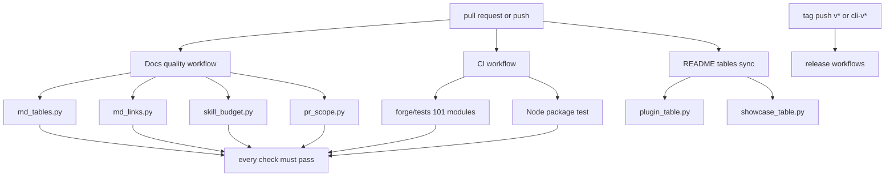
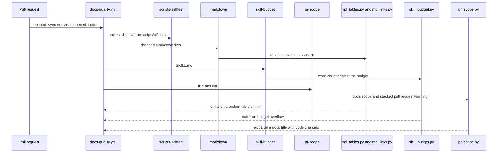
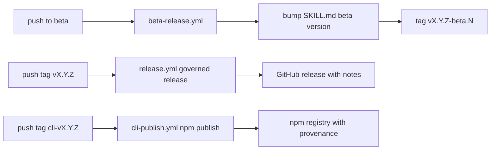

# Testing and Continuous Integration: Proving the Guardrails

The repository checks its own claims. Unit tests prove the forge behavior. Deterministic scripts prove the documents. Workflows run both on every change. This document explains the test suite, the documentation gates, and the release automation.

## Why the checks exist

The product makes strong promises. It claims a resumable state machine, a standard-library core, and documents that render. A promise without a check is only a sentence. The tests turn each promise into a failing build when it breaks. Continuous integration (CI) workflows run both the tests and the document checks on every change.

The checks also protect the agent contract. `SKILL.md` is loaded into every agent context. A silent word growth costs tokens on every run. A broken relative link sends the agent to a missing file. A deleted test module hides a regression.



The diagram shows a layered defense. A failure at any gate fails the workflow. The release workflows do not depend on these checks. They start from a tag, except the beta workflow, which starts from a push to the beta branch and creates its own tag.

## The shape of the test suite

`forge/tests/` holds the unit suite. It has 101 test modules and two support modules. The Python files total 103 and 26,386 lines. Seven fixture files support the tests.

A "fixture" is a fixed input file that a test reads. The fixture does not change between runs, so a failure points at the code and not at the input. The fixtures cover hard cases. `stand_proud_hair_on_head.json` tests hair placement. `knife_review_scene.json` tests a review scene. `visual_hull_two_views.json` tests multi-view geometry. `subdivision_cage.json` tests subdivision. `implicit_character_torso_limb.json` tests an implicit character part. `reference_target_conformance_spec.json` and `reference_target_oracle.ts` test target conformance.

The suite uses the standard library only. It runs with this command.

```bash
# CLAUDE.md:22
python3 -m unittest discover -s forge/tests -p 'test_*.py'
```

The continuous integration workflow uses a shorter form. It runs `python3 -m unittest discover -s forge/tests`, with no `-p` option. The default discovery pattern is `test*.py`. That pattern matches every `test_*.py` module and would also match a name such as `testing.py`. This tree has no `testing.py`, so the shorter form finds the same 101 modules.

This standard-library rule covers the Python checks. The Node package is separate. It has its own test command under npm, and that command does not use the Python standard library rule.

## The suite integrity tests

A test module that fails to import can vanish without a loud error. The discovery loader replaces it with one synthetic failure. A count of thirteen tests can become a count of one. The suite would still report a result.

`forge/tests/test_suite_integrity.py` exists to catch that class of loss.

```python
# forge/tests/test_suite_integrity.py:1-12
"""The suite must not shrink silently.

A module that fails to import does not fail loudly under unittest discovery -- it is replaced by a
single synthetic `_FailedTest`, so N real tests become 1 error and the count drops without anything
naming what went missing. That is not hypothetical here: a module-scope
`from cs2_review import load_review_scene` in forge/stage4_review/append_review.py meant a missing
domain module turned test_structure_gates.py's thirteen base structural-gate tests into one loader
error. Measured: `Ran 13 tests ... OK` became `Ran 1 test ... FAILED (errors=1)`.

These two checks make that class of loss visible on its own terms, rather than as a number a human
has to notice moving.
"""
```

The docstring records a real incident. A domain module was missing. Thirteen structural gate tests became one loader error. The suite still ran, so a simple pass or fail signal did not reveal the loss.

The missing module was `cs2_review`. It is the review-scene loader of the Counter-Strike 2 (CS2) domain plugin. CS2 is a first-person shooter game. The plugin now lives outside the base checkout. The base code no longer imports it. The review tool reads one field directly.

```python
# forge/stage4_review/append_review.py:18-30
def _review_scene_fixture_id(scene_path: Path) -> object:
    """Read the fixture id a review scene declares.

    Deliberately a plain JSON read and one field. This used to import a domain plugin's
    `load_review_scene`, which validated that plugin's own scene schema -- the base pipeline reaching
    into a plugin by module name, and a base run breaking when the plugin was absent. The schema is
    the plugin's business and its own gate already enforces it; all this needs is the id, to check
    that the report being attached and the scene being cited are the same fixture.
    """
    payload = json.loads(scene_path.read_text(encoding="utf-8"))
    if not isinstance(payload, dict):
        raise ValueError(f"--review-scene-json must be a JSON object: {scene_path}")
    return payload.get("fixtureId")
```

The docstring states the rule that the incident taught. The base pipeline must not reach into a plugin by module name. A plugin owns its own schema, and its own gate enforces that schema. The base side needs only the identifier.

The file sets a floor for test collection.

```python
# forge/tests/test_suite_integrity.py:48
COLLECTED_FLOOR = 1192
```

The floor is not a target. The comment above it says to raise the number when tests are added. It says never to lower the number to make a red suite green. The comment also records each deliberate change with an accounting.

The floor is also not the current count. It is the smallest count that the maintainers accept. A local run on this checkout collected 1,416 tests, with 64 skips. A Stage R record quoted in document 15 reports 1,343 tests with 30 skips. The two are different measurements, not the same run. The floor has 224 tests of headroom over 1,192. The comment lists several deliberate raises, such as 1119 to 1165 and 1182 to 1184. Only examples are given here.

The probe runs in a fresh interpreter.

```python
# forge/tests/test_suite_integrity.py:60-73
_PROBE = """
import json, unittest
def leaves(s):
    for x in s:
        if isinstance(x, unittest.TestSuite):
            yield from leaves(x)
        else:
            yield x
tests = list(leaves(unittest.TestLoader().discover("forge/tests", pattern="test_*.py")))
print(json.dumps({
    "collected": len(tests),
    "failed": [t.id() for t in tests if type(t).__name__ == "_FailedTest"],
}))
"""
```

An import world is the set of modules already loaded and the module search path at that moment. A fresh process starts with an empty import world. An in-process second discovery can see a different path state. The comment above the probe records a measured difference: 1097 tests in the first pass and 1124 in the second. The subprocess removes that drift.

The comment explains the drift. Importing a test module runs its module-level `sys.path.insert` calls. The first discovery therefore changes the path that the second discovery sees. A broken module can shadow a real one in the first pass and disappear in the second. The subprocess has one import world and cannot drift in this way.

The discovery result is cached.

The two tests apply the floor and the import check.

```python
# forge/tests/test_suite_integrity.py:91-109
class SuiteIntegrity(unittest.TestCase):
    def test_no_module_fails_to_import(self) -> None:
        broken = _discover()["failed"]
        self.assertEqual(
            broken,
            [],
            "a test module failed to import, so its tests were replaced by one synthetic error "
            "instead of running: " + "; ".join(broken),
        )

    def test_collected_count_has_not_dropped(self) -> None:
        collected = _discover()["collected"]
        self.assertGreaterEqual(
            collected,
            COLLECTED_FLOOR,
            f"the suite collects {collected} tests but the recorded floor is {COLLECTED_FLOOR}. "
            "Tests stopped being collected. Find out which module stopped importing before "
            "touching this number.",
        )
```

The discovery result is cached. The decorator is `lru_cache(maxsize=1)`, so one process spends the cost once.

```python
# forge/tests/test_suite_integrity.py:76-85
@lru_cache(maxsize=1)
def _discover() -> dict:
    # Cached: the subprocess imports every test module, so calling it once per assertion cost ~22s
    # of the suite's wall clock for an identical answer.
    proc = subprocess.run(
        [sys.executable, "-c", _PROBE],
        cwd=REPO_ROOT,
        capture_output=True,
        text=True,
    )
```

Without the cache, every assertion would import every module. The comment records a cost of about 22 seconds per call. A cache means the first test pays that cost and the second test reuses the answer.

**Aha:** A test count is a weak signal by itself. The discovery loader hides an import failure inside a smaller number. The integrity test does not trust the count alone. It asks the loader which modules became synthetic failures. This is the same philosophy as the render gates: measure the thing that can hide, not only the summary number.

## The showcase skip rule

Some tests compile generated TypeScript against a separate showcase checkout. A "checkout" here is a second Git working copy, cloned from the `img2threejs-showcase` repository. TypeScript is a typed language that compiles to JavaScript. The checkout is optional. The tests must not fail on a machine without it.

`forge/tests/showcase_test_support.py` makes the choice explicit.

```python
# forge/tests/showcase_test_support.py:8-19
def showcase_root() -> Path:
    configured_root = os.environ.get("IMG2THREEJS_SHOWCASE_ROOT")
    root = Path(configured_root).expanduser().resolve() if configured_root else None
    if root is not None and (root / "package.json").is_file():
        return root
    message = (
        "showcase TypeScript checks require IMG2THREEJS_SHOWCASE_ROOT pointing to an "
        f"img2threejs-showcase checkout; received {root if root is not None else 'no configuration'}"
    )
    if os.environ.get("IMG2THREEJS_REQUIRE_SHOWCASE") == "1":
        raise RuntimeError(message)
    raise unittest.SkipTest(message)
```

The function needs both a variable and a real package file. A path to an empty directory does not pass.

The second variable changes a skip into a failure. The workflow files in this repository do not set it. A separate continuous integration configuration can set `IMG2THREEJS_REQUIRE_SHOWCASE=1`, and a missing checkout then stops the build. A skipped test is not a passing test.

## The documentation gates

The `scripts/ci/` directory holds small Python programs. Their Python code uses the standard library only. One script also calls the read-only `gh` command for a stacked-pull-request warning. Each program prints a problem list and returns exit code 1 when the list is not empty.



The diagram shows the four jobs, not only the scripts. The jobs are `scripts-selftest`, `markdown`, `skill-budget`, and `pr-scope`. The Markdown job runs two scripts in sequence. The other jobs run one script each.

The jobs run in parallel. A failure in one job fails the workflow. A title edit triggers a new run, because the pull request event includes the `edited` type.

### The shared Markdown scanner

Every Markdown check must ignore fenced code. A link inside a code sample is not a link. A table inside a fence is not a table. `mdcommon.py` supplies one scanner for all checks.

```python
# scripts/ci/mdcommon.py:6-23
FENCE_RE = re.compile(r"^\s{0,3}(`{3,}|~{3,})")


def iter_lines(text):
    """Yield (lineno, line, in_fence). Fence markers themselves count as in_fence."""
    fence = None
    for n, line in enumerate(text.splitlines(), 1):
        m = FENCE_RE.match(line)
        if fence is None:
            if m:
                fence = m.group(1)[0]
                yield n, line, True
                continue
            yield n, line, False
        else:
            yield n, line, True
            if m and m.group(1)[0] == fence and not line.strip().strip(fence):
                fence = None
```

The scanner tracks the fence character, not only a boolean. A tilde fence cannot close a backtick fence. The closing line must contain only fence characters. An indented closing fence still closes the block.

The module also reads changed files from a Git comparison. It supports an explicit file list and an `--all` mode. The comparison is a three-dot diff from the given base to `HEAD`, filtered to added, copied, modified, or renamed Markdown files. Each check uses the same file input, so the workflows stay short.

### The table check

`md_tables.py` catches tables that will not render. It skips fenced blocks, because a table inside a fence is code.

```python
# scripts/ci/md_tables.py:32-52
def check_text(text, name="<text>"):
    problems = []
    lines = list(iter_lines(text))
    for idx, (n, line, fenced) in enumerate(lines):
        if fenced:
            continue
        if line.lstrip().startswith("||"):
            problems.append(f"{name}:{n}: table row starts with '||' (renders as broken table); use a single '|'")
            continue
        if looks_like_delim(line) and idx > 0:
            pn, prev, pf = lines[idx - 1]
            if pf or "|" not in prev:
                continue
            cells = split_row(line)
            bad = [c for c in cells if not DELIM_CELL.match(c)]
            if bad:
                problems.append(f"{name}:{n}: delimiter row has empty/invalid cell(s) {bad!r}")
                continue
            if len(split_row(prev)) != len(cells):
                problems.append(f"{name}:{n}: header has {len(split_row(prev))} columns but delimiter row has {len(cells)}")
    return problems
```

The check has three rules. A row cannot start with two pipes. A delimiter cell cannot be empty or malformed. The header and delimiter must have the same column count. A "delimiter row" is the second row of a table. It holds only pipes, dashes, and optional colons, and it tells Markdown where each column starts. A doubled pipe at the start of a row creates an empty first cell, so the row no longer matches the header. The split respects an escaped pipe, so `\|` stays inside one cell.

### The link check

`md_links.py` checks relative files and heading anchors. It ignores an external scheme and a protocol-relative address.

```python
# scripts/ci/md_links.py:68-92
def check_text(text, path, root="."):
    problems = []
    for n, line, fenced in iter_lines(text):
        if fenced:
            continue
        line = CODE_SPAN_RE.sub("", line)
        for m in LINK_RE.finditer(line):
            target = m.group(1) or m.group(2)
            if re.match(r"^[a-zA-Z][a-zA-Z0-9+.-]*:", target) or target.startswith("//"):
                continue
            file_part, _, frag = target.partition("#")
            file_part = unquote(file_part.split("?")[0])
            if file_part:
                dest = os.path.normpath(os.path.join(os.path.dirname(path), file_part))
                if file_part.startswith("/"):
                    dest = os.path.normpath(os.path.join(root, file_part.lstrip("/")))
                if not os.path.exists(dest):
                    problems.append((path, n, target, f"file not found: {dest}"))
                    continue
            else:
                dest = path
            if frag and dest.endswith(".md") and os.path.isfile(dest):
                if unquote(frag).lower() not in {a.lower() for a in anchors_of(dest)}:
                    problems.append((path, n, target, f"anchor '#{frag}' not found in {dest}"))
    return problems
```

The function removes code spans before it reads links. A link written inside backticks is an example, not a target. The anchor check lowercases both sides, because GitHub treats anchors as case-insensitive.

`anchors_of` builds the anchor set for one file. It reads each heading line, converts the heading text to a slug, and records the slug. A repeated slug gets a numeric suffix. The function also records explicit HyperText Markup Language (HTML) `id` attributes.

```python
# scripts/ci/md_links.py:44-64
def anchors_of(path):
    if path in _anchor_cache:
        return _anchor_cache[path]
    seen, anchors = {}, set()
    try:
        with open(path, encoding="utf-8") as fh:
            text = fh.read()
    except OSError:
        text = ""
    for _, line, fenced in iter_lines(text):
        if fenced:
            continue
        m = HEADING_RE.match(line)
        if m:
            s = slugify(m.group(2))
            k = seen.get(s, 0)
            seen[s] = k + 1
            anchors.add(s if k == 0 else f"{s}-{k}")
        for h in HTML_ID_RE.findall(line):
            anchors.add(h)
    _anchor_cache[path] = anchors
```

The cache is keyed by path. A link check that reads many links to one file therefore parses that file once.

The baseline file is empty on purpose.

```text
# scripts/ci/link-baseline.txt:1-2
# Known-broken relative links tolerated by the gate ("path: target" per line).
# Empty on purpose: main currently has none. Fix links instead of adding here.
```

An empty baseline means the gate has no known exceptions. A contributor could add a line, but the comment tells them to fix the link instead.

### The skill budget

`SKILL.md` is loaded into every agent context. Its word count is a real cost. `skill_budget.py` compares the current count with a configured limit.

```python
# scripts/ci/skill_budget.py:16-30
def word_count(path):
    with open(path, encoding="utf-8") as fh:
        return len(fh.read().split())  # same as `wc -w`


def check(config_path):
    cfg = json.load(open(config_path, encoding="utf-8"))
    path = cfg["file"]  # relative to the repo root (cwd)
    n = word_count(path)
    if n > cfg["max_words"]:
        return [f"{cfg['file']} has {n} words, over the budget of {cfg['max_words']} "
                f"(+{n - cfg['max_words']}). It is loaded into every agent context: trim it, move detail "
                f"to docs/, or raise max_words in {os.path.relpath(config_path)} deliberately and justify it in the PR."]
    print(f"{cfg['file']}: {n} words (budget {cfg['max_words']})")
    return []
```

The error message names the trade-off. The author can trim the file, move detail, or raise the budget. The last option needs a justification in the pull request.

The budget is a small file.

```json
# scripts/ci/skill-budget.json:1-6
{
  "file": "SKILL.md",
  "max_words": 4300,
  "baseline_words": 4102,
  "note": "main count + ~5%. Raise max_words only deliberately, with justification in the PR."
}
```

The budget is 4300 words. The baseline is 4102. The gap is about five percent. A normal edit has room. A large addition needs a deliberate decision.

### The generated README tables

The README contains two generated tables. One lists plugins. The other lists showcase demos. Both have machine-readable markers.

```python
# scripts/ci/plugin_table.py:14-16
CATALOG_URL = "https://raw.githubusercontent.com/img2threejs/img2/main/catalog.json"
START, END = "<!-- plugins:start -->", "<!-- plugins:end -->"
HEADER = ["Plugin / source README", "Adds", "Access", "Install after harness setup"]
```

The plugin table reads a remote catalog. The catalog is a JSON file in the `img2threejs/img2` GitHub repository. It validates every required field before it renders a row.

```python
# scripts/ci/plugin_table.py:19-33
def load_catalog(src):
    if re.match(r"https?://", src):
        with urllib.request.urlopen(src, timeout=30) as r:  # noqa: S310 (fixed https URL)
            data = json.load(r)
    else:
        with open(src, encoding="utf-8") as f:
            data = json.load(f)
    plugins = data.get("plugins") if isinstance(data, dict) else None
    if not isinstance(plugins, list):
        raise ValueError("catalog has no 'plugins' list")
    for p in plugins:
        for k in ("id", "description", "source", "access"):
            if not p.get(k):
                raise ValueError(f"catalog plugin missing '{k}': {p!r}")
    return plugins
```

The loader accepts a URL or a local file. It requires a `plugins` list. It then requires four fields on each plugin: `id`, `description`, `source`, and `access`. A missing field stops the table before a broken row can reach the README.

```python
# scripts/ci/plugin_table.py:36-53
def cell(text):
    return " ".join(str(text).split()).replace("|", "\\|")


def render(plugins):
    rows = [
        "| " + " | ".join(HEADER) + " |",
        "|---|---|---|---|",
    ]
    for p in sorted(plugins, key=lambda p: p["id"]):
        access = p["access"].capitalize()
        if p["access"] != "public":
            access = f"**{access} — authorized Git access required**"
        rows.append(
            f"| [{cell(p['id'])}](https://github.com/{p['source']}) | {cell(p['description'])} "
            f"| {access} | `img2 add {p['id']} --yes` |"
        )
    return "\n".join(rows)
```

The `cell` function collapses whitespace and escapes a pipe. A description with a pipe would otherwise break the table.

The demo table has its own source and its own limit. The source is the gallery's `demos.json` file. The "gallery" is the `img2threejs.io` web site that shows finished models. The file lists every demo, and the site reads the same data.

```python
# scripts/ci/showcase_table.py:17-20
CATALOG_URL = "https://img2threejs.io/demos.json"
START, END = "<!-- showcase:start -->", "<!-- showcase:end -->"
LIMIT = 12
REQUIRED = ("id", "title", "subjectClass", "status", "updatedAt", "url", "sourceUrl")
```

The render keeps only final demos. It sorts by update time and keeps the newest twelve.

```python
# scripts/ci/showcase_table.py:41-54
def render(demos, limit=LIMIT):
    final = [d for d in demos if d["status"] == "final"]
    final.sort(key=lambda d: d["updatedAt"], reverse=True)  # stable: keeps the gallery's order on ties
    rows = [
        "| Demo | Subject | Built with | View | Source |",
        "| --- | --- | --- | --- | --- |",
    ]
    for d in final[:limit]:
        version = f"`{d['version']}`" if d.get("version") else "—"
        rows.append(
            f"| {cell(d['title'])} | {cell(d['subjectClass'])} | {version} "
            f"| [Live]({d['url']}) | [code]({d['sourceUrl']}) |"
        )
    return "\n".join(rows)
```

A work-in-progress demo stays in the gallery. It does not reach the README until its status is final.

### The pull request scope gate

`pr_scope.py` checks the pull request title against the diff. A title with a `docs` type must touch documentation paths only.

```python
# scripts/ci/pr_scope.py:15-17
TYPE_RE = re.compile(r"^\s*([a-zA-Z]+)(\([^)]*\))?(!)?:\s")
DOCS_PATTERNS = ["*.md", "docs/*", "assets/*", ".github/pull_request_template.md",
                 ".github/ISSUE_TEMPLATE/*", ".github/PULL_REQUEST_TEMPLATE/*"]
```

The pattern list is wider than Markdown. A screenshot asset and a pull request template are documentation work.

```python
# scripts/ci/pr_scope.py:29-40
def scope_problems(title, files):
    if commit_type(title) != "docs":
        return []
    bad = [f for f in files if not is_docs_path(f)]
    if not bad:
        return []
    shown = "\n".join(f"  - {f}" for f in bad[:20])
    more = f"\n  ... and {len(bad) - 20} more" if len(bad) > 20 else ""
    return [f"PR title says 'docs' but the diff touches {len(bad)} non-docs file(s) "
            f"(of {len(files)} changed):\n{shown}{more}\n"
            "Allowed for docs PRs: *.md, docs/, assets/, PR/issue templates. "
            "Retitle (feat:/fix:/chore:) or split the non-docs changes into their own PR."]
```

The gate applies only to the `docs` type. A `feat` pull request can touch any path. The gate is not a general reviewer.

The script also warns about stacked pull requests. A "stacked pull request" is one whose branch starts from another open pull request's branch. Its commits then appear in both pull requests. `stacked_overlap` compares this pull request's commits with the commits of every other open pull request. A shared commit produces a warning, not a failure. The script uses a read-only GitHub command-line call. A missing tool skips the warning without a failure.

## The workflow files

Eight workflow files sit in `.github/workflows/`. Some hold one job. The docs quality file holds four. Every job has one responsibility.

The main continuous integration workflow has two jobs. The second job uses the Node Package Manager (npm) for the command-line test.

```yaml
# .github/workflows/ci.yml:11-29
jobs:
  test:
    # ci-workflows v1.1.0
    uses: img2threejs/ci-workflows/.github/workflows/python-ci.yml@dd3a7730cacb6ab00cc853be606ce72de389a54c
    with:
      python-version: "3.10"
      test-command: python3 -m unittest discover -s forge/tests
  cli:
    runs-on: ubuntu-latest
    strategy:
      matrix:
        node-version: [18, 22]
    steps:
      - uses: actions/checkout@v4
      - uses: actions/setup-node@v4
        with:
          node-version: ${{ matrix.node-version }}
      - run: npm test
      - run: npm run package:check
```

The reusable workflow is pinned to a full commit identifier. A branch reference would be mutable. The Python job runs on Python 3.10.

The command-line test runs on Node 18 and Node 22. The package check runs a dry-run pack. The publish workflow sets `node-version: '24'`, so the release build does not use either test version. The workflow file does not state the reason for that difference.

The documentation workflow has four jobs. The Markdown job runs a GitHub Flavored Markdown (GFM) table lint and a link check.

```yaml
# .github/workflows/docs-quality.yml:23-35
  markdown:
    runs-on: ubuntu-latest
    steps:
      - uses: actions/checkout@v4
        with:
          fetch-depth: 0
      - uses: actions/setup-python@v5
        with:
          python-version: "3.10"
      - name: GFM table lint (changed *.md)
        run: python3 scripts/ci/md_tables.py --base "origin/${{ github.base_ref }}"
      - name: Relative links and anchors (changed *.md)
        run: python3 scripts/ci/md_links.py --baseline scripts/ci/link-baseline.txt --base "origin/${{ github.base_ref }}"
```

The full history is needed for the base comparison. The job checks changed files only. It does not rescan the whole repository on every pull request.

A separate job runs the self-tests for the scripts. The command is `python3 -m unittest discover -s scripts/ci/tests`. The single test file is `scripts/ci/tests/test_ci_scripts.py`.

The README sync workflow has two modes. A pull request gets a warning. A scheduled run gets an issue.

```yaml
# .github/workflows/readme-tables-sync.yml:31-37
      - name: Check README tables against their sources
        run: |
          cd scripts/ci
          for t in plugin_table showcase_table; do
            python3 $t.py --readme ../../README.md --check \
              || echo "::warning file=README.md::$t differs from its source; the daily sync opens an issue; run scripts/ci/$t.py --write to refresh it."
          done
```

The loop names both generators. One failure does not stop the other check. The warning does not block a merge, because the table can drift from a remote source beyond the author's control.

The scheduled sync runs at 05:17 each day. It regenerates both tables and compares the README. If the file changed, the job opens one issue or updates the existing issue. The repository does not allow an action to open a pull request directly. The workflow comment states the rule: "Actions may not create PRs in this repo." The comment does not give a reason. A maintainer runs the `--write` option and opens the pull request. A later sync closes the issue when the README matches again.

## The release workflows

Three workflows publish artifacts. Each uses a different tag pattern.



The tag patterns do not overlap. A skill release cannot trigger a package publish. A package release cannot trigger a skill release.

The governed release uses one pinned workflow. A governed release is a release built by that reviewed, pinned workflow. The reference is a full secure hash algorithm (SHA) commit identifier.

```yaml
# .github/workflows/release.yml:10-20
jobs:
  release:
    # ci-workflows v1.1.0. Update this SHA through a reviewed PR.
    uses: img2threejs/ci-workflows/.github/workflows/governed-tag-release.yml@dd3a7730cacb6ab00cc853be606ce72de389a54c
    with:
      tag: ${{ github.ref_name }}
      version-file: SKILL.md
      # v1.4.3 bootstrapped the governed line and is already published; nothing bootstraps again.
      bootstrap-release: false
      # Last published governed release; generated notes start from it.
      previous-governed-tag: "v2.0.0"
```

The version comes from `SKILL.md`. The release notes start at the last governed tag. The bootstrap flag is off, because the line already exists.

A "governed release line" is the sequence of releases that the `governed-tag-release` workflow produces. A "bootstrap release" is the first release in such a sequence. It has no earlier release to compare against, so the workflow treats it in a special way. `v1.4.3` was that first release. `bootstrap-release: false` tells the workflow that the current tag is a normal release in an existing line.

The package workflow grants a token permission at the call site. OpenID Connect (OIDC) supplies the short-lived publishing token.

```yaml
# .github/workflows/cli-publish.yml:17-33
  publish:
    # Reusable workflows CANNOT escalate a caller-level permission block. Grant
    # `id-token: write` here at the reusable-call job level so npm OIDC can mint the
    # publish token. The shared workflow narrows the build job to `contents: read`.
    permissions:
      contents: read
      id-token: write
    uses: img2threejs/ci-workflows/.github/workflows/npm-publish.yml@7ef63107b39f77df3a11062a1a0a2245f500921c
    with:
      tag: ${{ inputs.tag || github.ref_name }}
      tag-prefix: 'cli-v'
      version-file: package.json
      package-directory: '.'
      node-version: '24'
      python-version: '3.10'
      test-command: npm test
      provenance: 'true'
```

"OIDC" means OpenID Connect. The token is short-lived. Provenance records the build source for the registry.

The beta workflow edits the skill version before it tags. The guard stops a loop.

```yaml
# .github/workflows/beta-release.yml:16
    if: "!startsWith(github.event.head_commit.message, 'chore(beta): v')"
```

The workflow pushes a commit with that message. Without the guard, the push would trigger the workflow again. The version bump uses a regular expression on the `SKILL.md` front matter.

"Front matter" is the metadata block at the top of a Markdown file, between two `---` lines. The version lives in that block. The beta script reads the `version:` field. It increments the beta number, or it starts a new beta sequence after a stable version.

The issue triage workflow runs at 09:17 each day. It delegates to a pinned reusable workflow. The local file sets only two inputs. One is the mode: a scheduled run uses `backfill`, and a manual run uses `dry-run` or `backfill`. The other is a rollout date. The behavior of the triage lives in the reusable workflow, so this repository does not define it.

The close policy workflow rejects closing keywords in a pull request body. A "closing keyword" is text such as `Closes #12` or `Fixes #12`. GitHub would close the named issue when the pull request merges. The local file does not explain why the repository rejects this. The effect is that a pull request description cannot close an issue by itself.

## What the checks cannot do

The tests cannot prove visual quality. A unit test can prove that a script returns a reason. It cannot prove that the reason is right for a new image. Agent vision supplies that judgment.

The Markdown gates cannot prove that a sentence is true. They prove that a link resolves and a table renders. The review process supplies the truth check.

The collection floor cannot prove that a test is useful. It proves that the test was collected. A weak test still counts.

The gates also have blind spots. The link check reads relative files only. A remote address can rot without a local failure. The table check does not test rendering in a specific browser.

## The division of labor

The repository repeats one pattern at every layer. A script measures. A person or an agent judges. The test suite measures the forge. The documentation gates measure the text. The release workflow records the result.

This matches the product rule. The rule is one sentence: "Scripts enforce, the model judges." Here "the model" means the host agent, not a trained model inside the repository. The files join the two.

## Cross-references

- [01 Repository anatomy](01-repository-anatomy.md) maps `forge/tests/`, `scripts/ci/`, and `.github/`.
- [03 Skill contract](03-skill-contract.md) explains the `SKILL.md` budget and the showcase variables.
- [04 Forge orchestration](04-forge-orchestration.md) explains the state machine that the tests exercise.
- [10 Grimoire](10-grimoire.md) explains the rubrics that the gates apply.
