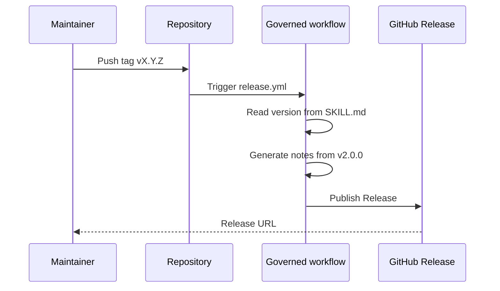
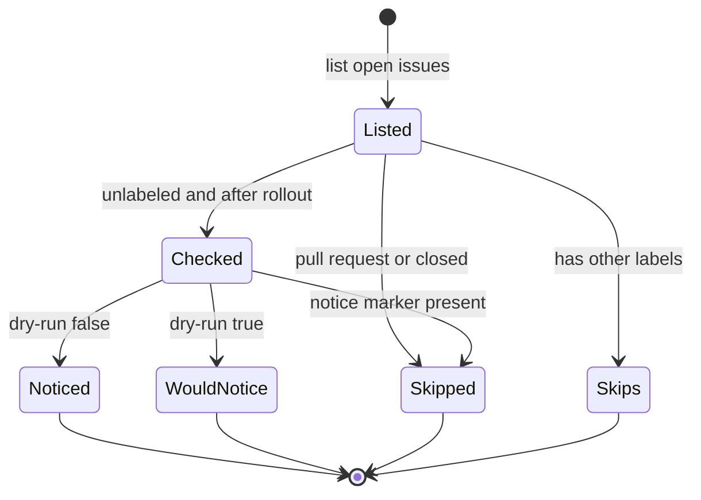

# Release and Operations: Two Version Lines and Governed Automation

This document explains how img2threejs is versioned, tested, published, and maintained. The thesis is: the repository ships two products on two independent version lines, and both are governed by pinned automation. The skill ships from tags on `SKILL.md`. The command-line interface (CLI) ships from tags on `package.json`. The stable line cannot publish by accident.

The source snapshot is commit `0c0c49bc168e648dbaf9c8c080474de0b3a941b6`. The pipeline that the release ships is described in [06 Stage spec](06-stage-spec.md) and [07 Stage build](07-stage-build.md). The review gates that must pass before a fidelity claim are in [08 Stage review](08-stage-review.md).

## 1. The two products

The repository has one Git history and two release channels.

| Product | Version source | Tag form | Publisher |
|---------|---------------|----------|-----------|
| Agent skill | `version:` in `SKILL.md` | `vX.Y.Z` | Governed release workflow |
| npm CLI installer | `version` in `package.json` | `cli-vX.Y.Z` | `cli-publish.yml` |

The package manifest describes the CLI.

```json
# package.json:2-4
  "name": "img2threejs",
  "version": "0.2.0",
  "description": "Install and update the img2threejs skill into agent hosts (Hermes, Claude Code, Codex, OpenCode).",
```

The CLI is an installer. It is not the skill. `CONTRIBUTING.md` states the relation.

```markdown
# CONTRIBUTING.md:47-53
The CLI version in `package.json` is independent of the skill version in `SKILL.md`.
Without `--ref`, `bin/img2threejs.mjs` installs the latest GitHub Release of the skill
(the `releases/latest` redirect), so a skill release needs no CLI republish. The tests
point that lookup at a local server through `IMG2THREEJS_RELEASES_LATEST_URL`; this env
var is a test hook only, not a supported user setting. The npm package ships the
installer only; it fetches the complete skill from GitHub when explicitly invoked.
No install lifecycle hook runs.
```

The separation has a practical result. A skill release does not require an npm publish. A CLI fix does not require a skill release. A user who runs `npx img2threejs install` gets the latest GitHub Release of the skill.

**Aha:** The two version lines are an isolation boundary, not duplication. The installer can receive a fix without a new skill version. The skill can ship without a new package. Each line has its own failure mode, so a fault in one line cannot block the other.

The package scripts list is deliberately short.

```json
# package.json:13-16
  "scripts": {
    "test": "node --test bin/img2threejs.mjs-test.mjs",
    "package:check": "npm pack --dry-run"
  },
```

The `files` array names only `bin/img2threejs.mjs`. The npm package contains the installer, not the forge. The forge is the deterministic Python pipeline; the grimoire is the reference document set. Both arrive through the GitHub Release that the installer fetches.

## 2. The governed skill release

A skill release starts with a tag push.

```yaml
# .github/workflows/release.yml:13-20
    uses: img2threejs/ci-workflows/.github/workflows/governed-tag-release.yml@dd3a7730cacb6ab00cc853be606ce72de389a54c
    with:
      tag: ${{ github.ref_name }}
      version-file: SKILL.md
      # v1.4.3 bootstrapped the governed line and is already published; nothing bootstraps again.
      bootstrap-release: false
      # Last published governed release; generated notes start from it.
      previous-governed-tag: "v2.0.0"
```

The workflow is a reusable workflow from a separate repository. It is pinned to a full commit identifier (a secure hash algorithm, SHA, digest), not a tag. The comment on line 12 of the file says the SHA is updated only through a reviewed pull request.

The reusable workflow reads the version from `SKILL.md`. It generates release notes from the previous governed tag. It writes a GitHub Release.

The caller grants `contents: write` at `.github/workflows/release.yml:6-7`. The permission is at the workflow level because the reusable job needs to write the release.



The trigger is a human action: a tag push. The stable release workflow does not decide the version. It verifies that the tag and `SKILL.md` agree, and it publishes.

The workflow file is 20 lines. That is intentional. A release job that is easy to read is easy to audit.

## 3. Beta tags

The beta line is automatic. A push to the `beta` branch creates the next beta tag.

```yaml
# .github/workflows/beta-release.yml:32-45
          if [[ "$current_version" =~ ^([0-9]+)\.([0-9]+)\.([0-9]+)-beta\.([0-9]+)$ ]]; then
            major="${BASH_REMATCH[1]}"
            minor="${BASH_REMATCH[2]}"
            patch="${BASH_REMATCH[3]}"
            beta_sequence="${BASH_REMATCH[4]}"
            next_version="$major.$minor.$patch-beta.$((beta_sequence + 1))"
          elif [[ "$current_version" =~ ^([0-9]+)\.([0-9]+)\.([0-9]+)$ ]]; then
            major="${BASH_REMATCH[1]}"
            minor="${BASH_REMATCH[2]}"
            next_version="$major.$((minor + 1)).0-beta.1"
          else
            echo "SKILL.md must contain a stable or beta semantic version."
            exit 1
          fi
```

The rule has two cases. A beta version increments its beta sequence. A stable version starts a new minor beta line at beta 1.

The job then writes the version, commits, tags, and pushes.

```yaml
# .github/workflows/beta-release.yml:52-58
          sed -i -E "s/^version: [0-9]+\.[0-9]+\.[0-9]+(-beta\.[0-9]+)?$/version: $next_version/" SKILL.md
          git config user.name "github-actions[bot]"
          git config user.email "41898282+github-actions[bot]@users.noreply.github.com"
          git add SKILL.md
          git commit -m "chore(beta): v$next_version"
          git tag -a "v$next_version" -m "v$next_version"
          git push origin HEAD:beta --follow-tags
```

Two guards prevent a loop. The job skips a commit whose message starts with `chore(beta): v`. The concurrency group `beta-release` does not cancel a running job.

The tag created here is a skill tag. The release workflow then sees `v*` and publishes the governed release. Beta tags and stable tags use the same form, so the version suffix is what marks a beta.

## 4. The CLI publish

The CLI publish has its own tag prefix and its own reusable workflow.

```yaml
# .github/workflows/cli-publish.yml:18-24
    # Reusable workflows CANNOT escalate a caller-level permission block. Grant
    # `id-token: write` here at the reusable-call job level so npm OIDC can mint the
    # publish token. The shared workflow narrows the build job to `contents: read`.
    permissions:
      contents: read
      id-token: write
    uses: img2threejs/ci-workflows/.github/workflows/npm-publish.yml@7ef63107b39f77df3a11062a1a0a2245f500921c
```

The comment records a platform rule that cost time to learn. A reusable workflow cannot raise the permission block of its caller. The `id-token: write` permission must be granted at the calling job. OpenID Connect (OIDC) then mints the npm publish token.

No npm write token is stored in GitHub Actions. `CONTRIBUTING.md` states this directly: no npm write token is passed to Actions.

```yaml
# .github/workflows/cli-publish.yml:25-33
    with:
      tag: ${{ inputs.tag || github.ref_name }}
      tag-prefix: 'cli-v'
      version-file: package.json
      package-directory: '.'
      node-version: '24'
      python-version: '3.10'
      test-command: npm test
      provenance: 'true'
```

The workflow accepts a tag push or a manual dispatch with a tag input. It tests the package, checks that the tag matches `package.json`, and publishes. Provenance is enabled.

The contributor guide records the exact order and the failure modes.

```markdown
# CONTRIBUTING.md:130-132
- Link implementation PRs with `Refs #<number>` or `Related to #<number>`. Do not use closing
  keywords. A maintainer manually closes an issue only after recording the merged PR, verification,
  and closure rationale in a final comment.
```

The no-closing-keyword rule is enforced by a workflow, not only by review.

## 5. The release metadata script

`scripts/release_metadata.py` computes the next version and edits three files: `SKILL.md`, `README.md`, and `CHANGELOG.md`. It is a deterministic helper that a maintainer or a workflow can run before a tag.

The version decision follows the commit messages.

```python
# scripts/release_metadata.py:65-72
def release_level(commits: tuple[str, ...]) -> ReleaseLevel | None:
    if any("BREAKING CHANGE:" in commit or BREAKING_PATTERN.search(commit) for commit in commits):
        return ReleaseLevel.MAJOR
    if any(commit.lstrip().startswith("feat") for commit in commits):
        return ReleaseLevel.MINOR
    if any(commit.lstrip().startswith("fix") for commit in commits):
        return ReleaseLevel.PATCH
    return None
```

A breaking change is a major release. A feature is a minor release. A fix is a patch release. No matching commit returns `None`, and the script reports `{"release": false}`.

The commits arrive as one text file with a record separator.

```python
# scripts/release_metadata.py:82-83
def parse_commits(commits_text: str) -> tuple[str, ...]:
    return tuple(commit.strip() for commit in commits_text.split("\x1e") if commit.strip())
```

The separator is the ASCII record separator, `\x1e`. It is a safe delimiter because it cannot appear in a normal commit message.

The changelog update is positional.

```python
# scripts/release_metadata.py:107-117
def update_changelog(changelog: str, plan: ReleasePlan, release_date: str, repository_url: str) -> str:
    heading = f"## [{plan.next}] — {release_date}\n\n{change_sections(plan.commits)}\n\n"
    heading_match = HEADING_PATTERN.search(changelog)
    if heading_match is None:
        raise ValueError("CHANGELOG.md must contain a version heading")
    with_heading = changelog[:heading_match.start()] + heading + changelog[heading_match.start():]
    reference_match = REFERENCE_PATTERN.search(with_heading)
    if reference_match is None:
        raise ValueError("CHANGELOG.md must contain version reference links")
    reference = f"[{plan.next}]: {repository_url}/compare/v{plan.current}...v{plan.next}\n"
    return with_heading[:reference_match.start()] + reference + with_heading[reference_match.start():]
```

The new section goes before the first existing version heading. The comparison link goes before the first reference link. A missing heading or a missing reference block is an error, not a silent skip.

The apply step is all-or-nothing in one respect: it computes all three updates before it writes any file. A dry run returns the plan and writes nothing.

```python
# scripts/release_metadata.py:143-158
def main() -> int:
    parser = argparse.ArgumentParser(description=__doc__)
    parser.add_argument("--root", type=Path, default=Path.cwd())
    parser.add_argument("--commits-file", type=Path, required=True)
    parser.add_argument("--date", default=date.today().isoformat())
    parser.add_argument("--repository-url", required=True)
    parser.add_argument("--dry-run", action="store_true")
    arguments = parser.parse_args()
    commits = parse_commits(arguments.commits_file.read_text(encoding="utf-8"))
    request = ReleaseRequest(arguments.root, commits, arguments.date, arguments.repository_url, arguments.dry_run)
    plan = apply_release(request)
    if plan is None:
        print(json.dumps({"release": False}))
        return 0
    print(json.dumps({"release": True, "version": str(plan.next), "level": plan.level.value}))
    return 0
```

The output is JavaScript Object Notation (JSON) on standard output. A caller can parse it without reading a human message.

The changelog follows the Keep a Changelog format and Semantic Versioning. The file states both.

```markdown
# CHANGELOG.md:5-6
The format is based on [Keep a Changelog](https://keepachangelog.com/en/1.1.0/),
and this project adheres to [Semantic Versioning](https://semver.org/spec/v2.0.0.html).
```

Each entry is dated and ordered newest first. The compare link at the bottom points to the tag range, so a reader can see every commit between two releases.

## 6. Continuous integration and documentation quality

The main continuous integration (CI) workflow has two jobs. Python tests come from a reusable workflow. The CLI job runs on two Node versions.

```yaml
# .github/workflows/ci.yml:18-29
  cli:
    runs-on: ubuntu-latest
    strategy:
      matrix:
        node-version: [18, 22]
    steps:
      - uses: actions/checkout@v4
      - uses: actions/setup-node@v4
        with:
          node-version: ${{ matrix.node-version }}
      - run: npm test
      - run: npm run package:check
```

Node 18 is the documented minimum. `package.json:10-11` sets `engines.node` to `>=18`. Node 22 is the current line. Testing both catches an accidental use of a newer runtime feature.

The Python job runs `python3 -m unittest discover -s forge/tests` on Python 3.10. The core uses only the standard library, so the test job needs no dependency install.

The documentation workflow adds four checks.

```yaml
# .github/workflows/docs-quality.yml:32-35
      - name: GFM table lint (changed *.md)
        run: python3 scripts/ci/md_tables.py --base "origin/${{ github.base_ref }}"
      - name: Relative links and anchors (changed *.md)
        run: python3 scripts/ci/md_links.py --baseline scripts/ci/link-baseline.txt --base "origin/${{ github.base_ref }}"
```

The table lint checks GitHub Flavored Markdown tables. The link check resolves relative links and anchors. Both scope their work to changed files against the base branch.

Two more jobs protect the skill and the pull request.

```yaml
# .github/workflows/docs-quality.yml:44
      - run: python3 scripts/ci/skill_budget.py
```

The skill budget job checks that `SKILL.md` stays inside its size budget. The pull request scope job compares the pull request title type with the diff and warns about stacked pull requests.

The title reaches the shell through an environment variable, never through direct interpolation. The workflow comment states the reason: a title is untrusted input.

The workflow also runs its own unit tests.

```yaml
# .github/workflows/docs-quality.yml:21
      - run: python3 -m unittest discover -s scripts/ci/tests
```

A check script that is not tested is a check script that can silently stop checking. The four jobs (`scripts-selftest`, `markdown`, `skill-budget`, `pr-scope`) declare no `needs:`, so they run in parallel. A failed self-test does not block the other jobs in the same run.

## 7. Maintenance jobs

### 7.1 Issue triage

The triage workflow runs on a schedule and on demand.

```yaml
# .github/workflows/issue-triage.yml:26-30
  triage:
    uses: img2threejs/ci-workflows/.github/workflows/issue-triage.yml@dd3a7730cacb6ab00cc853be606ce72de389a54c
    with:
      mode: ${{ github.event_name == 'schedule' && 'backfill' || inputs.mode }}
      rollout-after: ${{ github.event_name == 'schedule' && '2026-07-28T00:00:00Z' || '' }}
```

A scheduled run uses `backfill` and applies a rollout date. A manual run uses the chosen mode. The rollout date prevents the job from commenting on very old issues.

The script behind the workflow is standard library only. It marks each new issue once.

```python
# scripts/issue_triage.py:16-26
API_ROOT: Final = "https://api.github.com"
NOTICE_MARKER: Final = "<!-- img2threejs-triage-notice:v1 -->"
QUEUE_LABEL: Final = "triage: needs-review"
TRIAGE_BOT_LOGIN: Final = "github-actions[bot]"
NOTICE: Final = (
    f"{NOTICE_MARKER}\n"
    "Thanks for opening this issue. It is in the maintainer triage queue. "
    "Please add any missing reproduction steps, expected outcome, or scope here; "
    "a label is not a promise of implementation."
)
TRANSIENT_STATUSES: Final = frozenset({429, 500, 502, 503, 504})
```

The marker is an HTML comment. It is invisible to a reader and stable for a search. The notice says that a label is not a promise of implementation. That sentence is a policy, not a courtesy.

The queue label must exist before the run.

```python
# scripts/issue_triage.py:67-69
class MissingQueueLabelError(RuntimeError):
    def __init__(self) -> None:
        super().__init__(f"Required label is missing: {QUEUE_LABEL}")
```

A missing label stops the run. The alternative is a job that adds a label the repository does not have, and the application programming interface (API) call would fail later with a less clear message.

The retry policy is bounded.

```python
# scripts/issue_triage.py:87-95
    def queue_label_exists(self) -> bool:
        label = urllib.parse.quote(QUEUE_LABEL, safe="")
        try:
            self._request(f"/repos/{self._repository}/labels/{label}")
        except urllib.error.HTTPError as error:
            if error.code == 404:
                return False
            raise
        return True
```

The client retries only transient statuses: 429 and the 5xx family. It tries three times with exponential backoff. A permanent error is raised at once.

The comment creation has one special case. If the bot is unsure whether a notice exists, it checks for the marker before a second attempt. That prevents a duplicate comment after a network failure whose write actually succeeded.

The state machine is simple.



The dry-run path reports candidates and writes nothing. The scheduled path uses backfill, which applies the same rules to historical issues.

### 7.2 Close policy

The close policy is one job with no steps of its own.

```yaml
# .github/workflows/pr-issue-close-policy.yml:11-12
  reject-closing-keywords:
    uses: img2threejs/ci-workflows/.github/workflows/pr-close-policy.yml@dd3a7730cacb6ab00cc853be606ce72de389a54c
```

The policy rejects a pull request that uses a closing keyword. The contributor guide gives the alternative: `Refs #<number>` or `Related to #<number>`. A maintainer closes the issue manually after recording the merge and the verification.

This rule keeps the issue history honest. An issue that closes itself on a merge has no final comment that explains the decision.

### 7.3 README table sync

Two generated tables in the README have external sources. The plugin table comes from the plugin catalog. The demo table comes from the gallery's `demos.json`.

On a pull request, the job warns and never fails.

```yaml
# .github/workflows/readme-tables-sync.yml:22-24
  drift-warning:
    # Non-blocking: reports drift as a warning annotation, never fails the PR.
    if: github.event_name == 'pull_request'
```

On a schedule, the job regenerates both tables and opens or updates one issue. The comment records a platform limit: Actions may not create pull requests in this repository. The issue is the notification. A maintainer runs `--write` and opens the pull request.

One unreachable source must not block the other table. The job records each failure, finishes, and fails at the end.

## 8. Operator scripts

### 8.1 Character audit

`scripts/character_audit.sh` runs three named geometry gates against a live model and writes a baseline. The gates are self-intersection, pairwise penetration, and UV unwrap.

```bash
# scripts/character_audit.sh:44-58
# Every gate's exit code is captured rather than allowed to abort the run. A failing gate is the
# expected outcome on a model with defects, and stopping at the first one would hide the rest --
# which is the opposite of what an audit is for.
declare -A STATUS

run_gate() {
  local name="$1"; shift
  echo
  echo "== $name =="
  "$@" --json > "$OUT/$name.json" 2> "$OUT/$name.err"
  STATUS[$name]=$?
  # Human-readable copy alongside the JSON, since the JSON is for diffing and this is for reading.
  "$@" > "$OUT/$name.txt" 2>/dev/null
  head -20 "$OUT/$name.txt" 2>/dev/null || cat "$OUT/$name.err"
}
```

The script captures a failure instead of stopping. An audit that stops at the first defect reports one defect. An audit that continues reports all of them.

The gates are the same Python modules that Stage 4 uses.

```bash
# scripts/character_audit.sh:60-62
run_gate self-intersection python3 "$ROOT/forge/stage4_review/self_intersection.py" "$MESHES"
run_gate penetration       python3 "$ROOT/forge/stage4_review/pairwise_penetration.py" "$MESHES" "${PENETRATION_ARGS[@]+"${PENETRATION_ARGS[@]}"}"
run_gate uv                python3 "$ROOT/forge/stage3_build/uv_unwrap.py" "$MESHES"
```

The penetration gate accepts an allow list. Parts that should share space, such as an ear root in a skull, are contact, not defects. A gate without an exemption list flags them forever until someone disables the gate.

The script ends with a warning about zero counts.

```bash
# scripts/character_audit.sh:78-79
echo "read sampledVertexCount and skippedMeshes before trusting any clean verdict:"
echo "a zero because the defect is gone and a zero because the check never ran look identical."
```

This is the same distinction that the Stage 4 document makes. A skipped check and a clean check have the same zero. Only the report fields separate them.

### 8.2 Browser capture

`scripts/capture_threejs_playwright.py` is an optional adapter for the render bridge. Its docstring states the contract and the failure mode.

```python
# scripts/capture_threejs_playwright.py:4-11
The target page must expose:

    window.__IMG2THREEJS_READY__ = true
    window.__IMG2THREEJS_CAPTURE__.setCamera(cameraSpec)

The adapter captures the actual browser canvas/viewport. It never renders a
replacement scene in Python and fails closed when the runtime contract is absent.
"""
```

The adapter fails closed. If Playwright is missing, it raises a runtime error with an install instruction.

```python
# scripts/capture_threejs_playwright.py:39-43
        raise RuntimeError(
            "Playwright is not installed. Install it in an isolated environment "
            "(`python3 -m pip install playwright` and `playwright install chromium`) "
            "or use the existing Chrome DevTools MCP adapter."
        ) from exc
```

A missing adapter does not produce an empty folder and a passing log. It stops. That is the same fail-closed habit that the forge uses when a quality gate blocks generation.

The adapter reads the viewport, the device pixel ratio, and the runtime URL from the manifest. It waits for the ready flag. It then calls the page's own capture function. The scene stays in the browser. Python only records the result.

## 9. Failure and recovery

| Failure | Visible result | Recovery |
|---------|----------------|----------|
| Tag does not match `SKILL.md` | Governed workflow fails | Fix the version, move the tag |
| Beta tag already exists | Beta job exits 1 | Delete the stale tag or bump again |
| npm tag does not match `package.json` | CLI publish fails | Fix the version, retag |
| Missing `id-token: write` | npm authentication fails | Grant it at the calling job |
| Missing triage label | `MissingQueueLabelError` | Create the label, rerun |
| README table drift | Issue or warning | Run `--write`, open a pull request |
| Playwright absent | Runtime error | Install it, or use Chrome DevTools |
| A gate cannot run | No verdict is recorded | Fix the environment; a missing verdict is not a pass |

The common rule is that a failure is named. A release job does not publish a mismatched version. A triage job does not comment twice. An audit does not hide the second defect. A capture does not invent a screenshot.

## 10. Summary

The repository ships a skill and a CLI on independent version lines. The skill line is tag-driven and governed by a pinned reusable workflow. The beta branch increments itself and guards against a loop. The CLI line tests the package, checks the tag, and publishes through OIDC provenance.

The maintenance layer is deterministic and standard library only. It checks documentation tables and links, queues new issues once, rejects closing keywords, and reports README drift as an issue. Operator scripts capture a baseline and a browser image, and both fail closed.

The limits that these operations cannot remove are collected in [15 Limits and findings](15-limits-and-findings.md). The optional tools that the release does not install are described in [11 Integrations](11-integrations.md).
