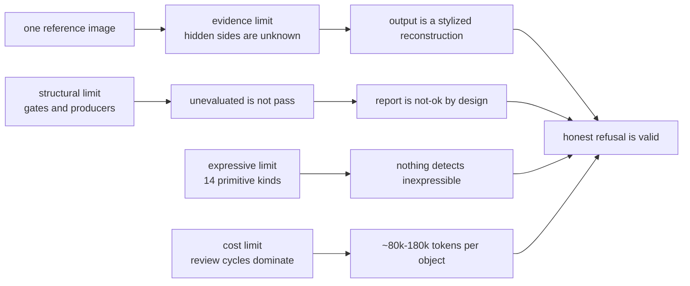
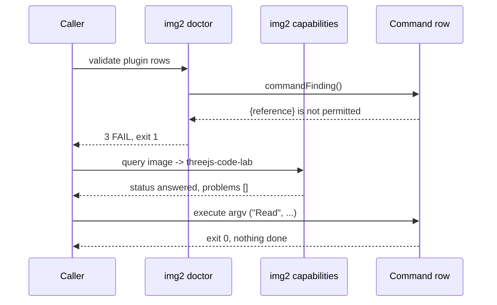

The repository documents its own limits instead of hiding them. The limits are evidence limits from one image, structural limits from gates that do not run, expressive limits from a fixed primitive vocabulary, and cost limits from review cycles. The findings are sharper than the limits. The harness is the `img2` command-line tool that installs domain plugins and answers plugin queries. It does not install the base skill; `bin/img2threejs.mjs` does that. A lab experiment found a harness path that reports `answered` with exit code 0 while the command it returns cannot work. That is not a limit. It is a defect, and it is the most important fact in this document.

**Aha:** The honest limit says "this cannot be resolved from this image". The dangerous failure says "answered" and returns an unusable command. The first keeps trust. The second destroys it, because the caller has no signal to check.

This document reads the public statements of limits and the lab record. It also reads the Stage R backlog and test plan, the TRELLIS.2 research note, the token cost model, and the emission target socket. It separates a measured fact from an estimate. It also records documentation drift that the other documents in this set found.

## 1. The evidence limit: one image has one side

The top-level README states the limit without hedging.

```markdown
# README.md:422-424
## Honesty about limits

A single image cannot reveal hidden sides or guarantee exact geometry. The skill states plainly when output is approximate, stylized, or low-poly, and infers unseen faces by mirroring visible ones rather than faking confidence. It is strong for hard-surface objects; characters are stylized reconstructions, not photoreal likeness. "This cannot reach the requested fidelity from this image" is a valid, expected result.
```

Three claims are in that paragraph. First, unseen geometry is unknown. Second, the pipeline mirrors visible faces instead of inventing confidence. Third, a refusal is a valid result.

The mirroring rule is the weakest of the three. A mirrored face is a guess with a known symmetry assumption. The assumption is often false for a real object. A scratched left side does not imply a scratched right side. A hidden clasp does not imply a matching clasp. The pipeline still uses the guess because an empty back face is worse than a plausible one. The document set treats this as a design choice, not a solved problem. See [05 Stage 1 intake](05-stage-intake.md) for the admission checks that can reject a reference before generation starts.

The third claim is stronger. A refusal is part of the contract. The strict-quality gate can stop code generation when the spec is underspecified. Stage 4 can return `request-input` or `stop`. See [08 Stage 4 review](08-stage-review.md) for the five decisions. A pipeline that can say "no" is more trustworthy than one that always returns a model.

The README also limits the character track. Characters are "stylized reconstructions, not photoreal likeness". The rig work does not remove this limit. A skeleton makes a character animatable. It does not add evidence that the photograph never held.

## 2. The structural limit: a gate that nothing invokes

The Stage R backlog opens with the most reusable lesson in the repository.

```markdown
# docs/STAGE_R_BACKLOG.md:23-32
Every `forge/stage5_rig/` module was callable and nothing in the workflow ever told anyone to call
one. `next.py` walks the checklist, so a gate absent from the checklist never runs — and a build
completes green having checked nothing.

**This was then reproduced while fixing it.** Nine rig steps were added to the checklist and
`next_entry()` was never taught to dispatch scope `"rig"`; the steps sat pending forever while the
build reported `complete`. Sixteen tests passed because they asserted the *contents* of the list.

> **Presence in a list is not reachability. Assert the behaviour, not the data structure.**
> Mutation-check it: break the dispatch on purpose and confirm a test goes red.
```

The mechanism is simple and general. `next.py` walks a checklist. A gate that is not on the checklist never runs. A build can then report `complete` after checking nothing. The bug was reproduced during the repair. Nine steps were added to the list, but `next_entry()` did not dispatch the scope `"rig"`. The steps stayed pending. The build still reported `complete`. Sixteen tests passed because they asserted the list contents, not the dispatch behaviour.

This is a failure of reachability, not a failure of the gate logic. The gate code was correct. Nothing called it. The lesson applies to every stage, not only Stage 5. A validation function that no workflow step names is documentation, not a control.

The second structural principle is a status rule.

```markdown
# docs/STAGE_R_BACKLOG.md:34-38
### `unevaluated` is not `pass`

A check whose input is absent must say so and must make the report not-ok. Four gates are in that
state today, which is why `rig_gates.py` cannot return green yet. That is the system being honest,
and the moment it is softened to "assume pass when unmeasured" the whole suite becomes decorative.
```

The test plan gives the same rule a vocabulary.

```markdown
# docs/STAGE_R_TEST_PLAN.md:33-37
| Status | Meaning |
|---|---|
| `pass` | The check ran, on real data, and the value was inside tolerance. |
| `fail` | The check ran and the value was outside tolerance. A real defect, or a real change in the input. |
| `unevaluated` | **Nothing measured it. This is not a pass.** It makes the whole report not-ok by design. |
```

The third status is the important one. A missing input does not produce a pass. It produces `unevaluated`, and the report becomes not-ok. This is a fail-closed design.

`G1` to `G12` live in `forge/stage5_rig/rig_gates.py` and run on a rig payload. They are not Stage 4 review gates and not the eight Stage 3 build passes. A normal code-only run does not execute them; the Stage R test plan drives them. `validate_rig_payload.py` checks structure before the gates run; the twelve gates test behaviour on that payload.

`rig_gates.py` cannot return green today because four gates have no producer. The test plan names them.

```markdown
# docs/STAGE_R_TEST_PLAN.md:46-57
| Gate | Catches | Input producer |
|---|---|---|
| `G1` | clips that play silently | **none yet** — needs `runGateR1()` exposed via a CLI |
| `G2` | bad indices, NaN weights | host harness |
| `G3` | pose bleed between clips | **none yet** |
| `G4` `G5` | weight sums, index range | `export_mesh_buffers.mjs` |
| `G6` | a part left in bind pose | **none yet** |
| `G7` | mirrored rig | computed in Python |
| `G8` `G9` | skating gait, joint scale | `glb_rig_reference.py --sample-clips` |
| `G10` | tearing under motion | **none yet** — needs a 176-frame sweep |
| `G11` | **rigging that rewrites geometry** | `export_mesh_buffers.mjs` |
| `G12` | clips addressing a different skeleton | `glb_rig_reference.py` |
```

`G1`, `G3`, `G6`, and `G10` have no producer. Four gates cannot pass.

```markdown
# docs/STAGE_R_TEST_PLAN.md:43-44
`rig_gates.py` **will report not-ok on any run today.** That is the system telling the truth, not a
test failure. Judge the run on the other eight gates plus the mesh-parity verdict.
```

The design is consistent. A missing producer is not a reason to weaken the gate. It is a reason to build the producer. The backlog gives those producers their own section, and the verification tasks come first.

```markdown
# docs/STAGE_R_BACKLOG.md:83-85
Everything built so far is machinery to catch a bug **nobody has seen**. The three mesh-damage
mechanisms were inferred by reading code. Building more gates before observing the failure repeats
that mistake at higher cost.
```

The rig machinery was built to catch a bug that no one had reproduced. The backlog's table names two symptom pairs and four candidate causes, and says they came from reading code. The backlog puts verification before more gates, because more gates without a reproduced failure repeat the same error at a higher cost.



## 3. The measurement limit: unit tests are not a pipeline run

The test plan states the gap between tests and evidence.

```markdown
# docs/STAGE_R_TEST_PLAN.md:11-15
**Status of what it tests:** the Stage R modules are unit-tested (1343 tests, `OK (skipped=30)`) and
several were exercised on real data — `glb_rig_reference.py` on a real GLB, `mesh_parity` through a
live browser round-trip. But **the pipeline has never been run end-to-end on a real character, and
nothing has been rendered.** The three mesh-damage mechanisms behind this work were inferred by
reading code, not by reproducing the failure.
```

The numbers are exact. The suite has 1343 tests. Thirty tests are skipped. The suite result is `OK`. Two modules ran on real data: `glb_rig_reference.py` on a GLB (binary Graphics Library Transmission Format) file, and `mesh_parity` through a live browser round trip. The 1,343/30 figure is the Stage R test plan's recorded run. The 1,416/64 figure is the whole base-suite run recorded in [13 Testing and CI](13-testing-and-ci.md). The two differ because they cover different test sets.

The gap is also exact. The pipeline never ran end to end on a real character. Nothing was rendered. The backlog names two symptom pairs and four candidate causes, and says they came from reading code. They were not reproduced. The snapshot records the plan; it does not add a run.

A green unit suite proves that units agree with their tests. It does not prove that the pipeline produces a correct mesh. The test plan makes this distinction the centre of its method. It defines Phase 0 as reproduce-and-record the damage before any fix. It says Phase 0 is not optional, because a later green run would be unfalsifiable. A green run after a skipped Phase 0 proves that the gates agree with each other. It does not prove that the mesh stopped tearing.

The plan also states that a saved artifact is the result, not the terminal output. A terminal "pass" is easy to lose. A dated recording and a baseline manifest are evidence.

## 4. The lab finding: success reported for a command that cannot work

`LAB-FINDINGS.md` records the first lab experiment. The full pipeline has 27 steps. The experiment encoded three intake steps as plugin rows. The rows copied the product commands without adaptation. The goal was to see what the harness refuses.

The first finding was predicted. The placeholder set rejected every row. `img2 doctor` returned three failures with exit code 1, one per row. The message named `{reference}` as an unrecognised placeholder. Only `{plugin_dir}`, `{workspace}`, and `{image}` were permitted. That message describes the doctor check on the lab rows. The emission socket records a per-consumer vocabulary and lists `{spec}` for target step files. The harness source is not in this repository, so the exact doctor set for target steps is not settled here.

The second finding was not predicted.

```markdown
# LAB-FINDINGS.md:40-43
{ "status": "answered", "problems": [],
  "providers": [ { "steps": [
    { "id": "image-analysis",
      "argv": ["Read", "grimoire/intake/image_analysis.md", "and", "analyze", "{reference}"] } … ] } ] }
```

The `img2 capabilities` query returned this object at the same moment that `doctor` failed all three rows. The status was `answered`. The problem list was empty. The returned argument vector still held the unsubstituted `{reference}`. Its first element was `Read`, which is an instruction to a model, not a program.

On macOS the result is worse.

```markdown
# LAB-FINDINGS.md:56-61
$ python3 -c "import shutil; print(shutil.which('Read'))"
/usr/bin/Read                     # i.e. /usr/bin/read
$ Read grimoire/intake/image_analysis.md and analyze '{reference}'
/usr/bin/Read: line 4: read: `grimoire/...': not a valid identifier
$ echo $?
0
```

The file system is case-insensitive. `Read` resolves to `/usr/bin/read`, a shell built-in wrapper. The command fails inside the script. The shell still returns 0. A caller that branches on exit code concludes that the step succeeded.

The contract tells callers to branch on `status` and never on standard error. A caller that follows the contract executes this command. The command does nothing. The caller records success.

The root cause is a validation split.

```markdown
# LAB-FINDINGS.md:68-71
Root cause: `img2 doctor` and `img2 capabilities` apply different validation. Doctor runs
`commandFinding`; the query does not consult it. Reviewer C named exactly this gap during review
("argv[0] resolvability … belongs in problems[] rather than as a runtime surprise") and it was not
implemented — recorded then as a missing requirement, demonstrated now as a live defect.
```

`cmdCapabilities` does not run the checks that `doctor` runs. The review named the missing check. The check was not implemented. The lab demonstrated the defect on a shipped version.

The required repair is stated in the same file. `cmdCapabilities` must run the same static checks on every row that it returns. A row that fails a check belongs in `problems[]`, never in `providers[]`. If no clean provider remains, the status is `data-fault`, not `answered`.



This is the central finding of the whole document. The system has a strong fail-closed design in the gates. It has a fail-open path in the capability query. The path is reachable today. It needs no schema decision. The repair is small: reuse the doctor checks in the query.

The third lab finding is a measured field count.

```markdown
# LAB-FINDINGS.md:80-87
On three rows, only two of the four predicted fields are actually forced:

| Predicted field | Forced by these 3 rows? | Evidence |
|---|---|---|
| `actor: agent \| tool` | **Yes** | 2 of 3 rows are instructions to the model, not programs. Without it the harness cannot know not to exec them. |
| `mustRead: [paths]` | **Yes** | `grimoire/intake/image_analysis.md` is the actual payload of those rows; nothing else can carry it. |
| `when` / `profiles` | Not yet | The CS2/character splice lives in later steps (`workflow_state.py:110-118`). |
| `config` | Not yet | Thresholds appear in review/build steps, not intake. |
```

CS2 (a game-specific domain profile) and the character track splice later in the workflow. The `when` and `config` fields are not forced by intake rows. Two of the four predicted fields are forced. The experiment does not show that the other two are unnecessary. It shows that three intake rows cannot prove them.

```markdown
# LAB-FINDINGS.md:95-97
The gate was: 0-1 new fields → proceed incrementally; all 4 plus harness changes → answer is "not
yet". The measured result is **2 fields forced on the easiest 3 of 27 rows, a placeholder policy
change, and a harness defect that must be fixed regardless**. That is the "not yet" side of the gate.
```

The result is "not yet". The experiment also does not test geometry quality.

```markdown
# LAB-FINDINGS.md:108-111
## What this experiment did not test

Whether the pipeline still produces good geometry. These are structural checks only. No reconstruction
was run, no render captured, no baseline recorded — that debt is unchanged.
```

That sentence limits the claim. The lab tested structure. It did not test output quality.

## 5. The expressive limit: fifteen primitive kinds

The research note compares the pipeline with TRELLIS.2.

```markdown
# docs/RESEARCH_TRELLIS2_TO_IMG2THREEJS.md:22-37
The two systems fail in opposite directions.

- **TRELLIS.2 has maximal representational capacity and zero semantics.** Its output is one
  `MeshWithVoxel`. No parts, no pivots, no sockets, no skeleton. Any shape is representable; nothing
  is editable.
- **img2threejs has maximal semantics and minimal representational capacity.** Its output is a
  `THREE.Group` of named parts drawn from **14 primitive kinds**
  (`VALID_PRIMITIVES` in `validate_sculpt_spec.py:38`). Everything is editable; a large class of
  shapes is not representable — and, critically, **nothing in the pipeline detects
  "inexpressible"**. It only detects "this render scored low", which is a different fact.

So the fidelity gap is not primarily a review-loop problem. It is:

1. a **representation-expressiveness** problem (§2.1, §4), and
2. a **correction-granularity** problem — the loop re-decides at whole-object fidelity and
   regenerates the whole factory (§6).
```

Every part has a name, a transform, a pivot, sockets, colliders, material references, and an articulation binding. The semantic layer is also the ceiling. The quoted research note says fourteen and cites line 38. The pinned set at `validate_sculpt_spec.py:43-59` has fifteen members: box, sphere, ellipsoid, cylinder, cone, capsule, torus, tube, lathe, extrude, ground-blade, curve-sweep, tapered-sweep, plane-card, and instanced-cluster. A shape outside those kinds cannot be expressed.

The critical sentence is the detection gap. The pipeline does not detect "inexpressible". It detects "this render scored low". These are different facts. A low score can mean a bad camera, a bad material, a bad proportion, or an impossible shape.

The fidelity gap is not mainly a review-loop problem. It is a representation problem and a correction-granularity problem. More review cycles do not add a missing primitive.

The transferable lesson is conditional. The note does not say "adopt TRELLIS.2". It says borrow the representation strategy and the stage ordering. The dense field is a measuring and fitting target, never the output. The Group stays the product.

The note also carries four measurement rules from a showcase build. Each rule started as a confident false finding.

```markdown
# docs/RESEARCH_TRELLIS2_TO_IMG2THREEJS.md:392-393
These belong in the skill because each one produced a *confident false finding* before it was
understood, and each generalises past the dragon.
```

The first rule is about the visible footprint.

```markdown
# docs/RESEARCH_TRELLIS2_TO_IMG2THREEJS.md:395-401
1. **Measure the visible footprint via an object-ID pass — not an isolation render, and not
   full-minus-hidden.** An isolation render shows geometry the reference cannot see: the dragon's
   wings measured 0.4362 dark-share against a reference 0.2240 ("the spars are twice too thick"), and
   at the *original* radii, measured correctly, 0.1891 against 0.2240 — inside tolerance. The spars
   were never too thick. The obvious fix, full-frame minus component-hidden-frame, is also wrong:
   71% of that pixel difference is indirect-lighting change, not occlusion. Only a flat-colour ID
   pass with depth testing gives the true frontmost footprint.
```

The numbers are concrete. The isolation render measured 0.4362 against a reference of 0.2240. That suggested spars that were twice too thick. The original radii, measured correctly, gave 0.1891 against 0.2240. The value was inside tolerance. The spars were never too thick. The measurement method created the finding.

The second rule is about normalisation. Min/max bounding-box normalisation cost about 0.10 intersection over union (IoU) per view. It also reversed a width finding: 5.34 times "too wide" was actually 0.85 times narrower. The tell was incoherence across five views. The min/max ratios read 5.34, 1.39, 2.70, 2.56, and 0.26. The robust ratios read 0.85, 0.50, 0.59, 0.59, and 0.60.

The third rule is about convergence. Every per-view floor in the showcase came from a clamped search. The worst view was chased for about 50 iterations at a locked 0.4838. It read 0.5002 when converged, and 0.6112 under robust normalisation, with no geometry change. A ratchet anchored to a search boundary is anchored to the boundary, not to an optimum.

The fourth rule is about disagreement. A new feature metric improved when the spars were thinned. The trusted silhouette ratchet lost 0.0075 IoU on one view. That is twice its tolerance. The ratchet was correct. A new metric must not override a regression in a metric that is already trusted.

The note adds one open discriminator. Part inflation and a camera field-of-view mismatch produce the same signature: "shift down and magnify". They separate on locality. Part inflation is local. Excluding the suspect part collapses `dy` toward zero and leaves `scale` alone. A perspective mismatch is global. `dy` tracks the view angle and persists with all parts included.

## 6. The economic limit: review cycles dominate

The token model opens with a disclaimer.

```markdown
# docs/TOKEN_COST.md:3
The numbers below are engineering estimates, not a measured benchmark. They are order-of-magnitude figures anchored to one reference build (a rounded-bevel loot chest: gradient enamel, gold corner brackets, an emissive emblem, resolved in about six render-review cycles). Actual cost varies with the model tier, image resolution, object complexity, and — above all — how many review cycles a subject needs. Treat them as a cost model, not a guarantee.
```

The estimate rests on one build. The build is a loot chest with gradient enamel, gold corner brackets, and an emissive emblem. It took about six review cycles. The disclaimer says "not a measured benchmark". A measured benchmark is planned for version 1.5. The roadmap says version 1.5 shipped on 2026-08-12, and this document set found no measured benchmark in the repository. The plan and the release record disagree.

The per-object estimate is a range.

```markdown
# docs/TOKEN_COST.md:9-16
| Stage | Est. model tokens | Notes |
|---|---|---|
| Deterministic scripts (probe, assessment, spec, validate, generate, sync) | ~2k-5k total | Run as subprocesses. This is the work that is near-free. |
| Read the reference image | <1k | A small reference; higher-res costs more. |
| Author assessment + detail inventory + spec JSON | ~15k-25k | The spec is the largest text artifact. |
| Write and edit the Three.js factory | ~20k-45k | Scales with part count and edit iterations. |
| Render-review loop (5-8 cycles) | ~30k-70k | The dominant cost; scales linearly with cycles. |
| **Total, one object** | **~80k-180k** | Simple/few-cycles to complex/many-cycles. |
```

The deterministic scripts cost about 2,000 to 5,000 tokens. That is the near-free work. The render-review loop costs about 30,000 to 70,000 tokens. It is the dominant cost, and it scales linearly with the number of cycles. The total for one object is about 80,000 to 180,000 tokens.

A character costs more. The estimate is about 150,000 to 350,000 tokens (`docs/TOKEN_COST.md:30`, an estimate). The reason is more review cycles plus landmark and projection checks.

The model states the lever.

```markdown
# docs/TOKEN_COST.md:36-37
- The gates are the savings mechanism: strict-quality blocks codegen on an underspecified spec, and the detail-inventory gate blocks it on missing detail — each avoided bad render saves roughly one full cycle (~10k-20k tokens).
- The single biggest lever on cost is the review-cycle count. A well-formed spec up front is worth more tokens than any micro-optimization downstream.
```

The economic limit and the structural limit meet here. A gate that runs early prevents a full cycle. A gate that never runs saves nothing. A gate that returns `unevaluated` prevents a false pass, but it also stops the build until a producer exists.

The estimate is not a measurement. A cost model can guide a decision. It cannot prove a budget.

## 7. The roadmap limit: what is not shipped and what never will be

The roadmap separates shipped work from tracked work.

```markdown
# ROADMAP.md:137-141
**Not shipped in v1.5**, and tracked rather than implied: the `hairProfile` → `componentTree`
compiler, IK (`BoneSpec.ik` exists and nothing populates it), pose-sweep gating, blendshape-driven
expression work beyond the morph-target emitter, and clothing. Hair dynamics and strand-level hair
are out of scope permanently — a single image carries no motion, and this pipeline emits no textures
or alpha.
```

Five items are tracked but not shipped. The `hairProfile` to `componentTree` compiler is absent. Inverse kinematics (IK) is absent: `BoneSpec.ik` exists and nothing populates it. Pose-sweep gating is absent. Blendshape expression work beyond the morph-target emitter is absent. Clothing is absent.

Two items are out of scope permanently. Hair dynamics and strand-level hair need motion and textures. One image has no motion. The pipeline emits no textures or alpha. The permanent exclusion is a logical consequence, not a scheduling choice.

The roadmap continues past version 1.5. Version 2.2 adds environments and multi-object scenes. Version 2.3 adds engine exporters and level-of-detail generation. Version 2.4 adds automatic rigging and facial rigs. Version 3.0 adds multi-view reconstruction. Multi-view reconstruction is the only listed item that removes the single-image blind-side limit.

The roadmap is a statement of intent. It is not evidence that the work exists. This document set treats it as a plan, not a result.

## 8. The emission socket: every failure path has a name

The emission target socket is the terminal export point. The default output stays procedural Three.js TypeScript. An exporter is an installed plugin, selected with `--target`.

```markdown
# docs/EMISSION_TARGET_SOCKET.md:3-6
The pipeline's terminal export point. The default output stays byte-identical procedural Three.js
TypeScript; an exporter (GLB, FBX, …) is an installed plugin selected explicitly with `--target` —
zero base changes, proven continuously by the sculpt-echo round-trip test's clean-`git diff`
assertion. Contract text: `img2` PLUGIN_CONTRACT draft sections and plugin-wiki Scenario 12.
```

The zero-base-change claim is tested by `test_install_doctor_resolve_target_round_trips_with_a_clean_base_tree` in `forge/tests/test_sculpt_echo_roundtrip.py`. It compares the base repository's `git status --porcelain` output before and after the run. The default path writes nothing and reads no registry. A malformed `plugins.json` cannot break the default path.

The socket also closes a vocabulary error.

```markdown
# docs/EMISSION_TARGET_SOCKET.md:66-76
Placeholder vocabularies are closed **per consumer**, matching what each renderer actually
substitutes — one uniform set was never true:

| file | vocabulary | renderer |
|---|---|---|
| `steps.json` / `gates.json` | `{plugin_dir}` `{workspace}` `{image}` `{spec}` | harness-executed argv |
| `domain.json` | `{plugin_dir}` `{reference}` `{spec}` `{pass_id}` | checklist `.format()` — `{workspace}`/`{image}` there would `KeyError` |

Shell-metacharacter hardening applies to command rows (leading token is a path or known
interpreter); prose instruction rows — which the cookbook's own examples contain, parentheses and
all — get vocabulary checks only.
```

Two consumers have two vocabularies. The harness substitutes `{workspace}` and `{image}`. The checklist formatter uses `{reference}` and `{pass_id}`. A uniform set was never true. The split explains the lab finding: the row used `{reference}`, which is valid for a checklist row and invalid for a harness row. The row was misclassified, not misspelled.

The socket refuses to hide a failure.

```markdown
# docs/EMISSION_TARGET_SOCKET.md:95-98
There is no silent fallback: *selected-and-failed* is never *nothing-selected*. Only the latter
falls back to the default TypeScript path. The base warrants the TypeScript model and its gates; a
target artifact carries provenance plus the target plugin's own gate verdicts, and no base quality
warranty beyond container/existence/size/location/determinism.
```

The distinction is precise. "Selected and failed" is an error. "Nothing selected" falls back to the default path. A failed export never becomes a silent default export. The base warranty covers container, existence, size, location, and determinism. It does not cover the target plugin's quality.

This is the same principle as the lab finding, applied to export. A failure must stay visible. The `capabilities` query violates the principle. The emission socket follows it.

## 9. Documentation drift found by this document set

Two files do not match the repository. The first is `forge/stage4_review/cs2_review.py`. `docs/ARCHITECTURE.md` lists it. The commit does not contain it. `append_review.py` accepts `--cs2-review-json` as an alias, so the review path still works. The file itself is absent. See [08 Stage 4 review](08-stage-review.md) for the review path.

The second is a requested filename. This document set was asked to read `docs/EMPLOYMENT_TARGET_SOCKET.md`. That file does not exist. The actual file is `docs/EMISSION_TARGET_SOCKET.md`, and this document reads it. The difference is one word. The description of the socket matches the emission file, so the request named the wrong file.

Both cases are documentation drift, not runtime defects. They matter because the documents are part of the product. A reader who trusts `ARCHITECTURE.md` will look for a file that is not there. The repository's own rules say that a claim must name its evidence. These two claims fail that rule.

## 10. What the repository does not define

Several questions have no answer in the source at this commit. This document states them instead of filling the gaps.

There is no measured token benchmark. `docs/TOKEN_COST.md` gives estimates from one build. A benchmark is planned for version 1.5. Until then, every cost figure is a model, not a measurement.

There is no end-to-end character run. The unit suite has 1343 tests, with 30 skipped. The pipeline never ran on a real character. Nothing was rendered. The backlog names two symptom pairs and four candidate causes, and says they were inferred by reading code.

There is no producer for four rig gates. `G1`, `G3`, `G6`, and `G10` cannot run today. `rig_gates.py` reports not-ok by design. Two verification tasks and four producer tasks are the path to a green report.

There is no detector for an inexpressible shape. The pipeline has 14 primitive kinds. It can report a low score. It cannot report "this shape is outside the vocabulary". The research note calls this the representation-expressiveness problem. The note proposes a fit layer. The layer is a proposal, not shipped code.

There is no measured fidelity ceiling. The README says a refusal is valid. The research note says a dense field fitted from one photograph is still one photograph's worth of information. Neither statement gives a numeric ceiling. No document defines one.

The limits are therefore bounded by evidence, not by opinion. The repository knows what it has not measured. That is an unusual and useful property. The one defect in the capability query is the exception. It reports success where the repository's own principles demand a named failure. The repair is small, and the lab record states it precisely.

The related documents give the mechanisms behind these limits. See [09 Stage 5 rig](09-stage-rig-and-character.md) for the rig gates and [11 Integrations](11-integrations.md) for the evidence adapters. See [12 Materials](12-materials-and-rendering.md) for the material gate and [14 Release and operations](14-release-and-operations.md) for the automation that would carry a repair to users.
