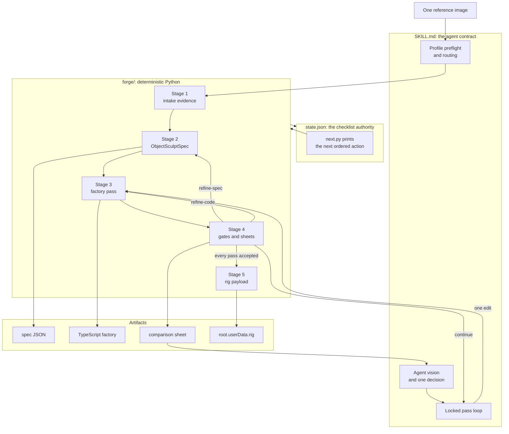
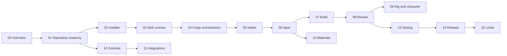

# img2threejs: one image, one procedural Three.js model

img2threejs is an agent skill that turns one reference image into a TypeScript factory that
builds a Three.js model from primitives, procedural shaders, and generated geometry. It runs
under Hermes, Claude Code, Codex, or OpenCode. It parses no image and renders no pixel by itself.
The host agent supplies the vision, and a deterministic Python forge supplies the enforcement.

The thesis of this exploration is that img2threejs is not a model and not a renderer. It is a
contract plus a state machine. The contract is `SKILL.md`, which tells a host agent what to do
and what it may not skip. The state machine is `forge/`, which measures a spec, a mesh, a render,
and a review, and refuses to advance until each one clears a threshold. The product is a text
artifact: an `ObjectSculptSpec` JavaScript Object Notation (JSON) file and a TypeScript factory.
No mesh file is shipped, so the output is diffable in a normal version-control system.

This set explains the repository at `/Users/darkvoid/GitSources/src.uigames/img2threejs` at commit
`0c0c49bc168e648dbaf9c8c080474de0b3a941b6` (2026-11-05), skill version `2.0.1` and Node package
version `0.2.0`. Every claim traces to a file in that snapshot.

Read [00 Overview](00-overview.md) first for the full picture. This page gives the shape, the
reading paths, and the limits.

## The four decisions

**1. Spend model tokens only on judgment.** Every mechanical step is a Python script. The scripts
validate JavaScript Object Notation (JSON), measure geometry, score an image difference, and
package a comparison sheet. The model looks at one side-by-side sheet and chooses one action. This
is the token-efficiency claim, and it is architectural, not procedural.

**2. Lock the build into eight passes.** The model is sculpted in a fixed order: `blockout`,
`structural-pass`, `form-refinement`, `material-pass`, `surface-pass`, `lighting-pass`,
`interaction-pass`, and `optimization-pass`. A pass unlocks only after a review accepts it. The
generator emits only the current pass, so no step asks the model to read the whole model again.

**3. Run every measurable gate on geometry first.** A self-intersection, a floating handle, or a
bald patch is cheaper to find on points than on pixels. These gates run before the browser starts.

**4. Keep the output as code and data.** The result is a `THREE.Group` factory plus a spec. The
factory exposes a runtime hierarchy in `root.userData.sculptRuntime`: pivots, sockets, colliders,
and destruction groups. The model is ready to animate, not only to look at.



## Three counts, three different questions

The set uses three units, and a reader can confuse them. A **stage** is one directory in
`forge/`: intake, spec, build, review, and rig. A **pass** is one locked build step inside
Stage 3, from `blockout` to `optimization-pass`, eight in total. A **state step** is one entry in
`state.json`, which `next.py` reads to print the next legal action. The stage tells you which code
runs. The pass tells you how far the model is sculpted. The state step tells you what the host may
do next. [03 Skill contract](03-skill-contract.md) and [04 Orchestration](04-forge-orchestration.md)
define the checklist; [07 Build](07-stage-build.md) defines the pass order.

| Count | Unit | Owner | Question it answers |
|-------|------|-------|---------------------|
| Five stages | Directory | `forge/stage{1..5}_*` | Which code runs now |
| Eight passes | Build order | `orchestrate_passes.py` | How far the model is sculpted |
| State steps | Checklist entry | `state.json`, `PASS_STEPS` | Which action is legal now |

## What is in the snapshot

The repository has 371 tracked files. Python is 234 of them, with about 71,000 lines under
`forge/` alone. Markdown is 71 files: the skill, the reference library, and 26 documents under
`docs/`.

| Area | Job | Document |
|------|-----|----------|
| `bin/` | The Node installer for four agent hosts | [02 Installer](02-installer-cli.md) |
| `SKILL.md` | The contract the host agent follows | [03 Skill contract](03-skill-contract.md) |
| `forge/state.py`, `next.py`, `report.py` | The resumable run state | [04 Orchestration](04-forge-orchestration.md) |
| `forge/stage1_intake/` | Image, GLB, detail, landmark, and PBR evidence | [05 Intake](05-stage-intake.md) |
| `forge/stage2_spec/` | Assessment, spec authoring, and strict validation | [06 Spec](06-stage-spec.md) |
| `forge/stage3_build/` | Pass orchestration, generation, and geometry gates | [07 Build](07-stage-build.md) |
| `forge/stage4_review/` | Sheets, difference, scoring, and self-correction | [08 Review](08-stage-review.md) |
| `forge/stage5_rig/` | Rig spec, skinning, and payload validation | [09 Rig and character](09-stage-rig-and-character.md) |
| `grimoire/` | The rubrics that the gates apply | [10 Grimoire](10-grimoire.md) |
| `integrations/` | Optional vision, mesh, and GLB tools | [11 Integrations](11-integrations.md) |
| `forge/materials/` | The material reference pipeline | [12 Materials](12-materials-and-rendering.md) |
| `forge/tests/`, `scripts/ci/` | 101 test modules, two support modules, and the repository gates | [13 Testing](13-testing-and-ci.md) |
| `.github/workflows/`, `package.json` | Release, publish, and docs jobs | [14 Release](14-release-and-operations.md) |
| `LAB-FINDINGS.md`, `ROADMAP.md` | The stated limits and open work | [15 Limits](15-limits-and-findings.md) |

The directory map and the dependency rules are in [01 Repository anatomy](01-repository-anatomy.md).

## How a run starts

The installer links the skill into every agent host that it finds. It accepts a release tag or a
full 40-character commit identifier, and it refuses a branch name or a short hash:

```text
# bin/img2threejs.mjs:49-51
// Ref validation: must be a tag like `v1.2.3`, `v2.0.0-beta.1` or a full 40-char SHA.
// Anything mutable (branch name, HEAD, short SHA) is rejected — a moved branch is a different
// skill on a different day, and a short SHA can become two things after a push.
```

The host then reads `SKILL.md` and runs the forge. Before any generation work, it must create the
local state artifact. That file is the checklist authority, because the conversation context is
disposable:

```bash
# SKILL.md:83-85
python3 forge/state.py init --state .img2threejs/state.json --reference  --profile <generic|character|installed-domain> --spec object-sculpt-spec.json
python3 forge/next.py --state .img2threejs/state.json [object-sculpt-spec.json]
python3 forge/state.py mark <step-id> --state .img2threejs/state.json --evidence <path>
```

The rest of this set explains what each stage measures, which gate blocks which claim, and how
the agent recovers when a gate fails.

## Reading order



Three paths exist, and each path stands alone.

- **The agent-host path.** Read [02](02-installer-cli.md), then [03](03-skill-contract.md). It
  explains how the skill reaches the host, what the host must do, and which checks the host
  cannot skip.
- **The pipeline path.** Read [04](04-forge-orchestration.md) to [09](09-stage-rig-and-character.md).
  It explains one run from intake to an animation-ready model.
- **The quality path.** Read [08](08-stage-review.md) and [10](10-grimoire.md). It explains which
  gate rejects which claim, and the rubric that the agent applies.

A reader who maintains the project should also read [13](13-testing-and-ci.md) and
[14](14-release-and-operations.md).

## Limits the repository states

The repository is direct about what one image cannot give. A single view cannot prove hidden
geometry, a second view, or exact likeness. The pipeline records per-region confidence and asks
for more views when the claim depends on them.

```text
# docs/ARCHITECTURE.md:39-42
them. **Geometric gates run before the browser does** — a bald patch or a self-intersection is found
on points, so a pass is never spent rendering geometry that was already wrong. And **routing can
refuse**: below a confidence of `0.82` the track resolves to `request-input` rather than guessing
whether the subject is a weapon or a character.
```

The confidence value comes from `forge/_shared/pipeline_routing.py`, which scores the subject
against the profile cues and returns `request-input` when the score is below the floor. A refusal
is not a failed run. It is a request for one more view or one more sentence from the user.

A gate failure has a defined exit. The review appends one of five actions: `continue`,
`refine-spec`, `refine-code`, `request-input`, or `stop`. `refine-code` returns to the same pass
with the gate message as the target. `refine-spec` returns to Stage 2 and rewrites the spec.
`request-input` asks the user. `stop` ends the run with the failure recorded in `state.json`.
[08 Review](08-stage-review.md) gives the decision table and the score each action needs.

Document [15](15-limits-and-findings.md) collects the stated limits, the lab findings, and the open
roadmap items. Document [08](08-stage-review.md) explains how a hard gate differs from a soft
signal.

## What this exploration is not

It is not a user guide. The repository's `README.md`, `INSTALL.md`, and `SKILL.md` are the
instructions that a user and an agent follow.

It is not a Three.js tutorial. The documents explain what the generated factory must contain and
why a gate checks it. They do not teach the Three.js application programming interface.

It does not run the pipeline. Every claim comes from the source, the tests, the reference library,
or the project documents. Where a claim depends on a render, the document says so.

## Related exploration

The directory [src.webgl/webgl](../../../src.webgl/webgl/markdown/README.md) is a separate
exploration in this same repository. It explains a browser game built directly on WebGL. That
exploration covers the runtime side: a scene graph that a page already has, with no image, no
spec, and no gate. The pair shows two opposite routes to a 3D scene. The game authors the scene by hand and
ships it. img2threejs derives the scene from evidence and ships a factory that rebuilds it.
