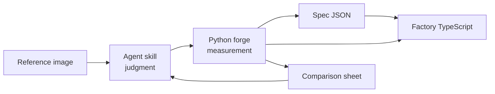

# User-interface games and procedural models

This page is the shared index for explorations of small user-interface projects and the tools
around them. The first entry is img2threejs, an agent skill that turns one reference image into a
TypeScript factory for a Three.js model. Each exploration lives in its own directory with its own
documents, its own index, and its own generated HyperText Markup Language (HTML) tree.

| Exploration | What it covers | Start here |
|-------------|----------------|------------|
| [img2threejs](img2threejs/html/README.html) | An agent skill plus a deterministic Python forge. The skill holds the contract and the judgment. The forge holds the evidence, the gates, and the resumable state. The output is an `ObjectSculptSpec` JavaScript Object Notation (JSON) file and a TypeScript `THREE.Group` factory | [Overview](img2threejs/html/00-overview.html), then [the skill contract](img2threejs/html/03-skill-contract.html) |

## The short answer

img2threejs answers a narrow question: **can an agent build a faithful Three.js model from one
image without spending model tokens on bookkeeping?** The answer is a split. The agent looks and
decides. Scripts measure and refuse. The split is why the project is small in runtime terms and
why its quality depends on the gates, not on the model alone.

## What makes it different from a rendering tool

A renderer takes a scene and produces pixels. img2threejs takes one image and produces a scene
description plus code that rebuilds the scene at run time. The render is only evidence. The
artifact that ships is text.

## Reading order

A reader who wants the system shape should read the
[img2threejs overview](img2threejs/html/00-overview.html), then
[repository anatomy](img2threejs/html/01-repository-anatomy.html). A reader who wants to run or
extend the pipeline should read [forge orchestration](img2threejs/html/04-forge-orchestration.html)
through [rig and character](img2threejs/html/09-stage-rig-and-character.html). A reader who wants
to judge the quality claims should read [review](img2threejs/html/08-stage-review.html),
[grimoire](img2threejs/html/10-grimoire.html), and
[limits and findings](img2threejs/html/15-limits-and-findings.html).

## What this index does not claim

The exploration did not run the pipeline. It did not generate a model, render a sheet, or call a
host agent. Every statement comes from the source at the pinned commit, the tests, the reference
library, or the project documents. Where the source and a project document disagree, the
exploration names both and follows the source.
