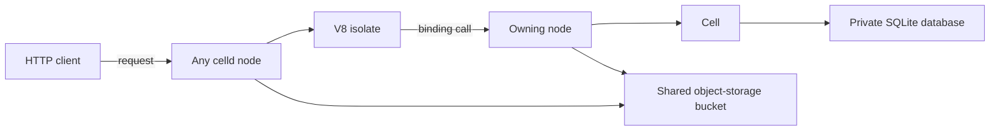
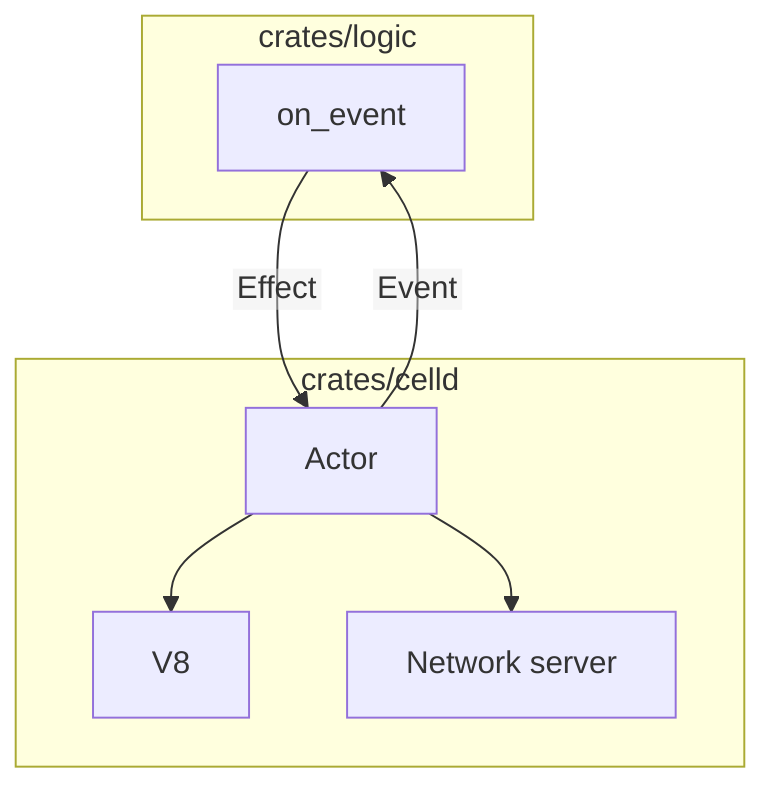

# 00 -- Overview: a distributed Durable Objects daemon

celld is a daemon written in Rust. It runs a Cloudflare Workers application on
machines you control, without Cloudflare. It executes Workers, Durable Objects,
KV (key-value) namespaces, Queues, D1 (Cloudflare's serverless SQL database)
databases, R2 (object storage) buckets, Workflows, Cron Triggers (scheduled
triggers), and static assets from the `wrangler.json` file the application
already has. The point is to run Workers and Durable Objects on machines you
control, for data locality, privacy, and independence from Cloudflare.

The project is a Cargo workspace with three crates. `crates/celld` is the
executor and adapter host: it owns the V8 JavaScript engine, the network
server, the object-storage client, and the effect loop. `crates/logic` is the
pure decision core: every state transition lives there, with no asynchronous
work, no input or output, no clocks, no randomness, and no locks.
`crates/ltx` is a vendored copy of the LTX replication library from the
rustyriver project, capturing LTX replication segments from each SQLite
database's write-ahead log.

The module documentation of the binary states the central idea in one
paragraph:

```rust
// Source: crates/celld/main.rs, lines 7-12
//! Runnable celld vertical slice.
//!
//! One actor serializes every event through `celld-logic`; the actor polls its
//! mailbox, timers, lease futures, and task completions together. Other effect
//! work runs on the host runtime so synchronous work cannot starve the core's
//! monotonic lease timers.
```

The core crate describes the same rule from its side:

```rust
// Source: crates/logic/lib.rs, lines 3-7
//! Clean-sheet celld decision core.
//!
//! [`on_event`] is the only way behavioral state advances. The production
//! executor and deterministic simulator both feed it events and perform the
//! returned effects. No adapter may mutate [`State`] directly.
```

One command-line interface (CLI) serves the daemon and the operator tools. Its
`Action` type names every subcommand:

```rust
// Source: crates/celld/main/cli.rs, lines 27-51
pub(crate) enum Action {
    Run(Settings),
    Diagnose {
        settings: Settings,
        peers: Vec<String>,
        /// Skip the write probe, for an operator who diagnoses with a
        /// credential that cannot write.
        read_only: bool,
        /// Print one JSON object per check instead of a text verdict line.
        json: bool,
    },
    Deploy(Vec<String>),
    Dev(Vec<String>),
    Cell(Vec<String>),
    D1(Vec<String>),
    Kv(Vec<String>),
    Queue(Vec<String>),
    R2(Vec<String>),
    Connect(Vec<String>),
    Credentials(Vec<String>),
    Token(Vec<String>),
    Disconnect(Vec<String>),
    Help,
    Version,
}
```

## The shape of a request

A request can arrive at any node, because every node holds the current
deployment. That node runs the Worker in a V8 isolate. When the Worker calls a
binding, the request travels to the node that owns the relevant cell. Only R2
reads and writes go straight to the fleet bucket — the one object-storage
bucket shared by the fleet (the set of celld nodes) — because R2 objects are
not cells.



## The two halves of the program

The executor in `crates/celld` never mutates the core's state directly. It
feeds an event to `on_event` and receives a list of effects. It then performs
those effects, and every asynchronous effect reports back as a new, versioned
event. The core can therefore run in a deterministic simulator with the same
code that runs in production.



The rest of this exploration follows one thread at a time. Document 01 defines
the cell, the Durable Object. Document 02 expands the logic and executor
split. Documents 03 through 08 cover durability, Workers, storage, Workflows
and Cron, static assets, and deployment. Document 09 closes with fleet
operations.

## Cross-References

- [01 -- The Cell](01-the-cell.md) — the Durable Object model and the reserved
  classes.
- [02 -- Logic and Executor](02-logic-executor-split.md) — the pure core and
  the effect shell in detail.

## The Aha Moment

**Aha:** celld is not a proxy that forwards requests to Cloudflare. It is the
Workers runtime itself. Every node embeds V8 and executes the deployment
locally. The fleet bucket is the only shared state. A small fleet of nodes
and one bucket is a complete Workers platform.

Continue to [01-the-cell.md](01-the-cell.md).
