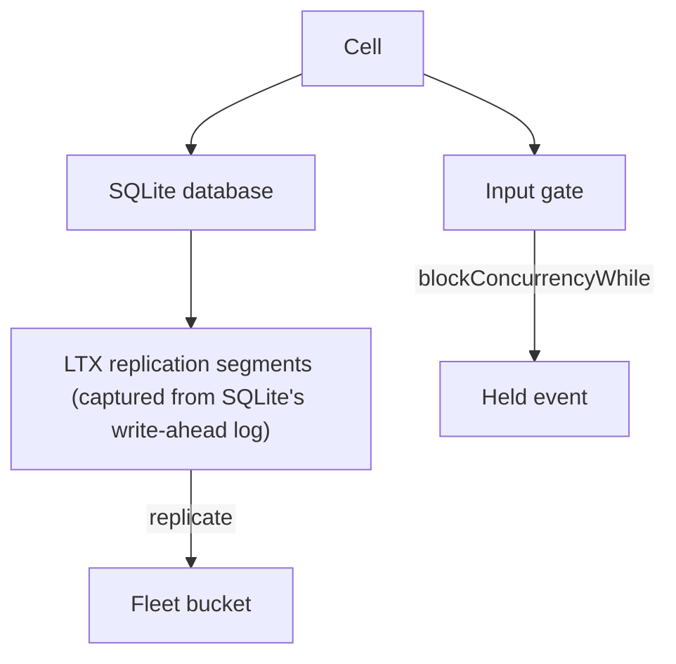
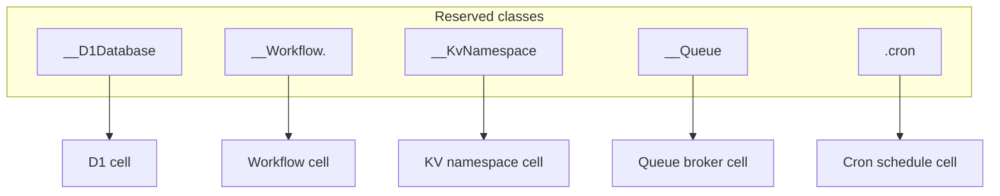

# 01 -- The Cell: one Durable Object, one SQLite database

The cell is celld's name for a Durable Object. A cell is a named slot in the
fleet with a private SQLite database. State advances only through one function,
`on_event`, so a cell is a serial actor: its events run one at a time, in a
deterministic order.

A cell has a scope and a name. The scope is a stable namespace for the
application, and the name is the instance identity. The runtime checks the
scope at startup, because a scope that passes the gate must fit every node in
the fleet:

```rust
// Source: crates/logic/cell.rs, lines 43-51
pub fn valid_cell_scope(scope: &str) -> bool {
    !scope.is_empty()
        && scope.len() <= MAX_CELL_SCOPE
        && scope != "."
        && scope != ".."
        && scope
            .bytes()
            .all(|b| b.is_ascii_alphanumeric() || matches!(b, b'_' | b'-' | b'.' | b':' | b'$'))
}
```

The ownership record is the small object that says which node owns the cell at
which epoch (a monotonic generation number). It is written to the fleet bucket
with a conditional write, so two nodes can never both believe they own one
cell:

```rust
// Source: crates/logic/types.rs, lines 164-170
#[derive(Clone, Debug, PartialEq, Eq)]
pub struct OwnerRecord {
    /// `None` is a deliberately released, fenced record. Epochs never reset.
    pub node: Option<NodeId>,
    pub epoch: Epoch,
    pub etag: String,
}
```

## Reserved classes are cells too

KV namespaces, D1 databases, Queues, and Workflows are not separate systems.
Each one is a cell under a runtime-supplied Durable Object class. The class
names are reserved so a user class cannot collide with them:

```rust
// Source: crates/celld/deploy.rs, lines 72-89
pub const D1_CLASS: &str = "__D1Database";

/// The Durable Object class every workflow instance runs as. Like `D1_CLASS`,
/// it is supplied by the runtime and refused as a user class name.
pub const WORKFLOW_CLASS: &str = "__Workflow";

/// The Durable Object class every KV namespace runs as.
///
/// Fleet-wide, like `D1_CLASS` and unlike `workflow_class`: a namespace is a
/// resource several Workers bind, so two scripts naming one namespace mean to
/// reach one set of cells.
pub const KV_CLASS: &str = celld_logic::kv::RESERVED_CLASS;

/// The Durable Object class every Queue broker runs as.
pub const QUEUE_CLASS: &str = celld_logic::queue::RESERVED_CLASS;

/// Every runtime-supplied Durable Object class.
pub const RESERVED_CLASSES: &[&str] = &[D1_CLASS, WORKFLOW_CLASS, KV_CLASS, QUEUE_CLASS];
```

A Cron Trigger uses a fifth reserved name, `.cron`, which Document 06 covers.
The leading dot is legal in the cell scope but cannot start a JavaScript
identifier, so no exported class can collide with it.



## The input gate

A cell normally delivers every event immediately. A handler can hold the gate
with `blockConcurrencyWhile`, which is the Durable Objects way to run a
critical section. The gate counts holds, because the blocks nest:

```rust
// Source: crates/logic/gate.rs, lines 95-108
    pub fn acquire(&mut self, event: EventId) -> bool {
        match self.holder {
            None => {
                self.holder = Some(event);
                self.outstanding = 1;
                true
            }
            Some(holder) if holder == event => {
                self.outstanding += 1;
                true
            }
            Some(_) => false,
        }
    }
```

A cell whose holder dies must not stay closed. The gate has an `abandon` path
that clears the holder, so a request killed in the middle of a block does not
lock the cell forever.

## One primitive, five products

The reserved-class mapping is the important design decision. A KV namespace,
a D1 database, a Queue, and a Workflow are the same serial-actor primitive
wearing a different class name:



## Cross-References

- [00 -- Overview](00-overview.md) — the fleet and the request path.
- [02 -- Logic and Executor](02-logic-executor-split.md) — how the event and
  effect cycle drives the cell.

## The Aha Moment

**Aha:** a Durable Object is not a special server type. In celld a cell is a
named slot with a private SQLite database. KV, Queues, D1, Workflows, and Cron
are all that same primitive with a different class name. One actor model
implements five Cloudflare products.

Continue to [02-logic-executor-split.md](02-logic-executor-split.md).
