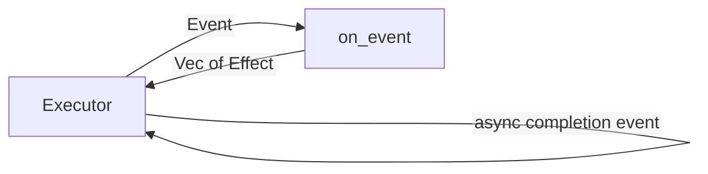

# 02 -- Logic and Executor: the decision core and the effect shell

The workspace splits cleanly. `crates/logic` holds every decision. The
executor in `crates/celld` holds every side effect. The binary comment states
the division in two lines:

```rust
// Source: crates/celld/main.rs, lines 3-4
// The binary contains connection, startup, shutdown, and V8 shell code. The
// library Actor owns the execution domain and its routed adapters.
```

The one entry point of the core is `on_event`. It takes the current state and
one event, and it returns the effects to perform:

```rust
// Source: crates/logic/lib.rs, lines 6729-6737
pub fn on_event(state: &mut State, event: Event) -> Vec<Effect> {
    let mut effects = Vec::new();
    if let Some(now_mono_ms) = event_mono_ms(&event) {
        state.now_mono_ms = state.now_mono_ms.max(now_mono_ms);
    }
    if let Some(now_ms) = event_now_ms(&event) {
        state.now_ms = state.now_ms.max(now_ms);
    }
    match event {
```

An effect is work that happens outside the core. The core cannot perform it,
because the core has no input, output, clock, or randomness. Every
asynchronous effect is versioned, so a stale completion cannot overwrite a
newer decision:

```rust
// Source: crates/logic/types.rs, lines 1022-1025
/// Work performed outside the core. Every asynchronous effect is versioned;
/// completion events with an obsolete `op` are ignored.
#[derive(Clone, Debug, PartialEq, Eq)]
pub enum Effect {
```

The executor owns time and the outside world. Its timer wheel coalesces every
scheduled activity, from the node lease renewal to a cell alarm to an
operation deadline:

```rust
// Source: crates/celld/actor.rs, lines 54-72
#[derive(Clone, Debug, PartialEq, Eq, PartialOrd, Ord)]
pub enum TimerSlot {
    NodeLeaseRenew,
    NodeLeaseFence,
    CellAlarm(String),
    /// Keyed by operation, deliberately. Every other timer here coalesces
    /// because only its newest arming matters; a deadline is the opposite --
    /// each watches a different outstanding operation, and a shared slot
    /// would let arming one silently cancel another, leaving every activation
    /// but the most recent with nothing watching it.
    OperationDeadline(OpId),
    /// Keyed by cell and generation for the same reason as the deadline
    /// above: a node parks many cells at once, and one slot per cell would
    /// let a later parking disarm an earlier one.
    QueuedActivation(String, u64),
    /// Keyed like `QueuedActivation`: one pending retry per cell, and a
    /// newer episode's arming supersedes a stale one.
    OwnerLogRecoveryRetry(String, u64),
}
```

## The cycle

The cycle is small and strict. The executor delivers an event. The core
mutates only its own state and returns effects. The executor performs the
effects. When an effect is asynchronous, its completion becomes a new event
with a version number, and the cycle repeats.



## Why the split exists

Because the core has no side effects, the same `on_event` runs in production
and in a deterministic simulator. The simulator feeds the same events and
performs the same effects, so a test can replay an event log and assert the
exact resulting state. That is what makes the durability guarantees in
Document 03 testable as pure functions rather than as a network of live
daemons.

```mermaid
%%{init: {"flowchart": {"htmlLabels": false}}}%%
flowchart TD
    subgraph Prod["Production"]
        Actor["Actor"]
    end
    subgraph Sim["Simulator"]
        Sim["Deterministic simulator"]
    end
    Actor -->|"Event"| Core["on_event"]
    Sim -->|"Event"| Core
    Core -->|"Effect"| Actor
    Core -->|"Effect"| Sim
```

The `crates/logic/Cargo.toml` describes the constraint the same way: "Pure
decision core: no async, I/O, clocks, randomness, locks, or dependencies."
That constraint is what pays for the determinism.

## Cross-References

- [01 -- The Cell](01-the-cell.md) — the state the core mutates.
- [03 -- Durability](03-durability.md) — the guarantee the deterministic core
  makes testable.

## The Aha Moment

**Aha:** the executor never mutates the cell. It only performs the effects the
core returns. That is the whole reason the core can run in a simulator: with
no side effects, replaying an event log yields the same state every time. A
durability failure is reproducible as a function call, not a fleet incident.

Continue to [03-durability.md](03-durability.md).
