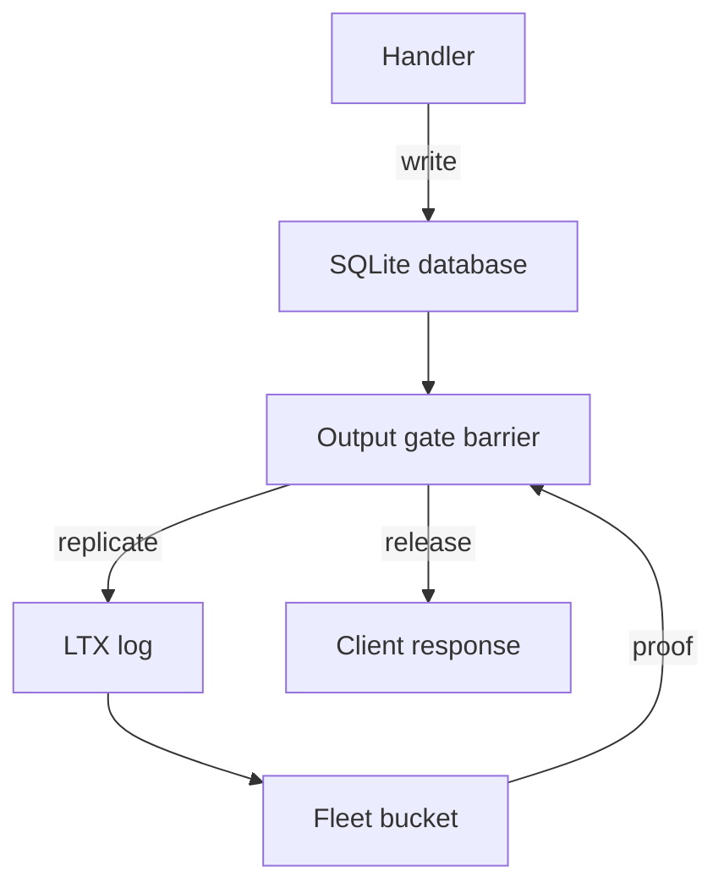
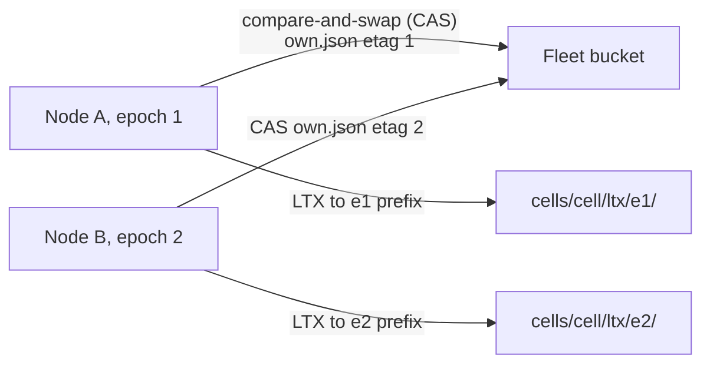

# 03 -- Durability: how a write survives a failure

celld promises a recovery point objective of zero (RPO = 0): a response that
reached a client proves the writes behind it, so no acknowledged write can be
lost in a crash. The mechanism is an output gate, not a faster disk. A
response leaves the node only after the write that produced it is proven
durable.

Every channel that can reveal a write to the outside world is a variant of
the `Channel` type. A response, a `fetch`, a WebSocket frame, a service call,
a Queue batch, and even the `storage.sync()` promise all take a ticket through
the same gate:

```rust
// Source: crates/logic/types.rs, lines 417-450
pub enum Channel {
    /// The answer to the cell event itself: an HTTP response, a cell RPC
    /// reply, or a peer-served reply. A response whose body streams takes one
    /// ticket for its head and one more for each chunk, because a chunk the
    /// producer makes after the release can reveal a later write.
    Response,
    /// `fetch()` from a handler to a third party.
    Fetch,
    /// A frame from a `webSocketMessage` handler, captured by the host and
    /// released from the cell's barrier queue.
    WsHibernatable,
    /// A frame on a socket the isolate opened and polls itself. It cannot be
    /// captured, because the handler may be awaiting the reply to the very
    /// frame being held, so it waits on a durability ticket instead.
    WsSelf,
    /// A service-binding call, `env.NAME.fetch()` or its RPC form.
    Service,
    /// A call to another cell: its `fetch` or one of its RPC methods.
    CellRpc,
    /// An operation that changes an application R2 bucket.
    R2,
    /// A connection, write, TLS upgrade, or shutdown on a raw TCP socket.
    Tcp,
    /// A leased Queue batch leaving its broker for a consumer Worker.
    Queue,
    /// The promise `storage.sync()` returns to the handler. Nothing leaves
    /// the process on this route, but the application treats the settled
    /// promise as a durability statement and acts on it through routes the
    /// gate cannot hold: a log line, local work, or the next checkpoint. A
    /// promise that settles before the proof lets the application discard a
    /// recovery path it still needs. So the promise takes the same ticket an
    /// egress takes, and its release is the promise settling.
    Sync,
}
```

The `Tcp` route is a raw TCP socket: a connection, a write, a TLS (Transport Layer Security) upgrade, or a shutdown.

There are two proof mechanisms. The fleet's follower ensemble arbitrates a
takeover, while the bucket only stores. A bucket proof must therefore verify
ownership before any reveal, and a fleet proof does not need that extra read:

```rust
// Source: crates/logic/types.rs, lines 475-478
pub enum ProofSource {
    Fleet,
    Bucket,
}
```

## The write path

A handler writes to the cell's SQLite database. The output gate opens a write
barrier. The LTX log replicates to the fleet bucket. When a proof lands, the
gate releases the response.



The output gate checks authority at release time, not only at request start. A
handler can start under a live node lease and reach its output after that
lease expired. Releasing then would reveal work that a successor owner may
already have replaced:

```rust
// Source: crates/logic/output_gate.rs, lines 92-113
    pub(crate) fn output(
        &mut self,
        request: RequestId,
        channel: Channel,
        position: Option<u64>,
        observed: Option<u64>,
        epoch: Option<Epoch>,
        effects: &mut Vec<Effect>,
    ) {
        let held = Held { request, channel };
        // Authority is checked here, not only at request start: a handler can
        // start under a live node lease and reach its output after that lease
        // expired. Releasing then would reveal work a successor owner can
        // already have replaced.
        if !self.node_authoritative() {
            effects.push(Effect::Release {
                request,
                channel,
                result: Err(RequestError::NodeFenced),
            });
            return;
        }
```

A queued write may wait for a proof while the node keeps proving other
writes. The wait is budgeted, so a sustained overload cannot make a client
wait forever:

```rust
// Source: crates/logic/durability.rs, lines 55-76
pub const QUEUED_BUDGETS: u64 = 6;

/// The monotonic ms at which this wait gives up, given what the node has done
/// so far. Recomputed on every wake, so a proof landing elsewhere on the node
/// or the cell's own capture beginning moves the deadline forward.
pub fn proof_deadline(wait: &ProofWait, progress: &ProofProgress) -> u64 {
    if progress.capture_seq >= wait.ticket {
        // In flight: the fixed budget, from the capture that covers this
        // write. A capture cannot cover a ticket taken after it, so the
        // `max` only guards a clock read that raced the ticket.
        return progress
            .capture_started_ms
            .max(wait.started_ms)
            .saturating_add(wait.budget_ms);
    }
    // Queued: one budget after the node's last proof, bounded in total.
    let anchor = progress.node_proof_ms.max(wait.started_ms);
    let cap = wait
        .started_ms
        .saturating_add(wait.budget_ms.saturating_mul(QUEUED_BUDGETS));
    anchor.saturating_add(wait.budget_ms).min(cap)
}
```

## Fencing with epochs

A takeover does not rely on a leader. Ownership is a conditional write on
`cells/<cell>/own.json`, guarded by an etag that carries the epoch. A node
that loses the cell cannot pass the condition again, and its LTX writes go to
its old epoch prefix, which the new owner ignores.



## Cross-References

- [02 -- Logic and Executor](02-logic-executor-split.md) — the deterministic
  core that makes the gate testable.
- [04 -- Workers](04-workers-execution.md) — the handlers whose responses the
  gate releases.

## The Aha Moment

**Aha:** durability here is not about fsync alone. It is an output gate. A
response leaves the node only after the write behind it is proven in the
bucket or the follower ensemble. That is how a self-hosted system reaches
RPO = 0: the client never saw a write that can vanish.

Continue to [04-workers-execution.md](04-workers-execution.md).
