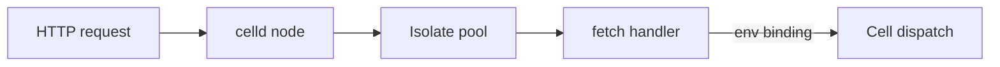
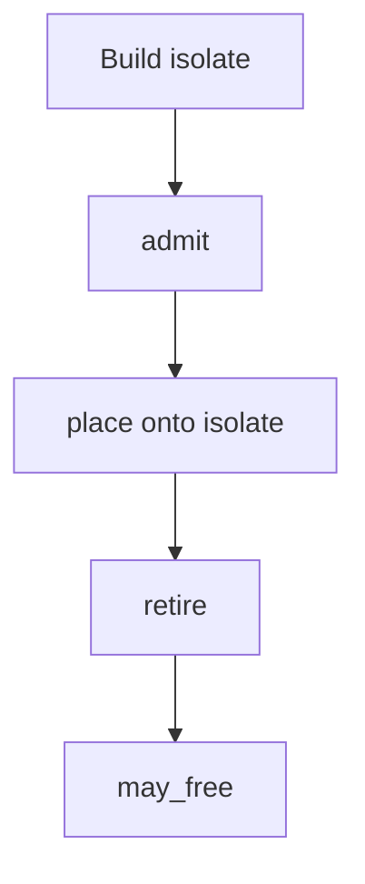

# 04 -- Workers: V8 isolates and stateless execution

A Worker is a stateless request handler. celld runs the deployment in a V8
isolate (V8's isolated JavaScript execution context) on every node, and it can
retire an isolate at any time. A Worker must therefore keep its state in a
binding, never in module scope.

The three jobs an isolate can run are fetch, RPC (remote procedure call), and
queue dispatch:

```rust
// Source: crates/celld/lib.rs, lines 234-267
pub enum WorkerJob {
    Fetch {
        queued_at: std::time::Instant,
        /// An entrypoint dispatcher target, or the direct default export when
        /// absent.
        entrypoint: Option<WorkerFetchEntrypoint>,
        invocation_limits: Option<WorkerInvocationLimits>,
        url: String,
        method: String,
        body: js::RequestBody,
        headers: Vec<(String, String)>,
        request_id: Option<js::RequestId>,
        /// Receives one completed invocation report for Dynamic Worker tails.
        /// Ordinary fetches leave this empty.
        tail_report: Option<tokio::sync::oneshot::Sender<String>>,
        reply: tokio::sync::oneshot::Sender<anyhow::Result<js::HttpResponse>>,
    },
    Rpc {
        entrypoint: String,
        operation: WorkerRpcOperation,
        /// The caller's `ctx.props` as V8 structured-clone bytes, the same
        /// encoding as `args`. It is empty when the caller sent none, which no
        /// encoded value can be. A Worker Loader entrypoint or a transferred
        /// Service Binding can set it.
        props: Vec<u8>,
        invocation_limits: Option<WorkerInvocationLimits>,
        reply: tokio::sync::oneshot::Sender<anyhow::Result<Vec<u8>>>,
    },
    Queue {
        queued_at: std::time::Instant,
        batch: js::QueueBatch,
        reply: tokio::sync::oneshot::Sender<anyhow::Result<js::QueueDispatchResult>>,
    },
}
```

The compatibility flags of the deployment become runtime switches. Each switch
turns on with a flag, off with its opposite flag, and otherwise follows the
compatibility date:

```rust
// Source: crates/celld/lib.rs, lines 274-313
pub fn worker_compat(metadata: &serde_json::Value) -> js::Compat {
    let flags = metadata
        .get("compatibility_flags")
        .and_then(serde_json::Value::as_array);
    let has_flag = |name: &str| {
        flags.is_some_and(|flags| {
            flags
                .iter()
                .any(|flag| flag.as_str().is_some_and(|flag| flag == name))
        })
    };
    let date = metadata
        .get("compatibility_date")
        .and_then(serde_json::Value::as_str);
    let switch = |enable: &str, disable: &str, since: &str| {
        if has_flag(enable) {
            return true;
        }
        if has_flag(disable) {
            return false;
        }
        date.is_some_and(|date| date >= since)
    };
    js::Compat {
        delete_all_deletes_alarm: switch(
            "delete_all_deletes_alarm",
            "delete_all_preserves_alarm",
            "2026-02-24",
        ),
        js_rpc: has_flag("js_rpc"),
        fetcher_get_put_delete: !switch(
            "fetcher_no_get_put_delete",
            "fetcher_has_get_put_delete",
            "2024-03-26",
        ),
        sqlite_vec: has_flag("sqlite_vec"),
        websocket_standard_binary_type: has_flag("websocket_standard_binary_type"),
        queue_json_messages: switch("queue_json_messages", "queue_v8_messages", "2024-03-18"),
    }
}
```

The isolate pool admits a request only if the node is not full or under memory
pressure. Under pressure it refuses to build another isolate, because another
heap is the last thing the node needs:

```rust
// Source: crates/logic/isolate.rs, lines 186-205
pub fn admit(load: &PoolLoad, shedding: bool) -> Result<Placement, Refusal> {
    if let Some(max) = load.limits.max_requests {
        let held: usize = load.isolates.iter().map(|l| l.requests).sum();
        if held >= max {
            return Err(if shedding {
                // Reported ahead of fullness: a full node drains on its own,
                // a pressured one does not, so pressure is the more
                // actionable thing to tell the caller.
                Refusal::NodePressured
            } else {
                Refusal::NodeFull
            });
        }
    }
    Ok(if shedding {
        place_without_growing(load)
    } else {
        place(load)
    })
}
```

## The request path

A request can arrive at any node. That node runs the Worker in an isolate.
When the Worker calls a binding, the node forwards the call to the node that
owns the relevant cell. An R2 binding reads and writes the fleet bucket
directly.



A real Worker is small. The counter example is a Durable Object class plus a
stateless default fetch handler:

```javascript
// Source: examples/counter/index.js, lines 1-18
export class Counter {
  constructor(state, env) {
    this.state = state;
  }
  async fetch(request) {
    let n = (await this.state.storage.get("n")) ?? 0;
    n++;
    await this.state.storage.put("n", n);
    return Response.json({ n, url: request.url });
  }
}
export default {
  async fetch(request, env) {
    const name = new URL(request.url).searchParams.get("name") ?? "default";
    const id = env.COUNTER.idFromName(name);
    return env.COUNTER.get(id).fetch(request);
  },
};
```

## Isolate lifecycle

Isolates are built, admitted, placed, retired, and freed. Retirement can
happen at any time, which is the reason module scope is a cache and not a
store.



## Cross-References

- [03 -- Durability](03-durability.md) — the gate that releases a handler's
  response.
- [05 -- KV, Queues, D1, R2](05-kv-queues-d1-r2.md) — the bindings a Worker
  reaches through `env`.

## The Aha Moment

**Aha:** a Worker is stateless not because Cloudflare forbids state, but
because an isolate can be retired at any moment. The only durable place a
Worker may keep state is a binding, and every binding is ultimately a cell or
the bucket. Module-scope state is a cache, never a store.

Continue to [05-kv-queues-d1-r2.md](05-kv-queues-d1-r2.md).
