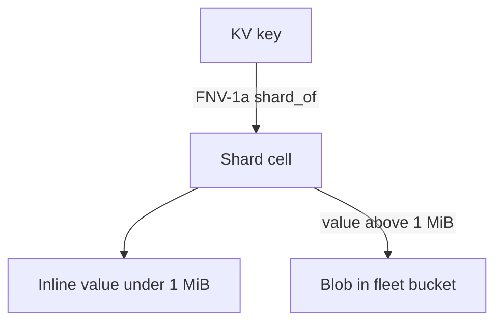
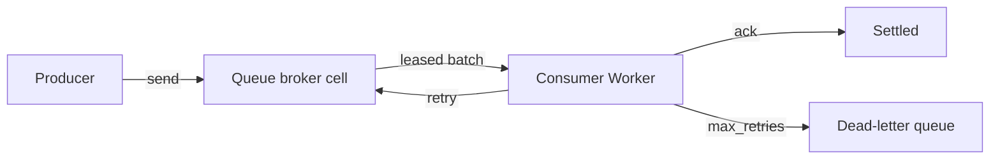

# 05 -- KV, Queues, D1, R2: the storage bindings

Four storage products reach a Worker through `env`. KV (key-value) stores
small values in a namespace cell and large values in the fleet bucket. Queues
is a message broker where one cell holds each queue. D1 is a SQL database
backed by the same per-cell SQLite. R2 is object storage that reads and writes
the bucket directly, without a cell in between.

## KV

A KV namespace is one fleet-wide name. Its cell class is reserved, and its
limits are refused rather than truncated:

```rust
// Source: crates/logic/kv.rs, lines 35-50, 56-63
pub const RESERVED_CLASS: &str = "__KvNamespace";

/// Upstream's limits, which this crate refuses rather than truncates.
pub const MAX_KEY_BYTES: usize = 512;
pub const MAX_VALUE_BYTES: usize = 25 * 1024 * 1024;

/// The largest value celld stores inside the namespace cell.
///
/// A cell's writes replicate as LTX, so an inline value is paid for twice: once
/// in SQLite and once on the wire, on every write. Upstream permits 25 MiB, and
/// 25 MiB inline would make a single `put` the most expensive operation in the
/// runtime.
///
/// Above this bound the bytes go to the fleet bucket and the row names them,
/// which is the split Cloudflare's own KV rearchitecture made for the same
/// reason — small values in the database, large ones in object storage.
pub const MAX_INLINE_VALUE_BYTES: usize = 1024 * 1024;
pub const MAX_METADATA_BYTES: usize = 1024;
/// Upstream refuses a shorter expiry outright, so a caller learns at the call
/// and not sixty seconds later.
pub const MIN_EXPIRATION_TTL_MS: i64 = 60_000;
/// One `get`/`getWithMetadata` bulk call. A CLI chunks beneath this rather
/// than inheriting it; the binding is where the ceiling belongs.
pub const MAX_BULK_KEYS: usize = 100;
```

A namespace with more than one shard routes each key to a shard by an FNV-1a
hash. The algorithm is pinned forever, because changing it would move keys
between cells and make a namespace written by one release unreadable by the
next:

```rust
// Source: crates/logic/kv.rs, lines 246-256
pub fn shard_of(key: &str, shards: u32) -> u32 {
    debug_assert!(shards > 0, "a namespace has at least one shard");
    const OFFSET: u64 = 0xcbf2_9ce4_8422_2325;
    const PRIME: u64 = 0x0000_0100_0000_01b3;
    let mut hash = OFFSET;
    for byte in key.as_bytes() {
        hash ^= u64::from(*byte);
        hash = hash.wrapping_mul(PRIME);
    }
    (hash % u64::from(shards.max(1))) as u32
}
```



## Queues

A Queue is a broker cell. The runtime supplies the class, and the limits are
the Cloudflare limits:

```rust
// Source: crates/logic/queue.rs, lines 19-28
pub const RESERVED_CLASS: &str = "__Queue";

/// Cloudflare measures a Queue kilobyte as 1000 bytes.
pub const MAX_MESSAGE_BYTES: usize = 128_000;
pub const MAX_SEND_BATCH_BYTES: usize = 256_000;
pub const MAX_BATCH_MESSAGES: usize = 100;
pub const MAX_BATCH_TIMEOUT_SECONDS: u16 = 60;
pub const MAX_RETRIES: u16 = 100;
pub const MAX_CONCURRENCY: u16 = 250;
pub const MAX_DELAY_SECONDS: u32 = 86_400;
```

A delivery has an attempt count, and a message is exhausted when its attempts
pass the configured retry count. The first delivery is attempt one, so
`max_retries = 3` allows attempts one through four:

```rust
// Source: crates/logic/queue.rs, lines 89-91
pub fn exhausted(attempt: u16, max_retries: u16) -> bool {
    attempt > max_retries
}
```

An exhausted message moves to the dead-letter queue, or celld deletes it when
the consumer names none. A message stays retained for four days:

```rust
// Source: crates/logic/queue.rs, lines 34-37
/// Queue retention is deployment-independent in celld v1. Wrangler has no
/// configuration key for it, so accepting one would make a celld project
/// invalid on Cloudflare.
pub const RETENTION_MS: Ms = 4 * 24 * 60 * 60 * 1000;
```



## D1 and R2

D1 is the SQL database product. It runs under the reserved class
`__D1Database`, which Document 01 listed. Each D1 database is a cell with a
private SQLite database, plus a migration history stored the same way. R2 is
object storage: the Worker's R2 binding reads and writes the fleet bucket
directly, so an R2 object is never a cell.

## Cross-References

- [04 -- Workers](04-workers-execution.md) — the bindings a Worker reaches
  through `env`.
- [06 -- Workflows and Cron](06-workflows-cron.md) — the two remaining
  reserved-cell services.

## The Aha Moment

**Aha:** KV is not a separate database. A namespace is a set of Durable Object
cells, one per shard, and a large value is a blob in the bucket with a row
pointing at it. Small values live in SQLite; large ones live in object
storage. That is the same split Cloudflare's own KV made, and for the same
reason.

Continue to [06-workflows-cron.md](06-workflows-cron.md).
