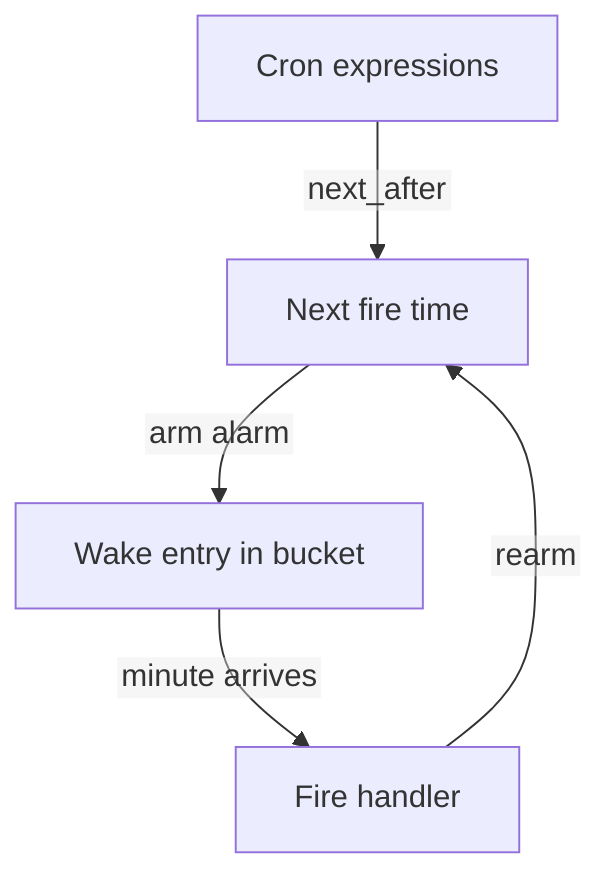
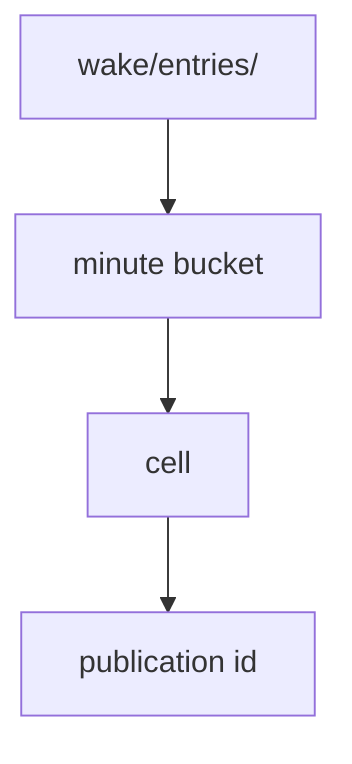

# 06 -- Workflows and Cron: durable steps and schedules

Workflows and Cron Triggers are the two services that turn the cell model into
time-driven behavior. A Workflow instance is a Durable Object under the
script-scoped class `__Workflow.<script_name>`, with each durable step
recorded in the cell. A Cron Trigger is a reserved cell named `.cron:<script>`
whose alarm is the next fire time.

## Cron

The reserved class name starts with a dot so it cannot collide with an
exported JavaScript class. Ownership of that cell is a compare-and-swap (CAS) on its name. The cell is keyed on the script name only, so a
deploy can change the schedule without stranding the alarm the old schedule
armed:

```rust
// Source: crates/logic/cron.rs, lines 27-43
/// The class name of the reserved cell that carries a script's schedule.
///
/// A leading `.` is inside `cell::valid_cell_scope`'s charset but is not a
/// legal start for a JavaScript identifier, so no exported class can collide
/// with the reserved namespace. That is the whole reason the name is punctuated
/// rather than pretty.
pub const RESERVED_CLASS: &str = ".cron";

/// The one cell that owns a script's cron schedule.
///
/// Keyed on the script and nothing else — not the expressions, not a hash of
/// them. Ownership CAS on this one name is what makes a
/// cron fire once per fleet rather than once per node, and a stable name is
/// what lets a deploy change the schedule without stranding the alarm the old
/// schedule armed.
pub fn reserved_cell(script_name: &str) -> String {
    format!("{RESERVED_CLASS}:{script_name}")
}
```

When the cell arms its alarm, it walks forward to the next fire time. The
lookahead bound is one full Gregorian cycle of 400 years, which is a proof and
not an estimate:

```rust
// Source: crates/logic/cron.rs, lines 45-59
/// How far ahead `next_after` walks before it calls an expression
/// unsatisfiable.
///
/// One Gregorian cycle. The calendar repeats exactly every 400 years, so a walk
/// of 146097 consecutive days sees every (month, day-of-month, day-of-week)
/// combination that can ever occur: an expression with no match in that window
/// has none at all, and the bound is a proof rather than an estimate. Estimates
/// were tried and were wrong twice over — `0 0 29 2 *` waits eight years, not
/// four, when a century skips its leap year (2096-02-29 to 2104-02-29 is 2921
/// days), and `0 0 * 2 SUN#5` needs a 29-day February that starts on a Sunday,
/// which is 28 years apart. Undershooting is not a late fire but a silent
/// retirement: `next_across` returns `None`, so the cell deletes its alarm. The
/// full walk costs about a hundred thousand cheap iterations and only an
/// unsatisfiable expression ever pays it, once, at arm time.
const MAX_LOOKAHEAD_DAYS: usize = 146_097;
```



## The wake index

An alarm is not a timer inside the node. It is a wake entry object in the
bucket, keyed by minute bucket, cell, and publication id:

```rust
// Source: crates/logic/wake.rs, lines 234-238
pub const ENTRY_PREFIX: &str = "wake/entries/";

pub fn entry_key(due_ms: i64, cell: &str, id: PublicationId) -> String {
    format!("{ENTRY_PREFIX}{}/{cell}/{id}", minute_bucket(due_ms))
}
```



When an alarm fires and the delivery fails, the retry backs off exponentially.
A failure that counts against the limit eventually abandons the alarm, while a
shed under pressure backs off but never reaches the ceiling:

```rust
// Source: crates/logic/alarm.rs, lines 21-34
pub fn alarm_retry(
    now_ms: Ms,
    retry: i64,
    counted_retry: i64,
    counts_against_limit: bool,
) -> Option<Ms> {
    if counts_against_limit && counted_retry >= RETRY_CEILING {
        None
    } else {
        let shift = retry.clamp(0, MAX_BACKOFF_SHIFT) as u32;
        let at_ms = now_ms.saturating_add(BACKOFF_BASE_MS * (1_i64 << shift));
        Some(at_ms)
    }
}
```

## Workflows

A Workflow is a sequence of durable steps. Each step runs once even if the
node restarts, because the step's result and the next step's input are stored
in the workflow cell. The workflow class is script-scoped: the instance
already carries its script, so the reserved cell key includes the script name.

## Cross-References

- [05 -- KV, Queues, D1, R2](05-kv-queues-d1-r2.md) — the storage bindings.
- [07 -- Static Assets](07-static-assets.md) — the content-addressed file
  store.

## The Aha Moment

**Aha:** a cron trigger is not a scheduler process. It is a Durable Object
named `.cron:<script>` whose alarm is the next fire time, and the alarm is a
wake entry object in the bucket keyed by minute. There is no central ticker;
the bucket's key layout is the schedule. And because the lookahead walk proves
unsatisfiability over one 400-year cycle, a schedule that can never fire is
retired once, deterministically.

Continue to [07-static-assets.md](07-static-assets.md).
