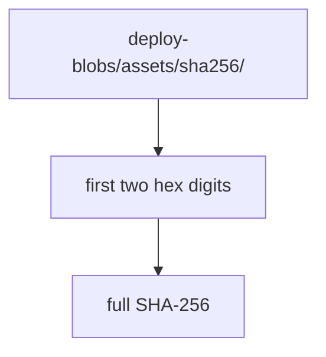
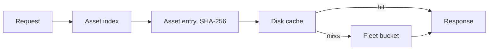

# 07 -- Static Assets: serving files from the bucket

Static assets are content-addressed by a Secure Hash Algorithm (SHA-256)
digest. The deploy manifest points at an asset index, and the index maps each
path to the hash of the exact response body:

```rust
// Source: crates/celld/protocol.rs, lines 379-404
/// Reference from a deploy manifest to its immutable, canonical asset index.
#[derive(Debug, Clone, Serialize, Deserialize)]
pub struct AssetManifestRef {
    pub index: String,
    pub sha256: String,
    pub file_count: u32,
    pub total_bytes: u64,
}

/// `deploy/<script>/<version>/assets.json`.
#[derive(Debug, Clone, Serialize, Deserialize, Default)]
pub struct AssetIndex {
    pub schema_version: u32,
    pub entries: BTreeMap<String, AssetEntry>,
    pub config: AssetConfig,
}

#[derive(Debug, Clone, Serialize, Deserialize)]
pub struct AssetEntry {
    /// Full SHA-256 of the exact response body, lowercase hexadecimal.
    pub sha256: String,
    pub bytes: u64,
    /// `None` means omit Content-Type, matching Wrangler's `application/null`.
    #[serde(default, skip_serializing_if = "Option::is_none")]
    pub content_type: Option<String>,
}
```

The body key is fleet-wide and immutable. The digest is validated before use,
and the object path is the hash itself:

```rust
// Source: crates/celld/protocol.rs, lines 441-454
pub fn asset_blob_key(sha256: &str) -> Option<String> {
    if sha256.len() != 64
        || !sha256
            .bytes()
            .all(|byte| byte.is_ascii_digit() || (b'a'..=b'f').contains(&byte))
    {
        return None;
    }
    Some(format!(
        "deploy-blobs/assets/sha256/{}/{}",
        &sha256[..2],
        sha256
    ))
}
```



Each node keeps a disk cache of 512 MiB by default, so a hot asset does not
fetch the bucket on every request:

```rust
// Source: crates/celld/assets.rs, lines 28-44
const DEFAULT_ASSET_CACHE_BYTES: u64 = 512 * 1024 * 1024;

#[derive(Clone)]
pub struct AssetResolver {
    inner: Arc<AssetResolverInner>,
}

/// Where a resolver can look for a NEWER deployment's asset index than the
/// one this process booted with. During a rolling restart an upgraded node
/// serves HTML whose content-hashed asset paths an un-restarted node has
/// never heard of; the blobs are content-addressed and fleet-visible, so
/// only the index is stale. denoland/celld#161.
pub struct FallbackSource {
    /// The pointer this deployment was loaded from (`deploy/current.json`,
    /// or the script-scoped pointer for a service).
    pub pointer_key: String,
    /// The deployment prefix loaded at boot; a pointer naming another
```



An asset-only deployment is still a Wrangler (Cloudflare's CLI/build tool)
project. The example declares only a name, a compatibility date, and a
directory:

```jsonc
// Source: examples/static-assets/wrangler.jsonc, lines 1-5
{
  "name": "static-assets",
  "compatibility_date": "2026-01-01",
  "assets": { "directory": "./public" }
}
```

The `_headers` and `_redirects` files in the asset directory become response
headers and redirect rules at the edge of the asset resolver.

## Cross-References

- [06 -- Workflows and Cron](06-workflows-cron.md) — the time-driven services.
- [08 -- Wrangler Deploy](08-wrangler-deploy.md) — how an asset index reaches
  the bucket.

## The Aha Moment

**Aha:** a static asset is not a file path; it is a hash. The body's SHA-256
is its key and its identity, so two deployments that share a file share the
same blob object. That is why a rolling restart works: an old node serving
HTML that references a new asset finds the blob by hash even though its index
is stale.

Continue to [08-wrangler-deploy.md](08-wrangler-deploy.md).
