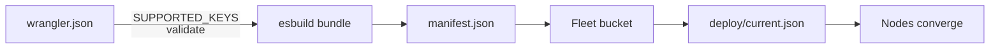
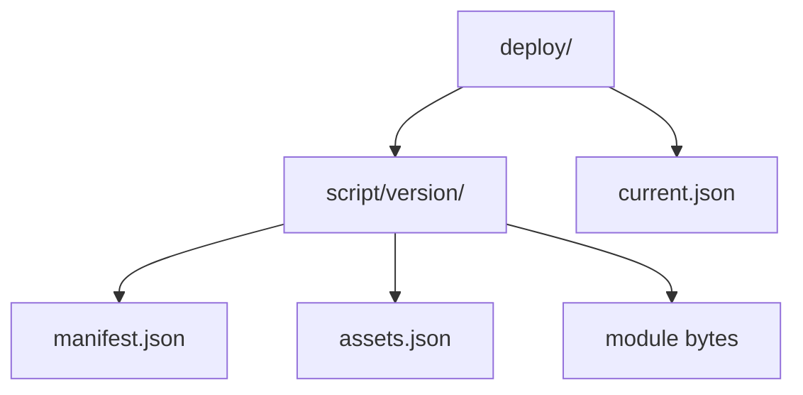

# 08 -- Wrangler Deploy: from configuration to a deployment

A deployment starts from a Wrangler (Cloudflare's CLI/build tool)
`wrangler.json` (or `.jsonc`) file. celld refuses unknown keys rather than
guess, because guessing produces confusing activation failures later:

```rust
// Source: crates/celld/deploy.rs, lines 42-64
const SUPPORTED_KEYS: &[&str] = &[
    "$schema",
    "name",
    "main",
    "compatibility_date",
    "compatibility_flags",
    "durable_objects",
    "migrations",
    "assets",
    "services",
    "triggers",
    "vars",
    "d1_databases",
    "kv_namespaces",
    "queues",
    "workflows",
    "r2_buckets",
    "worker_loaders",
    "containers",
    "no_bundle",
    "define",
    "rules",
];
```

The counter example shows the smallest real project: a Durable Object binding
plus a migration that marks the class as SQLite-backed:

```jsonc
// Source: examples/counter/wrangler.jsonc, lines 1-9
{
  "name": "counter",
  "main": "index.js",
  "compatibility_date": "2026-01-01",
  "durable_objects": {
    "bindings": [{ "name": "COUNTER", "class_name": "Counter" }]
  },
  "migrations": [{ "tag": "v1", "new_sqlite_classes": ["Counter"] }]
}
```

The deploy tool bundles the modules with esbuild (a JavaScript bundler) and
writes a manifest. The manifest is the normalized object a node reads to know
what to run:

```rust
// Source: crates/celld/protocol.rs, lines 11-55
/// `deploy/<script>/<version>/manifest.json` — the normalized thing celld reads
/// to know what to run. The script name is deployment identity, not a fleet
/// selector: one fleet has one current application.
#[derive(Debug, Clone, Serialize, Deserialize)]
pub struct Manifest {
    #[serde(default = "legacy_manifest_schema_version")]
    pub schema_version: u32,
    pub version: String,
    pub script_name: String,
    /// Absent for Wrangler asset-only deployments.
    pub main_module: Option<String>,
    /// Durable Object classes exported by the worker.
    pub do_classes: Vec<String>,
    /// Subset of `do_classes` that are SQLite-backed (from migrations).
    pub sqlite_classes: Vec<String>,
    pub modules: Vec<ModuleRef>,
    #[serde(default, skip_serializing_if = "Option::is_none")]
    pub assets: Option<AssetManifestRef>,
    /// Cron trigger expressions from the config's `triggers.crons`. They are
    /// deployment state rather than cell state: the reserved cron cell reads
    /// them from the manifest it is running under, so changing a schedule
    /// needs no migration of an already-armed alarm.
    #[serde(default, skip_serializing_if = "Vec::is_empty")]
    pub crons: Vec<String>,
    /// Push consumers attached to this Worker deployment. Producer bindings
    /// remain in `raw_metadata.bindings`, because they become values in `env`;
    /// consumers drive the broker and have no environment binding.
    #[serde(default, skip_serializing_if = "Vec::is_empty")]
    pub queue_consumers: Vec<QueueConsumerConfig>,
    /// The container classes of this deployment: class, image id, and the
    /// instance shape. Each image tar is at `deploy/images/<id>.tar`.
    #[serde(default, skip_serializing_if = "Vec::is_empty")]
    pub containers: Vec<crate::container::ContainerSpec>,
    /// The `celld-fence` image `celld deploy` built beside the container
    /// images: the node runs it once, privileged, to fence its container
    /// bridges before any container starts. `None` in a deployment without
    /// containers, and in one made by a celld that predates the fence,
    /// which a node then refuses to start containers for.
    #[serde(default, skip_serializing_if = "Option::is_none")]
    pub fence_image: Option<String>,
    #[serde(default, skip_serializing_if = "Vec::is_empty")]
    pub required_features: Vec<String>,
    /// wrangler's raw metadata, retained verbatim for anything we don't yet model.
    pub raw_metadata: serde_json::Value,
}
```

The version is a deterministic identity: sorted module contents plus the
serialized metadata, hashed with SHA-256 and truncated to 16 hex digits. The
raw upload framing is not included, because it is not deterministic:

```rust
// Source: crates/celld/protocol.rs, lines 485-506
pub fn deployment_version(
    modules: &[(String, Vec<u8>)],
    metadata_json: &[u8],
    asset_index: Option<&[u8]>,
) -> String {
    let mut sorted = modules.iter().collect::<Vec<_>>();
    sorted.sort_by(|left, right| left.0.cmp(&right.0));
    let mut hasher = Sha256::new();
    for (name, bytes) in sorted {
        hasher.update(name.as_bytes());
        hasher.update([0]);
        hasher.update(bytes);
    }
    hasher.update(metadata_json);
    if let Some(index) = asset_index {
        hasher.update([0]);
        hasher.update(b"assets.json");
        hasher.update([0]);
        hasher.update(index);
    }
    format!("{:x}", hasher.finalize())[..16].to_string()
}
```



The bucket layout separates immutable version objects from the fleet-wide
pointer. Changing the pointer is a deploy; nodes converge to it:



## Cross-References

- [07 -- Static Assets](07-static-assets.md) — the asset index the manifest
  references.
- [09 -- Fleet Operations](09-fleet-operations.md) — how nodes converge on the
  pointer.

## The Aha Moment

**Aha:** a deploy is just a bucket write plus a pointer move. There is no
control plane. `celld deploy` computes a deterministic version from the sorted
modules and metadata, writes the manifest under that version, and then flips
`deploy/current.json`. Nodes poll the pointer and converge. A rollout is a
percent in that same pointer.

Continue to [09-fleet-operations.md](09-fleet-operations.md).
