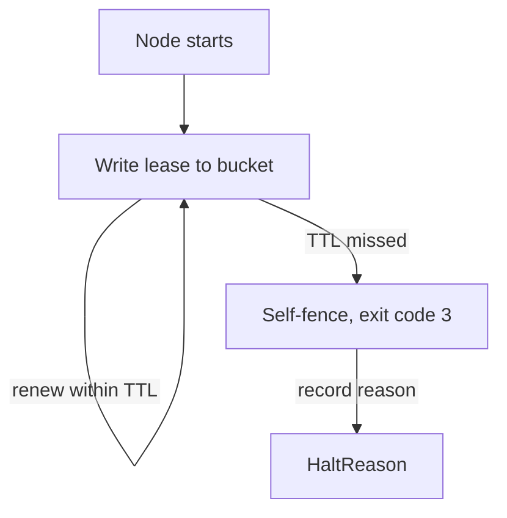
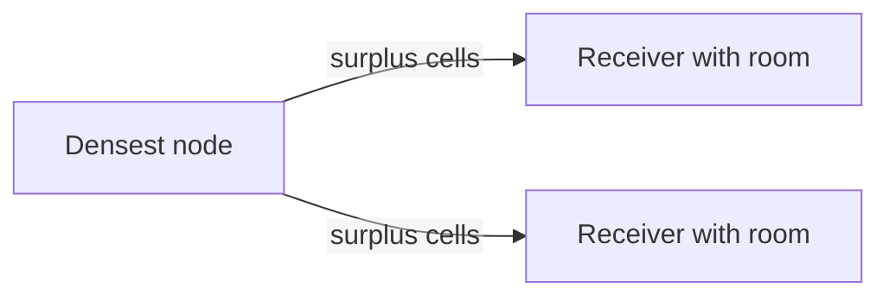

# 09 -- Fleet Operations: leases, balance, and shutdown

A fleet is a set of celld nodes sharing one bucket. Each node holds a lease,
written to `nodes/<node>.json`, and renews it within a TTL (time to live) of
10,000 milliseconds by default. A node that cannot renew its lease loses the
authority to prove it owns anything, so it halts itself.

```rust
// Source: crates/celld/machine.rs, lines 101-103
pub fn lease_ttl_ms_from_environment() -> u64 {
    crate::env_vars::positive_or("CELLD_TTL_MS", 10_000).expect("validated CELLD_TTL_MS")
}
```

The halt reason is recorded, because a process that self-fences without
saying why leaves an operator with an exit code and nothing else:

```rust
// Source: crates/logic/types.rs, lines 304-317
pub enum HaltReason {
    /// The node lease was not renewed inside its TTL, so this node can no
    /// longer prove it owns anything it is serving.
    NodeLeaseExpired,
    /// A renewal readback found no node lease record, so the record that
    /// published the authority of this process is gone.
    NodeLeaseMissing,
    /// A renewal readback found a node lease record that this process can
    /// neither recognize nor adopt, so it can no longer prove its authority.
    /// The record can be a foreign replacement, or a late self-authored write
    /// that carries a stale folded log stamp; the readback cannot tell them
    /// apart, so the reason names the observation, not an author.
    NodeLeaseMismatch,
}
```



## Rebalance

Cells move between nodes to keep the fleet balanced. Only the densest live
node donates, and only while it exceeds its target and a peer has room. The
count never exceeds the batch size or the receivers' room:

```rust
// Source: crates/logic/rebalance.rs, lines 116-141
pub fn surplus(
    peers: &[CapacityPeer],
    self_node: &str,
    now_ms: u64,
    max_age_ms: u64,
    since_ms: u64,
    batch: usize,
) -> Option<usize> {
    let fleet = Fleet::observe(peers, self_node, now_ms, max_age_ms, since_ms)?;
    let donor = fleet
        .members
        .iter()
        .max_by(|left, right| left.denser(right))?;
    if donor.peer.node != self_node {
        return None;
    }
    let surplus = donor.owned.saturating_sub(fleet.target(donor));
    let room: u128 = fleet
        .members
        .iter()
        .filter(|member| member.receives_from(self_node))
        .map(|member| fleet.room(member))
        .sum();
    let count = surplus.min(room).min(batch as u128);
    (count > 0).then_some(count as usize)
}
```

A deadband of 2 percent keeps the fleet from oscillating: a receiver fills to
2 percent below its weighted target, while a donor drains to its target
exactly, so the fleet cannot end short by one deadband per donor. The
receiver's margin absorbs the lease lag between a batch and its publication.

```rust
// Source: crates/logic/rebalance.rs, lines 13-18
/// A receiver fills to this fraction below its target. A donor drains to its
/// target exactly, so the fleet cannot end short by one deadband per donor.
/// The receiver's margin absorbs the lease lag between a batch and its
/// publication: a stale count can overshoot by one batch, and the node it
/// came from has no room to take that batch straight back.
const DEADBAND_PERCENT: u128 = 2;
```



## Memory pressure

Memory pressure is a separate ceiling from cell count. The ordinary limit is
the cell-held memory, set by `CELLD_MAX_RSS_MB`. A hard ceiling is a fixed
share of the machine, never derived from the ordinary limit. RSS is resident
set size (the process's main-memory footprint); a cgroup is a Linux control
group:

```rust
// Source: crates/logic/pressure.rs, lines 20-44
pub struct PressureConfig {
    /// The ceiling on the memory the cells hold. This is the ordinary limit,
    /// and `CELLD_MAX_RSS_MB` sets it.
    pub high_bytes: Option<u64>,
    /// An absolute ceiling on the cgroup charge, or process RSS when the
    /// process has no readable cgroup: 95% of the available memory.
    ///
    /// `high_bytes` applies to allocator-adjusted RSS and to the active cgroup
    /// working set after the same allocator adjustment. The adjustment lets a
    /// node recover after a free, and the cgroup measurement includes active
    /// kernel charges outside RSS. Neither measurement includes every charge
    /// that the cgroup limit uses.
    ///
    /// This is the floor under that trade. A container reads
    /// `memory.current`, so kernel charges outside process RSS cannot hide
    /// from it.
    ///
    /// It is a fixed share of the machine and is never derived from
    /// `high_bytes`. A first attempt placed it "at least 125% of the ceiling",
    /// which put it at exactly 100% of the machine for the default ceiling of
    /// 80% -- above anything the kernel would let the process reach, so the
    /// floor did not exist in the configuration that ships. See
    /// [`PressureConfig::from_limits`].
    pub rss_hard_bytes: Option<u64>,
}
```

## Failure discipline

A SQLite error does not always kill the node. The actor is poisoned only when
a critical engine error (full, input or output error, out of memory, or
interrupt) coincides with a destroyed transaction. Anything else recovers:

```rust
// Source: crates/logic/sqlite.rs, lines 21-29
pub fn poisons_actor(result_code: i32, started_in_transaction: bool, now_autocommit: bool) -> bool {
    let primary = result_code & 0xff;
    started_in_transaction
        && now_autocommit
        && matches!(
            primary,
            SQLITE_FULL | SQLITE_IOERR | SQLITE_NOMEM | SQLITE_INTERRUPT
        )
}
```

On a planned shutdown, a node hands its cells to peers rather than dropping
them. The owner record moves with a conditional write, and the receiving node
replays the LTX log from the bucket.

## Cross-References

- [03 -- Durability](03-durability.md) — the fencing epochs that make a
  takeover sound.
- [08 -- Wrangler Deploy](08-wrangler-deploy.md) — the pointer the fleet
  converges on.

## The Aha Moment

**Aha:** a node that cannot renew its lease fences itself. It does not ask a
leader for permission to keep serving; it writes a halt reason and exits,
because the only safe response to losing authority is to stop. That is what
makes ownership sound: authority is a self-checked lease, not a coordinator's
say-so.

Continue to [README.md](README.md).
