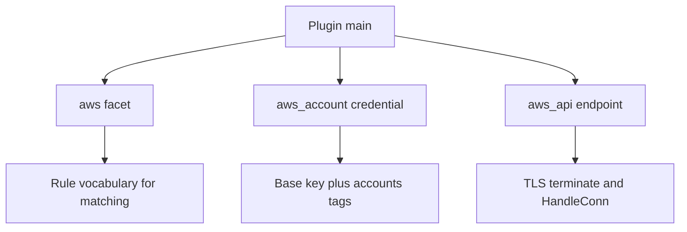

# 00 -- Clawpatrol AWS plugin: a wire-level gate over many AWS accounts

This plugin is one endpoint, one facet, and one credential, registered with the
clawpatrol gateway. Clawpatrol is an agent-security firewall: it sits between
an agent and production, reads traffic at the wire, and gates each action
against rules written in HCL (HashiCorp Configuration Language). This plugin
makes the gateway speak Amazon Web Services (AWS). It does not call AWS itself. It terminates the
agent's TLS (Transport Layer Security), rebuilds every request, and sends it to
AWS through the gateway's brokered dial.

The key idea is in the trust model: the agent's own SigV4 (Signature Version 4)
signature is stripped and thrown away, and the agent's claim about which
operation it is running is not believed either. Both are rebuilt by the plugin.
The agent supplies a placeholder access key id that encodes the target account;
the plugin turns it into temporary credentials and a fresh signature.

```go
// Source: main.go, lines 40-54
func main() {
	pluginsdk.Run(&pluginsdk.Plugin{
		Name:    "aws",
		Version: "0.3.10",
		// No network of its own: every upstream connection — the API call
		// and the STS AssumeRole — is the gateway's audited brokered dial.
		Capabilities: pluginsdk.Capabilities{
			Network: pluginsdk.NetworkNone,
			Egress:  []string{"*.amazonaws.com:443"},
		},
		Facets:      []pluginsdk.FacetDef{awsFacet},
		Credentials: []pluginsdk.CredentialDef{awsAccountCredential},
		Endpoints:   []pluginsdk.EndpointDef{awsAPIEndpoint},
	})
}
```

The `Network: pluginsdk.NetworkNone` line means the plugin owns no sockets.
The `Egress` list names the only hosts the gateway will dial on the plugin's
behalf: anything under `amazonaws.com` on port 443.

## The three registered artifacts

The plugin registers three things. Each maps to one part of the gate.

```go
// Source: main.go, lines 58-66
var awsFacet = pluginsdk.FacetDef{
	Name: "aws",
	Fields: []pluginsdk.FacetField{
		{Name: "service", Kind: pluginsdk.FacetString, Label: "Service", Description: "AWS service", DetailOnly: true},
		// action (the CloudTrail API action, e.g. "ListBuckets") is the Title:
		// the activity-log verb. It reads more naturally than the IAM action
		// (iam_action, "s3:ListBuckets"), which is kept detail-only below but
		// stays matchable via aws.iam_action.
		{Name: "action", Kind: pluginsdk.FacetString, Label: "Action", Description: "API action (CloudTrail)", Title: true},
```

The facet `aws` is the rule vocabulary. Its fields are `service`, `action`, `verb`,
`resource`, `account`, `region`, `method`, `iam_action`, and `account_name`.
`action` is the API operation name (the CloudTrail `eventName`, for example
`DeleteObject`); it is also the title, the verb shown in the activity log.
`iam_action` is the IAM (Identity and Access Management) action with its
service prefix, for example `s3:DeleteObject`. The facet also carries two
result fields: `status` (the HTTP (Hypertext Transfer Protocol) code, or the
AWS error code on failure) and `response_body` (a stream).

The credential is the base key:

```go
// Source: main.go, lines 104-127
var awsAccountCredential = pluginsdk.CredentialDef{
	TypeName: "aws_account",
	Schema: pluginsdk.Schema{Fields: []pluginsdk.SchemaField{
		// 12-digit account ids this key's role-assumption serves; empty = the
		// fallback key for any account no other credential claims.
		{Name: "accounts", TypeString: "list(string)"},
	}},
	Build: func(req pluginsdk.BuildRequest) (any, error) {
		var cfg struct {
			Accounts []string `json:"accounts"`
		}
		_ = json.Unmarshal(req.ConfigJSON, &cfg)
		return pluginsdk.CredentialBuildResult{
			Canonical: map[string]any{"accounts": cfg.Accounts},
			Metadata: pluginsdk.CredentialMetadata{
				SecretSlots: []pluginsdk.SecretSlot{
					{Name: "access_key_id", Label: "Base AWS access key ID"},
					{Name: "secret_access_key", Label: "Base AWS secret access key"},
					{Name: "session_token", Label: "Base AWS session token (optional)"},
				},
			},
		}, nil
	},
}
```

The credential `aws_account` holds a single base key (access key id, secret
access key, optional session token) in a hub account. That one key is used to
assume a per-account role. More than one credential can be bound to an
endpoint; the `accounts` list tags which accounts each key serves, and a
credential with no `accounts` is the catch-all. See
[02-account-selection-and-assume-role.md](./02-account-selection-and-assume-role.md).

The endpoint is where requests arrive:

```go
// Source: main.go, lines 131-140
var awsAPIEndpoint = pluginsdk.EndpointDef{
	TypeName: "aws_api",
	Family:   "aws",
	TLSMode:  pluginsdk.TLSTerminate,
	Schema: pluginsdk.Schema{Fields: []pluginsdk.SchemaField{
		{Name: "role", TypeString: "string", Required: true}, // role name assumed in each account
		{Name: "region", TypeString: "string"},               // default STS/signing region
	}},
	HandleConn: handleAWS,
}
```

`TLSMode: pluginsdk.TLSTerminate` is the first half of the trust model: the
gateway ends the agent's TLS here, so the plugin reads the plain HTTP request
and rebuilds it. The endpoint requires a `role` name (the role assumed in each
account) and takes an optional default `region`. `HandleConn: handleAWS` is the
single handler for every connection.



## The request pipeline

Every request goes through one function, `handleAWS` in main.go. The order
matters. The body is read before the action is parsed (query-protocol services
put the operation name in the form body). The action is parsed before the
account is required. The base key is chosen before the policy is evaluated,
because it also drives account-name resolution. The role is assumed and the
request re-signed only after the policy says the request can go.

```mermaid
%%{init: {"flowchart": {"htmlLabels": false}}}%%
flowchart LR
  A["Agent SDK"] -->|"HTTPS to aws_api"| B["Terminate TLS"]
  B --> C["Read request and body"]
  C --> D["Parse into aws facet"]
  D --> E["Evaluate rules"]
  E -->|"allow or hitl_allow"| F["Assume per-account role"]
  F --> G["Re-sign with SigV4"]
  G --> H["Brokered dial to AWS"]
  H --> I["Stream response to agent"]
```



Two gates stand between the agent and AWS. The first is the policy evaluation
(`conn.Evaluate` with the `aws` facet), which returns a verdict such as `allow`
or `hitl_allow` (human-in-the-loop (HITL)); only those two pass. The second is the rebuild: the plugin
assumes a role and signs a clean request, so the bytes AWS sees are never the
agent's bytes.

## The map of this exploration

- [01-tls-termination-and-parsing.md](./01-tls-termination-and-parsing.md) — how the request becomes the `aws` facet.
- [02-account-selection-and-assume-role.md](./02-account-selection-and-assume-role.md) — the account id, the base key, the role, and account names.
- [03-sigv4-resigning.md](./03-sigv4-resigning.md) — the clean-request rebuild and re-sign.
- [04-s3-and-iam-mapping.md](./04-s3-and-iam-mapping.md) — S3 (Simple Storage Service) operation reconstruction and IAM action mapping.
- [05-chunked-and-body-handling.md](./05-chunked-and-body-handling.md) — aws-chunked decoding and the response body tap.

## The Aha Moment

**Aha:** The plugin never proxies a request. It confiscates it. The agent's
TLS is terminated, its signature is discarded, and its claim about the
operation is audited for consistency and refused if the header, query, and
body do not agree. Only then does the plugin mint fresh credentials and a
fresh signature and dial AWS itself, over the gateway's connection. The agent
writes bytes; the gateway decides what AWS actually runs.

Continue to [01-tls-termination-and-parsing.md](./01-tls-termination-and-parsing.md).
