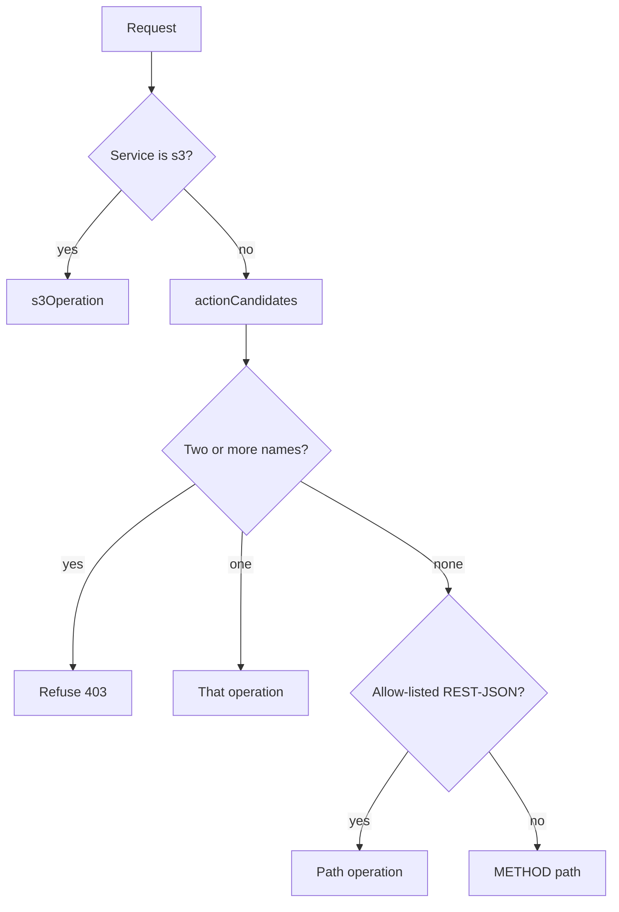
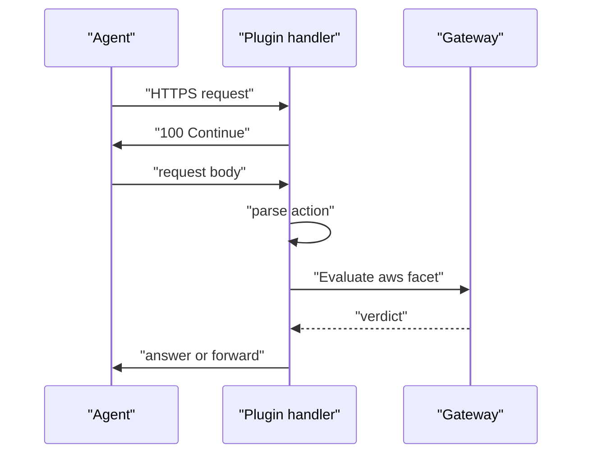

# 01 -- TLS termination and parsing: building the aws facet

The endpoint terminates TLS (Transport Layer Security), so the plugin reads
the plain HTTP (Hypertext Transfer Protocol) request the agent sent. It then
turns that request into the `aws` facet: a set of fields that rules match on.
This document covers the read path, the host parsing, the operation-name
parsing, and the field map. The account and signature rebuild come later, in
[02-account-selection-and-assume-role.md](./02-account-selection-and-assume-role.md)
and [03-sigv4-resigning.md](./03-sigv4-resigning.md).

The handler reads the request off the gateway connection with the standard
library. One detail is easy to miss: it answers `Expect: 100-continue` before
reading the body, because uploads wait for that interim response before they
stream.

```go
// Source: main.go, lines 156-177
	br := bufio.NewReader(conn)
	req, err := http.ReadRequest(br)
	if err != nil {
		return fmt.Errorf("read request: %w", err)
	}
	// Honor Expect: 100-continue before reading the body. Uploads (S3
	// PutObject and friends) send the request headers with
	// "Expect: 100-continue" and wait for an interim 100 response before
	// streaming the body. http.ReadRequest doesn't emit that for us, so
	// without it the io.ReadAll(req.Body) below deadlocks against the
	// waiting client and the connection eventually closes with no response.
	if expectsContinue(req.Header.Get("Expect")) {
		_, _ = conn.Write([]byte("HTTP/1.1 100 Continue\r\n\r\n"))
	}
	host := req.Host
	if host == "" {
		host = conn.UpstreamHost
	}
	service, region := parseServiceRegion(host)
	if region == "" {
		region = cfg.Region
	}
```

The host is where the service and region come from. `parseServiceRegion` walks
the host labels right to left: the region, when present, is the last label
before `.amazonaws.com`; the service is the label before it. Virtual-host-style
S3 (Simple Storage Service) must resolve to service `s3`, not to the bucket
name, or the re-signing breaks.

```go
// Source: parse.go, lines 21-49
func parseServiceRegion(host string) (service, region string) {
	host = strings.ToLower(host)
	const suffix = ".amazonaws.com"
	if !strings.HasSuffix(host, suffix) {
		return "", ""
	}
	labels := strings.Split(strings.TrimSuffix(host, suffix), ".")
	i := len(labels) - 1
	if i < 0 || labels[i] == "" {
		return "", ""
	}
	// Region is the last label when it's a region code (us-east-1).
	if looksLikeRegion(labels[i]) {
		region = labels[i]
		i--
	}
	// Skip addressing qualifiers between the service and region labels
	// (dualstack / fips), e.g. "<bucket>.s3.dualstack.<region>" — they're
	// not the service.
	for i >= 0 && isAddressingQualifier(labels[i]) {
		i--
	}
	if i < 0 {
		return "", region
	}
	service = labels[i]
	service, region = normalizeS3Endpoint(service, region)
	return service, region
}
```

The body is buffered next, capped at 256 MiB (mebibytes; main.go, line 150) so a huge upload
cannot exhaust the gateway's memory. Then the operation is parsed. This is the
heart of the gate: the operation name decides whether a rule reads a call as a
read or a write.

```go
// Source: parse.go, lines 141-160
func parseAction(req *http.Request, body []byte, service string) (string, error) {
	// S3 is REST: the operation is implied by method + path + subresource,
	// never carried as X-Amz-Target / Action. Reconstruct the operation name.
	if service == "s3" {
		return s3Operation(req), nil
	}
	names := actionCandidates(req, body)
	if len(names) > 1 {
		return "", fmt.Errorf("request carries conflicting operation names (%s); "+
			"refusing rather than guessing which one AWS would run",
			describeOperationNames(names))
	}
	if len(names) == 1 {
		return names[0], nil
	}
	if op := restJSONPathOperation(service, req.URL.Path); op != "" {
		return op, nil
	}
	return req.Method + " " + req.URL.Path, nil
}
```

The operation name can travel in three slots: the `X-Amz-Target` header (JSON
protocols), the `Action` parameter in the URL (Uniform Resource Locator) query
or the form body (query protocols), or the path (REST-JSON services). The
plugin does not know which protocol a service speaks, and it must not rank the
sources, because a slot the service ignores is a free decoy. It collects every
operation-shaped name instead; two distinct names mean a refusal.

```go
// Source: parse.go, lines 242-269
func actionCandidates(req *http.Request, body []byte) []string {
	if req.URL.Path != "/" && req.URL.Path != "" {
		return nil
	}
	if len(body) > maxActionScanBody {
		return nil
	}
	var names []string
	add := func(n string) {
		if len(names) >= maxCollectedOperationNames || !isOperationName(n) {
			return
		}
		for _, have := range names {
			if have == n {
				return
			}
		}
		names = append(names, n)
	}
	add(targetOperation(req.Header.Get("X-Amz-Target")))
	for _, a := range queryActions(req.URL.RawQuery) {
		add(a)
	}
	for _, a := range queryActions(string(body)) {
		add(a)
	}
	return names
}
```

A name counts only when the request addresses the service root (`/`), because
every protocol that names its operation this way posts there. On any other path
the operation is the path itself — an agent-controlled resource such as an
AWS Lambda function name — and a planted `Action` must not rename it. The path is
also read only for a short allow-list of REST-JSON services (`savingsplans`; parse.go, lines 340-342),
so an unknown service falls through to `METHOD path` and is gated as a
mutation, never a read.



When the operation is determined, the handler builds the facet fields and asks
the gateway to evaluate the rules.

```go
// Source: main.go, lines 254-273
	fields := map[string]any{
		"service":  service,
		"action":   action, // CloudTrail eventName, e.g. DeleteObject
		"verb":     action, // drives the activity-log verb column
		"account":  account,
		"region":   region,
		"resource": req.URL.Path,
		"method":   req.Method,
	}
	if iam := iamAction(service, action); iam != "" {
		fields["iam_action"] = iam // e.g. s3:DeleteObject, s3:ListBucket
	}
	// account_name comes from AWS Organizations. Omit it when it can't be
	// resolved: a rule matching aws.account_name then evaluates to a CEL
	// unknown and fails closed, while rules that don't reference it are
	// unaffected.
	acctName, known := org.accountName(ctx, conn, base, cfg.Role, account)
	if known {
		fields["account_name"] = acctName
	}
```

`resource` is the request URL path. `iam_action` is omitted when it cannot be
determined, and `account_name` is omitted when Organizations cannot resolve it.
Both are deliberately not `Optional` in the facet definition, so an omitted
value stays absent and a rule that references it fails closed as a CEL (Common
Expression Language) unknown. See [04-s3-and-iam-mapping.md](./04-s3-and-iam-mapping.md)
for the Identity and Access Management (IAM) mapping and [02-account-selection-and-assume-role.md](./02-account-selection-and-assume-role.md)
for the Organizations lookup.

A request that is refused before its operation is determined still leaves a
record. The handler files a `deny` event and then answers the agent, so an
agent probing for a decoy slot shows on the dashboard as clearly as a request a
rule denied. Every value the agent wrote is clamped in length.



## The Aha Moment

**Aha:** The operation name is a claim the agent makes in three places at once,
and the plugin treats disagreement as an attack. It does not rank the header
over the body, or the body over the query, because a slot a real service
ignores is a decoy slot — preferring the header would gate `TerminateInstances`
as a read while EC2 (Elastic Compute Cloud) runs the termination. Collecting every name and refusing on
any two distinct ones is the whole defense: no legitimate client sends two.

Continue to [02-account-selection-and-assume-role.md](./02-account-selection-and-assume-role.md).
