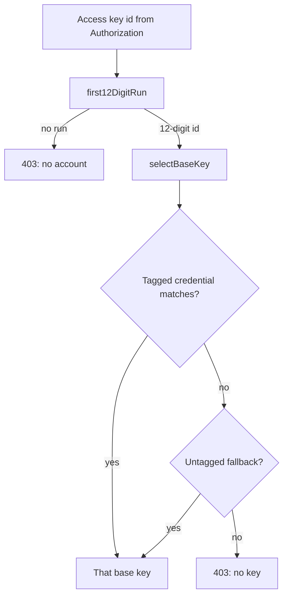
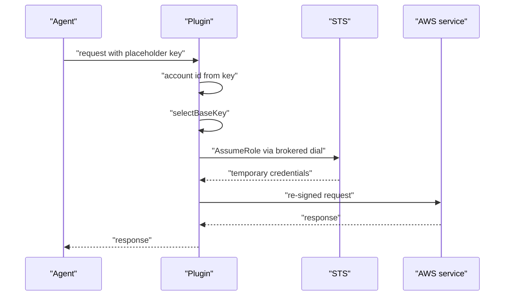

# 02 -- Account selection and assume-role: identity and credentials

The plugin has one base IAM (Identity and Access Management) key in a hub
account, and a role of the same name in every member account. The agent picks
the target account by writing its access key id as a placeholder that encodes
the 12-digit account id. This document covers three steps: deriving the account
id, choosing the base key, and assuming the per-account role. It also covers
how account names come from AWS (Amazon Web Services) Organizations through the
same assume-role machinery.

The account id is pulled out of the SigV4 (Signature Version 4) `Authorization`
header. The operator writes `AKIA<account-id>XXXX` as the agent's access key id,
and the plugin reads the first run of 12 consecutive digits.

```go
// Source: parse.go, lines 388-426
func accessKeyFromAuthorization(authz string) string {
	const marker = "Credential="
	i := strings.Index(authz, marker)
	if i < 0 {
		return ""
	}
	rest := authz[i+len(marker):]
	if j := strings.IndexByte(rest, '/'); j >= 0 {
		return rest[:j]
	}
	return ""
}

// accountFromAuthorization derives the target 12-digit AWS account id from
// the agent's request. The operator encodes the account id in the agent's
// per-account placeholder access key id (e.g. "AKIA035475582903XXXX"); this
// returns the first 12-consecutive-digit run found in it, or "".
func accountFromAuthorization(authz string) string {
	return first12DigitRun(accessKeyFromAuthorization(authz))
}

func first12DigitRun(s string) string {
	run := 0
	start := 0
	for i := 0; i < len(s); i++ {
		if s[i] >= '0' && s[i] <= '9' {
			if run == 0 {
				start = i
			}
			run++
			if run == 12 {
				return s[start : start+12]
			}
		} else {
			run = 0
		}
	}
	return ""
}
```

If no account can be derived, the handler answers 403 and stops: there is no
account to bill the request to, and no base key to pick. The agent's real
secret is never used; it is a placeholder, because the gateway re-signs.

## Choosing the base key

One endpoint can bind several `aws_account` credentials, each tagged with the
accounts its key serves. `selectBaseKey` picks the credential whose `accounts`
list contains the target account, and falls back to a credential that lists no
accounts.

```go
// Source: credselect.go, lines 20-48
func selectBaseKey(conn *pluginsdk.Conn, accountID string) (aws.Credentials, error) {
	if len(conn.Credentials) == 0 {
		return baseKey(conn), nil // legacy single-credential delivery
	}
	var fallback *pluginsdk.ConnCredential
	for i := range conn.Credentials {
		c := &conn.Credentials[i]
		if c.TypeName != "aws_account" {
			continue
		}
		accts := credentialAccounts(c.CanonicalConfig)
		if len(accts) == 0 {
			if fallback == nil {
				fallback = c
			}
			continue
		}
		for _, a := range accts {
			if a == accountID {
				return credFromExtras(c.Extras), nil
			}
		}
	}
	if fallback != nil {
		return credFromExtras(fallback.Extras), nil
	}
	return aws.Credentials{}, fmt.Errorf(
		"no aws_account credential serves account %s (tag a credential's accounts with it, or bind a credential with no accounts as the fallback)", accountID)
}
```

With a single untagged credential — the common case — that one key serves every
account. The base key is needed before policy evaluation, because it also
drives Organizations account-name resolution.



## Assuming the role

The role is assumed over the gateway's brokered dial, not over a socket the
plugin owns. The STS (Security Token Service) call goes through an SDK (Software
Development Kit) HTTP client whose transport dials `conn.DialUpstream`, so the
traffic is gateway-audited and bounded by the egress allow-list. The result is
cached per role ARN (Amazon Resource Name) and session name until shortly
before expiry.

```go
// Source: assumerole.go, lines 68-98
func assumeRole(ctx context.Context, conn *pluginsdk.Conn, base aws.Credentials, accountID, role, sessionName string) (aws.Credentials, error) {
	arn := fmt.Sprintf("arn:aws:iam::%s:role/%s", accountID, role)
	cacheKey := arn + "\x00" + sessionName
	if c, ok := assumed.get(cacheKey); ok {
		return c, nil
	}

	cfg := aws.Config{
		Region:      stsRegion,
		Credentials: awscreds.NewStaticCredentialsProvider(base.AccessKeyID, base.SecretAccessKey, base.SessionToken),
		HTTPClient:  brokeredHTTPClient(conn),
	}
	out, err := sts.NewFromConfig(cfg).AssumeRole(ctx, &sts.AssumeRoleInput{
		RoleArn:         aws.String(arn),
		RoleSessionName: aws.String(sessionName),
	})
	if err != nil {
		return aws.Credentials{}, fmt.Errorf("assume %s: %w", arn, err)
	}
	creds := aws.Credentials{
		AccessKeyID:     aws.ToString(out.Credentials.AccessKeyId),
		SecretAccessKey: aws.ToString(out.Credentials.SecretAccessKey),
		SessionToken:    aws.ToString(out.Credentials.SessionToken),
	}
	expiry := time.Now().Add(time.Hour)
	if out.Credentials.Expiration != nil {
		expiry = *out.Credentials.Expiration
	}
	assumed.put(cacheKey, creds, expiry)
	return creds, nil
}
```

The cache key joins the role ARN and the session name with a NUL byte. The
session name is part of the key so credentials minted for one session (for
example the Organizations resolver's `clawpatrol-orgresolve`) are never reused
for another session's calls; otherwise CloudTrail would misattribute the
caller. Cached credentials are reused until five minutes before expiry (assumerole.go, lines 26-27).

```go
// Source: assumerole.go, lines 103-116
func brokeredHTTPClient(conn *pluginsdk.Conn) *http.Client {
	return &http.Client{
		Timeout: 20 * time.Second,
		Transport: &http.Transport{
			DialTLSContext: func(ctx context.Context, _, addr string) (net.Conn, error) {
				host, _, err := net.SplitHostPort(addr)
				if err != nil {
					host = addr
				}
				return conn.DialUpstream(ctx, "tcp", addr, &pluginsdk.DialUpstreamOptions{TLS: true, TLSServerName: host})
			},
		},
	}
}
```



## Account names from Organizations

`aws.account_name` is read live from AWS Organizations, not from an operator
alias. The resolver finds the hub account with `GetCallerIdentity`, assumes the
configured role there, reads the management account id with
`DescribeOrganization`, then lists every account with `ListAccounts`,
re-assuming the role in the management account only when it is not the hub (`masterID != hub`) and reusing the hub credentials otherwise. The whole id-to-name map is cached for
15 minutes and single-flighted so concurrent requests trigger one refresh (orgresolver.go, lines 26 and 33-36).

```go
// Source: orgresolver.go, lines 102-127
func fetchOrgAccounts(ctx context.Context, conn *pluginsdk.Conn, base aws.Credentials, role string) (map[string]string, error) {
	hub, err := callerAccount(ctx, conn, base)
	if err != nil {
		return nil, fmt.Errorf("get caller identity: %w", err)
	}
	hubCreds, err := assumeRole(ctx, conn, base, hub, role, "clawpatrol-orgresolve")
	if err != nil {
		return nil, err
	}
	masterID, err := describeOrgMaster(ctx, conn, hubCreds)
	if err != nil {
		return nil, fmt.Errorf("describe organization: %w", err)
	}
	mgmtCreds := hubCreds
	if masterID != hub {
		mgmtCreds, err = assumeRole(ctx, conn, base, masterID, role, "clawpatrol-orgresolve")
		if err != nil {
			return nil, err
		}
	}
	names, err := listAccountNames(ctx, conn, mgmtCreds)
	if err != nil {
		return nil, fmt.Errorf("list accounts: %w", err)
	}
	return names, nil
}
```

The assumed role therefore needs `organizations:DescribeOrganization` in the hub
account and `organizations:ListAccounts` in the management account; when the hub is itself the management account, the one role needs both. When a name
cannot be resolved the handler omits `aws.account_name`, so a rule matching on
it evaluates to a CEL (Common Expression Language) unknown and fails closed,
while rules that do not reference it are unaffected. See
[01-tls-termination-and-parsing.md](./01-tls-termination-and-parsing.md) for how
the field is built, and [00-plugin-architecture.md](./00-plugin-architecture.md)
for the base-key model.

## The Aha Moment

**Aha:** The account id is carried as data inside a placeholder key, not as
metadata the plugin invents. The agent already signs with an access key id, so
reusing that slot to encode the account costs the operator nothing and removes
a whole channel of attacker-controlled account claims. Everything after it —
base-key selection, the role ARN, the Organizations name — flows from that one
12-digit run, and the plugin never guesses an account from anything else.

Continue to [03-sigv4-resigning.md](./03-sigv4-resigning.md).
