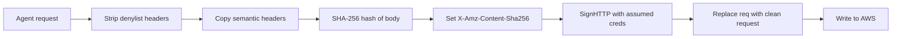
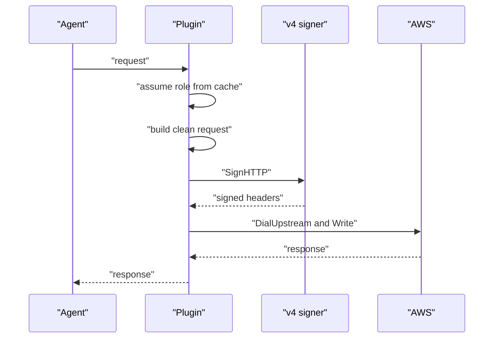

# 03 -- SigV4 re-signing: a clean request, signed fresh

Once the policy allows the request, the plugin must replace the agent's SigV4
(Signature Version 4) signature with one AWS (Amazon Web Services) will accept.
The agent's signature is computed over its placeholder secret, so AWS would
reject it as `SignatureDoesNotMatch`. The re-sign happens over the assumed-role
credentials from [02-account-selection-and-assume-role.md](./02-account-selection-and-assume-role.md).

The subtle decision is not to re-sign the agent's `*http.Request` in place.
That object arrives through `http.ReadRequest` carrying transport and streaming
headers and parser state that make the signed canonical request differ from the
bytes that `req.Write` later puts on the wire. The plugin builds a fresh
request instead.

```go
// Source: main.go, lines 449-459
// signRequest replaces *req with a freshly built upstream request for host,
// carrying body and only the operation-relevant headers, signed with creds.
//
// Re-signing the agent's own *http.Request in place is fragile: it arrives
// via http.ReadRequest carrying transport/streaming headers (Expect,
// Accept-Encoding, aws-chunked framing, the agent's placeholder
// Authorization/x-amz-content-sha256) and parser state that make SignHTTP
// cover header values the subsequent req.Write serializes differently —
// S3 then rejects with SignatureDoesNotMatch. Building a clean request and
// copying only the headers that are part of the S3 operation keeps the
// signed canonical request and the bytes on the wire identical.
```

The rebuild copies only the headers that are part of the operation's semantics,
then hashes the body, sets `X-Amz-Content-Sha256`, and signs.

```go
// Source: main.go, lines 460-481
func signRequest(ctx context.Context, req *http.Request, host string, body []byte, service, region string, creds aws.Credentials) error {
	out, err := http.NewRequestWithContext(ctx, req.Method, "https://"+host+req.URL.RequestURI(), bytes.NewReader(body))
	if err != nil {
		return err
	}
	out.ContentLength = int64(len(body))
	for k, vs := range req.Header {
		if signerControlledHeader(k) {
			continue
		}
		out.Header[http.CanonicalHeaderKey(k)] = append([]string(nil), vs...)
	}

	sum := sha256.Sum256(body)
	hash := hex.EncodeToString(sum[:])
	out.Header.Set("X-Amz-Content-Sha256", hash)
	if err := v4.NewSigner().SignHTTP(ctx, creds, out, hash, service, region, time.Now()); err != nil {
		return err
	}
	*req = *out
	return nil
}
```

The payload hash is the SHA-256 (Secure Hash Algorithm 256-bit) of the body,
hex-encoded. `SignHTTP` is the AWS SDK (Software Development Kit) v4 signer; it
computes the `Authorization` header and `X-Amz-Date` over the clean request.

The header filter is a denylist, not an allow-list, and the reasoning is
deliberate:

```go
// Source: main.go, lines 483-502
// signerControlledHeader reports whether a request header is one the gateway
// owns and must not copy verbatim from the agent: SigV4 auth/identity and
// payload-hash headers that the re-sign recomputes, content-length and host
// that come from the request fields, and hop-by-hop transport headers. Every
// other header (Content-Type, Range, conditional, SSE, copy-source, ACL
// grants, x-amz-meta-*, checksums, ...) is part of the operation's semantics
// and is forwarded and signed as sent — an allow-list would silently drop
// operation-affecting headers (wrong bytes from a Range GET, an object stored
// unencrypted when SSE headers vanish, a broken CopyObject).
func signerControlledHeader(k string) bool {
	switch strings.ToLower(k) {
	case "authorization", "x-amz-date", "x-amz-security-token",
		"x-amz-content-sha256", "content-length", "host", "expect",
		"user-agent", "accept-encoding",
		"connection", "proxy-connection", "keep-alive",
		"transfer-encoding", "te", "trailer", "upgrade":
		return true
	}
	return false
}
```

The denylist strips exactly what the re-sign recomputes or what belongs to the
transport: the old authorization, the old date and token, the payload hash, the
length, the host, and hop-by-hop headers such as `Connection` and
`Transfer-Encoding`. Everything else — `Content-Type`, `Range`, SSE (Server-Side
Encryption) headers, `x-amz-copy-source`, ACL (Access Control List) grants,
`x-amz-meta-*`, checksums — is forwarded and signed as sent, so an object is
stored with the encryption the agent asked for and a `Range` read returns the
right bytes. An allow-list would silently drop headers that change the
operation.



The body that feeds the hash is the same body the plugin forwards. For S3
(Simple Storage Service) streaming uploads the aws-chunked framing was already
decoded back to the raw content and the chunked headers removed, so the hash
matches what S3 receives. See [05-chunked-and-body-handling.md](./05-chunked-and-body-handling.md).

After signing, the handler dials AWS and writes the request, then reads the
response:



The dial is also the gateway's: `conn.DialUpstream(ctx, "tcp", host+":443",
TLS: true, TLSServerName: host)`, matching the no-network rule in
[00-plugin-architecture.md](./00-plugin-architecture.md).

## The Aha Moment

**Aha:** The signature is not computed over the request the agent sent; it is
computed over a request the plugin rebuilt, byte for byte, and then forwards.
Re-signing in place would sign a phantom — headers the signer saw but the wire
did not — and S3 would reject it. Building a clean request and copying only the
semantic headers through a denylist is what makes the signed canonical request
identical to the bytes on the wire, and it is also what preserves
operation-affecting headers an allow-list would drop.

Continue to [04-s3-and-iam-mapping.md](./04-s3-and-iam-mapping.md).
