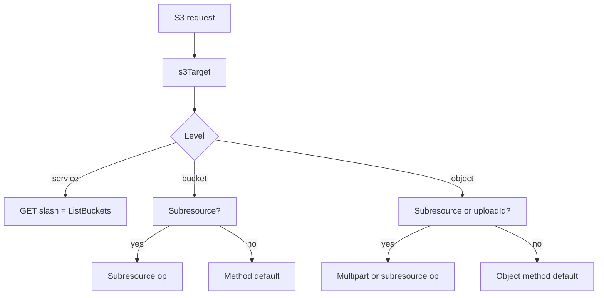
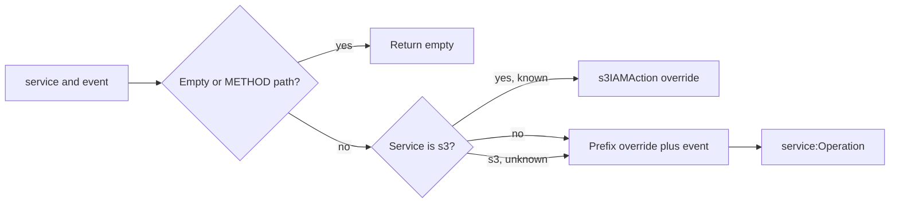

# 04 -- S3 and IAM mapping: operation names to policy actions

Two mappings turn a raw request into the rule vocabulary from
[01-tls-termination-and-parsing.md](./01-tls-termination-and-parsing.md). The
first reconstructs the S3 (Simple Storage Service) operation name, which is
never on the wire as a header or a parameter. The second maps a service and
operation to the IAM (Identity and Access Management) action an operator would
write in a policy. The same service and operation also drive the re-sign in
[03-sigv4-resigning.md](./03-sigv4-resigning.md), so getting the service right
is load-bearing for both the rule and the signature.

S3 is a REST (Representational State Transfer) service: the operation is
implied by the HTTP (Hypertext Transfer Protocol) method, whether the request
addresses the service, a bucket, or an object, and the subresource query
parameter (`?acl`, `?policy`, `?policyStatus`, `?tagging`, `?versioning`, `?versions`, `?location`, `?lifecycle`, `?cors`, `?website`, `?logging`, `?notification`, `?replication`, `?encryption`, `?object-lock`, `?accelerate`, `?requestPayment`, `?publicAccessBlock`, `?ownershipControls`, `?analytics`, `?inventory`, `?metrics`, `?intelligent-tiering`, `?uploads`, `?delete`, `?object-lambda-acl`, `?requestPaymentConfig`, `?retention`, `?legal-hold`, `?torrent`, `?attributes`, `?restore`, and `?select`). Two addressing styles
exist: path-style, where the bucket is the first path segment, and
virtual-host-style, where the bucket is the leftmost host label.

```go
// Source: s3op.go, lines 36-66
func s3BucketInHost(host string) bool {
	host = strings.ToLower(host)
	const suffix = ".amazonaws.com"
	if !strings.HasSuffix(host, suffix) {
		return false
	}
	labels := strings.Split(strings.TrimSuffix(host, suffix), ".")
	// Path-style hosts are exactly "s3", "s3-<region>", "s3.<region>",
	// "s3-fips.<region>", "s3.dualstack.<region>", etc. — the leftmost label
	// always begins with "s3". A virtual-host bucket prepends a label that
	// does not, e.g. "mybucket.s3.us-east-1".
	return len(labels) > 0 && !strings.HasPrefix(labels[0], "s3")
}

// s3Target classifies the request as service/bucket/object addressing.
func s3Target(host, path string) s3Level {
	trimmed := strings.Trim(path, "/")
	if s3BucketInHost(host) {
		if trimmed == "" {
			return s3Bucket
		}
		return s3Object
	}
	if trimmed == "" {
		return s3Service
	}
	if i := strings.IndexByte(trimmed, '/'); i >= 0 && trimmed[i+1:] != "" {
		return s3Object
	}
	return s3Bucket
}
```

With the level known, `s3Operation` looks up a subresource table first, then
falls back to the method-plus-level default.

```go
// Source: s3op.go, lines 116-148
func s3Operation(req *http.Request) string {
	q := req.URL.Query()
	level := s3Target(req.Host, req.URL.Path)
	method := strings.ToUpper(req.Method)

	switch level {
	case s3Service:
		// Only the service root: GET / lists buckets.
		if method == http.MethodGet {
			return "ListBuckets"
		}
		return method + " /"

	case s3Bucket:
		if op := s3SubresourceOp(s3BucketSubresource, q, method); op != "" {
			return op
		}
		switch method {
		case http.MethodGet:
			// list-type=2 is ListObjectsV2; bare GET bucket is the v1 ListObjects.
			if q.Get("list-type") == "2" {
				return "ListObjectsV2"
			}
			return "ListObjects"
		case http.MethodHead:
			return "HeadBucket"
		case http.MethodPut:
			return "CreateBucket"
		case http.MethodDelete:
			return "DeleteBucket"
		case http.MethodPost:
			return "PostBucket"
		}
```

The object level adds the multipart upload lifecycle, keyed on the `uploads`
query and the `uploadId` query, and `X-Amz-Copy-Source` distinguishes
`CopyObject` from `PutObject` and `UploadPartCopy` from `UploadPart`.

```go
// Source: s3op.go, lines 150-172
	case s3Object:
		if op := s3SubresourceOp(s3ObjectSubresource, q, method); op != "" {
			return op
		}
		// Multipart upload lifecycle keys on the uploadId / uploads query.
		if _, ok := q["uploads"]; ok && method == http.MethodPost {
			return "CreateMultipartUpload"
		}
		if q.Get("uploadId") != "" {
			switch method {
			case http.MethodPut:
				if req.Header.Get("X-Amz-Copy-Source") != "" {
					return "UploadPartCopy"
				}
				return "UploadPart"
			case http.MethodPost:
				return "CompleteMultipartUpload"
			case http.MethodDelete:
				return "AbortMultipartUpload"
			case http.MethodGet:
				return "ListParts"
			}
		}
```

The subresource lookup is exact: a write method with a subresource that only
maps to a read method falls through to the write default, so it can never be
auto-allowed as a read. An unknown HTTP method falls through to `METHOD path`,
which matches no read prefix and is gated as a mutation. This is fail-closed.



## Mapping to IAM actions

`iamAction` maps a wire service and operation name to the IAM action string.
For most services it is simply `<service>:<Operation>`; two kinds of divergence
are corrected: a service prefix that differs from the host label, and S3's
historically irregular action names.

```go
// Source: iamaction.go, lines 24-49
func iamAction(service, event string) string {
	if service == "" || event == "" || strings.ContainsAny(event, " /") {
		return ""
	}
	if service == "s3" {
		if a, ok := s3IAMAction[event]; ok {
			return a
		}
	}
	return iamServicePrefix(service) + ":" + event
}

// iamServicePrefix maps a host service label to its IAM action prefix when the
// two differ; otherwise the service label is the prefix.
func iamServicePrefix(service string) string {
	if p, ok := iamPrefixOverride[service]; ok {
		return p
	}
	return service
}

var iamPrefixOverride = map[string]string{
	"monitoring":       "cloudwatch",
	"email":            "ses",
	"streams.dynamodb": "dynamodb",
}
```

The function returns `""` when the service or operation is empty or the
operation is a raw `METHOD path` fallback. The caller then omits the
`aws.iam_action` field, so a rule matching on it fails closed rather than
matching a guess. The S3 overrides correct names such as `ListObjectsV2` to
`s3:ListBucket` and `GetBucketLifecycleConfiguration` to
`s3:GetLifecycleConfiguration`.

```go
// Source: iamaction.go, lines 55-74
var s3IAMAction = map[string]string{
	"ListBuckets":             "s3:ListAllMyBuckets",
	"ListObjects":             "s3:ListBucket",
	"ListObjectsV2":           "s3:ListBucket",
	"HeadBucket":              "s3:ListBucket",
	"ListObjectVersions":      "s3:ListBucketVersions",
	"ListMultipartUploads":    "s3:ListBucketMultipartUploads",
	"ListParts":               "s3:ListMultipartUploadParts",
	"HeadObject":              "s3:GetObject",
	"SelectObjectContent":     "s3:GetObject",
	"CopyObject":              "s3:PutObject",
	"UploadPart":              "s3:PutObject",
	"UploadPartCopy":          "s3:PutObject",
	"CreateMultipartUpload":   "s3:PutObject",
	"CompleteMultipartUpload": "s3:PutObject",
	"PostObject":              "s3:PutObject",
	"DeleteObjects":           "s3:DeleteObject",
	// Bucket configuration subresources whose IAM action name drops "Bucket"
	// or otherwise differs from the API operation name.
	"GetBucketLifecycleConfiguration":    "s3:GetLifecycleConfiguration",
```

`iam_action` is best-effort: exact for the common data-plane operations and the
curated divergences, and `<service>:<Operation>` otherwise. It is the action an
operator writes in a policy, distinct from `aws.action`, which is the API
operation name and the title of the activity record.



## The Aha Moment

**Aha:** S3 does not tell you what operation it is running; you must re-derive
it from three silent facts — method, addressing level, and subresource — and
the derivation must refuse to fabricate on anything it does not recognize. The
same restraint applies to the IAM action: an empty or `METHOD path` result is
dropped rather than guessed, so both `aws.action` and `aws.iam_action` either
name something real or stay absent and fail closed.

Continue to [05-chunked-and-body-handling.md](./05-chunked-and-body-handling.md).
