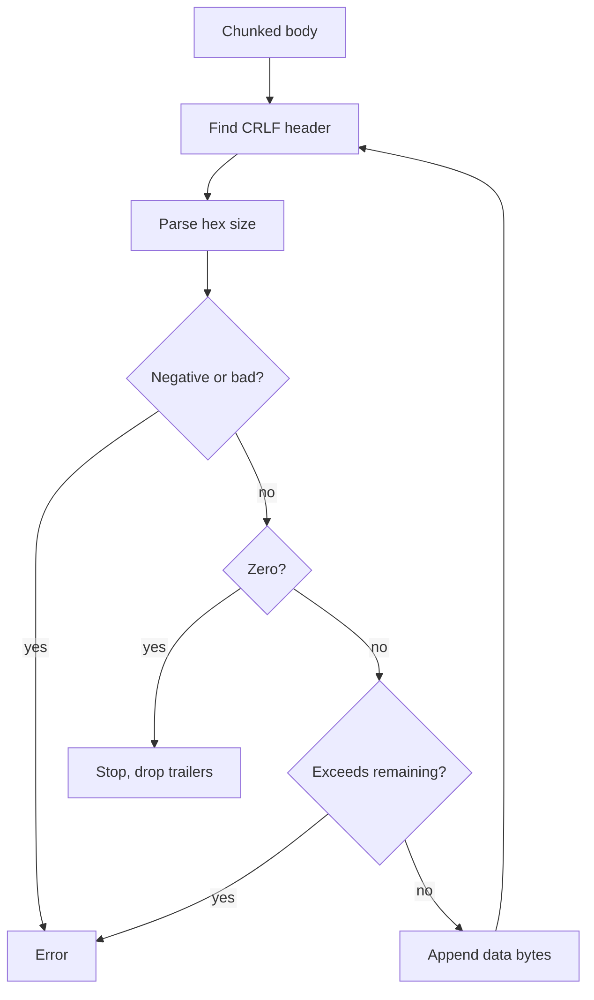
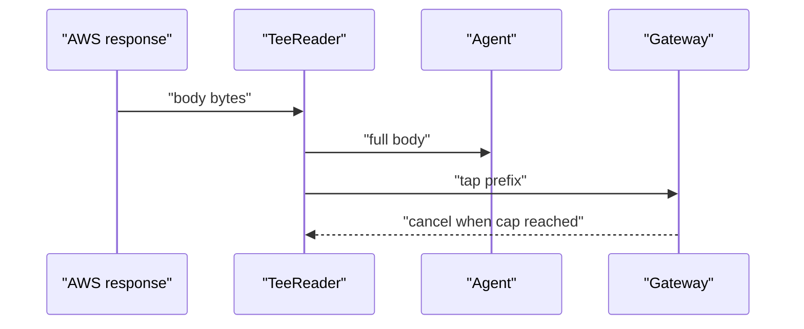

# 05 -- Chunked and body handling: streaming, bounds, and the response tap

Two kinds of body flow through the plugin: the request body, which can arrive
in S3 (Simple Storage Service) `aws-chunked` streaming encoding, and the
response body, which is tapped for the gateway while the agent still gets the
full stream. This document covers both, plus the size bounds that keep an
attacker-controlled body from breaking the decoder.

S3 uploads stream with a chunked content encoding: each chunk is length-prefixed
and carries a per-chunk signature, and the final chunk is zero-sized. The plugin
re-signs as a plain payload, so it must decode the framing back to the raw
content and drop the chunked headers; otherwise the body S3 receives does not
match the hash and length the re-sign from [03-sigv4-resigning.md](./03-sigv4-resigning.md)
signs.

```go
// Source: chunked.go, lines 14-19
func isAWSChunked(h http.Header) bool {
	if containsToken(h.Get("Content-Encoding"), "aws-chunked") {
		return true
	}
	return strings.HasPrefix(strings.ToUpper(h.Get("X-Amz-Content-Sha256")), "STREAMING-")
}
```

The decoder walks the wire format `<hex-size>[;chunk-signature=<hex>]\r\n<size
bytes>\r\n`, terminated by a zero-size chunk that can be followed by trailing
headers. Per-chunk signatures and trailers are ignored — only the data bytes
matter, because the gateway re-signs the reconstructed payload from scratch.

```go
// Source: chunked.go, lines 56-102
func decodeAWSChunked(body []byte) ([]byte, error) {
	out := make([]byte, 0, len(body))
	i := 0
	for {
		j := bytes.Index(body[i:], []byte("\r\n"))
		if j < 0 {
			return nil, fmt.Errorf("malformed chunk header (no CRLF)")
		}
		line := body[i : i+j]
		i += j + 2

		sizeField := line
		if k := bytes.IndexByte(line, ';'); k >= 0 {
			sizeField = line[:k]
		}
		size, err := strconv.ParseInt(string(bytes.TrimSpace(sizeField)), 16, 64)
		if err != nil {
			return nil, fmt.Errorf("bad chunk size %q: %w", string(bytes.TrimSpace(sizeField)), err)
		}
		// ParseInt honors a sign prefix in base 16 too, so the size field
		// can name a negative value. It is rejected here because the bound
		// below, and the slice expression under it, both require a
		// non-negative size: a negative one clears the bound and slices
		// backwards.
		if size < 0 {
			return nil, fmt.Errorf("negative chunk size %d", size)
		}
		if size == 0 {
			// Final chunk; any trailers that follow are not part of the
			// object content.
			break
		}
		// Clearing this bound is what makes int(size) exact and keeps both
		// i+int(size) and the slice below within len(body).
		if size > int64(len(body)-i) {
			return nil, fmt.Errorf("chunk size %d exceeds remaining body %d", size, len(body)-i)
		}
		out = append(out, body[i:i+int(size)]...)
		i += int(size)
		// Optional trailing CRLF after the chunk data. Two bytes have to
		// remain for body[i] and body[i+1] to be in range.
		if len(body)-i >= 2 && body[i] == '\r' && body[i+1] == '\n' {
			i += 2
		}
	}
	return out, nil
}
```

The size field is written by the agent, so every value an int64 (64-bit signed
integer) can hold reaches the scan. The bounds therefore subtract `i` from
`len(body)` instead of adding to `i`: a size near the maximum integer would wrap
an addition negative and clear the bound on its way to an out-of-range slice.
The decoder rejects negative sizes and sizes past the remaining bytes.

After decoding, the handler removes every header that described the framing and
the agent's checksum, then resets the content length:

```go
// Source: main.go, lines 203-222
	if isAWSChunked(req.Header) {
		decoded, derr := decodeAWSChunked(body)
		if derr != nil {
			return fmt.Errorf("decode aws-chunked body: %w", derr)
		}
		body = decoded
		req.Header.Del("Content-Encoding")
		req.Header.Del("X-Amz-Decoded-Content-Length")
		req.Header.Del("X-Amz-Trailer")
		// The trailing chunk carried the agent's checksum, which we drop with
		// the framing. Remove the checksum-declaring headers too so the
		// re-signed plain PutObject doesn't promise a checksum we won't send.
		req.Header.Del("X-Amz-Sdk-Checksum-Algorithm")
		for _, k := range headerKeys(req.Header) {
			if strings.HasPrefix(strings.ToLower(k), "x-amz-checksum-") {
				req.Header.Del(k)
			}
		}
		req.ContentLength = int64(len(body))
	}
```



## The response body tap

On the way back, the plugin reports the outcome to the gateway without ever
short-changing the agent. The response body is piped through a `bodyTap`, a
non-blocking bounded buffer: the agent always reads the full body through a
tee, and the gateway drains a separate reader over the same buffer up to its
own cap, then cancels.

```go
// Source: main.go, lines 373-415
func (t *bodyTap) Write(p []byte) (int, error) {
	t.mu.Lock()
	if room := t.cap - len(t.buf); room > 0 {
		n := len(p)
		if n > room {
			n = room
		}
		t.buf = append(t.buf, p[:n]...)
		t.cond.Broadcast()
	}
	t.mu.Unlock()
	return len(p), nil
}

// close marks the tap as done; a reader blocked for more data wakes and, once
// it has drained the buffer, sees EOF.
func (t *bodyTap) close() {
	t.mu.Lock()
	t.closed = true
	t.cond.Broadcast()
	t.mu.Unlock()
}

// reader returns an io.Reader over the captured bytes for the gateway. The
// gateway cancelling (closing the reader mid-way) just stops the reads; it
// never touches the Write side, so resp.Write to the agent is unaffected.
func (t *bodyTap) reader() io.Reader { return &bodyTapReader{t: t} }

type bodyTapReader struct{ t *bodyTap }

func (r *bodyTapReader) Read(p []byte) (int, error) {
	t := r.t
	t.mu.Lock()
	defer t.mu.Unlock()
	for t.off >= len(t.buf) && !t.closed {
		t.cond.Wait()
	}
	if n := copy(p, t.buf[t.off:]); n > 0 {
		t.off += n
		return n, nil
	}
	return 0, io.EOF
}
```

`Write` always reports the full length consumed and never blocks, so the copy
feeding the agent is never stalled or errored by the tap. A mutex (mutual
exclusion lock) plus a condition variable guard the buffer while the write side
and the read side run concurrently.



Before the tap, the handler resolves the result `status`. On success it is the
HTTP (Hypertext Transfer Protocol) code; on a 4xx or 5xx response the Amazon Web Services (AWS) error
code (for example `AccessDenied`) is far more useful, so the error body is
buffered and scanned, then restored so the agent still gets it.

```go
// Source: main.go, lines 627-651
func awsErrorCode(h http.Header, body []byte) string {
	if et := h.Get("X-Amzn-Errortype"); et != "" {
		// e.g. "AccessDeniedException:http://internal.amazon.com/...".
		if i := strings.IndexByte(et, ':'); i > 0 {
			et = et[:i]
		}
		return strings.TrimSpace(et)
	}
	s := string(body)
	if m := xmlErrCodeRe.FindStringSubmatch(s); len(m) == 2 {
		return m[1]
	}
	if m := jsonErrTypeRe.FindStringSubmatch(s); len(m) == 2 {
		t := m[1]
		// "...ServiceException#AccessDeniedException" -> "AccessDeniedException".
		if i := strings.LastIndexByte(t, '#'); i >= 0 {
			t = t[i+1:]
		}
		return t
	}
	if m := jsonErrCodeRe.FindStringSubmatch(s); len(m) == 2 {
		return m[1]
	}
	return ""
}
```

The request body itself is capped at 256 MiB (mebibytes; main.go, line 150) before parsing, and a
request beyond it is answered 413 (main.go, lines 192-194). Larger objects need multipart or streaming
uploads; the current implementation does not yet cover chunked or streaming request bodies beyond the buffered limit.
See [01-tls-termination-and-parsing.md](./01-tls-termination-and-parsing.md) and
[04-s3-and-iam-mapping.md](./04-s3-and-iam-mapping.md).

## The Aha Moment

**Aha:** The plugin treats every body as data to rebuild, not as a
stream to pass through. The request body is decoded from aws-chunked framing
with bounds that survive an attacker's maximum integer, and the response body
is duplicated through a non-blocking tap so the gateway can observe it without
ever holding up the agent. In both directions the invariant is the same: the
agent's bytes are never trusted, and the agent is never starved by the gateway's
inspection.

Continue to [README.md](./README.md).
