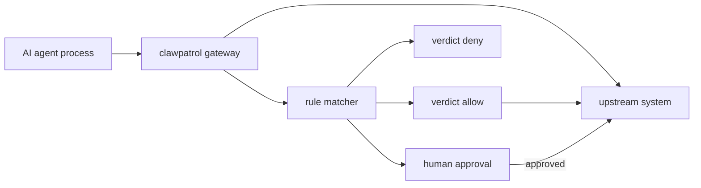
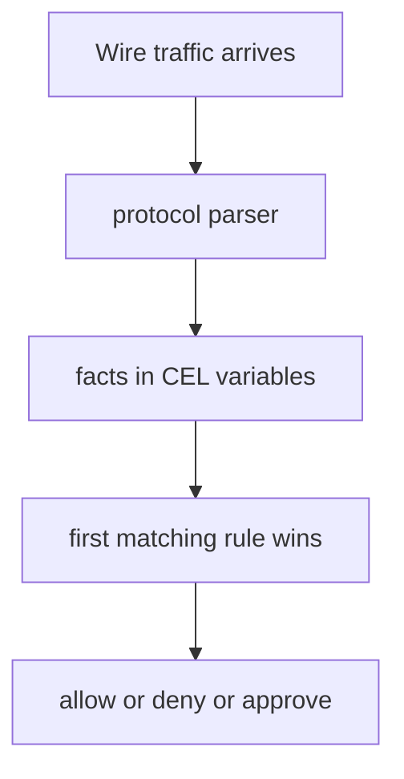

# 00 -- Overview: an agent firewall at the wire

clawpatrol is a security firewall for AI agents. It is a Go program that sits
between an agent and production systems, reads the agent's network traffic at
the wire level, and checks each action against rules the operator writes in
HCL (HashiCorp Configuration Language). The self-description in the binary's
usage text calls it exactly that:

```go
// Source: cmd/clawpatrol/main.go, lines 3630-3634
func usage() {
	fmt.Fprintln(os.Stderr, `clawpatrol — secret-injection MITM proxy for AI agents

usage:
  clawpatrol gateway <config.hcl>        run the gateway server
```

The README prose example is block destructive SQL, or pause a `kubectl delete
pod` until a human approves; the HCL rule it shows blocks reading Kubernetes
Secret objects. A real production rule is only six lines:

```hcl
// Source: README.md, lines 25-30
rule "k8s-no-secrets" {
  endpoint  = k8s-prod
  condition = "k8s.resource == 'secrets'"
  verdict   = "deny"
  reason    = "Secret values must not leave the cluster via the agent"
}
```

The `condition` is a CEL (Common Expression Language) expression over facts
the gateway extracts per protocol: SQL verbs and table names for PostgreSQL
and ClickHouse, resource and verb and namespace for the Kubernetes API, and
method and path and headers and body for HTTP. A rule either allows, denies,
or forwards the action to an approval chain. That is the whole policy model:
extract facts, match a rule, apply a verdict.

The MITM (man-in-the-middle) part is the load-bearing design. The gateway
terminates the agent's TLS (Transport Layer Security), inspects the plaintext, injects real credentials,
and only then dials upstream. Because real credentials live only in the
gateway, the agent cannot leak them.

```text
// Source: README.md, lines 44-46
clawpatrol gateway config.hcl   # run the proxy itself
clawpatrol join <gateway-url>   # join a gateway
clawpatrol run claude           # wrap one agent's process tree
```

The three deployment shapes are:

- `gateway` runs the proxy. It loads HCL and accepts clients that tunnel in
  over WireGuard (a VPN protocol) or Tailscale.
- `join` brings up a WireGuard tunnel that routes a whole host.
- `run` opens a per-process tunnel (a Linux network namespace or a macOS
  NetworkExtension), so only the wrapped command's traffic passes through.

The rest of this exploration reads the source in
`/Users/darkvoid/GitSources/src.s3/clawpatrol/` and explains each layer.





## The Aha Moment

**Aha:** clawpatrol is not a sidecar that the agent cooperates with. It is a
transparent proxy that intercepts traffic the agent already sends, which means
the agent does not need to be modified at all. The "firewall" property comes
from the gateway owning TLS termination and credential injection, so policy is
enforced on every byte that leaves.

See [01-gateway-architecture.md](./01-gateway-architecture.md) for the gateway
process itself and [03-hcl-rule-language-facets.md](./03-hcl-rule-language-facets.md)
for how the facts behind a rule get extracted.

Continue to [01-gateway-architecture.md](./01-gateway-architecture.md).
