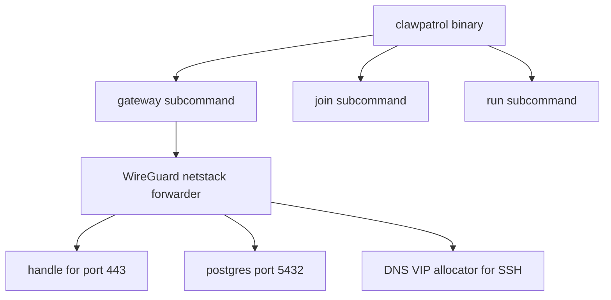
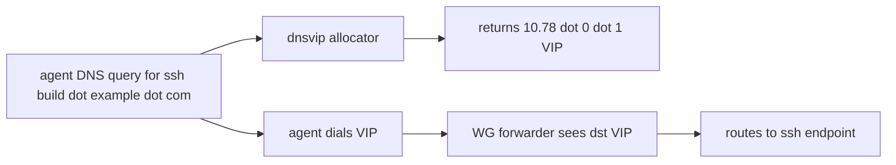

# 01 -- Gateway architecture: one binary, three tunnels

The whole clawpatrol product is a single Go binary, `cmd/clawpatrol`. The
entry point in `main.go` dispatches on the first argument:

```go
// Source: cmd/clawpatrol/main.go, lines 3516-3530
func main() {
	// Must run before anything else: when this process is the
	// re-exec'd sandbox stage-1 child for an external plugin, Stage1
	// sets the sandbox up and execs the plugin binary in place.
	sandbox.Stage1()
	if len(os.Args) < 2 {
		usage()
	}
	switch os.Args[1] {
	case "gateway":
		runGateway(os.Args[2:])
	case "join":
		runJoin(os.Args[2:])
	case "run":
		runRun(os.Args[2:])
```

Beyond `gateway`, `join`, and `run`, the switch also has `env`, `validate`,
`plugins`, `test`, `uninstall`, `status`, and `version`. The `sandbox.Stage1()` call runs
first because the same binary is re-executed as a sandbox stage-1 child when
the gateway launches an external plugin.

The `Gateway` struct holds the live runtime state. Note how several fields are
atomic pointers: the config and the compiled policy are swapped on reload while
dashboard handlers read them without a lock.

```go
// Source: cmd/clawpatrol/main.go, lines 394-437
	cfg      atomic.Pointer[config.Gateway]
	cfgPath  string // path the HCL config was loaded from
	configMu sync.Mutex
	stateDir string // resolved gateway state dir (sqlite + plugin blobs)
	db       *sql.DB
	policy   atomic.Pointer[config.CompiledPolicy]
	certs    *CertCache
	dialer   gatewayDialer
	// resolver is the name resolver the relay paths classify a
	// destination with, the same one dialer resolves through. nil means
	// the stdlib default.
	resolver relayResolver
	sink     *Sink
	// blobs is the gateway-side plugin blob store (sqlite-backed).
	// Used by endpoint plugins that need per-endpoint persistent
	// bytes — SSH host keys today, future JWT signing keys.
	// Exposed to plugins via ConnHandle.Blobs.
	blobs runtime.BlobStore
	// pluginMgr supervises the external plugin subprocesses; the
	// dashboard reads it for the Plugins page.
	pluginMgr *extplugin.Manager
	oauth     *OAuthRegistry
	agents    *AgentRegistry
	hitl      *HITLRegistry
	onboard   *onboardRegistry
	// secrets hands credential plugins the secret bytes they inject
	// at request time. gatewaySecretStore stacks the credential_secrets
	// table (dashboard slots), OAuthRegistry (refreshed access tokens),
	// and CLAWPATROL_SECRET_<NAME> env vars in that priority.
	secrets runtime.SecretStore
	// connIdx maps WG-forwarder dstIPs back to the endpoint that
	// claims them — populated by every endpoint plugin whose body
	// implements runtime.ConnRouter (postgres today, future binary
	// protocols). Rebuilt on every policy load.
	connIdx atomic.Pointer[runtime.ConnIndex]
	// dnsvip owns the hostname↔virtual-IP table for endpoints whose
	// wire protocol can't be disambiguated at TCP-accept time (SSH
	// today).
	dnsvip *dnsvip.Allocator
	// tunnels is the lifecycle manager for endpoints whose
	// CompiledEndpoint.Tunnel is non-nil. Refcounts runtime tunnel
	// instances across endpoints; the dispatcher consults it from
	// dialUpstream / ConnHandle.DialUpstream callbacks.
	tunnels *TunnelManager
```

The transport layer is a plain WireGuard (a VPN protocol) control plane. The comment at the top
of `wireguard.go` states the contract: the clawpatrol binary is the WireGuard
endpoint, with no kernel module and no `wg-quick` (the WireGuard quick-setup script).

```go
// Source: cmd/clawpatrol/wireguard.go, lines 3-17
// Plain WireGuard control plane — embedded userspace WG endpoint + L3
// forwarder + per-device onboarder. The clawpatrol binary IS the WG
// endpoint; no kernel module, no wg-quick, no /etc/wireguard, no
// systemd, no /etc/hosts pinning on clients.
//
// Architecture:
//   - StartWGServer boots a wireguard-go device backed by our own
//     gVisor netstack TUN (HandleLocal=false — see netTun comment).
//   - EnablePromiscuousForwarder turns the netstack into an L3 sink:
//     SYNs/datagrams to ANY destination IP land in the caller's
//     dispatcher with the original 4-tuple. Mirrors unclaw's smoltcp
//     `set_any_ip` + dynamic listener pool model.
//   - wireguardOnboarder mints a fresh keypair + allocates a /32 from
//     the configured subnet for each new device, registers the peer
//     with the live device, hands back a wg-quick conf.
```

The key detail is `HandleLocal: false`. The stock `tun/netstack` package (gVisor's userspace TCP/IP stack) builds
its stack with `HandleLocal=true`; combined with promiscuous mode that flips
every inbound source into "local source" territory, which the IPv4 layer then
drops. clawpatrol builds its own netstack so promiscuous forwarding works — mirroring unclaw (a sibling project) and smoltcp (a Rust userspace TCP/IP stack).

Not every protocol can be disambiguated at TCP-accept time. HTTPS carries SNI
(Server Name Indication); PostgreSQL and ClickHouse have a startup handshake;
but SSH on port 22 carries nothing. For those, clawpatrol runs a DNS (Domain Name System) server
that answers agent lookups with a virtual IP (VIP) per hostname.

```go
// Source: cmd/clawpatrol/dnsvip/dnsvip.go, lines 1-11
// Package dnsvip handles DNS interception and virtual-IP allocation
// for non-HTTP endpoints that can't be disambiguated at TCP-accept
// time. The canonical case is SSH: a TCP connection to port 22
// carries no SNI / Host header, so an agent dialling
// "ssh build.example.com" reaches the gateway's WG forwarder with
// nothing more than a destination IP. To know which logical endpoint
// the user meant, clawpatrol gives every SSH-able hostname a unique
// IP from a private range (10.78.0.0/16 v4, fd78::/64 v6) and answers
// agent DNS queries with those instead of the real upstream IP. When
// the connection comes back, the destination IP is the VIP — and the
// VIP is keyed to exactly one hostname.
```

The allocator hands out addresses from `10.78.0.0/16` and `fd78::/64`. Because
the VIP is keyed one-to-one to a hostname, a returning connection's destination
IP names the endpoint exactly.





## The Aha Moment

**Aha:** the gateway does not rely on the agent sending traffic to a fixed
proxy address. The WireGuard forwarder is promiscuous: it sinks traffic to any
destination IP. For protocols that cannot identify themselves on the wire, the
gateway answers the agent's own DNS with a virtual IP, turning "which host did
you mean" into a property of the destination address alone.

See [02-wire-traffic-parsing.md](./02-wire-traffic-parsing.md) for how a
connection's bytes are turned into facts, and [07-dashboard.md](./07-dashboard.md)
for the HTTP server that shares the `Gateway` struct.

Continue to [02-wire-traffic-parsing.md](./02-wire-traffic-parsing.md).
