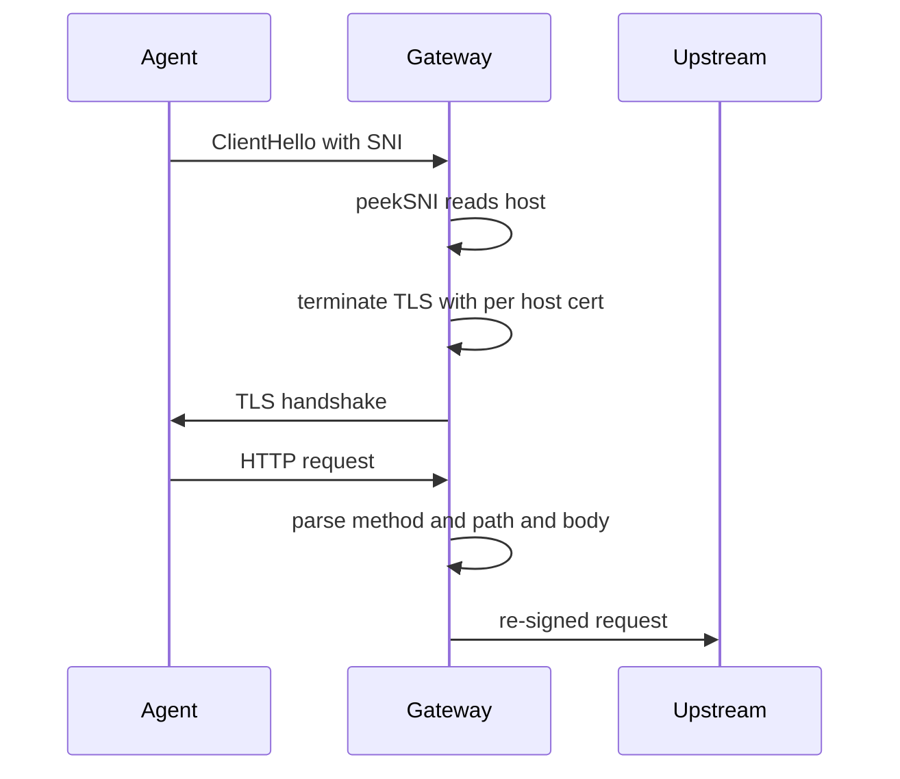
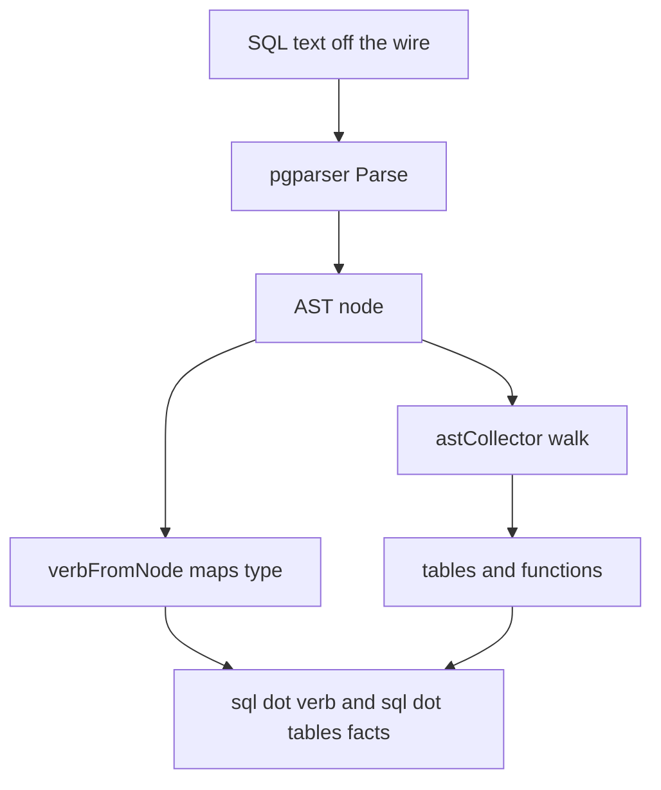

# 02 -- Wire traffic parsing: from bytes to facts

Every rule condition references facts the gateway extracted from the wire. This
document follows the extraction for the three big protocol families: HTTPS,
SQL, and the Kubernetes API.

The first gate is TLS (Transport Layer Security) Server Name Indication (SNI). Before the gateway knows
which endpoint owns a connection, it peeks at the client's ClientHello and
reads the SNI extension. This is a hand-rolled parser over the TLS record
format, not a TLS library.

```go
// Source: cmd/clawpatrol/main.go, lines 244-256
func peekSNI(c net.Conn) (string, []byte, error) {
	_ = c.SetReadDeadline(time.Now().Add(10 * time.Second))
	defer func() { _ = c.SetReadDeadline(time.Time{}) }()

	hdr := make([]byte, 5)
	if _, err := io.ReadFull(c, hdr); err != nil {
		return "", nil, err
	}
	if hdr[0] != 0x16 {
		return "", hdr, errors.New("not TLS")
	}
	recLen := int(hdr[3])<<8 | int(hdr[4])
	if recLen < 42 || recLen > 16384 {
		return "", hdr, errors.New("bad TLS record length")
	}
```

The `handle` function is the dispatcher for port 443. If SNI peek fails, it
falls back to a direct-IP lookup for Kubernetes and HTTPS endpoints whose
`server` field is an IP literal (kubectl dials by IP and never sends SNI). If
the host is unknown, the configured `unknown_host` policy decides: deny,
inspect under a synthetic endpoint, or pass through.

```go
// Source: cmd/clawpatrol/main.go, lines 1937-1962
	host, prefix, err := peekSNI(raw)
	if err != nil {
		// No SNI — fall back to direct-IP endpoint lookup for kubernetes/https
		// endpoints whose `server` field is an IP literal (kubectl connects
		// by IP and never sends SNI).
		if dstIP != "" {
			c := wrapPeek(raw, prefix)
			if g.isInternalVIP(dstIP) {
				// Fixed-IP fallback for `curl https://<internal-vip>/`
				// when DNS interception isn't active — no SNI on an IP
				// literal, so the dst VIP is the only signal.
				g.serveInternal(c, dstIP)
				return
			}
			pip := peerIP(c)
			profile := g.profileFor(pip)
			ep, authority, certHost := g.httpsMITMEndpoint(profile, dstIP, dstPort)
			if ep != nil && isHTTPSMITMFamily(ep.Family) {
				log.Printf("sni-fallback: %s → %s", authority, ep.Name)
				g.mitmHTTPSWithCertHost(c, authority, certHost, ep)
				return
			}
		}
		log.Printf("sni: %v", err)
		return
	}
```

Once TLS is terminated, HTTP is easy: method, path, query, headers, and body
become the `http` CEL (Common Expression Language) variable. SQL is harder. PostgreSQL and ClickHouse carry
a binary protocol, and the SQL text arrives inside it. clawpatrol parses the
SQL text with `pgparser` (the parser package of `github.com/pgplex/pgparser` — `pgplex` is the module org, `pgparser` the pure-Go port of PostgreSQL's
grammar) and walks the abstract syntax tree (AST) to extract the verb, tables, and functions.

```go
// Source: internal/config/plugins/endpoints/postgres_sql.go, lines 59-65
func parseSQL(sql string) (pgInfo, bool) {
	a := analyseAll(sql)
	if len(a) == 0 {
		return pgInfo{Statement: strings.TrimSpace(sql)}, false
	}
	return a[0].Outer, a[0].Unparseable
}
```

The AST walker maps PostgreSQL node types to lowercase verbs. A `SELECT` node
becomes `"select"`, an `INSERT` node becomes `"insert"`, and so on.

```go
// Source: internal/config/plugins/endpoints/postgres_sql.go, lines 165-176
func verbFromNode(stmt nodes.Node) string {
	switch n := stmt.(type) {
	case *nodes.SelectStmt:
		return "select"
	case *nodes.InsertStmt:
		return "insert"
	case *nodes.UpdateStmt:
		return "update"
	case *nodes.DeleteStmt:
		return "delete"
	case *nodes.MergeStmt:
		return "merge"
```

The Kubernetes facet decomposes the URL path instead. A Kubernetes API request
looks like `/api/v1/namespaces/default/secrets/foo`. The parser splits the path
and returns a `Meta` tuple of verb, resource, namespace, name, and params.

```go
// Source: internal/config/plugins/facets/k8s/k8s.go, lines 257-284
func parsePath(method, rawURL string) *Meta {
	u, err := url.Parse(rawURL)
	if err != nil {
		return nil
	}
	if isMetaPath(strings.Trim(u.Path, "/")) {
		return &Meta{Verb: "meta"}
	}
	parts := strings.Split(strings.Trim(u.Path, "/"), "/")
	if len(parts) < 2 {
		return nil
	}
	switch parts[0] {
	case "api":
		parts = parts[2:]
	case "apis":
		if len(parts) < 3 {
			return nil
		}
		parts = parts[3:]
	default:
		return nil
	}
	if len(parts) == 0 {
		return nil
	}
	m := &Meta{}
	if specialVerbs[parts[0]] {
```

When the parser refuses an input, the gateway does not guess. `parsePath`
returns `nil` for anything it cannot decompose, and the SQL parser returns an
`Unparseable` flag. The downstream matcher turns both into a fail-closed deny,
which [04-action-gating-approval.md](./04-action-gating-approval.md) covers.





## The Aha Moment

**Aha:** the extraction layer is deliberately refusal-based. When a protocol
parser cannot produce facts it trusts, it returns a sentinel meaning "I could
not parse this," and the rule engine denies by default. This is the opposite of
a best-effort parser that fills in a guess; a wrong-but-present fact would
evaluate a rule to a clean false and let a deny rule miss.

See [03-hcl-rule-language-facets.md](./03-hcl-rule-language-facets.md) for how
these facts become CEL variables, and [08-aws-credential.md](./08-aws-credential.md)
for how placeholder credentials are detected on the same parsed bytes.

Continue to [03-hcl-rule-language-facets.md](./03-hcl-rule-language-facets.md).
